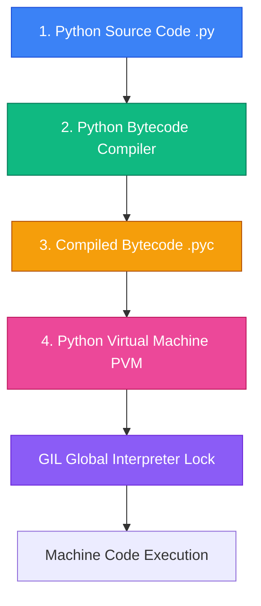

### Welcome to Python Engineering

Python is a versatile, high-level, interpreted programming language known for its clear syntax and immense ecosystem. 

---

## 🗺️ Python Learning Modules

| Module | Core Topics | Focus & Key Concepts |
| :--- | :--- | :--- |
| **[1. Core Syntax & Types](./01-core-syntax/data-types-and-control-flow)** | Variables, Dynamic Typing, Lists, Dicts, Tuples, Sets, List Comprehensions | Memory mutability vs immutability and sequence data structures |
| **[2. Advanced Python](./02-advanced-concepts/decorators-and-generators)** | Closures, Decorators, Generators (`yield`), Iterators, Asyncio & GIL | Functional programming constructs and non-blocking asynchronous I/O |

---

<Quiz question="What is the role of Python's Global Interpreter Lock (GIL) in CPython?" options={["Prevents compilation errors.","Ensures only one native thread executes Python bytecode at a time per CPython process.","Manages heap memory allocations.","Optimizes database queries."]} answerIndex={1}>
The Global Interpreter Lock (GIL) is a mutex that protects access to Python objects, preventing multiple native threads from executing CPython bytecode simultaneously.
</Quiz>
