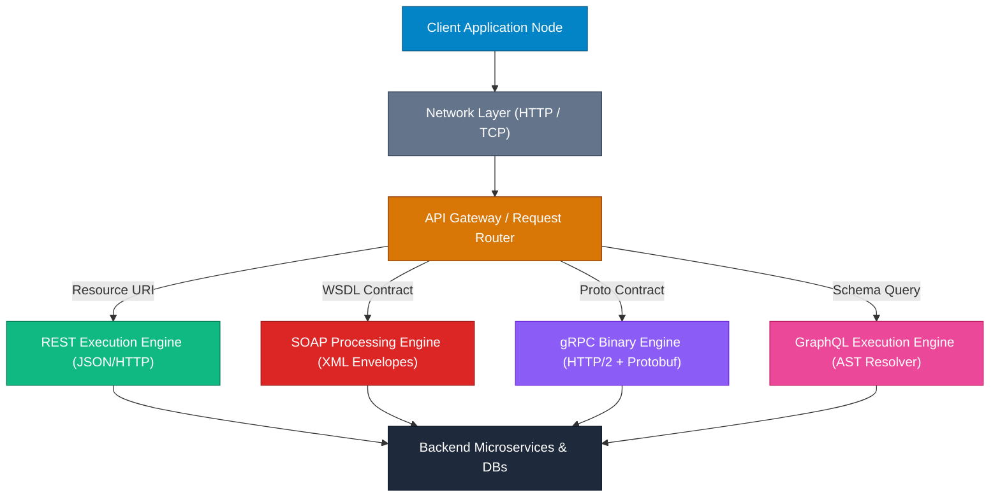

## 🏛️ High-Level Concept Definition & Real-World Analogy

Web service architectures establish formal communication boundaries and data exchange semantics between decoupled computing nodes across a distributed network. As modern software systems transitioned from monolithic in-process memory calls to microservices and cloud-native topologies, web service specifications evolved to standardize transport mechanisms, payload serialization schemes, state management models, and interface contracts. The core objective of any web service architecture is to allow disparate runtime environments—regardless of underlying programming language, operating system, or memory representation—to execute remote operations predictably, securely, and efficiently over TCP/IP networks.

Without structured architectural paradigms, network interactions devolve into brittle, proprietary byte-stream parsing where every client-server pair requires custom wire-level protocols. Modern web service frameworks abstract transport complexity behind well-defined abstractions: resource-oriented interfaces (REST), protocol-enforced RPC envelopes (SOAP), strongly typed binary streams (gRPC/Protobuf), or client-driven graph query execution engines (GraphQL). Selecting the optimal paradigm requires balancing network overhead, operational coupling, schema enforcement, caching characteristics, and developer ergonomic requirements.

### 🏙️ Real-World Analogy: The International Logistics & Postal Network

To understand web service paradigms and data formats, envision an **International Postal and Logistics System**:

*   **HTTP / Transport Protocol**: The **Highway System & Delivery Vehicles** (trucks, cargo planes). It dictates how packages travel physically between locations, regardless of what is inside the truck.
*   **SOAP**: A **Diplomatic Courier System using Armored Steel Vaults**. Every payload is enclosed in a heavy, standardized envelope with security seals, formal wax-stamped clearance papers (WSDL contract), and strict inspection checkpoints at every border.
*   **REST**: A **Standardized Warehouse Pick-Up Counter**. Clients send simple standardized request slips (GET, POST, PUT, DELETE) referencing specific shelf bin locations (URIs) to retrieve or replace items, utilizing standard delivery receipts (HTTP Status Codes).
*   **JSON Payload**: A **Transparent Plastic Container with Printed Key-Value Labels**. Lightweight, human-scannable, easy to pack, and effortlessly unpacked by any standard warehouse worker.
*   **XML Payload**: A **Hierarchical Wooden Crate with Framed Document Compartments**. Highly structured, strictly schema-validated (XSD), supports complex nested attributes and security metadata, but heavier and slower to unbox.
*   **gRPC / Protocol Buffers**: A **High-Speed Pneumatic Tube System carrying Compressed Hexadecimal Freight Pods**. Bypasses human-readable labels entirely; uses pre-agreed binary slot offsets for extreme speed and minimal payload weight.



---

## 🗺️ Structured Module Roadmap

Navigating modern web service architecture requires mastering both architectural design patterns and low-level data parsing mechanics. Use the roadmap below to explore specific deep-dive modules:

| Module | Core Topics | Key Focus & Engineering Concepts | Read Time |
| :--- | :--- | :--- | :--- |
| **[REST API Architecture](./rest-architecture)** | 6 Constraints, Verbs, Idempotency, Status Codes, URI Design | Uniform Interface, Statelessness, Cacheability, Richardson Maturity Model | 18 min |
| **[SOAP & Enterprise Services](./soap-enterprise)** | Envelopes, WSDL, WS-Security, XML Faults, Enterprise Integration | Strict Contract First, State Machine Envelopes, WS-ReliableMessaging | 15 min |
| **[JSON Serialization Mechanics](./json-engineering)** | RFC 8259 Syntax, Parser Internals, Jackson/Gson, AST Parsing | Lexical Analysis, Streaming Tokenizer vs. Object Tree Model, Allocation Overhead | 16 min |
| **[XML Processing & Memory](./xml-processing)** | DOM, SAX, StAX, XSD Validation, XPath, Security Edge Cases | In-Memory DOM Trees vs. Event Stream SAX/StAX, XXE Injection Mitigation | 17 min |
| **[Production Java Integration](./java-api-integration)** | HttpURLConnection, HttpClient (HTTP/2), Retry Loops, Resiliency | Socket Connection Pools, Exponential Backoff, Circuit Breakers, Response Streaming | 20 min |

---

## 📊 Quick Reference & Comparison Matrices

### 1. Web Service Architectural Paradigms Comparison Matrix

| Architectural Feature | REST (Representational State Transfer) | SOAP (Simple Object Access Protocol) | gRPC (Google Remote Procedure Call) | GraphQL |
| :--- | :--- | :--- | :--- | :--- |
| **Paradigm Type** | Architectural Style | Protocol Specification | RPC Framework | Data Query Language & Runtime |
| **Primary Data Format** | JSON, XML, HTML, Plain Text | XML Only | Protocol Buffers (Binary) | JSON (Query in UTF-8 Text) |
| **Transport Layer** | Exclusively HTTP / HTTPS | HTTP, SMTP, TCP, JMS | HTTP/2 Multiplexed Streams | HTTP / HTTPS (POST / WebSockets) |
| **Interface Contract** | Informal / OpenAPI (Swagger) | Strict WSDL (XML Schema) | `.proto` IDL File | GraphQL Schema Definition (SDL) |
| **State Management** | Strictly Stateless | Stateless or Stateful (WS-Context) | Stateless / Long-Lived Streams | Stateless |
| **Network Overhead** | Low to Medium (Human Readable) | High (Verbose XML Wrappers) | Extremely Low (Compact Binary) | Medium (Client Selects Fields) |
| **Client Caching** | Native HTTP Caching (`Cache-Control`) | Non-standard (Requires Custom Layer) | Custom Caching / Middleware | Client-Side Normalized Cache (Relay/Apollo) |
| **Typing System** | Loose (Weak Schema Enforcement) | Very Strong (XSD Datatypes) | Very Strong (Protobuf Compiler) | Very Strong (GraphQL Type System) |
| **Streaming Support** | Server-Sent Events (SSE) / Chunked | Limited / Non-standard | Native Bidirectional HTTP/2 Streams | Subscriptions (WebSockets) |

### 2. Data Serialization Formats Taxonomy

| Format Property | JSON (RFC 8259) | XML (W3C Recommendation) | Protocol Buffers (v3) | YAML 1.2 |
| :--- | :--- | :--- | :--- | :--- |
| **Structure Representation** | Key-Value / Arrays / Primitive Trees | Hierarchical Element Tag Tree | Compact Binary Wire Fields | Indentation-Based Object Tree |
| **Schema Validation** | JSON Schema (Optional) | XSD / DTD (Strict Native) | `.proto` Schema (Mandatory) | Kube-Schema / JSON Schema |
| **Parsing CPU Complexity** | $O(N)$ Single Pass Lexing | $O(N)$ Tree / Event Tokenization | $O(N)$ Direct Byte Offset Mapping | $O(N)$ Indentation State Engine |
| **Payload Size Index** | Baseline ($1.0\times$) | Heavy ($1.8\times - 2.5\times$ base) | Hyper-Compact ($0.25\times - 0.4\times$) | Moderate ($0.9\times - 1.1\times$) |
| **Native Data Types** | String, Number, Boolean, Null, Array, Object | String (All nodes are text untyped) | Int32/64, Float, String, Enum, Bytes | String, Int, Float, Bool, Null, Map, List |
| **Comment Support** | ❌ No (Not in RFC Standard) | ✅ Yes (`<!-- Comment -->`) | ✅ Yes (`// Comment`) | ✅ Yes (`# Comment`) |
| **Namespace Isolation** | ❌ No (Requires custom key prefixing) | ✅ Yes (`xmlns:ns="http://..."`) | ✅ Yes (`package com.example;`) | ❌ No |

---

## ⚡ Architectural Deep-Dive & Engineering Concepts

### Transport Layer vs. Application Layer Contracts

A fundamental area of confusion in distributed systems design is the distinction between **Transport Protocols** and **Application Architecture Contracts**.

```
+-----------------------------------------------------------------------+
| Application Contract Layer : REST (JSON), SOAP (XML Envelopes), gRPC  |
+-----------------------------------------------------------------------+
| Session / Security Layer   : TLS 1.3, WS-Security, JWT Bearer Tokens|
+-----------------------------------------------------------------------+
| Transport Layer            : HTTP/1.1, HTTP/2, TCP Socket Streams     |
+-----------------------------------------------------------------------+
| Network Layer              : IPv4 / IPv6 Packet Routing               |
+-----------------------------------------------------------------------+
```

1.  **Transport Protocols (HTTP/1.1, HTTP/2, TCP)** handle socket establishment, TLS handshakes, packet ordering, congestion control, and byte transmission between network interfaces.
2.  **Application Layer Contracts (REST, SOAP)** define the semantics of the byte payload carried inside those network packets. 
    *   **SOAP** treats HTTP merely as a dumb pipe (tunneling all operations over `POST`). It embeds routing, security, and transaction logic inside its own XML envelope (`<soap:Envelope>`).
    *   **REST** aligns directly with HTTP's native semantics. It uses HTTP headers for content negotiation (`Accept`, `Content-Type`), standard HTTP methods (`GET`, `POST`, `PUT`, `DELETE`) for operations, and HTTP status codes (`200`, `404`, `500`) for execution state reporting.

<Callout type="info">
**Engineering Trade-off: Coupling vs. Flexibility**  
SOAP enforces strict compile-time coupling via WSDL contracts, ensuring typed safety for enterprise banking integrations. REST provides runtime flexibility and decoupled evolvability via hypermedia and dynamic JSON structures, making it the dominant paradigm for public web APIs and mobile backends.
</Callout>

---

## ❓ Interactive Self-Assessment Checkpoints

<Quiz 
  question="Why is gRPC significantly faster and more bandwidth-efficient than REST over HTTP/1.1 with JSON payloads?" 
  options={[
    "gRPC bypasses TCP entirely and operates over raw UDP datagrams without encryption.", 
    "gRPC uses Protocol Buffers to serialize data into binary fields mapped by tag numbers, eliminating text field key repetition, and multiplexes requests over HTTP/2 streams.", 
    "gRPC automatically compresses JSON strings using GZIP before transmission over standard HTTP GET requests.", 
    "gRPC stores client session state on the server memory, avoiding payload overhead on repeated calls."
  ]} 
  answerIndex={1}
>
  Option B is correct. Protocol Buffers serialize object structures into binary byte streams where keys are represented as 1 to 4-byte field tags rather than full UTF-8 string keys (e.g., field tag `1` instead of `"first_name_of_employee"`). Additionally, gRPC runs exclusively over HTTP/2, which supports header compression (HPACK) and binary multiplexing over a single long-lived TCP connection, eliminating HTTP/1.1 head-of-line blocking.
</Quiz>

<Quiz 
  question="What is the primary operational risk when utilizing an unconstrained GraphQL API compared to a structured RESTful API?" 
  options={[
    "GraphQL does not support HTTPS transport security.", 
    "Clients can construct arbitrarily deep, nested relational queries that cause N+1 database queries and CPU starvation on the server.", 
    "GraphQL forces all server responses to be formatted in XML instead of JSON.", 
    "GraphQL disables browser caching entirely across all HTTP methods."
  ]} 
  answerIndex={1}
>
  Option B is correct. Because GraphQL allows clients to specify exact payload schemas, a client can execute deeply nested queries (e.g., `user { friends { friends { friends } } }`). Without strict query depth limiting, query cost analysis, and dataloader batching (to fix N+1 query problems), an unconstrained query can consume excessive memory and database connection pools.
</Quiz>

<Quiz 
  question="Which technical limitation prevents JSON from natively representing high-precision 64-bit integers (e.g., database primary key sequences or financial transaction IDs in Long format) without data corruption?" 
  options={[
    "JSON numbers are strictly limited to 16-bit signed integers in RFC 8259.", 
    "JavaScript and standard JSON parser specifications process numbers as IEEE 754 double-precision floating-point numbers, which lose integer precision beyond $2^{53} - 1$.", 
    "JSON converts all numeric values into ASCII strings before parsing.", 
    "JSON numbers cannot contain decimal points."
  ]} 
  answerIndex={1}
>
  Option B is correct. In IEEE 754 double-precision floating-point numbers (used by JavaScript engines and standard JSON specifications), the maximum safe integer is $2^{53} - 1$ (`9007199254740991`). Standard Java 64-bit `Long` values exceed this limit (up to $2^{63} - 1$). Transmitting raw 64-bit integers in JSON numbers leads to low-order bit truncation; production systems solve this by serializing 64-bit IDs as JSON Strings (`"1234567890123456789"`).
</Quiz>

<Problem title="Problem: Architectural Refactoring of Monolithic Polling Loop">
<ProblemDescription>
A legacy microservice polls a partner API every 500ms using a REST `GET /api/v1/orders/status` request to track order status transitions. During peak sales, 10,000 active clients generate 20,000 HTTP GET requests per second, exhausting server socket connection pools and causing network congestion. Refactor this polling architecture to an event-driven mechanism.
</ProblemDescription>
<ProblemSolution>
Replace client-side HTTP short polling with WebSockets or Server-Sent Events (SSE) for unidirectional real-time updates, or gRPC Server Streaming:

```java
// Server-Sent Events (SSE) Spring Boot Controller Implementation
@RestController
@RequestMapping("/api/v1/orders")
public class OrderEventController {

    private final OrderStatusService statusService;

    public OrderEventController(OrderStatusService statusService) {
        this.statusService = statusService;
    }

    @GetMapping(path = "/{orderId}/stream", produces = MediaType.TEXT_EVENT_STREAM_VALUE)
    public Sinks.Many<OrderEvent> streamOrderStatus(@PathVariable String orderId) {
        // Establishes a single long-lived HTTP connection per client
        // Eliminates 99.9% of polling overhead by pushing updates only on state changes!
        return statusService.getOrderEventStream(orderId);
    }
}
```
</ProblemSolution>
</Problem>