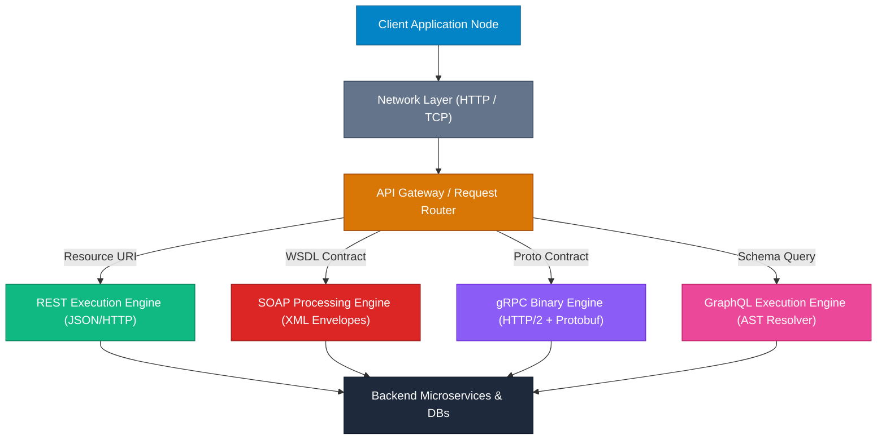

## High-Level Concept Definition & Real-World Analogy

Web service architectures define formal communication boundaries, payload serialization rules, and transport semantics between decoupled software nodes across distributed networks.

### Core Architectural Purpose
*   **Decoupled Interoperability**: Enables systems running different OSs, programming languages, or memory models to execute remote operations seamlessly.
*   **Transport Abstraction**: Hides low-level network socket and TLS handling behind clear interface paradigms.
*   **Paradigm Versatility**: Accommodates resource routing (REST), strict enterprise contracts (SOAP), high-speed binary streams (gRPC), or client-driven data queries (GraphQL).

### Real-World Analogy: The International Logistics & Postal Network

To visualize web service paradigms and data formats, consider an **International Logistics and Postal Network**:

*   **HTTP / Transport Protocol**: The **Highway System & Cargo Fleet** (trucks, planes) that physically moves packages between locations.
*   **SOAP**: An **Armored Diplomatic Courier System**. Encloses payloads in heavy, standardized vaults with wax seals (WS-Security) and formal treaties (WSDL contracts).
*   **REST**: A **Standardized Warehouse Pick-Up Counter**. Clients present action slips (`GET`, `POST`, `PUT`, `DELETE`) for specific shelf bins (`URIs`).
*   **JSON Payload**: A **Transparent Plastic Container** with printed key-value labels. Lightweight and easily readable by any worker.
*   **XML Payload**: A **Hierarchical Wooden Crate** with framed document compartments. Heavy, strictly schema-validated (XSD), and supporting complex metadata.
*   **gRPC / Protocol Buffers**: A **High-Speed Pneumatic Tube System** firing compressed hexadecimal pods mapped directly by tag numbers.



---

## Structured Module Roadmap

| Module | Core Topics | Key Focus & Engineering Concepts | Read Time |
| :--- | :--- | :--- | :--- |
| **[REST API Architecture](./rest-architecture)** | 6 Constraints, Verbs, Idempotency, Status Codes, URI Design | Uniform Interface, Statelessness, Cacheability, Richardson Maturity Model | 18 min |
| **[SOAP & Enterprise Services](./soap-enterprise)** | Envelopes, WSDL, WS-Security, XML Faults, Enterprise Integration | Strict Contract First, State Machine Envelopes, WS-ReliableMessaging | 15 min |
| **[JSON Serialization Mechanics](./json-engineering)** | RFC 8259 Syntax, Parser Internals, Jackson/Gson, AST Parsing | Lexical Analysis, Streaming Tokenizer vs. Object Tree Model, Allocation Overhead | 16 min |
| **[XML Processing & Memory](./xml-processing)** | DOM, SAX, StAX, XSD Validation, XPath, Security Edge Cases | In-Memory DOM Trees vs. Event Stream SAX/StAX, XXE Injection Mitigation | 17 min |
| **[Production Java Integration](./java-api-integration)** | HttpURLConnection, HttpClient (HTTP/2), Retry Loops, Resiliency | Socket Connection Pools, Exponential Backoff, Circuit Breakers, Response Streaming | 20 min |

---

## Quick Reference & Comparison Matrices

### 1. Web Service Architectural Paradigms Comparison Matrix

| Architectural Feature | REST (Representational State Transfer) | SOAP (Simple Object Access Protocol) | gRPC (Google Remote Procedure Call) | GraphQL |
| :--- | :--- | :--- | :--- | :--- |
| **Paradigm Type** | Architectural Style | Protocol Specification | RPC Framework | Data Query Language & Runtime |
| **Primary Data Format** | JSON, XML, HTML, Plain Text | XML Only | Protocol Buffers (Binary) | JSON (Query in UTF-8 Text) |
| **Transport Layer** | Exclusively HTTP / HTTPS | HTTP, SMTP, TCP, JMS | HTTP/2 Multiplexed Streams | HTTP / HTTPS (POST / WebSockets) |
| **Interface Contract** | Informal / OpenAPI (Swagger) | Strict WSDL (XML Schema) | `.proto` IDL File | GraphQL Schema Definition (SDL) |
| **State Management** | Strictly Stateless | Stateless or Stateful (WS-Context) | Stateless / Long-Lived Streams | Stateless |
| **Network Overhead** | Low to Medium (Human Readable) | High (Verbose XML Wrappers) | Extremely Low (Compact Binary) | Medium (Client Selects Fields) |
| **Client Caching** | Native HTTP Caching (`Cache-Control`) | Non-standard (Requires Custom Layer) | Custom Caching / Middleware | Client-Side Normalized Cache |
| **Typing System** | Loose (Weak Schema Enforcement) | Very Strong (XSD Datatypes) | Very Strong (Protobuf Compiler) | Very Strong (GraphQL Type System) |
| **Streaming Support** | Server-Sent Events (SSE) / Chunked | Limited / Non-standard | Native Bidirectional HTTP/2 Streams | Subscriptions (WebSockets) |

### 2. Data Serialization Formats Taxonomy

| Format Property | JSON (RFC 8259) | XML (W3C Recommendation) | Protocol Buffers (v3) | YAML 1.2 |
| :--- | :--- | :--- | :--- | :--- |
| **Structure Representation** | Key-Value / Arrays / Primitive Trees | Hierarchical Element Tag Tree | Compact Binary Wire Fields | Indentation-Based Object Tree |
| **Schema Validation** | JSON Schema (Optional) | XSD / DTD (Strict Native) | `.proto` Schema (Mandatory) | Kube-Schema / JSON Schema |
| **Parsing Complexity** | O(N) Single Pass Lexing | O(N) Tree / Event Tokenization | O(N) Direct Byte Offset Mapping | O(N) Indentation State Engine |
| **Payload Size Index** | Baseline (1.0x) | Heavy (1.8x - 2.5x base) | Hyper-Compact (0.25x - 0.4x) | Moderate (0.9x - 1.1x) |
| **Native Data Types** | String, Number, Boolean, Null, Array, Object | String (All nodes are text untyped) | Int32/64, Float, String, Enum, Bytes | String, Int, Float, Bool, Null, Map, List |
| **Comment Support** | No (Not in RFC Standard) | Yes (`<!-- Comment -->`) | Yes (`// Comment`) | Yes (`# Comment`) |
| **Namespace Isolation** | No (Requires custom key prefixing) | Yes (`xmlns:ns="http://..."`) | Yes (`package com.example;`) | No |

---

## Architectural Deep-Dive & Engineering Concepts

### Protocol Layering vs. Application Contracts

Understanding network isolation requires separating lower-level transport mechanics from higher-level payload semantics:

```text
+-----------------------------------------------------------------------+
| Application Contract Layer : REST (JSON), SOAP (XML Envelopes), gRPC  |
+-----------------------------------------------------------------------+
| Session / Security Layer   : TLS 1.3, WS-Security, JWT Bearer Tokens|
+-----------------------------------------------------------------------+
| Transport Layer            : HTTP/1.1, HTTP/2, TCP Socket Streams     |
+-----------------------------------------------------------------------+
| Network Layer              : IPv4 / IPv6 Packet Routing               |
+-----------------------------------------------------------------------+
```

### Transport vs. Application Responsibilities
*   **Transport Layer (HTTP/1.1, HTTP/2, TCP)**: Manages socket connections, TLS handshakes, packet sequencing, and byte delivery.
*   **Application Contract Layer (REST, SOAP)**: Dictates the structure and meaning of the payload carried inside network packets.
    *   **SOAP Strategy**: Treats HTTP purely as a transport tunnel (`POST` method for all calls), placing routing, security, and transaction data inside the XML Envelope.
    *   **REST Strategy**: Integrates directly with native HTTP semantics, leveraging HTTP verbs (`GET`, `POST`, `PUT`), status codes (`200`, `404`), and content negotiation headers (`Content-Type`, `Accept`).

<Callout type="info">
**Engineering Trade-off: Coupling vs. Flexibility**  
SOAP enforces strict compile-time coupling via WSDL contracts, ensuring typed safety for enterprise banking integrations. REST provides runtime flexibility and decoupled evolvability via dynamic JSON structures, making it the dominant paradigm for public web APIs and mobile backends.
</Callout>

---

## Interactive Self-Assessment Checkpoints

<Quiz 
  question="Why is gRPC significantly faster and more bandwidth-efficient than REST over HTTP/1.1 with JSON payloads?" 
  options={[
    "gRPC bypasses TCP entirely and operates over raw UDP datagrams without encryption.", 
    "gRPC uses Protocol Buffers to serialize data into binary fields mapped by tag numbers, eliminating text field key repetition, and multiplexes requests over HTTP/2 streams.", 
    "gRPC automatically compresses JSON strings using GZIP before transmission over standard HTTP GET requests.", 
    "gRPC stores client session state on the server memory, avoiding payload overhead on repeated calls."
  ]} 
  answerIndex={1}
>
  Option B is correct. Key performance drivers include:
  * **Compact Serialization**: Protocol Buffers serialize objects into binary byte streams mapped by 1 to 4-byte tag numbers instead of verbose UTF-8 key strings.
  * **HTTP/2 Transport**: Supports HPACK header compression and binary multiplexing over a single long-lived TCP connection, eliminating HTTP/1.1 head-of-line blocking.
</Quiz>

<Quiz 
  question="What is the primary operational risk when utilizing an unconstrained GraphQL API compared to a structured RESTful API?" 
  options={[
    "GraphQL does not support HTTPS transport security.", 
    "Clients can construct arbitrarily deep, nested relational queries that cause N+1 database queries and CPU starvation on the server.", 
    "GraphQL forces all server responses to be formatted in XML instead of JSON.", 
    "GraphQL disables browser caching entirely across all HTTP methods."
  ]} 
  answerIndex={1}
>
  Option B is correct. Key vulnerability mechanics:
  * **Nested Query Abuse**: Clients can construct queries with arbitrary depth (`user { friends { friends { friends } } }`).
  * **Resource Exhaustion**: Without depth limiting, query cost analysis, and dataloader batching, unconstrained queries trigger N+1 database calls and exhaust thread pools.
</Quiz>

<Quiz 
  question="Which technical limitation prevents JSON from natively representing high-precision 64-bit integers without data corruption?" 
  options={[
    "JSON numbers are strictly limited to 16-bit signed integers in RFC 8259.", 
    "JavaScript engines and JSON specs parse numbers as IEEE 754 double-precision floats, losing integer precision beyond 2^53 - 1.", 
    "JSON converts all numeric values into ASCII strings before parsing.", 
    "JSON numbers cannot contain decimal points."
  ]} 
  answerIndex={1}
>
  Option B is correct. Key precision boundaries:
  * **IEEE 754 Double Limit**: Maximum safe integer is `2^53 - 1` (`9007199254740991`).
  * **Java Long Overflow**: Java 64-bit `Long` values reach up to `2^63 - 1`, exceeding double precision limits. Production APIs pass 64-bit IDs as JSON Strings (`"1234567890123456789"`).
</Quiz>

<Problem title="Problem: Architectural Refactoring of Monolithic Polling Loop">
<ProblemDescription>
A legacy microservice polls a partner API every 500ms using a REST `GET /api/v1/orders/status` request to track order status transitions. During peak sales, 10,000 active clients generate 20,000 HTTP GET requests per second, exhausting server socket connection pools and causing network congestion. Refactor this polling architecture to an event-driven mechanism.
</ProblemDescription>
<ProblemSolution>
Replace client-side HTTP short polling with Server-Sent Events (SSE) for unidirectional real-time updates:

```java
// Server-Sent Events (SSE) Spring Boot Controller Implementation
@RestController
@RequestMapping("/api/v1/orders")
public class OrderEventController {

    private final OrderStatusService statusService;

    public OrderEventController(OrderStatusService statusService) {
        this.statusService = statusService;
    }

    @GetMapping(path = "/{orderId}/stream", produces = MediaType.TEXT_EVENT_STREAM_VALUE)
    public Sinks.Many<OrderEvent> streamOrderStatus(@PathVariable String orderId) {
        // Establishes a single long-lived HTTP connection per client
        // Eliminates 99.9% of polling overhead by pushing updates only on state changes!
        return statusService.getOrderEventStream(orderId);
    }
}
```
</ProblemSolution>
</Problem>