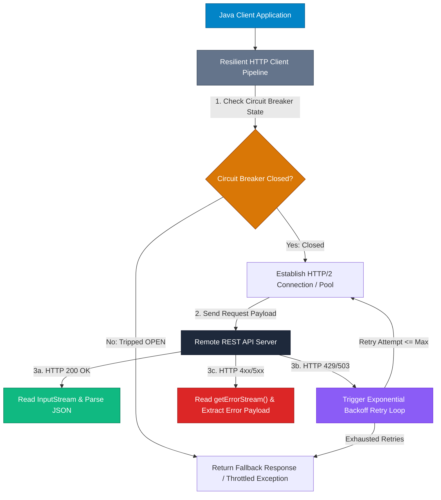

## High-Level Concept Definition & Real-World Analogy

**Production API Consumption** in Java represents client-side engineering for connecting, authenticating, transmitting payloads, and handling responses from remote REST APIs across distributed networks.

### Core Architectural Features
*   **Transport Frameworks**: Choice between legacy `HttpURLConnection` and modern reactive `java.net.http.HttpClient` (HTTP/2).
*   **Resiliency Pipelines**: Integration of socket timeouts, error stream readers, pagination loops, and retry strategies.
*   **Non-Blocking I/O**: Asynchronous request execution avoiding main thread pool starvation.

### Real-World Analogy: The Autonomous Freight Logistics Dispatcher

To visualize API client integration, consider an **Autonomous Freight Logistics Dispatcher**:

*   **HTTP GET Connection**: Sending a **Freight Courier to Retrieve Goods**. The courier drives to a warehouse counter (`URL`), presents an ID badge (`Authorization: Bearer`), and collects a package.
*   **HttpURLConnection (Legacy)**: A **Single-Threaded Truck Driver**. Drives to destination, turns off ignition, and waits frozen at loading dock until package is ready.
*   **Java 11+ HttpClient (Async / HTTP/2)**: An **Automated Drone Logistics Swarm**. Dispatches multiple requests over a single shared flight corridor (HTTP/2 multiplexing) without blocking dispatch.
*   **Exponential Backoff & Jitter**: A **Smart Traffic Retry Strategy**. If a route is blocked (HTTP 429 Rate Limit), dispatcher waits 1s, 2s, 4s, adding random time variations (jitter) to prevent traffic jams.
*   **Circuit Breaker**: An **Automated Bridge Gate**. If 10 consecutive trucks crash off a broken bridge (500 Errors), the gate trips shut immediately, preventing further dispatches until repairs finish.



---

## Structured Module Roadmap

| Module | Core Topics | Key Focus & Engineering Concepts | Read Time |
| :--- | :--- | :--- | :--- |
| **HttpURLConnection Mechanics** | Legacy API, Socket Timeouts, Input/Output Streams | Synchronous Blocking I/O, `setDoOutput`, Connection Disconnection | 5 min |
| **Modern Java 11+ HttpClient** | `HttpClient`, `HttpRequest`, `HttpResponse` | Non-blocking Async Futures, HTTP/2 Multiplexing, Reactive Streaming | 5 min |
| **Pagination & Error Streams** | `getErrorStream()`, Multi-page Loops | Safe Stream Handling, Cursor-based vs. Page Offset Pagination | 5 min |
| **Resiliency & Retries** | Exponential Backoff, Jitter, Circuit Breaker | Thundering Herd Mitigation, Retry Loop Architecture, Fault Recovery | 5 min |

---

## Quick Reference & Comparison Matrices

### 1. Java HTTP Client Frameworks Comparison Matrix

| Client Framework | Java Version | Execution Paradigm | HTTP/2 Support | Async Capabilities | Primary Enterprise Use Case |
| :--- | :--- | :--- | :--- | :--- | :--- |
| **`HttpURLConnection`** | JDK 1.1+ | Synchronous Blocking I/O | No (HTTP/1.1 only) | Complex (Manual Threading) | Legacy Java applications, simple coding tests |
| **`java.net.http.HttpClient`** | JDK 11+ | Non-Blocking / Reactive | Native Multiplexing | `CompletableFuture` / Reactive Flow | Modern core Java microservices (Zero third-party deps) |
| **Spring `WebClient`** | Spring 5+ | Non-Blocking Reactive Stream | Native | Mono / Flux (Project Reactor) | Spring Boot Reactive / Microservice Architectures |
| **Apache `HttpClient` 5** | Java 8+ | Synchronous & Asynchronous | Supported | Future / Callback Callbacks | Complex enterprise HTTP connection pooling |

### 2. API Client Resiliency & Error Recovery Strategies Taxonomy

| Resiliency Strategy | Trigger Condition | Operational Mechanism | Engineering Objective |
| :--- | :--- | :--- | :--- |
| **Exponential Backoff** | HTTP 429 (Rate Limit) / 503 (Overload) | Multiplies delay exponentially (`base * 2^attempt`) after each failure. | Gives overloaded servers time to recover without immediate re-blasting. |
| **Full Jitter** | High-concurrency retry synchronization | Adds random noise to backoff delay (`delay = random(0, backoff)`). | Prevents "Thundering Herd" spikes where 10,000 clients retry simultaneously. |
| **Connection Timeouts** | Network latency / Frozen TCP sockets | Enforces `ConnectTimeout` (e.g. 3s) and `ReadTimeout` (e.g. 5s). | Prevents worker threads from hanging indefinitely on stalled network sockets. |
| **Circuit Breaker** | High failure rate threshold (`> 50%`) | Transitions states: `CLOSED` -> `OPEN` -> `HALF-OPEN`. | Fast-fails incoming requests immediately to protect downstream system stability. |

---

## Architectural Deep-Dive & Engineering Concepts

### 1. Legacy API Consumption: `HttpURLConnection`

Synchronous API request pipeline using JDK built-in tools:

```java
import java.io.BufferedReader;
import java.io.InputStream;
import java.io.InputStreamReader;
import java.io.OutputStream;
import java.net.HttpURLConnection;
import java.net.URL;
import java.nio.charset.StandardCharsets;

public class HttpURLConnectionProductionDemo {

    public static String executePost(String urlStr, String jsonBody, String bearerToken) throws Exception {
        URL url = new URL(urlStr);
        HttpURLConnection conn = (HttpURLConnection) url.openConnection();

        // 1. Mandatory Socket Timeout Configuration
        conn.setConnectTimeout(4000); // 4 seconds connect timeout
        conn.setReadTimeout(6000);    // 6 seconds socket read timeout

        // 2. Request Configuration
        conn.setRequestMethod("POST");
        conn.setRequestProperty("Content-Type", "application/json; charset=utf-8");
        conn.setRequestProperty("Accept", "application/json");
        conn.setRequestProperty("Authorization", "Bearer " + bearerToken);
        conn.setDoOutput(true); // Enables sending request body

        // 3. Write Request Body Stream
        try (OutputStream os = conn.getOutputStream()) {
            byte[] input = jsonBody.getBytes(StandardCharsets.UTF_8);
            os.write(input, 0, input.length);
        }

        // 4. Inspect Response Status Code
        int statusCode = conn.getResponseCode();

        // 5. Handle InputStream vs ErrorStream
        InputStream responseStream;
        if (statusCode >= 200 && statusCode < 300) {
            responseStream = conn.getInputStream();
        } else {
            // Read error details from getErrorStream()!
            responseStream = conn.getErrorStream();
        }

        // 6. Read Stream Content
        StringBuilder response = new StringBuilder();
        try (BufferedReader br = new BufferedReader(new InputStreamReader(responseStream, StandardCharsets.UTF_8))) {
            String responseLine;
            while ((responseLine = br.readLine()) != null) {
                response.append(responseLine.trim());
            }
        }

        conn.disconnect();

        if (statusCode < 200 || statusCode >= 300) {
            throw new RuntimeException("API Error HTTP " + statusCode + ": " + response.toString());
        }

        return response.toString();
    }
}
```

### 2. Modern Asynchronous API Consumption: Java 11+ `HttpClient`

Non-blocking, HTTP/2 multiplexed request pipeline:

```java
import java.net.URI;
import java.net.http.HttpClient;
import java.net.http.HttpRequest;
import java.net.http.HttpResponse;
import java.time.Duration;
import java.util.concurrent.CompletableFuture;

public class Java11HttpClientDemo {

    // Reuse a single HttpClient instance across the application (Thread-Safe with Connection Pool)
    private static final HttpClient HTTP_CLIENT = HttpClient.newBuilder()
            .version(HttpClient.Version.HTTP_2)
            .connectTimeout(Duration.ofSeconds(5))
            .build();

    public static CompletableFuture<String> fetchUserAsync(String userId) {
        HttpRequest request = HttpRequest.newBuilder()
                .uri(URI.create("https://api.example.com/v1/users/" + userId))
                .timeout(Duration.ofSeconds(5))
                .header("Accept", "application/json")
                .header("Authorization", "Bearer token_abc123")
                .GET()
                .build();

        // Non-blocking Asynchronous Request Execution!
        return HTTP_CLIENT.sendAsync(request, HttpResponse.BodyHandlers.ofString())
                .thenApply(response -> {
                    if (response.statusCode() == 200) {
                        return response.body();
                    } else {
                        throw new RuntimeException("HTTP Error " + response.statusCode() + ": " + response.body());
                    }
                });
    }

    public static void main(String[] args) throws Exception {
        System.out.println("Dispatching Async Request...");
        CompletableFuture<String> future = fetchUserAsync("1088");

        future.thenAccept(json -> System.out.println("Async Response Received: " + json))
              .join();
    }
}
```

### 3. Resilient Exponential Backoff & Full Jitter Implementation

```java
import java.util.Random;
import java.util.concurrent.Callable;

public class ResilienceUtils {

    private static final Random RANDOM = new Random();

    public static <T> T executeWithBackoff(Callable<T> task, int maxRetries, long baseDelayMs) throws Exception {
        int attempt = 0;

        while (true) {
            try {
                return task.call();
            } catch (Exception e) {
                attempt++;
                if (attempt > maxRetries) {
                    System.err.println("Exhausted all " + maxRetries + " retry attempts. Operation failed.");
                    throw e;
                }

                // 1. Calculate Exponential Backoff: base * 2^(attempt - 1)
                long exponentialDelay = baseDelayMs * (1L << (attempt - 1));

                // 2. Apply Full Jitter: random(0, exponentialDelay) to prevent Thundering Herd!
                long jitteredDelay = (long) (RANDOM.nextDouble() * exponentialDelay);

                System.out.println(String.format("Attempt %d failed (%s). Retrying in %d ms...", 
                        attempt, e.getMessage(), jitteredDelay));

                Thread.sleep(jitteredDelay);
            }
        }
    }
}
```

<Callout type="warning">
**Why Full Jitter is Mandatory in Production Systems**  
If a database or REST API experiences a brief network outage, thousands of microservice instances fail simultaneously. Without Jitter, all instances retry at the exact same millisecond (`2000ms` later), creating a **Thundering Herd** traffic spike. Full Jitter spreads retries evenly across a time window.
</Callout>

---

## Interactive Self-Assessment Checkpoints

<Quiz 
  question="Why does calling `conn.getInputStream()` on an `HttpURLConnection` instance throw an `IOException` when the server responds with HTTP Status 404 Not Found or 500 Internal Error?" 
  options={[
    "Because `HttpURLConnection` requires a computer restart on 404 errors.", 
    "Because `HttpURLConnection` restricts `getInputStream()` exclusively to successful 2xx responses; non-2xx error responses must be read via `conn.getErrorStream()`.", 
    "Because 404 responses automatically close the operating system network socket.", 
    "Because `HttpURLConnection` only supports HTTP POST requests."
  ]} 
  answerIndex={1}
>
  Option B is correct. Stream handling rules:
  * **2xx Status Codes**: Accessible via `conn.getInputStream()`.
  * **4xx / 5xx Status Codes**: Calling `getInputStream()` throws `IOException`. Error bodies must be read via `conn.getErrorStream()`.
</Quiz>

<Quiz 
  question="What major architecture and performance improvement does Java 11+ `java.net.http.HttpClient` provide over legacy `HttpURLConnection`?" 
  options={[
    "It restricts all requests to plain-text HTTP without TLS encryption.", 
    "It natively supports HTTP/2 multiplexing over shared TCP connections, non-blocking asynchronous execution via `CompletableFuture`, and reactive streams.", 
    "It converts all JSON responses directly into C++ binary structs.", 
    "It eliminates the need for HTTP status codes."
  ]} 
  answerIndex={1}
>
  Option B is correct. Modern client capabilities:
  * **HTTP/2 Multiplexing**: Multiple requests travel over a single TCP connection.
  * **Async Execution**: `sendAsync()` returns a `CompletableFuture`, freeing application threads.
</Quiz>

<Quiz 
  question="In distributed microservice architecture, what is the primary purpose of adding 'Full Jitter' (randomization) to an Exponential Backoff retry strategy?" 
  options={[
    "To encrypt the retry payload using AES-256.", 
    "To randomize the target API endpoint URL.", 
    "To prevent 'Thundering Herd' spikes by desynchronizing retry attempts across thousands of concurrent client instances.", 
    "To force the server to respond in XML instead of JSON."
  ]} 
  answerIndex={2}
>
  Option C is correct. Jitter mechanics:
  * Without jitter, concurrent failed clients retry simultaneously, creating traffic spikes.
  * Jitter introduces random variance, spreading retries smoothly across time.
</Quiz>

<Problem title="Problem: Paginated REST API Consumption in Java">
<ProblemDescription>
Write a Java program using Java 11 `HttpClient` and `org.json` to fetch all pages from a paginated REST API (`https://jsonmock.hackerrank.com/api/articles?page=1`) and collect article titles until `page > total_pages`.
</ProblemDescription>
<ProblemSolution>
Implement a pagination loop that updates the `page` query parameter until `page` exceeds `total_pages`:

```java
import java.net.URI;
import java.net.http.HttpClient;
import java.net.http.HttpRequest;
import java.net.http.HttpResponse;
import java.time.Duration;
import org.json.JSONArray;
import org.json.JSONObject;

public class PaginatedAPIFetcher {

    private static final HttpClient client = HttpClient.newBuilder()
            .connectTimeout(Duration.ofSeconds(5))
            .build();

    public static void main(String[] args) throws Exception {
        int currentPage = 1;
        int totalPages = 1;
        int articleCount = 0;

        while (currentPage <= totalPages) {
            String url = "https://jsonmock.hackerrank.com/api/articles?page=" + currentPage;

            HttpRequest request = HttpRequest.newBuilder()
                    .uri(URI.create(url))
                    .GET()
                    .build();

            HttpResponse<String> response = client.send(request, HttpResponse.BodyHandlers.ofString());

            if (response.statusCode() == 200) {
                JSONObject json = new JSONObject(response.body());

                // Update pagination total_pages on first iteration
                totalPages = json.getInt("total_pages");

                JSONArray data = json.getJSONArray("data");
                for (int i = 0; i < data.length(); i++) {
                    JSONObject article = data.getJSONObject(i);
                    String title = article.optString("title", "");
                    if (!title.isEmpty()) {
                        articleCount++;
                        System.out.println(articleCount + ". " + title);
                    }
                }

                currentPage++;
            } else {
                System.err.println("Failed to fetch page " + currentPage + ". Status: " + response.statusCode());
                break;
            }
        }
        System.out.println("Successfully fetched " + articleCount + " total articles across " + totalPages + " pages.");
    }
}
```
</ProblemSolution>
</Problem>
