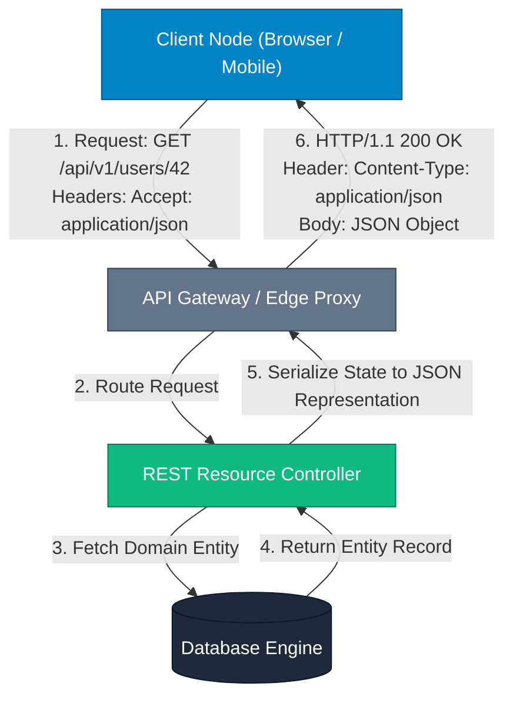

## High-Level Concept Definition & Real-World Analogy

**REST** (**RE**presentational **S**tate **T**ransfer) is an architectural style—formulated by Roy Fielding—that governs how distributed web applications exchange data using standard HTTP infrastructure.

### Core Architectural Principles
*   **Resource-Oriented Modeling**: Interfaces are structured around named resources (e.g., `/orders/42`) rather than remote procedures.
*   **State Representation**: Clients manipulate resources by exchanging digital representations (such as JSON or XML) of the resource's state.
*   **HTTP Protocol Reuse**: Leverages native web infrastructure including browser caches, CDNs, proxies, load balancers, and standard status codes.

### Real-World Analogy: The National Postal & Standard Warehouse System

To visualize RESTful architecture, consider a **National Postal System and Standard Warehouse Network**:

*   **Resource (URI)**: A specific **Warehouse Shelf Bin** (`/warehouses/tx-01/bins/8842`). Identifies where an asset lives, independent of how you alter it.
*   **HTTP Methods (Verbs)**: Standardized **Postal Action Slips**:
    *   `GET`: Read item on shelf (leaves item untouched).
    *   `POST`: Deliver new box for storage (creates item with auto-assigned ID).
    *   `PUT`: Replace entire bin contents (full overwrite).
    *   `PATCH`: Replace only the torn shipping label (partial update).
    *   `DELETE`: Remove the bin entirely (deletion).
*   **Statelessness**: A **Lobby Worker with Amnesia**. Every request requires showing your full ID badge and delivery manifest. The worker retains no memory of past visits.
*   **Representation**: The **Package Container Format**. The raw item is stored internally as iron, but delivered formatted as a cardboard box (`application/json`) or wooden crate (`application/xml`).



---

## Structured Module Roadmap

| Module | Core Topics | Key Focus & Engineering Concepts | Read Time |
| :--- | :--- | :--- | :--- |
| **Architectural Constraints** | 6 Principles, Client-Server, Stateless, Cacheable | Complete Decoupling, Sessionless Operations, Intermediate Caching Layers | 5 min |
| **HTTP Verbs & Idempotency** | GET, POST, PUT, PATCH, DELETE, OPTIONS | Idempotency Spectrum, Side-Effect Guarantees, Safe vs. Unsafe Operations | 5 min |
| **Status Codes & Headers** | 2xx, 4xx, 5xx Taxonomy, Content Negotiation | Semantics, 401 vs. 403 Security, Authorization Bearer Tokens | 4 min |
| **URI Design & Formatting** | Naming Rules, Path vs. Query Parameters | Plural Resource Naming, Filtering/Sorting, Versioning Strategies | 4 min |
| **Richardson Maturity Model** | Levels 0 through 3, HATEOAS Mechanics | URI Routing, HTTP Verbs Integration, Hypermedia Controls Engine | 5 min |

---

## Quick Reference & Comparison Matrices

### 1. HTTP Methods, Safety & Idempotency Matrix

| HTTP Method | Operation Purpose | Safe? (Read-Only) | Idempotent? | Request Body Allowed? | Response Cacheable? |
| :--- | :--- | :--- | :--- | :--- | :--- |
| **GET** | Retrieve resource representation | Yes | Yes | No | Yes (Default) |
| **POST** | Create child resource / Trigger process | No | No | Yes | Only with specific headers |
| **PUT** | Replace entire resource representation | No | Yes | Yes | No |
| **PATCH** | Apply partial modifications to resource | No | No (Not Guaranteed) | Yes | No |
| **DELETE** | Remove resource from server | No | Yes | Optional (Avoid) | No |
| **HEAD** | Fetch HTTP headers only (no payload) | Yes | Yes | No | Yes |
| **OPTIONS** | Query supported methods for endpoint | Yes | Yes | No | No |

### 2. HTTP Status Code Execution Taxonomy

| Code Range | Category | Key Status Codes | Production Meaning & Engine Trigger |
| :--- | :--- | :--- | :--- |
| **2xx** | **Success** | `200 OK`<br/>`201 Created`<br/>`204 No Content` | Request succeeded.<br/>Resource created (`Location` header set).<br/>Succeeded without response body (DELETE). |
| **3xx** | **Redirection** | `301 Moved Permanently`<br/>`304 Not Modified` | Permanent URI redirect.<br/>Conditional GET validated; client loads from local cache. |
| **4xx** | **Client Error** | `400 Bad Request`<br/>`401 Unauthorized`<br/>`403 Forbidden`<br/>`404 Not Found`<br/>`409 Conflict`<br/>`422 Unprocessable Entity` | Malformed JSON / schema validation failure.<br/>Missing or invalid authentication token.<br/>Authenticated identity lacks role/permission.<br/>Resource URI does not exist.<br/>Concurrent update state conflict (optimistic lock).<br/>Valid JSON structure, but violates domain rules. |
| **5xx** | **Server Error** | `500 Internal Error`<br/>`502 Bad Gateway`<br/>`503 Service Unavailable` | Unhandled runtime exception / server crash.<br/>Upstream proxy failed to connect to backend microservice.<br/>Server overloaded or undergoing maintenance. |

---

## Architectural Deep-Dive & Engineering Concepts

### The 6 Architectural Constraints of REST

To qualify as RESTful, an architecture must strictly implement 6 foundational constraints:

*   **1. Client-Server Separation**: UI and data storage concerns evolve independently over standard HTTP contracts.
*   **2. Statelessness**: Requests contain all required context. No client session state is held on server memory.
*   **3. Cacheability**: Responses define caching policies (`Cache-Control: max-age=3600`) to avoid duplicate network fetches.
*   **4. Uniform Interface**: Standardized interactions via URIs, standard HTTP verbs, self-descriptive messages, and HATEOAS links.
*   **5. Layered System**: Proxies, load balancers, and CDNs can be transparently placed between client and application server.
*   **6. Code-on-Demand (Optional)**: Server can transmit executable scripts (e.g., JavaScript) to extend client capabilities.

<Callout type="important">
**Statelessness Execution Mechanics**  
In a stateless REST service, authorization MUST NOT rely on server-side HTTP `HttpSession` memory blocks. Clients attach a cryptographically signed JWT Bearer token inside the `Authorization` header of **every single request**, enabling any node in a load-balanced server pool to handle any request instantly.
</Callout>

### Deep-Dive: PUT vs. PATCH Mechanics

Understanding structural differences between `PUT` and `PATCH` is critical for API updates:

```json
// Original Resource State in Database:
{
  "id": 42,
  "name": "Alex Mercer",
  "email": "alex@example.com",
  "department": "Engineering",
  "role": "Lead Architect"
}
```

#### PUT Operation Mechanics (`PUT /api/v1/users/42`)
*   **Behavior**: Replaces the **entire resource**.
*   **Payload Sent**: `{"email": "alex.mercer@company.com"}`
*   **Result**: Omitted fields (`name`, `department`, `role`) are overwritten with `null` values!

```json
// DANGER: PUT Overwrite Result
{
  "id": 42,
  "name": null,
  "email": "alex.mercer@company.com",
  "department": null,
  "role": null
}
```

#### PATCH Operation Mechanics (`PATCH /api/v1/users/42`)
*   **Behavior**: Modifies **only specified fields**.
*   **Payload Sent**: `{"email": "alex.mercer@company.com"}`
*   **Result**: `email` is updated while `name`, `department`, and `role` remain untouched.

<Callout type="warning">
**Idempotency Edge Case in PATCH**  
While `PUT` is strictly idempotent, `PATCH` is **not guaranteed** to be idempotent. For example, if a `PATCH` payload contains `{"op": "increment", "path": "/login_count", "value": 1}`, executing it 5 times will increment `login_count` by 5.
</Callout>

### The Richardson Maturity Model

The **Richardson Maturity Model** classifies REST APIs into 4 levels of architectural compliance:

```text
Level 3: HATEOAS (Hypermedia Controls) --> Complete REST Compliance
Level 2: HTTP Verbs & Status Codes    --> Standard Modern Web APIs
Level 1: Individual Resource URIs      --> URI per resource (POST/GET)
Level 0: The Swamp of POX             --> Single URI RPC over HTTP POST
```

*   **Level 0 (The Swamp of POX)**: Single endpoint (`POST /api/service`) tunneling custom RPC commands over HTTP.
*   **Level 1 (Resources)**: Exposes distinct URIs per entity (`/users`, `/orders`), but uses a single HTTP method.
*   **Level 2 (HTTP Verbs & Status Codes)**: Combines resource URIs with standard HTTP verbs (`GET`, `POST`, `PUT`, `DELETE`) and status codes (`200`, `201`, `404`).
*   **Level 3 (HATEOAS)**: Responses embed hypermedia links (`_links`) guiding clients on dynamic next actions.

```json
// Level 3 HATEOAS Response Example (JSON-HAL Format)
{
  "orderId": 1088,
  "status": "PAID",
  "amount": 250.00,
  "_links": {
    "self": { "href": "/api/v1/orders/1088" },
    "ship": { "href": "/api/v1/orders/1088/ship", "method": "POST" },
    "cancel": { "href": "/api/v1/orders/1088/refund", "method": "POST" }
  }
}
```

---

## Interactive Self-Assessment Checkpoints

<Quiz 
  question="Why is an HTTP GET request required to be both 'Safe' and 'Idempotent' under the REST specification?" 
  options={[
    "So that servers can execute database DELETE operations in background threads without client awareness.", 
    "So that clients and intermediate proxy networks can automatically retry failed requests and cache responses without causing unintended server side-effects or state mutations.", 
    "To ensure that GET request payloads are encrypted using RSA public keys.", 
    "Because GET requests are executed exclusively over HTTP/2 binary streams."
  ]} 
  answerIndex={1}
>
  Option B is correct. Operational guarantees include:
  * **Safe (Read-Only)**: Does not alter underlying server state.
  * **Idempotent**: Executing the request 1 time or 1,000 times produces identical server state. Browsers and CDNs can safely cache responses and retry dropped requests.
</Quiz>

<Quiz 
  question="What is the subtle architectural security difference between HTTP Status Code 401 Unauthorized and 403 Forbidden?" 
  options={[
    "401 implies server hardware crash; 403 implies client network timeout.", 
    "401 means authentication credentials are missing or invalid ('Who are you?'); 403 means identity is verified, but the client lacks necessary permissions ('I know you, but you cannot access this').", 
    "401 is used for GET requests; 403 is used exclusively for POST requests.", 
    "401 indicates JSON parsing failure; 403 indicates database deadlocks."
  ]} 
  answerIndex={1}
>
  Option B is correct. Security status definitions:
  * **401 Unauthorized**: Missing or invalid authentication token (Identity unknown).
  * **403 Forbidden**: Identity verified, but assigned roles/scopes do not permit action (Permission denied).
</Quiz>

<Quiz 
  question="In RESTful URI design, which URL pattern correctly follows resource-oriented naming standards for fetching active orders of a specific user?" 
  options={[
    "GET /api/v1/getActiveOrdersForUser?userId=42", 
    "POST /api/v1/user/42/fetch-orders-active", 
    "GET /api/v1/users/42/orders?status=ACTIVE", 
    "FETCH /api/v1/users/42/orders/active"
  ]} 
  answerIndex={2}
>
  Option C is correct. REST Naming Rules:
  * **Plural Noun Resources**: Use `/users/42/orders` rather than verbs (`getActiveOrders`).
  * **Query Parameters**: Pass dynamic filtering parameters (`?status=ACTIVE`) rather than embedding operational verbs in path segments.
</Quiz>

<Problem title="Problem: Refactoring RPC-style HTTP API to RESTful Level 2">
<ProblemDescription>
A legacy application uses a single HTTP endpoint `POST /api/service` with custom JSON command payloads to execute actions:

```json
// Legacy Request 1:
POST /api/service
{ "action": "updateUserEmail", "userId": 101, "newEmail": "dev@test.com" }

// Legacy Request 2:
POST /api/service
{ "action": "deleteUser", "userId": 101 }
```

Refactor these interactions into RESTful Level 2 endpoints using appropriate HTTP verbs, URIs, and status codes.
</ProblemDescription>
<ProblemSolution>
Replace the RPC endpoint with resource-oriented URIs and standard HTTP methods:

```http
// Refactored Email Update (Partial Update via PATCH)
PATCH /api/v1/users/101 HTTP/1.1
Host: api.example.com
Content-Type: application/json

{
  "email": "dev@test.com"
}

// Response: HTTP/1.1 200 OK

// Refactored User Deletion (DELETE)
DELETE /api/v1/users/101 HTTP/1.1
Host: api.example.com

// Response: HTTP/1.1 204 No Content
```
</ProblemSolution>
</Problem>
