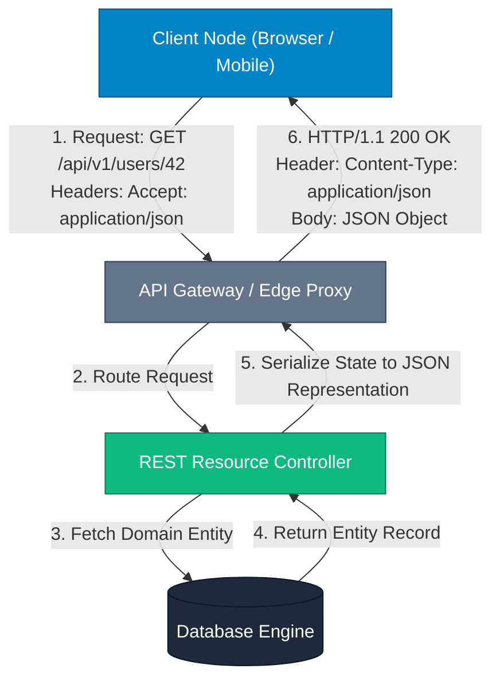

## 🏛️ High-Level Concept Definition & Real-World Analogy

**REST** (**RE**presentational **S**tate **T**ransfer) is an architectural style—originally formulated by Roy Fielding in his 2000 doctoral dissertation—that governs how web applications exchange data across distributed networks using standard HTTP infrastructure. Unlike rigid RPC protocols that invoke remote procedural functions, REST structures system interactions around named **Resources** (e.g., `/orders/42`). Clients interact with resources by transmitting standardized HTTP operations, receiving a digital representation (such as JSON or XML) of the resource's current state.

At its core, REST leverages existing HTTP/1.1 and HTTP/2 infrastructure—such as native browser caching mechanisms, intermediate proxy servers, load balancers, and standardized status codes—to build scalable, decoupled, and evolution-friendly distributed software. A system that adheres strictly to REST principles is termed **RESTful**.

### 🏙️ Real-World Analogy: The National Postal & Standard Warehouse System

To intuitively understand RESTful architecture, envision a **National Postal System and Standard Warehouse Network**:

*   **Resource (URI)**: A specific **Warehouse Shelf Location** (`/warehouses/tx-01/bins/8842`). It identifies *where* an asset lives, completely independent of *how* you alter it.
*   **HTTP Methods (Verbs)**: Standardized **Postal Delivery Action Forms**:
    *   `GET`: *Inspect item on shelf* (Read-only, leaves item untouched).
    *   `POST`: *Deliver a brand new box to be stored* (Creates a new item with an auto-assigned tracking number).
    *   `PUT`: *Replace the entire contents of the bin* (Full overwrite).
    *   `PATCH`: *Open the bin and replace only the torn shipping label* (Partial update).
    *   `DELETE`: *Remove the bin completely* (Deletion).
*   **Statelessness**: A **Lobby Worker with Amnesia**. Every time you approach the counter, you must present your full ID badge and shipping receipt. The worker forgets your face the instant you walk away.
*   **Representation**: The **Shipping Material Packaging**. The warehouse item might be stored internally as raw iron, but it is delivered to you formatted inside a cardboard box (`application/json`) or a wooden crate (`application/xml`).



---

## 🗺️ Structured Module Roadmap

| Module | Core Topics | Key Focus & Engineering Concepts | Read Time |
| :--- | :--- | :--- | :--- |
| **Architectural Constraints** | 6 Principles, Client-Server, Stateless, Cacheable | Complete Decoupling, Sessionless Operations, Intermediate Caching Layers | 5 min |
| **HTTP Verbs & Idempotency** | GET, POST, PUT, PATCH, DELETE, OPTIONS | Idempotency Spectrum, Side-Effect Guarantees, Safe vs. Unsafe Operations | 5 min |
| **Status Codes & Headers** | 2xx, 4xx, 5xx Taxonomy, Content Negotiation | Semantics, 401 vs. 403 Security, Authorization Bearer Tokens | 4 min |
| **URI Design & Formatting** | Naming Rules, Path vs. Query Parameters | Plural Resource Naming, Filtering/Sorting, Versioning Strategies | 4 min |
| **Richardson Maturity Model** | Levels 0 through 3, HATEOAS Mechanics | URI Routing, HTTP Verbs Integration, Hypermedia Controls Engine | 5 min |

---

## 📊 Quick Reference & Comparison Matrices

### 1. HTTP Methods, Safety & Idempotency Matrix

| HTTP Method | Operation Purpose | Safe? (Read-Only) | Idempotent? | Request Body Allowed? | Response Cacheable? |
| :--- | :--- | :--- | :--- | :--- | :--- |
| **GET** | Retrieve resource representation | ✅ Yes | ✅ Yes | ❌ No | ✅ Yes (Default) |
| **POST** | Create child resource / Trigger process | ❌ No | ❌ No | ✅ Yes | ⚠️ Only with specific headers |
| **PUT** | Replace entire resource representation | ❌ No | ✅ Yes | ✅ Yes | ❌ No |
| **PATCH** | Apply partial modifications to resource | ❌ No | ⚠️ No (Not Guaranteed) | ✅ Yes | ❌ No |
| **DELETE** | Remove resource from server | ❌ No | ✅ Yes | ⚠️ Optional (Avoid) | ❌ No |
| **HEAD** | Fetch HTTP headers only (no payload) | ✅ Yes | ✅ Yes | ❌ No | ✅ Yes |
| **OPTIONS** | Query supported methods for endpoint | ✅ Yes | ✅ Yes | ❌ No | ❌ No |

### 2. HTTP Status Code Execution Taxonomy

| Code Range | Category | Key Status Codes | Production Meaning & Engine Trigger |
| :--- | :--- | :--- | :--- |
| **2xx** | **Success** | `200 OK`<br/>`201 Created`<br/>`204 No Content` | Request succeeded.<br/>Resource created (`Location` header set).<br/>Succeeded without response body (DELETE). |
| **3xx** | **Redirection** | `301 Moved Permanently`<br/>`304 Not Modified` | Permanent URI redirect.<br/>Conditional GET validated; client loads from local cache. |
| **4xx** | **Client Error** | `400 Bad Request`<br/>`401 Unauthorized`<br/>`403 Forbidden`<br/>`404 Not Found`<br/>`409 Conflict`<br/>`422 Unprocessable Entity` | Malformed JSON / schema validation failure.<br/>Missing or invalid authentication token.<br/>Authenticated identity lacks role/permission.<br/>Resource URI does not exist.<br/>Concurrent update state conflict (optimistic lock).<br/>Valid JSON structure, but violates domain rules. |
| **5xx** | **Server Error** | `500 Internal Error`<br/>`502 Bad Gateway`<br/>`503 Service Unavailable` | Unhandled runtime exception / server crash.<br/>Upstream proxy failed to connect to backend microservice.<br/>Server overloaded or undergoing maintenance. |

---

## ⚡ Architectural Deep-Dive & Engineering Concepts

### 1. The 6 Architectural Constraints of REST

To qualify as RESTful, an architecture must strictly implement 6 foundational constraints:

1.  **Client-Server Separation**: Separation of concerns. The user interface (client) and data storage (server) evolve independently over standard HTTP contracts.
2.  **Statelessness**: Every request from client to server must contain **all information necessary** to understand and fulfill the request. No client context/session state is stored on the server memory between requests.
3.  **Cacheability**: Responses must implicitly or explicitly define themselves as cacheable or non-cacheable (`Cache-Control: max-age=3600`) to prevent clients from re-fetching static data.
4.  **Uniform Interface**: The core differentiator of REST. Standardized interactions via URIs, standard HTTP methods, self-descriptive messages, and hypermedia (HATEOAS).
5.  **Layered System**: Clients cannot tell whether they are connected directly to the end application server or to an intermediate proxy, CDN, or load balancer.
6.  **Code-on-Demand (Optional)**: Servers can temporarily extend client functionality by transferring executable code (e.g., JavaScript scripts).

> [!IMPORTANT]
> **Statelessness Execution Mechanics**  
> In a stateless REST service, user authorization MUST NOT rely on server-side HTTP `HttpSession` memory blocks. Instead, clients attach a cryptographically signed token (such as a JWT Bearer token) inside the `Authorization` header of **every single request**. This allows any node in a load-balanced server pool to handle any request instantly!

---

### 2. Deep-Dive: PUT vs. PATCH Mechanics

Understanding the structural difference between `PUT` and `PATCH` is critical for API resource updates:

```java
// Original Resource State in Database:
{
  "id": 42,
  "name": "Alex Mercer",
  "email": "alex@example.com",
  "department": "Engineering",
  "role": "Lead Architect"
}
```

#### Executing a PUT Request (`PUT /api/v1/users/42`)
A `PUT` request **replaces the complete target resource**. If client sends:
```json
{
  "email": "alex.mercer@company.com"
}
```
**Resulting State**: Fields omitted by the client (`name`, `department`, `role`) are overwritten with `null` or default values!

```json
// DANGER: PUT Overwrite Result
{
  "id": 42,
  "name": null,
  "email": "alex.mercer@company.com",
  "department": null,
  "role": null
}
```

#### Executing a PATCH Request (`PATCH /api/v1/users/42`)
A `PATCH` request updates **only the fields explicitly specified** in the request body, leaving all unspecified fields unchanged:
```json
// Safe Partial Update via PATCH
{
  "email": "alex.mercer@company.com"
}
```

<Callout type="warning">
**Idempotency Edge Case in PATCH**  
While `PUT` is strictly idempotent ($f(f(x)) = f(x)$), `PATCH` is **not guaranteed** to be idempotent. For example, if a `PATCH` body contains an operational payload like `{"op": "increment", "path": "/login_count", "value": 1}`, executing it 5 times will increment `login_count` by 5!
</Callout>

---

### 3. The Richardson Maturity Model

The **Richardson Maturity Model** classifies REST APIs into 4 levels of architectural compliance:

```
Level 3: HATEOAS (Hypermedia Controls) ──► Complete REST Compliance
Level 2: HTTP Verbs & Status Codes    ──► Standard Modern Web APIs
Level 1: Individual Resource URIs      ──► URI per resource (POST/GET)
Level 0: The Swamp of POX             ──► Single URI RPC over HTTP POST
```

*   **Level 0 (The Swamp of POX - Plain Old XML/JSON)**: Single endpoint (e.g., `POST /api/endpoint`) using HTTP as a transport tunnel for custom method calls (e.g., `{ "action": "getUser", "id": 42 }`).
*   **Level 1 (Resources)**: System exposes multiple distinct URIs for distinct entities (e.g., `/users`, `/orders`), but interacts using a single HTTP method (`POST` or `GET`).
*   **Level 2 (HTTP Verbs & Status Codes)**: System utilizes resource URIs alongside standard HTTP methods (`GET`, `POST`, `PUT`, `DELETE`) and proper HTTP status codes (`200`, `201`, `404`, `500`). *Most modern APIs operate at Level 2.*
*   **Level 3 (HATEOAS - Hypermedia As The Engine Of Application State)**: Server responses contain dynamic hypermedia links informing the client of available state transitions and valid next actions.

```json
// Level 3 HATEOAS Response Example (JSON-HAL Format)
{
  "orderId": 1088,
  "status": "PAID",
  "amount": 250.00,
  "_links": {
    "self": { "href": "/api/v1/orders/1088" },
    "ship": { "href": "/api/v1/orders/1088/ship", "method": "POST" },
    "cancel": { "href": "/api/v1/orders/1088/refund", "method": "POST" }
  }
}
```

---

## ❓ Interactive Self-Assessment Checkpoints

<Quiz 
  question="Why is an HTTP GET request required to be both 'Safe' and 'Idempotent' under the REST specification?" 
  options={[
    "So that servers can execute database DELETE operations in background threads without client awareness.", 
    "So that clients and intermediate proxy networks can automatically retry failed requests and cache responses without causing unintended server side-effects or state mutations.", 
    "To ensure that GET request payloads are encrypted using RSA public keys.", 
    "Because GET requests are executed exclusively over HTTP/2 binary streams."
  ]} 
  answerIndex={1}
>
  Option B is correct. A 'Safe' operation does not modify server state (read-only), while an 'Idempotent' operation produces the exact same server state regardless of whether it is executed 1 time or 1,000 times. Because GET requests meet both criteria, web browsers, CDNs, and API gateways can safely cache GET responses and automatically re-issue GET requests if a network packet drops.
</Quiz>

<Quiz 
  question="What is the subtle architectural security difference between HTTP Status Code 401 Unauthorized and 403 Forbidden?" 
  options={[
    "401 implies server hardware crash; 403 implies client network timeout.", 
    "401 means authentication credentials are missing or invalid ('Who are you?'); 403 means identity is verified, but the client lacks necessary permissions ('I know you, but you cannot access this').", 
    "401 is used for GET requests; 403 is used exclusively for POST requests.", 
    "401 indicates JSON parsing failure; 403 indicates database deadlocks."
  ]} 
  answerIndex={1}
>
  Option B is correct. `401 Unauthorized` (technically unauthenticated) is returned when the user fails to provide valid credentials (missing `Authorization` header or expired JWT). `403 Forbidden` occurs when the user is successfully authenticated, but their assigned roles/scopes do not grant access to the requested resource.
</Quiz>

<Quiz 
  question="In RESTful URI design, which URL pattern correctly follows resource-oriented naming standards for fetching active orders of a specific user?" 
  options={[
    "GET /api/v1/getActiveOrdersForUser?userId=42", 
    "POST /api/v1/user/42/fetch-orders-active", 
    "GET /api/v1/users/42/orders?status=ACTIVE", 
    "FETCH /api/v1/users/42/orders/active"
  ]} 
  answerIndex={2}
>
  Option C is correct. RESTful URIs should use plural nouns representing resources (`/users/42/orders`) rather than verbs or procedural function names (`getActiveOrdersForUser`). Dynamic filtering criteria (such as status) must be passed as query parameters (`?status=ACTIVE`) rather than path segments or custom HTTP verbs.
</Quiz>

<Problem title="Problem: Refactoring RPC-style HTTP API to RESTful Level 2">
<ProblemDescription>
A legacy application uses a single HTTP endpoint `POST /api/service` with custom JSON command payloads to execute actions:

```json
// Legacy Request 1:
POST /api/service
{ "action": "updateUserEmail", "userId": 101, "newEmail": "dev@test.com" }

// Legacy Request 2:
POST /api/service
{ "action": "deleteUser", "userId": 101 }
```

Refactor these interactions into RESTful Level 2 endpoints using appropriate HTTP verbs, URIs, and status codes.
</ProblemDescription>
<ProblemSolution>
Replace the RPC endpoint with resource-oriented URIs and standard HTTP methods:

```http
// Refactored Email Update (Partial Update via PATCH)
PATCH /api/v1/users/101 HTTP/1.1
Host: api.example.com
Content-Type: application/json

{
  "email": "dev@test.com"
}

// Response: HTTP/1.1 200 OK

// Refactored User Deletion (DELETE)
DELETE /api/v1/users/101 HTTP/1.1
Host: api.example.com

// Response: HTTP/1.1 204 No Content
```
</ProblemSolution>
</Problem>
