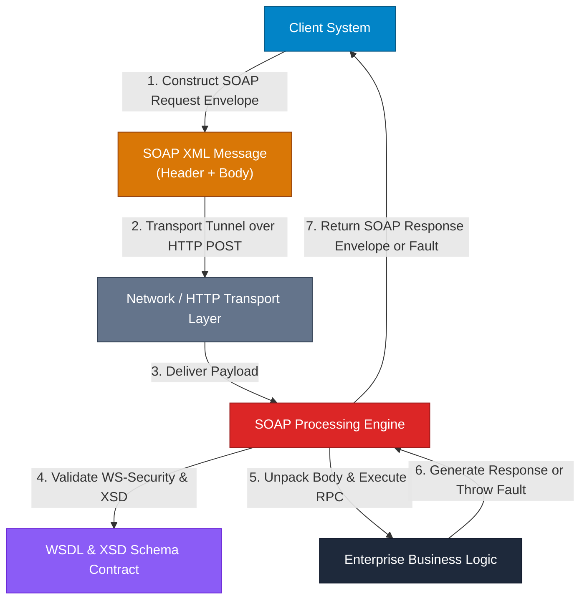

## High-Level Concept Definition & Real-World Analogy

**SOAP** (**Simple Object Access Protocol**) is a strict, protocol-based web service specification created by W3C for exchanging structured XML data across computer networks.

### Core Architectural Features
*   **Transport Independence**: Operates over HTTP, HTTPS, SMTP, TCP, or JMS transports.
*   **Mandatory XML Envelope**: Wraps every payload inside an explicit `<soap:Envelope>` document structure.
*   **Enterprise-Grade Frameworks**: Supports formal contracts (WSDL), WS-Security, WS-ReliableMessaging, and WS-AtomicTransaction.

### Real-World Analogy: The Armored Diplomatic Courier System

To visualize SOAP operations, consider an **Armored Diplomatic Courier System**:

*   **SOAP Envelope (`<soap:Envelope>`)**: The **Heavy Steel Diplomatic Vault** enclosing every transported document.
*   **SOAP Header (`<soap:Header>`)**: The **Security Seals & Customs Manifest** carrying authentication tokens, digital signatures, and routing data.
*   **SOAP Body (`<soap:Body>`)**: The **Sealed Compartment** holding the actual domain data or RPC instruction.
*   **WSDL Contract**: A **Bilateral Diplomatic Treaty Document** specifying allowed languages, formats, and clearance rules.
*   **SOAP Fault (`<soap:Fault>`)**: An **Official Rejection Notice** returned when a vault is tampered with or an invalid command is issued.



---

## Structured Module Roadmap

| Module | Core Topics | Key Focus & Engineering Concepts | Read Time |
| :--- | :--- | :--- | :--- |
| **Envelope Anatomy** | `<Envelope>`, `<Header>`, `<Body>`, `<Fault>` | XML Namespaces, Mandatory Header Attributes (`mustUnderstand`) | 4 min |
| **WSDL Contracts** | Types, Message, PortType, Binding, Service | Contract-First Development, XML Schema Types (XSD), Endpoint Binding | 4 min |
| **WS-* Standards** | WS-Security, WS-Addressing, WS-ReliableMessaging | End-to-End Encryption, Message-Level Tokens, ACKN/NACK Retries | 4 min |
| **Fault Mechanics** | `faultcode`, `faultstring`, `detail` Element | Standard Fault Taxonomy (`Client`, `Server`), Programmatic Error Handling | 3 min |

---

## Quick Reference & Comparison Matrices

### 1. SOAP vs. REST Architectural Comparison Matrix

| Metric / Dimension | SOAP (Simple Object Access Protocol) | REST (Representational State Transfer) |
| :--- | :--- | :--- |
| **Architectural Nature** | Rigid, Transport-Agnostic Protocol Specification | Flexible Architectural Style leveraging HTTP |
| **Payload Format** | Strictly XML (`text/xml` or `application/soap+xml`) | JSON, XML, HTML, Plain Text, Binary |
| **Transport Binding** | HTTP, HTTPS, SMTP, TCP, JMS | HTTP / HTTPS Exclusively |
| **Contract Specification** | Formal WSDL (Web Services Description Language) | Optional OpenAPI (Swagger) / JSON Schema |
| **Security Layer** | WS-Security (Message-Level Encryption & Digital Signatures) | Transport-Level Security (HTTPS/TLS) + JWT Bearer |
| **ACID Transactions** | Native WS-AtomicTransaction Support | Eventual Consistency / Saga Pattern |
| **Stateful Capabilities** | Built-in WS-Context for Stateful Session Support | Strictly Stateless (No server session state) |
| **Bandwidth Efficiency** | Heavy (High XML Tag & Header Overhead) | Lightweight (Minimal JSON Bytes) |
| **Error Format** | Standardized `<soap:Fault>` Element | Standard HTTP Status Codes (4xx/5xx) + JSON Error Body |

### 2. WS-* Enterprise Specification Taxonomy

| Specification Name | Standard Purpose | Key Technical Focus |
| :--- | :--- | :--- |
| **WS-Security** | Message-level security | Encrypts and digitally signs specific XML elements within `<soap:Header>` using SAML or UsernameTokens. |
| **WS-Addressing** | Transport-independent routing | Embeds `To`, `From`, `ReplyTo`, and `MessageID` XML headers inside SOAP headers to route messages across proxy networks. |
| **WS-ReliableMessaging** | Guaranteed message delivery | Implements end-to-end ACK/NACK protocol over asynchronous transports to guarantee exactly-once delivery. |
| **WS-AtomicTransaction** | Distributed ACID transactions | Coordinates two-phase commit (2PC) transactions across multiple heterogeneous enterprise web services. |

---

## Architectural Deep-Dive & Engineering Concepts

### SOAP XML Envelope Structure

A SOAP message is an XML document consisting of a mandatory `<soap:Envelope>` root, an optional `<soap:Header>`, a mandatory `<soap:Body>`, and an optional `<soap:Fault>` element inside the body:

```xml
<?xml version="1.0" encoding="UTF-8"?>
<soap:Envelope 
  xmlns:soap="http://schemas.xmlsoap.org/soap/envelope/"
  xmlns:sec="http://docs.oasis-open.org/wss/2004/01/oasis-200401-wss-wssecurity-secext-1.0.xsd"
  xmlns:bank="http://api.bank.com/payments">

  <!-- 1. SOAP HEADER: Authentication, Tokens, and Routing -->
  <soap:Header>
    <sec:Security>
      <sec:UsernameToken>
        <sec:Username>EnterpriseClientApp</sec:Username>
        <sec:Password Type="...#PasswordText">SecretPass123</sec:Password>
      </sec:UsernameToken>
    </sec:Security>
  </soap:Header>

  <!-- 2. SOAP BODY: Business Payload or RPC Execution -->
  <soap:Body>
    <bank:TransferFundsRequest>
      <bank:SourceAccountId>ACC-99812</bank:SourceAccountId>
      <bank:DestinationAccountId>ACC-44102</bank:DestinationAccountId>
      <bank:Amount currency="USD">50000.00</bank:Amount>
    </bank:TransferFundsRequest>
  </soap:Body>

</soap:Envelope>
```

<Callout type="info">
**The `mustUnderstand` Attribute**  
SOAP headers support an attribute `soap:mustUnderstand="1"`. If a receiving server receives a header tagged with `mustUnderstand="1"` but does not possess the processing logic to parse that header, the server MUST halt processing immediately and return a `soap:MustUnderstand` Fault.
</Callout>

### WSDL Document Structural Components

A WSDL document defines the service contract via 5 core components:

*   **`<types>`**: Defines XML Schema (XSD) data types and domain payload structures.
*   **`<message>`**: Maps parameter payloads for input and output operations.
*   **`<portType>`**: Defines abstract service operations (analogous to a Java Interface).
*   **`<binding>`**: Specifies physical transport protocols (e.g. SOAP over HTTP POST) and style encoding.
*   **`<service>`**: Defines concrete network endpoint URLs.

```xml
<!-- Example WSDL Excerpt: PortType & Binding -->
<wsdl:portType name="PaymentPortType">
  <wsdl:operation name="TransferFunds">
    <wsdl:input message="tns:TransferFundsInputMessage"/>
    <wsdl:output message="tns:TransferFundsOutputMessage"/>
    <wsdl:fault name="InsufficientFundsFault" message="tns:FaultMessage"/>
  </wsdl:operation>
</wsdl:portType>

<wsdl:binding name="PaymentSOAPBinding" type="tns:PaymentPortType">
  <soap:binding style="document" transport="http://schemas.xmlsoap.org/soap/http"/>
  <wsdl:operation name="TransferFunds">
    <soap:operation soapAction="http://api.bank.com/payments/TransferFunds"/>
    <wsdl:input><soap:body use="literal"/></wsdl:input>
    <wsdl:output><soap:body use="literal"/></wsdl:output>
  </wsdl:operation>
</wsdl:binding>
```

### SOAP Fault Processing Mechanics

When an exception occurs during SOAP execution, the server returns an HTTP 500 status code containing a `<soap:Fault>` element:

```xml
<soap:Envelope xmlns:soap="http://schemas.xmlsoap.org/soap/envelope/">
  <soap:Body>
    <soap:Fault>
      <!-- Standardized Error Code: VersionMismatch, MustUnderstand, Client, Server -->
      <faultcode>soap:Client</faultcode>

      <!-- Human Readable Reason -->
      <faultstring>Invalid Account Identification Provided</faultstring>

      <!-- Machine-Readable Custom Technical Details -->
      <detail>
        <bank:PaymentException xmlns:bank="http://api.bank.com/errors">
          <errorCode>ERR-40092</errorCode>
          <message>Account ACC-99812 is frozen or inactive.</message>
        </bank:PaymentException>
      </detail>
    </soap:Fault>
  </soap:Body>
</soap:Envelope>
```

<Callout type="warning">
**Security Edge Case: Transport Security vs. Message Security**  
Standard REST APIs rely on HTTPS (TLS) for transport encryption, which is decrypted at each intermediate proxy/gateway. SOAP's **WS-Security** encrypts individual XML nodes *inside the body itself*, keeping sensitive fields encrypted end-to-end across multiple intermediate hops and persistent queues.
</Callout>

---

## Interactive Self-Assessment Checkpoints

<Quiz 
  question="Why does SOAP support message-level security (WS-Security) whereas standard REST APIs rely primarily on transport-level security (HTTPS/TLS)?" 
  options={[
    "Because REST APIs cannot run over encrypted HTTPS connections.", 
    "Because HTTPS decrypts network traffic at every intermediate proxy hop, whereas WS-Security keeps specific payload elements encrypted end-to-end through multi-hop messaging intermediaries.", 
    "Because XML payloads cannot be encrypted using TLS standard algorithms.", 
    "Because SOAP requires HTTPS connections to be established without TCP handshakes."
  ]} 
  answerIndex={1}
>
  Option B is correct. Key security differences:
  * **HTTPS (TLS)**: Point-to-point encryption decrypted at every intermediate API proxy or load balancer.
  * **WS-Security**: Message-level payload encryption allowing sensitive XML fields to remain encrypted end-to-end across queues and proxies.
</Quiz>

<Quiz 
  question="What happens if a SOAP server receives a request with a `<soap:Header>` containing the attribute `soap:mustUnderstand='1'` for a namespace the server does not support?" 
  options={[
    "The server silently ignores the unsupported header and processes the body.", 
    "The server halts request processing immediately and returns a MustUnderstand SOAP Fault with HTTP status 500.", 
    "The server automatically converts the request to a REST JSON format.", 
    "The server forwards the request to a default fallback gateway."
  ]} 
  answerIndex={1}
>
  Option B is correct. Processing rule:
  * `soap:mustUnderstand='1'` is a strict processing directive. If the recipient node cannot parse that header, it must abort and return a `soap:MustUnderstand` fault.
</Quiz>

<Quiz 
  question="In a WSDL document, which element bridges abstract operation definitions (`portType`) with concrete physical transport protocols and message formats?" 
  options={[
    "`<wsdl:types>`", 
    "`<wsdl:message>`", 
    "`<wsdl:binding>`", 
    "`<wsdl:documentation>`"
  ]} 
  answerIndex={2}
>
  Option C is correct. The `<wsdl:binding>` element maps abstract `<wsdl:portType>` operations to wire protocols (SOAP over HTTP POST) and encoding styles (`literal`).
</Quiz>

<Problem title="Problem: Handling SOAP Faults in Java Integration">
<ProblemDescription>
You are integrating a legacy Java application with a banking SOAP web service. The server returns a SOAP Fault with HTTP status code 500. Standard `conn.getInputStream()` throws an `IOException`. Write a Java snippet to catch this condition and read the raw SOAP Fault XML stream safely.
</ProblemDescription>
<ProblemSolution>
When HttpURLConnection receives a 500 response code, `getInputStream()` throws an `IOException`. Switch to `getErrorStream()` to read the XML Fault payload:

```java
URL url = new URL("https://bank.example.com/soap/payments");
HttpURLConnection conn = (HttpURLConnection) url.openConnection();
conn.setRequestMethod("POST");
conn.setRequestProperty("Content-Type", "text/xml; charset=utf-8");
conn.setDoOutput(true);

// ... Write SOAP Envelope to conn.getOutputStream() ...

int statusCode = conn.getResponseCode();

InputStream stream;
if (statusCode >= 200 && statusCode < 300) {
    stream = conn.getInputStream();
} else {
    // 4xx or 5xx SOAP Fault returned on error stream!
    stream = conn.getErrorStream();
}

BufferedReader reader = new BufferedReader(new InputStreamReader(stream, StandardCharsets.UTF_8));
StringBuilder xmlResponse = new StringBuilder();
String line;
while ((line = reader.readLine()) != null) {
    xmlResponse.append(line);
}
reader.close();

System.out.println("SOAP Response/Fault XML: " + xmlResponse.toString());
```
</ProblemSolution>
</Problem>
