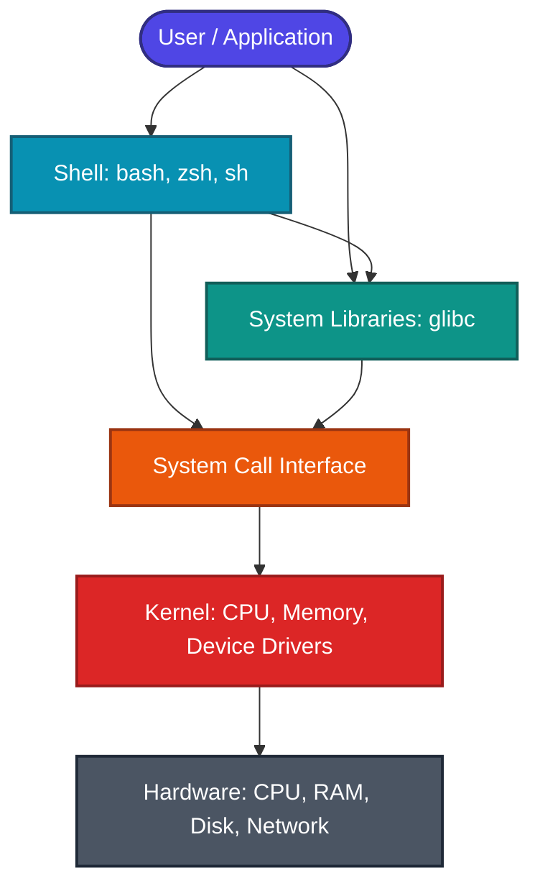

### 1. Introduction to Unix/Linux Architecture

Imagine a high-security research facility.
*   **The Hardware**: The physical server facility (CPU, RAM, Disks).
*   **The Kernel**: The facility manager who has direct, absolute access to the vault keys, hardware switches, and control panels.
*   **The Shell**: The receptionist sitting at the entrance desk. You (the user) cannot walk in and flip hardware switches yourself; you must tell the receptionist what you want, and they translate your command into a formal request for the manager.



#### User Space vs. Kernel Space
To prevent a bug in a user application from accidentally wiping out the entire system, CPU architectures enforce strict boundaries:
1.  **Kernel Space (Ring 0)**: The inner laboratory vault. The Kernel runs here with unrestricted access to physical hardware, memory blocks, and privileged CPU instructions.
2.  **User Space (Ring 3)**: The public lobby. All user programs, database servers, web browsers, and shells run here. They have no direct access to hardware and must request resources from the Kernel.

#### System Calls vs. Library Calls
If a program in User Space wants to read a file from the disk drive:
*   **System Call (Syscall)**: The program writes a formal request ticket and slides it through a slot in the security glass window. The CPU pauses execution, switches from User Space (Ring 3) to privileged Kernel Space (Ring 0), performs the disk read, and returns the data back to User Space. Examples: `read()`, `write()`, `fork()`, `open()`.
*   **Library Call**: A pre-packaged utility function inside a standard library (like C's `glibc`). Calling `printf()` is a library call; it formats your text in User Space, and then internally slides a `write()` system call ticket through the window to print the pixels to the screen.

#### Monolithic vs. Microkernels
*   **Monolithic Kernel (e.g., Linux)**: The facility manager puts all department leads (device drivers, file systems, memory schedulers) inside the inner vault (Kernel Space). This is fast because they can talk directly to one another without paperwork, but if a single driver crashes, the whole facility goes down.
*   **Microkernel (e.g., macOS's Mach core)**: Only the core manager sits in the vault. The driver, file system, and network teams are moved to user-space offices. If the network driver crashes, it doesn't crash the manager; you just reboot that single office. However, constant message-passing between offices creates performance overhead.

<Quiz question="What is the primary difference between a system call and a library call?" options={["System calls run in user space, while library calls run in kernel space","System calls require switching CPU execution modes from User Space (Ring 3) to Kernel Space (Ring 0); library calls are standard user-space functions","Library calls are open-source, whereas system calls are proprietary","System calls do not consume CPU cycles, while library calls do"]} answerIndex={1}>
System calls are the interface between user space and kernel space. They trigger a hardware interrupt or exception that switches the CPU to privileged mode (Ring 0). Library calls (like `malloc` or `printf`) run in user space and may or may not invoke system calls internally.
</Quiz>

---

### 2. The Linux File System & Inodes

The golden rule of Unix is: **"Everything is a file."** Hardware drives, network interfaces, directories, and running processes are all exposed as files within a single hierarchical tree structure starting at `/` (root).

#### Virtual File System (VFS)
*   **VFS**: The hotel's central reservation desk. You ask for a room check-in using standard words ("open room", "lock door"), and the desk handles whether it's a log cabin, a tent, or a concrete suite (ext4, FAT32, NFS) behind the scenes.

#### Anatomy of a File: Inodes
To understand files, we must separate a file's **metadata** from its **content** and its **name**.
An **Inode (Index Node)** is a data structure on disk that represents a file system object. Each file has exactly one inode, identified by a unique **inode number** on its partition.
*   **Analogy**: The landlord's master property ledger card.

```
        Directory Data Block (e.g. /home/user)
        ┌───────────────────────────────┐
        │ Filename      │ Inode Number  │
        ├───────────────┼───────────────┤
        │ notes.txt     │ 140234        ├────────┐
        │ script.sh     │ 140235        │        │
        └───────────────┴───────────────┘        │
                                                 ▼
        Inode Table (Entry 140234)               │
        ┌──────────────────────────────────────┐ │
        │ Metadata:                            │ │
        │ - Owner: UID 1000                    │◀┘
        │ - Permissions: rw-r----              │
        │ - Size: 4096 bytes                   │
        │ - Links count: 1                     │
        │ - Pointers to Data Blocks            ├────────┐
        └──────────────────────────────────────┘        │
                                                        ▼
        Data Blocks on Disk                             │
        ┌─────────────────────────────────────────────┐ │
        │ [ Actual text content of the file... ]      │◀┘
        └─────────────────────────────────────────────┘
```

*   **What is stored in an Inode?** File type, size, owner (UID/GID), permissions, timestamps (`atime`, `mtime`, `ctime`), and pointers to the physical data blocks on disk where the actual content is stored.
*   **What is NOT stored in an Inode?** The file name! File names are stored in directory files. A directory is just a file whose content is a list of filename-to-inode-number mappings.

#### Hard Links vs. Soft (Symbolic) Links
*   **Hard Link**: Creating a second directory plaque in another hallway that lists the exact same ledger card (inode) number. The room is only cleaned out if you take down *both* plaques.
*   **Symbolic Link (Symlink)**: A post-it note pointing to the first directory plaque path. If you tear down the original plaque, the post-it note points to nothing (a broken or dangling link).

| Feature | Hard Link | Symbolic Link (Symlink) |
| --- | --- | --- |
| **Creation** | `ln target linkname` | `ln -s target linkname` |
| **Inode** | Shares the **same** inode as the target file. | Has a **new, unique** inode. |
| **Target Content** | Points directly to the data blocks. | Points to the path string of the target. |
| **Across File Systems** | No (cannot span different partitions). | Yes (can span partitions). |
| **For Directories** | No (restricted to prevent loops). | Yes. |
| **If Target Deleted** | Link remains active; data is preserved. | Link becomes **broken (dangling)**. |

---

### 3. Shell Environments & Startup Configurations

#### Startup Files Evaluation Lifecycle: The Club Member Routine
*   **Interactive Login Shell (e.g., SSH, or `bash --login`)**: Entering the main club entrance with registration check. The club manager reads the global guest guidelines (`/etc/profile`) and then checks your personal locker configuration (first of `~/.bash_profile`, `~/.bash_login`, or `~/.profile`).
*   **Interactive Non-login Shell (e.g., opening a new terminal window)**: Walking into an inner room of the club you're already in. You skip the main gate registration and just load the quick-reference rules on the table (`~/.bashrc`).

```
Interactive Login Shell (e.g., SSH, or bash --login)
  │
  ├─► Reads /etc/profile
  │
  └─► Looks for first of:
        1. ~/.bash_profile
        2. ~/.bash_login
        3. ~/.profile
      (Executes ONLY the first one found, ignores others)

Interactive Non-login Shell (e.g., New Terminal Window, or subshell)
  │
  └─► Reads ~/.bashrc
```

---

### 4. Advanced Input/Output Redirection & File Descriptors

#### File Descriptors: Plumbing and Pipes
In Unix, every running process has three default plumbing connectors:
*   **Standard Input (FD 0 - cold water pipe)**: Usually reads from your keyboard.
*   **Standard Output (FD 1 - hot water tap)**: Usually writes text to your screen.
*   **Standard Error (FD 2 - drain pipe)**: Usually writes error reports to your screen.

```
       [ Keyboard ] ────► FD 0 (STDIN) ────► [ Running Process ] ────► FD 1 (STDOUT) ────► [ Screen ]
                                                                 └──► FD 2 (STDERR) ────► [ Screen ]
```

*   `>` (Redirect Output): Fitting a coupler onto the hot water tap (FD 1) and piping the water into a bucket file (`stdout.log`).
*   `2>` (Redirect Error): Redirecting the drain pipe (FD 2) into an error log file (`stderr.log`).
*   `2>&1` (Merge Streams): Routing the drain pipe (FD 2) directly into the hot water stream (FD 1).
*   `/dev/null`: A black hole drain pipe. Anything piped here is permanently discarded.
    ```bash
    # Run a command, sending successful output to a file and discarding errors
    $ my_script.sh > output.log 2> /dev/null
    ```

---

### 5. Process Management & Job Control

#### Process States: The Office Department
*   **Process**: A hired worker.
*   **Parent/Child**: A manager hiring assistants.
*   **Orphan**: A manager who leaves the company (parent exits), leaving the assistants working. The company owner (process ID 1 / `systemd`) automatically adopts them.
*   **Zombie**: A worker who completes their task and stands in the hallway holding a report sheet, waiting for the manager to look at it. If the manager ignores them (doesn't call `wait()`), they remain stuck as a zombie.

```
  [ Running/Runnable ] ──► (sleeps) ──► [ Sleeping (Interruptible) ]
           │                                          │
    (stops / Ctrl+Z)                           (wakes up/signal)
           │                                          │
           ▼                                          ▼
     [ Stopped ] ───────► (termination) ───────► [ Zombie ]
                                                      │
                                             (parent reads code)
                                                      │
                                                      ▼
                                                 [ Dead ]
```

*   `SIGINT` (Signal 2): `Ctrl+C`. A polite request for the worker to clean up their desk and go home.
*   `SIGTERM` (Signal 15): The standard exit request. Can be caught and handled.
*   `SIGKILL` (Signal 9): Security escorting the worker out immediately. Cannot be ignored or blocked.

---

### 6. Text Wrangling & Processing Power Tools

#### Sed: The Conveyor Belt Rubber Stamp
*   **Sed**: A conveyor belt passing rolls of paper where a machine dynamically replaces matches using a stamps template.
    ```bash
    # Replace the first occurrence of "A" with "B" on each line of a file
    $ sed 's/A/B/' input.txt
    ```

#### Awk: The Spreadsheet Analyst
*   **Awk**: A spreadsheet analyst who takes text line-by-line, cuts it into columns automatically (`$1`, `$2`), and sums up values in a mental ledger.
    ```bash
    # Print the second column of lines containing "SUCCESS"
    $ awk '/SUCCESS/ { print $2 }' log.txt
    ```

---

### 7. Conceptual Quizzes

<Quiz question="If you delete the original target file, what happens to its hard link and symbolic link respectively?" options={["The hard link is broken, and the symbolic link remains valid.","Both links are immediately broken.","The hard link remains valid and can access the data, while the symbolic link becomes broken.","Both links remain valid and preserve the file data."]} answerIndex={2}>
A hard link points directly to the file's inode number. Deleting the original file only decreases the link count in the inode. The data is not deleted until the link count reaches 0. Therefore, the hard link remains valid. A symbolic link, however, points to the target filename path; when the target is deleted, the path no longer exists, rendering the symbolic link broken.
</Quiz>

<Quiz question="Which command redirects Standard Error (FD 2) to standard output (FD 1)?" options={["`command > 2`","`command 2>&1`","`command 1>&2`","`command >> 2`"]} answerIndex={1}>
`2>&1` routes file descriptor 2 (STDERR) to the destination of file descriptor 1 (STDOUT).
</Quiz>

<Quiz question="What is a zombie process in Unix?" options={["A process that consumes 100% CPU.","A process that has finished execution but still has an entry in the process table because its parent has not yet read its exit status.","A process running without a parent.","A background thread."]} answerIndex={1}>
Zombie processes occupy no memory or CPU; they are simply inactive process table entries waiting for the parent process to fetch their exit code using the `wait()` system call.
</Quiz>

---

### 8. Real-world Practice Problems

<Problem title="Problem 1: Process and File Descriptor Redirect">
<ProblemDescription>
Write a bash script that runs a background task `backup_system.sh`, redirects all normal logs to `/var/log/backup.log`, redirects all error logs to `/var/log/backup_err.log`, and prints the background job process ID (PID) to the screen.
</ProblemDescription>
<ProblemSolution>
This script uses standard file descriptor routing:

```bash
#!/bin/bash

# Start the script in the background, routing STDOUT to FD 1's file and STDERR to FD 2's file
./backup_system.sh > /var/log/backup.log 2> /var/log/backup_err.log &

# Fetch the PID of the last background process
BACKUP_PID=$!

echo "Backup job started in the background with PID: $BACKUP_PID"
```
</ProblemSolution>
</Problem>

<Problem title="Problem 2: Text Wrangling with Awk and Sed">
<ProblemDescription>
Given a space-separated log file `transactions.log` where column 3 is the transaction status (e.g. `SUCCESS`, `FAILED`) and column 5 is the amount.
Write a pipeline that:
1. Filters for rows containing `SUCCESS`.
2. Changes all currency symbols `$` to empty spaces.
3. Sums up the total transaction amount.
</ProblemDescription>
<ProblemSolution>
This pipeline combines text parsing and aggregation:

```bash
# 1. Filter rows where col 3 is SUCCESS
# 2. Use sed to strip out the dollar signs
# 3. Sum column 5 values with awk
awk '$3 == "SUCCESS"' transactions.log | sed 's/\$//g' | awk '{ sum += $5 } END { print "Total: " sum }'
```
</ProblemSolution>
</Problem>