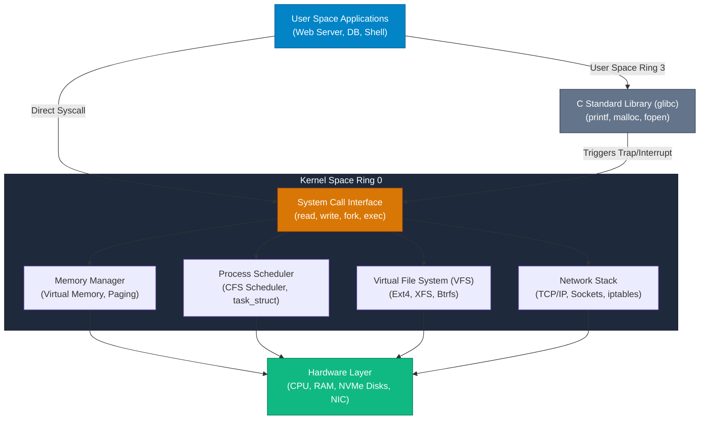

## High-Level Concept Definition & Real-World Analogy

**Unix/Linux** is a family of multi-user, multitasking operating systems built on modular, text-centric abstractions, hierarchical file systems, and strict Ring 0 vs. Ring 3 hardware memory boundaries.

### Core Architectural Features
*   **"Everything is a File" Abstraction**: Hardware devices, network sockets, directories, and running processes are exposed as uniform file paths.
*   **Modular Pipeline Philosophy**: Small, single-purpose utilities connected via byte-stream pipes (`|`) to solve complex workflows.
*   **Strict Memory Protection**: Hardware-enforced separation between unprivileged User Space (Ring 3) and privileged Kernel Space (Ring 0).

### Real-World Analogy: The High-Security Research Facility

To visualize Unix/Linux system architecture, consider a **High-Security Research Facility**:

*   **The Hardware (CPU, RAM, Disks)**: The **Physical Server Facility Vaults**. Holds raw power, storage rooms, and electrical generators.
*   **The Kernel Space (Ring 0)**: The **Inner Vault Security Manager**. Has absolute, unrestricted clearance keys to flip hardware switches and open physical doors.
*   **The User Space (Ring 3)**: The **Public Entrance Lobby**. Where visitors, researchers (`web browsers`, `compilers`, `databases`) work. They possess zero hardware keys.
*   **The System Call (Syscall)**: A **Formal Security Service Ticket**. A researcher in the lobby slides a ticket through a bulletproof glass slot to ask the Manager to read a file from the vault.
*   **The Shell (`bash`, `zsh`)**: The **Front Desk Receptionist**. Listens to spoken instructions, checks permissions, and translates commands into formal service tickets for the Manager.



---

## Structured Module Roadmap

| Module | Core Topics | Key Focus & Engineering Concepts | Read Time |
| :--- | :--- | :--- | :--- |
| **[Kernel Architecture & Syscalls](./kernel-architecture-and-syscalls)** | User vs. Kernel Space, Ring 0/3, Syscalls, Monolithic vs. Micro | Hardware Memory Boundaries, `glibc` Wrappers, Context Switching | 18 min |
| **[File Systems & Inode Mechanics](./filesystems-and-inodes)** | VFS Layer, Ext4 Inodes, Hard Links vs. Symlinks, `/proc` & `/sys` | Index Node Metadata Tables, Direct Pointers, Pseudo-Filesystems | 17 min |
| **[Process Management & IPC](./process-management-and-ipc)** | `fork()`, `execve()`, Process States, Signals, Pipes, Shared Memory | `task_struct`, Zombie/Orphan Processes, POSIX Signals, IPC Channels | 19 min |
| **[Shell Scripting & Text Pipelines](./shell-scripting-and-text-processing)** | `bash` Mechanics, Redirection (`0/1/2`), `grep`, `sed`, `awk` | Stream Parsing, File Descriptors, Columnar Processing, Regex | 16 min |

---

## Quick Reference & Comparison Matrices

### 1. Unix Operating Systems Lineage & Architecture Matrix

| OS Flavor | Kernel Type | Primary Ecosystem Focus | Default Package Manager | Unique Architectural Signature |
| :--- | :--- | :--- | :--- | :--- |
| **Linux (Ubuntu/Debian)** | Monolithic (Dynamic Modules) | Cloud Infrastructure & Enterprise Servers | `apt` / `dpkg` | Completely open-source kernel; powers $90\%+$ of cloud workloads. |
| **RHEL / Rocky Linux** | Monolithic (SELinux Hardened) | Corporate Enterprise IT & Banking Systems | `dnf` / `rpm` | Strict stability lifecycles and mandatory SELinux security policies. |
| **macOS (Darwin)** | Hybrid (Mach Microkernel + BSD) | Developer Workstations & Desktop Consumer | `brew` (Homebrew) | Combines Mach microkernel messaging with BSD POSIX subsystem. |
| **FreeBSD** | Monolithic | High-Throughput Networking & Storage | `pkg` | Complete unified OS distribution; advanced ZFS and Jail isolation. |

### 2. Systems Abstraction Levels Taxonomy

| Abstraction Layer | Privileged CPU Ring | Execution Purpose | Code Example |
| :--- | :--- | :--- | :--- |
| **User Application** | Ring 3 (Unprivileged) | High-level business logic processing | Python script, Java API service, Node.js server |
| **C Library (`glibc`)** | Ring 3 (Unprivileged) | Standard user-space helper abstractions | `printf("Hello")`, `malloc(1024)`, `fopen()` |
| **System Call (Syscall)** | Ring 3 -> Ring 0 (Trap) | Formal hardware request interface | `write(1, "Hello", 5)`, `read()`, `fork()` |
| **Kernel Subsystem** | Ring 0 (Privileged) | Hardware execution, memory paging, device driver access | Process scheduler, Ext4 driver, TCP/IP stack |

---

## CLI Command Masterclass: System Overview & Information

### `uname`, `uptime`, `whoami`, `id`

*   **Mental Model**: Interrogates the active kernel and user identity contexts from User Space (Ring 3).

| Command & Flag | Operational Purpose |
| :--- | :--- |
| `uname -a` | Displays complete system kernel architecture, OS release, and CPU architecture string. |
| `uptime` | Prints system running time, active user count, and 1, 5, 15-minute CPU load averages. |
| `whoami` & `id` | Displays current effective User ID (UID), Group ID (GID), and assigned group memberships. |

```bash
# Production System Identity Inspection
$ uname -srm # Output: Linux 6.8.0-x86_64
$ id # Output: uid=1000(alex) gid=1000(alex) groups=1000(alex),27(sudo),142(docker)
```

---

## Interactive Self-Assessment Checkpoints

<Quiz 
  question="Why does a Linux system separate execution into User Space (Ring 3) and Kernel Space (Ring 0)?" 
  options={[
    "To make C programs run faster than Python programs.", 
    "To prevent buggy or malicious user applications from accessing raw memory or hardware directly, protecting system stability and security.", 
    "Because Linux cannot run without a web browser.", 
    "To restrict system access to root users only."
  ]} 
  answerIndex={1}
>
  Option B is correct. Hardware protection rings:
  * **Ring 3 (User Space)**: Runs applications with restricted CPU instructions and isolated virtual memory addresses.
  * **Ring 0 (Kernel Space)**: Possesses absolute hardware access. A crash in Ring 3 terminates only that process; a crash in Ring 0 triggers a kernel panic.
</Quiz>

<Quiz 
  question="What is the primary difference between a C library call (e.g. `printf`) and a System Call (e.g. `write`)?" 
  options={[
    "`printf` runs in Kernel Space; `write` runs in User Space.", 
    "`printf` is a user-space helper function in `glibc` that buffers formatted text before invoking the low-level `write()` system call to request kernel execution.", 
    "`write` is used exclusively for network sockets.", 
    "They are identical aliases for the exact same CPU instruction."
  ]} 
  answerIndex={1}
>
  Option B is correct. Execution pipeline breakdown:
  * `printf()` is a user-space library function that formats text into an internal buffer.
  * When the buffer flushes, `printf()` triggers the `write()` system call, which switches CPU execution to Ring 0 to output bytes to the file descriptor.
</Quiz>

<Quiz 
  question="Which Unix philosophy rule allows commands like `grep`, `sed`, and `sort` to be chained together flexibly into complex data processing pipelines?" 
  options={[
    "Write programs exclusively in C++.", 
    "Write programs that do one thing well and expect the output of every program to become the input to another via standard text streams.", 
    "Store all data in binary databases.", 
    "Require root privileges for all file operations."
  ]} 
  answerIndex={1}
>
  Option B is correct. Unix Pipeline Principle:
  * Small, specialized utilities emitting standard plain-text streams enable developers to compose powerful custom pipelines (`cat | grep | awk | sort | uniq -c`).
</Quiz>

<Problem title="Problem: Inspecting Kernel Hardware Abstraction via Pseudo-Filesystems">
<ProblemDescription>
Write a Linux terminal command sequence to demonstrate the "Everything is a File" abstraction by querying CPU hardware details, active kernel version, and memory usage directly from the `/proc` pseudo-filesystem without using third-party GUI tools.
</ProblemDescription>
<ProblemSolution>
Query the virtual file nodes generated dynamically by the Linux kernel inside `/proc`:

```bash
# 1. Read CPU architecture and model details from the kernel
$ cat /proc/cpuinfo | grep "model name" | head -n 1

# 2. Read live system RAM memory usage statistics
$ head -n 4 /proc/meminfo

# 3. Read kernel hostname and release version
$ cat /proc/sys/kernel/hostname
$ cat /proc/sys/kernel/osrelease

# 4. Read the exact command-line invocation of PID 1 (init/systemd)
$ tr '\0' ' ' < /proc/1/cmdline
```
</ProblemSolution>
</Problem>