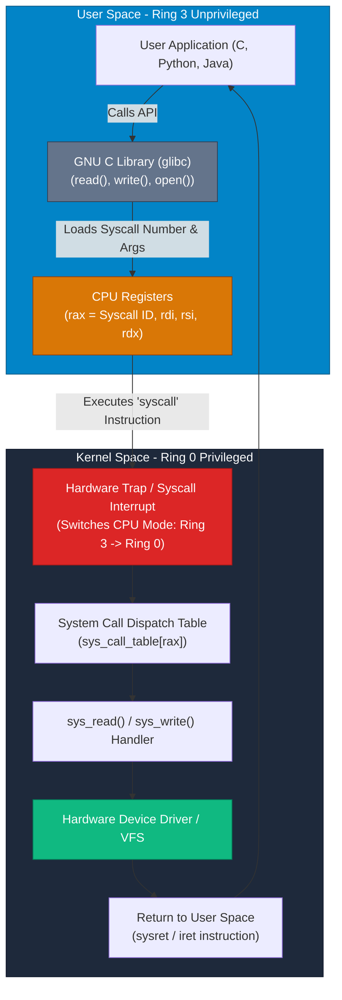

## High-Level Concept Definition & Real-World Analogy

The **Linux Kernel** is the core, low-level software component running in privileged CPU mode (Ring 0) that manages hardware resources, virtual memory allocation, process scheduling, and security boundaries.

### Core Architectural Features
*   **Privileged Execution Boundary**: Executes in Ring 0 with unrestricted access to CPU registers, physical RAM pages, and peripheral I/O ports.
*   **System Call Trap Interface**: Exposes a formal gateway (`syscall` / `int 0x80`) allowing unprivileged User Space programs (Ring 3) to request hardware services.
*   **Dynamic Kernel Modules (LKM)**: Supports loading and unloading device drivers and kernel features at runtime without rebooting (`lsmod`, `insmod`).

### Real-World Analogy: The Vault Manager & Counter Ticket System

To visualize kernel architecture and system call traps, consider a **Bank Vault Manager and Counter Ticket System**:

*   **User Space (Ring 3)**: The **Bank Customer Lobby**. Customers can fill out deposit slips, count their cash, and write notes, but cannot walk into the cash vault.
*   **Kernel Space (Ring 0)**: The **Inner Bank Vault**. The Vault Manager has direct keys to safe deposit boxes, money counting machines, and armed security gates.
*   **System Call Trap (`syscall`)**: The **Bulletproof Service Teller Window**. When a customer needs cash, they pass a formal withdrawal slip (`syscall number + args`) through the teller window slot.
*   **`glibc` Wrapper Function**: A **Helpful Bank Desk Agent**. Takes your high-level request (`fopen("file.txt")`), fills out the precise withdrawal slip format, and handles the window transaction for you.
*   **Kernel Panic**: An **Emergency Vault Lockdown**. Triggered when an illegal vault instruction occurs in Ring 0, halting the entire bank to prevent corruption.



---

## Structured Module Roadmap

| Module | Core Topics | Key Focus & Engineering Concepts | Read Time |
| :--- | :--- | :--- | :--- |
| **Protection Rings & Memory** | Ring 0 vs. Ring 3, Virtual Memory Paging | Hardware Page Tables, TLB, Privileged CPU Instruction Set | 5 min |
| **System Call Execution Pipeline** | `syscall`, `sys_call_table`, `glibc` Wrappers | Register Passing (`rax`, `rdi`), Hardware Traps, Context Switches | 5 min |
| **Kernel Design Paradigms** | Monolithic vs. Microkernel, Hybrid | Linux Monolithic Efficiency, IPC Overhead in Microkernels | 4 min |
| **Loadable Kernel Modules (LKM)** | `lsmod`, `modprobe`, `insmod`, `rmmod` | Runtime Kernel Extension, Dynamic Linking, Memory Leak Risks | 4 min |

---

## Quick Reference & Comparison Matrices

### 1. User Space vs. Kernel Space Architecture Matrix

| Architectural Property | User Space (Ring 3) | Kernel Space (Ring 0) |
| :--- | :--- | :--- |
| **CPU Privileged Execution** | Unprivileged Mode (Restricted CPU instructions) | Fully Privileged Mode (All CPU instructions unlocked) |
| **Hardware Device Access** | Indirect (Must request access via System Calls) | Direct (Direct access to CPU, RAM, Disk, Port I/O) |
| **Memory Address Access** | Isolated Virtual Memory (Cannot see other processes) | Unified Kernel Memory Mapping (Sees full RAM space) |
| **Failure Impact Index** | Low (Fault triggers SIGSEGV; terminates process) | Critical (Fault triggers Kernel Panic; crashes machine) |
| **Context Switch Overhead** | Zero (Normal function call overhead) | High (Requires CPU register save, Ring switch, TLB flush) |

### 2. Monolithic Kernel vs. Microkernel Comparison Matrix

| Structural Dimension | Monolithic Kernel (Linux, FreeBSD) | Microkernel (seL4, Minix, Mach) |
| :--- | :--- | :--- |
| **Component Placement** | All subsystems (Drivers, VFS, Net) in Ring 0 | Only core scheduler and IPC reside in Ring 0 |
| **Communication Overhead** | Ultra-Fast (Direct in-memory function calls) | Slower (High IPC message-passing overhead) |
| **Crash Fault Tolerance** | A bug in a single driver can crash the entire OS | Drivers run in User Space; isolated driver crashes can restart |
| **Extensibility Mechanism** | Loadable Kernel Modules (`modprobe`) | User-space service process spawning |

---

## CLI Command Masterclass: Kernel Tracing & Module Management

### 1. `strace` & `dmesg`

*   **Mental Model**: `strace` hooks into process execution via `ptrace()` to log every System Call crossing from Ring 3 to Ring 0. `dmesg` reads the kernel ring buffer ring log.

| Command & Flag | Operational Purpose |
| :--- | :--- |
| `strace -c <cmd>` | **Syscall Profiling**: Summarizes execution counts, error counts, and time spent per syscall. |
| `strace -e trace=file <cmd>` | Filters syscall log to display file-related system calls (`openat`, `read`, `write`). |
| `strace -p <PID>` | Attaches to an active running process PID to trace system calls in real time. |
| `dmesg -T --level=err,warn` | Displays human-readable timestamps for kernel errors and hardware warnings. |

```bash
# Production Syscall Profiling
$ strace -c ./my-app
```

---

### 2. `lsmod`, `modprobe`, `insmod`

*   **Mental Model**: Manages Loadable Kernel Modules (LKMs) residing inside Ring 0 kernel memory space.

```bash
# List all active kernel modules
$ lsmod | grep overlay

# Load kernel module with automatic dependency resolution
$ sudo modprobe overlay

# Unload kernel module safely
$ sudo modprobe -r overlay
```

---

## Architectural Deep-Dive & Engineering Concepts

### 1. Anatomy of a System Call Trap (`syscall`)

Step-by-step low-level sequence when a C program calls `read(fd, buffer, count)`:

```c
// User Space Code:
ssize_t bytesRead = read(3, buf, 1024);
```

#### Low-Level Assembly Execution Sequence
1.  **Register Setup**: `glibc` loads the system call ID for `read` (ID `0` on x86_64) into register `%rax`. Arguments are loaded into `%rdi` (`fd=3`), `%rsi` (`buf address`), and `%rdx` (`count=1024`).
2.  **Hardware Trap**: `glibc` executes the CPU assembly instruction `syscall`.
3.  **Mode Switch**: The CPU pauses user-space instruction fetching, switches execution mode from Ring 3 to Ring 0, and jumps to the kernel's system call entry point stored in MSR (Model Specific Register).
4.  **Dispatch Table Lookup**: The kernel indexes `sys_call_table[0]` to execute the kernel function `sys_read()`.
5.  **Execution & Return**: `sys_read()` performs the operation, stores the return value in `%rax`, and executes `sysret` to restore Ring 3 mode.

---

## Interactive Self-Assessment Checkpoints

<Quiz 
  question="What low-level CPU assembly mechanism allows an unprivileged application running in Ring 3 to request kernel execution in Ring 0?" 
  options={[
    "A standard C `goto` instruction.", 
    "Executing a hardware trap instruction (`syscall` or `int 0x80`) that switches CPU privilege mode and jumps to the kernel's dispatch handler.", 
    "Writing code directly into `/dev/kmem`.", 
    "Restarting the computer."
  ]} 
  answerIndex={1}
>
  Option B is correct. Syscall Trap Mechanics:
  * The `syscall` instruction triggers a hardware-enforced mode switch from Ring 3 to Ring 0.
  * The CPU jumps to a pre-configured kernel address, preventing user applications from jumping to arbitrary kernel memory locations.
</Quiz>

<Quiz 
  question="Why is a Monolithic Kernel like Linux faster at executing filesystem and networking operations compared to a Microkernel?" 
  options={[
    "Monolithic kernels are written in Python.", 
    "Monolithic kernels run all device drivers, file systems, and network stacks directly inside the same Ring 0 memory space, allowing direct function calls without IPC message-passing overhead.", 
    "Microkernels do not support multi-threading.", 
    "Monolithic kernels bypass physical RAM."
  ]} 
  answerIndex={1}
>
  Option B is correct. Architectural efficiency:
  * In a Monolithic kernel, components communicate via fast internal C function calls in Ring 0.
  * In a Microkernel, drivers reside in isolated user-space processes, requiring inter-process communication (IPC) and multiple context switches per operation.
</Quiz>

<Quiz 
  question="What diagnostic tool can a Linux systems engineer use to inspect every system call executed by a program in real time?" 
  options={[
    "`top`", 
    "`strace`", 
    "`ping`", 
    "`df -h`"
  ]} 
  answerIndex={1}
>
  Option B is correct. Syscall Tracing:
  * `strace` intercepts and logs all system calls made by a process and the signals received by it.
</Quiz>

<Problem title="Problem: Tracing Syscall Performance and File Access with strace">
<ProblemDescription>
A legacy application is executing slowly during startup. You suspect it is attempting to open thousands of non-existent configuration files. Write an `strace` command sequence to count and summarize the frequency and total time spent on failed file open system calls.
</ProblemDescription>
<ProblemSolution>
Use `strace -c` (summary mode) or filter `openat` calls to identify bottlenecks:

```bash
# 1. Summarize all system call counts, errors, and execution times
$ strace -c ./my-legacy-app

# 2. Filter specifically for failed openat system calls
$ strace -e trace=openat -Z ./my-legacy-app

# 3. Output sample showing failed file lookups:
# openat(AT_FDCWD, "/etc/app/config.d/001.conf", O_RDONLY) = -1 ENOENT (No such file or directory)
# openat(AT_FDCWD, "/etc/app/config.d/002.conf", O_RDONLY) = -1 ENOENT (No such file or directory)
```
</ProblemSolution>
</Problem>
