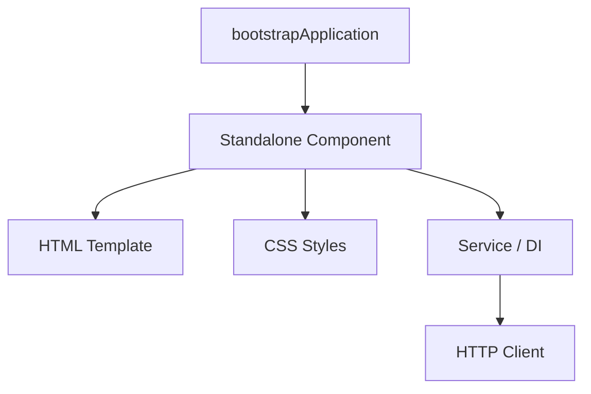
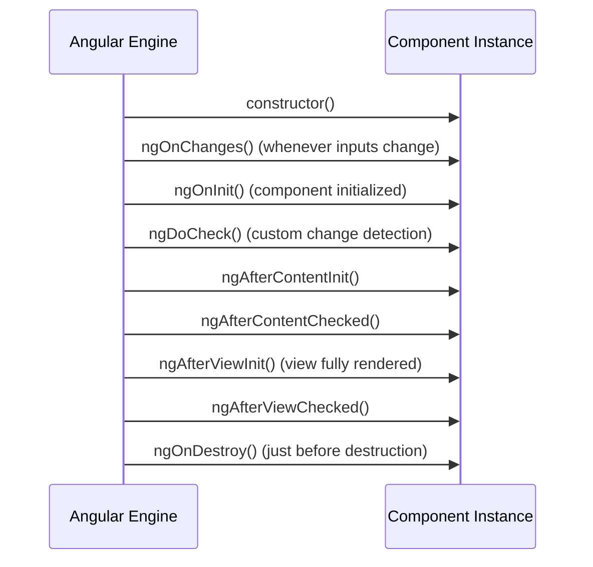

### 1. Angular Basics & Core Philosophies

Imagine you are building a planned township. You don't just need blueprints for the houses (components); you need zoning laws, centralized water systems (Services/DI), a road network (Routing), and garbage collection. You want everything pre-planned, structured, and regulated. That is **Angular**. 

Angular is a **component-based, TypeScript-first web framework** developed and maintained by Google. It is a **fully-featured framework** (often called "opinionated" or "batteries-included") because it provides official, built-in, out-of-the-box solutions for everything from routing to form validation and HTTP requests. This contrasts with React, which is a thin UI library that leaves ecosystem decisions to the developer.

<Callout type="warn" title="📋 Framework vs. Library">
A **framework** dictates the architecture, directory structure, and execution flow. It calls *your* code (Inversion of Control).  
A **library** is a tool you call from *your* code when and where you see fit. You control the application lifecycle and layout.
</Callout>

| Feature | Angular | React |
| --- | --- | --- |
| **Category** | Opinionated Framework | Flexible UI Library |
| **Language** | TypeScript (by default) | JavaScript / JSX / TypeScript |
| **Data Binding** | Two-way binding (`[(ngModel)]`) | One-way data flow (unidirectional) |
| **DOM Type** | Real DOM (with Incremental DOM / Ivy) | Virtual DOM (reconciliation) |
| **State Management** | Services, Signals, RxJS, NgRx | useState, Context, Redux, Zustand |
| **Routing & Forms** | Built-in (official modules) | Third-party (React Router, Formik, etc.) |
| **CLI** | Powerful (`ng generate`, `ng build`, `ng serve`) | Third-party templates or builders (Vite, Next.js) |

<Callout type="info" title="Key Concept">
"Angular is a JavaScript library" — **FALSE**. Angular is a TypeScript-based **framework**. React is the library.
</Callout>

<Quiz question={"Which of the following describes the difference between a Framework and a Library?"} options={["A framework is written in TypeScript, while a library is written in JavaScript", "A framework calls your code (inversion of control), while your code calls a library", "Libraries are only used for backend development", "Frameworks do not allow third-party package installations"]} answerIndex={1}>
A framework calls your code (inversion of control), dictating the architecture and lifecycle. A library is called by your code, leaving architectural choices to you.
</Quiz>

---

### 2. Angular Architecture

An Angular application is structured around a few core building blocks:



1. **Standalone Components (v14+ / Default)**: The modern unit of structure. Previously, Angular grouped elements inside complex modules (`@NgModule`). Today, components are standalone by default, declaring their own dependencies directly.
2. **Components**: The fundamental building block of the user interface. A component consists of:
   - A **TypeScript class** containing properties (state) and methods (logic).
   - An **HTML template** defining the visual structure.
   - **CSS styles** controlling visual design.
3. **Templates**: HTML code annotated with Angular-specific directives and binding expressions.
4. **Services**: Classes containing business logic or data-fetching code, designed to be shared across multiple components.
5. **Dependency Injection (DI)**: A design pattern where Angular instantiates services and injects them into components that request them, rather than the component instantiating them manually.

#### Standalone Component Example

```typescript
import { Component } from '@angular/core';
import { CommonModule } from '@angular/common';
import { FormsModule } from '@angular/forms';

@Component({
  selector: 'app-user-profile',      // Custom HTML tag to render this component
  standalone: true,                  // Marks it as a modern standalone component
  imports: [CommonModule, FormsModule], // Imports required modules directly
  templateUrl: './user-profile.component.html',
  styleUrls: ['./user-profile.component.css']
})
export class UserProfileComponent {
  username = 'Kamran';
}
```

<Callout type="info" title="💡 Why Standalone Components?">
Standalone components eliminate the boilerplate of `NgModule`. You no longer need to declare every component in a central module file; you simply import what you need inside the component's `@Component.imports` array.
</Callout>

<Quiz question={"Which metadata property in the `@Component` decorator is used to define the custom HTML tag for the component?"} options={["`tag`", "`name`", "`selector`", "`id`"]} answerIndex={2}>
The `selector` property defines the CSS selector that triggers the rendering of this component (e.g., `<app-user-profile>`).
</Quiz>

---

### 3. Data Binding

Data binding is the communication bridge between the TypeScript class (logic) and the HTML template (view). It controls how data flows between them.

```
+------------------------------------------+
|          TypeScript Class (TS)           |
+------------------------------------------+
    |                     ^            ^
    | (Interpolation /    | (Event     | (Two-way
    |  Property Binding)  |  Binding)  |  Binding)
    v                     |            v
+------------------------------------------+
|           HTML Template (View)           |
+------------------------------------------+
```

Angular supports **four distinct types of data binding**:

| Binding Type | Syntax | Direction | Description |
| --- | --- | --- | --- |
| **Interpolation** | `{{ property }}` | Component &rarr; View | Renders text values inside HTML elements. |
| **Property Binding** | `[property]="value"` | Component &rarr; View | Binds values to DOM properties or component inputs. |
| **Event Binding** | `(event)="handler()"` | View &rarr; Component | Listens for user interactions (clicks, keypresses) and runs class methods. |
| **Two-way Binding** | `[(ngModel)]="property"` | Component &hArr; View | Synchronizes inputs and class properties automatically. |

#### Code Examples

```html
<!-- 1. Interpolation: Renders text dynamically -->
<h1>Welcome back, {{ username }}!</h1>

<!-- 2. Property Binding: Disables input if isLocked is true in TS -->
<input [disabled]="isLocked" placeholder="Enter password">

<!-- 3. Event Binding: Fires login() method on click -->
<button (click)="login()">Submit</button>

<!-- 4. Two-Way Data Binding: Keeps email variable in sync with input -->
<input [(ngModel)]="email" placeholder="Enter email">
<p>You typed: {{ email }}</p>
```

<Callout type="error" title="⚠️ Two-way Binding Gotcha">
To use `[(ngModel)]` in your templates, you **must import `FormsModule`** from `@angular/forms` into your component's `imports` array. Otherwise, Angular will throw a compilation error:  
`Can't bind to 'ngModel' since it isn't a known property of 'input'`.
</Callout>

<Callout type="info" title="🍌 Banana in a Box Rule">
An easy way to remember the syntax for two-way data binding: the parentheses (banana) go inside the square brackets (box) &rarr; `[(ngModel)]`.
</Callout>

<Quiz question={"Which module must be imported to resolve the error: \"Can't bind to 'ngModel' since it isn't a known property of 'input'\"?"} options={["`CommonModule`", "`ReactiveFormsModule`", "`FormsModule`", "`BrowserModule`"]} answerIndex={2}>
`FormsModule` from `@angular/forms` provides the directive `ngModel` required for two-way data binding.
</Quiz>

---

### 4. Directives

Directives are instructions in the HTML template that tell Angular how to manipulate or change the DOM. They fall into three categories:

1. **Component Directives**: A component is simply a directive with an attached template (using the `@Component` decorator).
2. **Structural Directives**: Add, remove, or modify elements in the DOM. Traditionally prefixed with an asterisk (`*`).
3. **Attribute Directives**: Modify the appearance or behavior of an existing element (e.g., changing styles, classes, or attributes dynamically).

#### Structural Control Flow: Traditional vs Modern (v17+)

In Angular 17, a faster, compiler-based **Control Flow** syntax was introduced. It replaces traditional structural directives (`*ngIf`, `*ngFor`, `*ngSwitch`) with clean, native `@` blocks.

| Concept | Traditional Syntax (requires `CommonModule`) | Modern Syntax (Built-in, v17+) |
| --- | --- | --- |
| **Conditional** | `<div *ngIf="isLoggedIn">Welcome</div>` | `@if (isLoggedIn) { <div>Welcome</div> }` |
| **Loops** | `<li *ngFor="let item of items">{{ item }}</li>` | `@for (item of items; track item.id) { <li>{{ item }}</li> }` |
| **Switch** | `<div [ngSwitch]="role"><span *ngSwitchCase="'admin'">Admin</span></div>` | `@switch (role) { @case ('admin') { <span>Admin</span> } }` |

#### Detailed Modern Control Flow Examples

```html
<!-- 1. Conditional flow -->
@if (role === 'admin') {
  <p>Welcome, Administrator!</p>
} @else if (role === 'editor') {
  <p>Welcome, Editor!</p>
} @else {
  <p>Welcome, Guest!</p>
}

<!-- 2. Loops with track statement (MANDATORY in v17+) -->
<ul>
  @for (user of users; track user.id) {
    <li>{{ user.name }} - Index: {{ $index }}</li>
  } @empty {
    <li>No users found.</li>
  }
</ul>
```

<Callout type="error" title="⚠️ Why is track mandatory?">
The `track` expression is mandatory in `@for` loops. It tells Angular how to uniquely identify each item in the array (usually by a unique `id` property). This allows the rendering engine (Ivy) to only re-render the specific DOM nodes that changed when the array is modified, instead of destroying and rebuilding the entire list.
</Callout>

#### Attribute Directives: `ngClass` & `ngStyle`

Attribute directives change the appearance or behavior of an existing DOM element:
- `ngClass`: Adds or removes a set of CSS classes dynamically.
- `ngStyle`: Adds or removes a set of inline CSS styles dynamically.

```html
<!-- ngClass: Applies 'active' class if isActive is true, 'disabled' if isDisabled is true -->
<div [ngClass]="{ 'active': isActive, 'disabled': isDisabled }">
  Status Box
</div>

<!-- ngStyle: Applies dynamic color and font size -->
<p [ngStyle]="{ 'color': isError ? 'red' : 'green', 'font-size.px': size }">
  Operation Message
</p>
```

<Quiz question={"Which of the following is TRUE about the new Angular 17 control flow syntax?"} options={["It requires importing `CommonModule` into your component", "The `track` parameter is optional in `@for` loops", "It runs faster than traditional directives because it is handled at compile-time", "It uses the `*` prefix like traditional directives"]} answerIndex={2}>
The modern `@` control flow is built directly into the Angular compiler. It is faster, does not require importing `CommonModule`, and makes the `track` parameter mandatory for `@for` loops to maximize performance.
</Quiz>

---

### 5. Component Lifecycle Hooks

Every component in Angular goes through a lifecycle from creation (instantiation) to destruction (removal from the DOM). Angular provides lifecycle hooks that let you run custom logic at specific stages.



#### Key Lifecycle Hooks Reference

| Hook | Executed | Common Use Case |
| --- | --- | --- |
| **`ngOnChanges()`** | Before `ngOnInit()` and whenever data-bound input properties (`@Input`) change. | Reacting to parent component data updates. |
| **`ngOnInit()`** | Once after Angular has initialized all data-bound properties. | Fetching initial data from services/APIs. |
| **`ngDoCheck()`** | During every change detection run, immediately after `ngOnChanges()` and `ngOnInit()`. | Custom change detection for changes Angular misses. |
| **`ngAfterViewInit()`**| Once after Angular has fully initialized the component's views and child views. | Querying DOM elements via `@ViewChild`. |
| **`ngOnDestroy()`** | Just before Angular destroys the component. | Unsubscribing from Observables and clearing timers to prevent **memory leaks**. |

#### constructor vs ngOnInit

A common point of confusion is the difference between the class `constructor()` and the `ngOnInit()` hook.

- **`constructor()`**: A standard TypeScript class feature. It is called when the class is instantiated. However, at this point, the component's inputs (`@Input()`) and bindings are not yet initialized. Use the constructor only for dependency injection.
- **`ngOnInit()`**: An Angular hook. It is called after Angular has initialized all input properties. This is where you should write initialization logic and fetch API data.

```typescript
export class UserComponent implements OnInit {
  @Input() userId!: string;

  constructor(private http: HttpClient) {
    // WRONG: this.userId is undefined here!
  }

  ngOnInit() {
    // RIGHT: inputs are ready. Fetch data.
    this.http.get(`/api/users/${this.userId}`).subscribe(data => {
      console.log(data);
    });
  }
}
```

<Callout type="error" title="⚠️ Memory Leak Prevention">
If you subscribe to an RxJS Observable manually inside a component, you **must unsubscribe** in `ngOnDestroy()`. Otherwise, the subscription lives on in memory even after the component is destroyed, leading to performance degradation.
</Callout>

<Quiz question={"Which lifecycle hook is called whenever one of the component's `@Input()` properties changes?"} options={["`ngOnInit()`", "`ngOnChanges()`", "`ngAfterViewInit()`", "`ngDoCheck()`"]} answerIndex={1}>
`ngOnChanges()` is triggered before `ngOnInit()` and whenever any input property changes, receiving a `SimpleChanges` object detailing the previous and current values.
</Quiz>

---

### 6. Dependency Injection (DI) & Services

Imagine you run a restaurant. Instead of each chef leaving the kitchen to fetch raw ingredients from a market (creating service instances inside components), you hire a centralized delivery provider (Angular's Dependency Injection system) that delivers ingredients directly to the kitchen on demand.

In Angular, a **Service** is a class containing reusable logic. To make a class injectable, annotate it with the `@Injectable()` decorator.

```typescript
// data.service.ts
import { Injectable } from '@angular/core';

@Injectable({
  providedIn: 'root' // Singleton: tells Angular to create a single instance app-wide
})
export class DataService {
  getData() {
    return ['Item 1', 'Item 2', 'Item 3'];
  }
}
```

#### How to Inject a Service

Angular supports two ways to inject services inside standalone components (Angular 14+):

1. **Classic Constructor Injection**:
```typescript
import { Component, OnInit } from '@angular/core';
import { DataService } from './data.service';

@Component({
  selector: 'app-item-list',
  standalone: true
})
export class ItemListComponent implements OnInit {
  items: string[] = [];

  constructor(private dataService: DataService) {}

  ngOnInit() {
    this.items = this.dataService.getData();
  }
}
```

2. **Modern `inject()` Function**:
```typescript
import { Component, OnInit, inject } from '@angular/core';
import { DataService } from './data.service';

@Component({
  selector: 'app-item-list',
  standalone: true
})
export class ItemListComponent implements OnInit {
  // Cleaner, no constructor needed!
  private dataService = inject(DataService);
  items: string[] = [];

  ngOnInit() {
    this.items = this.dataService.getData();
  }
}
```

<Callout type="info" title="💡 Hierarchical Injector Scopes">
- `providedIn: 'root'`: The service is a **Singleton** (one single instance shared app-wide).
- Component-level provider: Specifying `providers: [DataService]` in a component's decorator tells Angular to create a **new instance** of the service for this component and its child components. Once the component is destroyed, that instance is also destroyed.
</Callout>

<Quiz question={"What is the default scope of a service registered with `@Injectable({ providedIn: 'root' })`?"} options={["A new instance is created for every component that requests it", "It is scoped only to the main module", "It is a Singleton, meaning a single shared instance is created app-wide", "It is scoped to the current user session"]} answerIndex={2}>
`providedIn: 'root'` registers the service as a singleton, ensuring the entire application shares one single instance of the service.
</Quiz>

---

### 7. Pipes

Pipes are template utilities used to transform and format data directly inside the HTML markup, without modifying the underlying value in the TypeScript class.

```html
<!-- 1. Formatting text to uppercase -->
<p>Name: {{ username | uppercase }}</p>

<!-- 2. Formatting currency (Output: ₹1,500.00) -->
<p>Price: {{ amount | currency:'INR' }}</p>

<!-- 3. Formatting date -->
<p>Today is: {{ today | date:'dd-MM-yyyy' }}</p>

<!-- 4. Chaining pipes: Uppercase first, then slice characters index 0 to 5 -->
<p>{{ title | uppercase | slice:0:5 }}</p>
```

#### Pure vs. Impure Pipes

| Pipe Type | Description | Performance |
| --- | --- | --- |
| **Pure Pipe** (Default) | Angular executes the pipe *only* when it detects a pure change to the input value (e.g., a change to a primitive type like string, number, or object reference). | Highly optimized. |
| **Impure Pipe** | Angular executes the pipe on *every* change detection cycle, regardless of whether the inputs changed. | Can cause significant slowdown if the pipe contains heavy logic. |

```typescript
// Custom Pure Pipe Example
import { Pipe, PipeTransform } from '@angular/core';

@Pipe({
  name: 'exponent',
  standalone: true,
  pure: true // Runs only when base or exponent changes
})
export class ExponentPipe implements PipeTransform {
  transform(base: number, exponent: number = 1): number {
    return Math.pow(base, exponent);
  }
}
```

#### The `async` Pipe

One of the most important pipes in Angular is the `async` pipe. It automatically subscribes to an RxJS `Observable` or `Promise` directly in the template, extracts the emitted values, and **automatically unsubscribes** when the component is destroyed, completely eliminating memory leaks.

```html
<!-- status$ is an Observable inside UserComponent -->
<p>Current Status: {{ status$ | async }}</p>
```

<Quiz question={"Why is the `async` pipe preferred for handling Observables in templates?"} options={["It formats the data into JSON automatically", "It automatically subscribes and unsubscribes, preventing memory leaks", "It speeds up API response times", "It bypasses Angular's change detection"]} answerIndex={1}>
The `async` pipe manages the subscription lifecycle automatically, subscribing to the observable and unsubscribing when the component is destroyed to prevent memory leaks.
</Quiz>

---

### 8. Asynchronous Programming with RxJS

Angular relies heavily on **RxJS (Reactive Extensions for JavaScript)** for asynchronous operations, including HTTP requests and state events. 

#### Observable vs. Promise

- **Promise**: Handles a single asynchronous event. Once resolved, it cannot emit any further values. It is eager (runs immediately upon creation).
- **Observable**: A stream of data that can emit **zero, one, or multiple values** over time. It is cold by default (does nothing until you `.subscribe()` to it).

```
Promise:    [------------(Single Value)------------>] (Complete)
Observable: [-----(Value 1)-----(Value 2)-----(Value 3)----->] (Continuous stream)
```

#### Core RxJS Operators

Operators are functions that transform or manipulate data streams:
- `map`: Transforms each emitted value (e.g., multiplying numbers or extracting properties).
- `filter`: Emits only values that pass a specific condition.
- `switchMap`: Cancels the current internal observable stream and switches to a new one (perfect for autocomplete searches where you only care about the latest keystroke request).
- `catchError`: Intercepts errors on a stream and handles them gracefully.

```typescript
import { inject } from '@angular/core';
import { HttpClient } from '@angular/common/http';
import { map, filter, catchError } from 'rxjs/operators';
import { of } from 'rxjs';

export class UserListComponent {
  private http = inject(HttpClient);

  fetchActiveUsers() {
    this.http.get<any[]>('/api/users').pipe(
      // 1. Filter out inactive users
      map(users => users.filter(u => u.isActive)),
      // 2. Catch errors and return an empty array fallback
      catchError(err => {
        console.error('Error fetching users:', err);
        return of([]); 
      })
    ).subscribe(activeUsers => {
      console.log('Active Users:', activeUsers);
    });
  }
}
```

#### Subjects vs. BehaviorSubjects

A **Subject** is a multicast Observable. Think of it like a radio station: listeners who tune in late only hear music played *after* they subscribed.
A **BehaviorSubject** is a Subject that remembers its last emitted value. New listeners immediately receive the **current value** as soon as they subscribe.

```typescript
import { BehaviorSubject } from 'rxjs';

const state$ = new BehaviorSubject<string>('Initial State');

state$.subscribe(val => console.log('Sub A:', val)); // Output: Sub A: Initial State
state$.next('Updated State');                        // Output: Sub A: Updated State

state$.subscribe(val => console.log('Sub B:', val)); // Output: Sub B: Updated State (receives current state immediately)
```

<Quiz question={"Which RxJS flattening operator cancels previous pending HTTP requests and switches to the latest one?"} options={["`mergeMap`", "`concatMap`", "`switchMap`", "`exhaustMap`"]} answerIndex={2}>
`switchMap` cancels the previous inner observable and switches to the new one, making it ideal for features like real-world search inputs.
</Quiz>

---

### 9. Forms: Template-driven vs. Reactive

Angular offers two separate paradigms for handling user inputs and validations:

| Feature | Template-Driven Forms | Reactive Forms |
| --- | --- | --- |
| **Setup** | Defined in the template (HTML-heavy) | Programmed in the TypeScript class (TS-heavy) |
| **Data Flow** | Asynchronous | Synchronous |
| **Validation** | Directive-based (`required`, `pattern`) | JavaScript validator functions |
| **Testing** | Hard (requires UI rendering) | Easy (tests class logic directly) |
| **Module** | `FormsModule` | `ReactiveFormsModule` |

#### Reactive Forms Example

```typescript
import { Component, inject } from '@angular/core';
import { ReactiveFormsModule, FormBuilder, Validators } from '@angular/forms';

@Component({
  selector: 'app-login-form',
  standalone: true,
  imports: [ReactiveFormsModule],
  template: `
    <form [formGroup]="loginForm" (ngSubmit)="onSubmit()">
      <div>
        <label>Email:</label>
        <input formControlName="email">
        @if (loginForm.get('email')?.invalid && loginForm.get('email')?.touched) {
          <small style="color: red;">Valid email is required</small>
        }
      </div>
      <button [disabled]="loginForm.invalid">Submit</button>
    </form>
  `
})
export class LoginFormComponent {
  private fb = inject(FormBuilder);

  loginForm = this.fb.group({
    email: ['', [Validators.required, Validators.email]]
  });

  onSubmit() {
    if (this.loginForm.valid) {
      console.log('Form Submitted!', this.loginForm.value);
    }
  }
}
```

<Quiz question={"Which form strategy is model-driven and defined inside the TypeScript class?"} options={["Template-Driven Forms", "Reactive Forms", "Directive Forms", "Static Forms"]} answerIndex={1}>
Reactive Forms are model-driven and defined directly inside the TypeScript class, providing synchronous data flow and easier unit testability.
</Quiz>

---

### 10. Routing & Route Guards

Angular's Router allows users to navigate between different pages without reloading the browser.

#### Routing Configuration

```typescript
// app.routes.ts
import { Routes } from '@angular/router';
import { HomeComponent } from './home.component';
import { AdminComponent } from './admin.component';
import { adminGuard } from './admin.guard';

export const routes: Routes = [
  { path: '', component: HomeComponent },
  
  // Lazy Loading a Standalone Component (v14+)
  { 
    path: 'dashboard', 
    loadComponent: () => import('./dashboard.component').then(m => m.DashboardComponent) 
  },
  
  // Guarded route
  { 
    path: 'admin', 
    component: AdminComponent, 
    canActivate: [adminGuard] 
  }
];
```

#### Navigation in Templates

```html
<!-- RouterOutlet renders the active route component -->
<nav>
  <a routerLink="/">Home</a> | 
  <a routerLink="/dashboard">Dashboard</a> |
  <a routerLink="/admin">Admin Portal</a>
</nav>

<hr>
<router-outlet></router-outlet>
```

#### Functional Route Guards (Modern v15+)

In modern Angular, class-based guards (`CanActivate` interface) are deprecated. Instead, guards are written as lightweight **functional guards**.

```typescript
// admin.guard.ts
import { inject } from '@angular/core';
import { CanActivateFn, Router } from '@angular/router';
import { AuthService } from './auth.service';

export const adminGuard: CanActivateFn = (route, state) => {
  const authService = inject(AuthService);
  const router = inject(Router);

  if (authService.isAdmin()) {
    return true; // Navigation allowed
  }

  // Redirect to login/home
  return router.parseUrl('/login');
};
```

<Quiz question={"Which function configuration allows a component to be lazy-loaded in Angular's routes?"} options={["`component: () => import(...)`", "`loadComponent: () => import(...)`", "`lazy: Component`", "`loadChildren: () => Component`"]} answerIndex={1}>
`loadComponent` is used in modern Angular routes to lazy load a single standalone component when the user navigates to its path.
</Quiz>

---

### 11. Modern Angular: Signals

Introduced in Angular 16, **Signals** are a brand new reactive model. Think of them like cells in an Excel spreadsheet. If cell `A1` contains a number, and cell `B1` contains the formula `=A1 * 10`, Excel automatically recalculates `B1` the millisecond you change `A1`.

Signals provide a reactive wrapper around variables, letting Angular track exactly where state is used in the DOM. This enables **Fine-Grained Change Detection**, allowing Angular to bypass Zone.js and update the DOM directly without checking the entire component tree.

#### Core Signal APIs

1. **Writable Signals (`signal`)**: A reactive value you can read and write to.
2. **Computed Signals (`computed`)**: Read-only signals derived from other signals.
3. **Effects (`effect`)**: Side-effect operations that run whenever their read signals change.

```typescript
import { Component, signal, computed, effect } from '@angular/core';

@Component({
  selector: 'app-counter',
  standalone: true,
  template: `
    <p>Count: {{ count() }}</p>
    <p>Double: {{ doubleCount() }}</p>
    <button (click)="increment()">Increment</button>
  `
})
export class CounterComponent {
  // 1. Define a writable signal
  count = signal<number>(0);

  // 2. Define a computed (derived) signal
  doubleCount = computed(() => this.count() * 2);

  constructor() {
    // 3. Define an effect (monitors signal changes)
    effect(() => {
      console.log(`Current count is: ${this.count()}`);
    });
  }

  increment() {
    // Updating the signal value
    this.count.update(val => val + 1);
  }
}
```

<Callout type="warn" title="📋 Signals vs. RxJS">
Signals are designed for **synchronous state tracking** within components (e.g., variables, calculations, UI states). RxJS is designed for **asynchronous event streams** (e.g., HTTP calls, web sockets, search inputs). They complement each other rather than compete.
</Callout>

<Quiz question={"How do you read the current value of a Signal in an HTML template or TS file?"} options={["`mySignal.value`", "`mySignal()` (by calling it as a function)", "`mySignal.get()`", "`*mySignal`"]} answerIndex={1}>
To read a signal, you invoke it like a function: `mySignal()`. This sets up a dependency link, letting Angular know that the caller needs to be notified if the signal changes.
</Quiz>

---

### 12. Angular Common Gotchas

<Callout type="error" title="1. Can't bind to 'ngModel' since it isn't a known property">
**The Trap:** Attempting to use `[(ngModel)]` in a standalone component without importing `FormsModule`.  
**The Solution:** Import `FormsModule` from `@angular/forms` inside the component's `@Component.imports` array.
</Callout>

<Callout type="error" title="2. No provider for HttpClient">
**The Trap:** Attempting to inject `HttpClient` inside a service/component without registering the HTTP client provider during bootstrapping.  
**The Solution:** In your `main.ts` file, add `provideHttpClient()` to the application configuration:
```typescript
bootstrapApplication(AppComponent, {
  providers: [provideHttpClient()]
});
```
</Callout>

<Callout type="error" title="3. Async Pipe compilation errors">
**The Trap:** Using the `async` pipe in a template but forgetting to import `CommonModule` (or `AsyncPipe`) in the component.  
**The Solution:** Standalone components must explicitly import `CommonModule` or `AsyncPipe` from `@angular/common` to utilize them in HTML templates.
</Callout>

<Callout type="warn" title="💡 Key Facts to Remember">
- **Ivy** is the name of Angular's rendering and compiler engine.
- **Zone.js** is the library Angular uses to intercept asynchronous APIs (like clicks, timeouts, requests) and trigger automatic change detection.
- **OnPush** change detection strategy tells Angular to check a component *only* if its `@Input()` references change or an event fires from within the component.
- **Interpolation** uses double curly braces `{{ }}`.
- **Property binding** uses square brackets `[prop]`.
- **Event binding** uses parentheses `(click)`.
</Callout>
