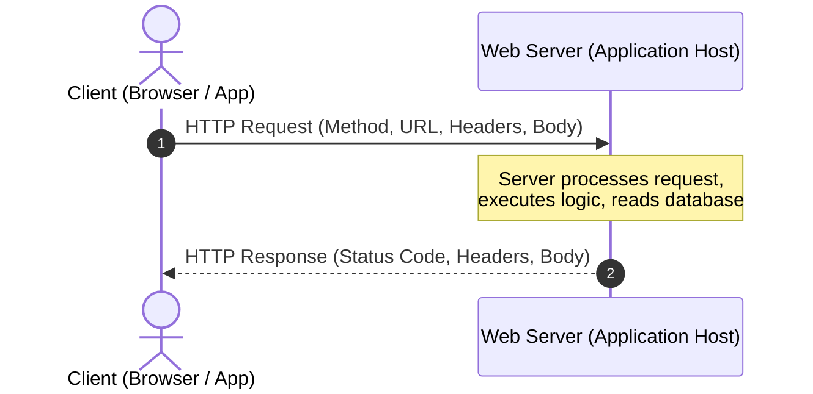

## 1. Client-Server Architecture

In modern web development, applications operate on a **client-server model**:

* **Client**: The requesting entity (e.g., web browser, mobile application, Postman, CLI tool).
* **Server**: The processing entity (e.g., Java application running on a remote host or cloud instance).



### Analogy: A Restaurant Ordering System

Think of backend application architecture as a restaurant:

| Technical Component | Real-World Equivalent | Role |
| :--- | :--- | :--- |
| **Client** | Customer | Initiates the request by asking for a service or resource. |
| **HTTP Request** | Customer's Order Form | Formatted document stating what item is requested and giving options. |
| **Server Host** | Restaurant Building | Physical location providing infrastructure. |
| **IP Address** | Street Address | Unique location locator on the global network. |
| **Port** | Entrance Door / Service Counter | Specific listening endpoint for a given service. |
| **HTTP Response** | Served Meal + Receipt | The result returned to the customer, complete with metadata and status. |

---

## 2. Networking Primitives: IP, Ports, Sockets & URLs

### IP Addresses (`127.0.0.1` vs External)

An **IP (Internet Protocol) Address** uniquely identifies a physical or virtual machine on a network.
* **Public/Private IP**: e.g., `192.168.1.50` or `172.217.14.206`.
* **Loopback IP (`127.0.0.1`)**: A special IP address reserved for a host to refer to **itself**. `localhost` is a domain name that resolves to `127.0.0.1`.

### Port Numbers

While an IP address gets network packets to a specific **computer**, a computer runs hundreds of processes simultaneously. A **Port Number** (0–65535) routes traffic to a specific **application process**.

```text
IP Address (Building)  -->  Port Number (Apartment Number / Door)
192.168.1.100                :8080 (Spring Boot Application)
                             :5432 (PostgreSQL Database)
                             :3306 (MySQL Database)
```

#### Common Standard Ports

| Protocol / Application | Default Port |
| :--- | :--- |
| **HTTP** | `80` (Browsers omit this automatically) |
| **HTTPS** | `443` (Browsers omit this automatically) |
| **SSH** | `22` |
| **Spring Boot Embedded Server** | `8080` (Default dev port) |
| **PostgreSQL** | `5432` |

### URL Anatomy

A **URL (Uniform Resource Locator)** decomposes into specific structural components:

```text
  http:// localhost : 8080 /api/v1/users ? status=active # profile
  │───┘   │───────┘   └──┘ └───────────┘ └──────────────┘ └──────┘
Scheme    Host        Port     Path       Query Params    Fragment
```

1. **Scheme/Protocol**: `http://` or `https://` (Defines communication protocol).
2. **Host**: `localhost` or `api.example.com` (Identifies target server).
3. **Port**: `:8080` (Target application socket door).
4. **Path**: `/api/v1/users` (Identifies target resource endpoint).
5. **Query Parameters**: `?status=active` (Key-value filter parameters).
6. **Fragment/Hash**: `#profile` (Client-side UI anchor, never sent to server).

---

## 3. HTTP: The Language of the Web

**HTTP (HyperText Transfer Protocol)** is an application-layer, stateless request-response protocol running on top of **TCP/IP**.

### Analogy: A Courier Package

An HTTP transmission behaves like sending a parcel:

```text
Courier Package
├── Label (Headers)
│   ├── Destination / Path
│   ├── Content-Type (JSON, HTML)
│   └── Sender Credentials (Auth Token)
└── Contents (Body)
    └── Payload Data
```

### HTTP Request Structure

An HTTP request consists of four primary parts:
1. **HTTP Method**: Verb defining desired action.
2. **Path / URL**: Target resource identifier.
3. **Headers**: Key-value metadata.
4. **Body**: Payload (optional in GET/DELETE, mandatory in POST/PUT/PATCH).

```http
POST /api/v1/orders HTTP/1.1
Host: api.store.com
Content-Type: application/json
Authorization: Bearer eyJhbGciOi...

{
  "productId": 4021,
  "quantity": 2
}
```

### HTTP Methods & Semantic Rules

| Method | Intended Meaning | Idempotent? | Safe? | Request Body? |
| :--- | :--- | :---: | :---: | :---: |
| **GET** | Read data from server | **Yes** | **Yes** | No |
| **POST** | Create a new resource | **No** | **No** | Yes |
| **PUT** | Replace target resource completely | **Yes** | **No** | Yes |
| **PATCH** | Update specific fields partially | **No** | **No** | Yes |
| **DELETE** | Remove target resource | **Yes** | **No** | Optional |

> **Idempotency Rule**: An operation is **idempotent** if making the same request multiple times produces the exact same side-effect on the server as making it once. `PUT` is idempotent (replacing a file 10 times yields the same state); `POST` is non-idempotent (creating 10 orders yields 10 database rows).

#### `PUT` vs `PATCH` Engineering Distinction

* `PUT` replaces the **entire object state**. Omitted fields are reset to default/null.
* `PATCH` updates **only specified attributes**, leaving existing attributes untouched.

---

## 4. HTTP Headers & Status Codes

### Key Headers

| Header Category | Key Header | Usage |
| :--- | :--- | :--- |
| **Content Negotiation** | `Content-Type` | Tells receiver format of current body (e.g., `application/json`). |
| **Content Negotiation** | `Accept` | Tells server format client expects in response (e.g., `application/json`). |
| **Security / Auth** | `Authorization` | Passes identity tokens (e.g., `Bearer <token>`, `Basic <base64>`). |
| **Host Routing** | `Host` | Virtual host name of target server. |
| **Caching** | `Cache-Control` | Directives for browser/CDN caching policies. |

### HTTP Status Code Taxonomy

Status codes are 3-digit numerical responses indicating result categories:

```text
Status Code Ranges:
├── 1xx (Informational) -> Protocol switching, processing
├── 2xx (Success)       -> 200 OK, 201 Created, 204 No Content
├── 3xx (Redirection)   -> 301 Moved Permanently, 304 Not Modified
├── 4xx (Client Error)  -> 400 Bad Request, 401 Unauthorized, 403 Forbidden, 404 Not Found
└── 5xx (Server Error)  -> 500 Internal Server Error, 502 Bad Gateway, 503 Service Unavailable
```

| Status Code | Name | Description & Usage |
| :--- | :--- | :--- |
| `200 OK` | Request Succeeded | Standard response for GET, PUT, PATCH, DELETE operations. |
| `201 Created` | Resource Created | Standard response for successful POST creation. |
| `204 No Content` | Executed, No Body | Request succeeded, but response body is empty (common for DELETE). |
| `400 Bad Request` | Client Payload Error | Invalid JSON, missing required body field, validation failure. |
| `401 Unauthorized` | Unauthenticated | Missing or invalid authentication token. |
| `403 Forbidden` | Access Denied | Client authenticated, but lacks permissions for resource. |
| `404 Not Found` | Endpoint/Resource Missing | Invalid URL path, or database ID does not exist. |
| `500 Server Error` | Application Crash | Unhandled Exception thrown on server thread. |

---

## ❓ Knowledge Check

<Quiz question="What is the key semantic difference between HTTP PUT and HTTP PATCH?" options={["PUT is used for creating data while PATCH is used for reading data", "PUT replaces the entire resource completely, whereas PATCH updates only specified fields partially", "PATCH is idempotent, whereas PUT is non-idempotent", "PUT can only accept XML, whereas PATCH can only accept JSON"]} answerIndex={1}>
HTTP `PUT` specifies complete replacement of the target resource state, whereas `PATCH` specifies partial modification of only the fields supplied in the request body.
</Quiz>

<Quiz question="Which component of a URL tells the operating system which specific application process should receive incoming network traffic?" options={["Scheme / Protocol", "Host / Domain", "Port Number", "Query Parameter"]} answerIndex={2}>
While the Host/IP address locates the physical computer, the **Port Number** specifies the exact application socket listening for network traffic on that host.
</Quiz>
