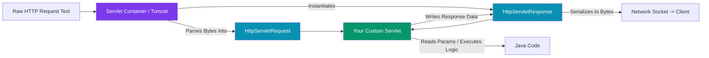
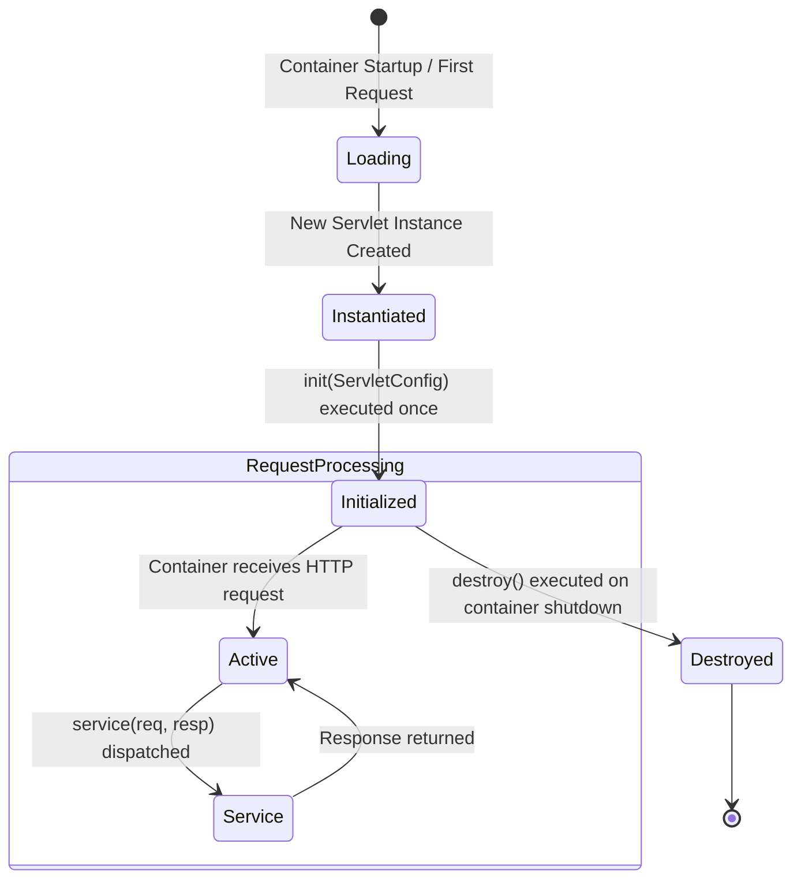
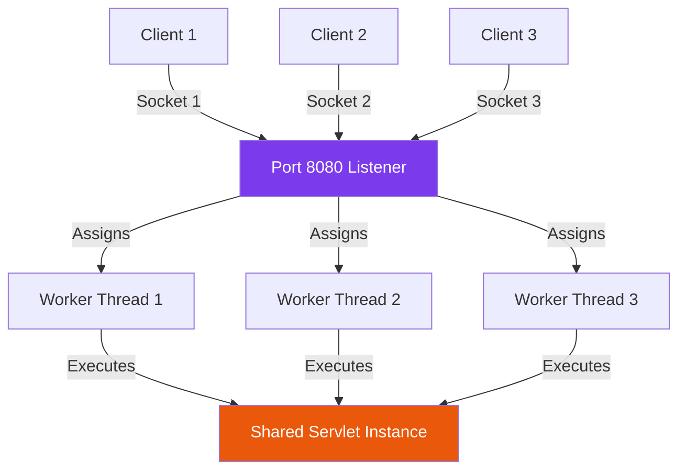

## 1. Why Core Java Alone Is Not a Web Framework

If you write a pure Java class with methods and compile it into `.class` files, it does **not** automatically understand web traffic.

```text
Java Language Capability:          Web Requirement:
├── Object creation                 ├── Listening on port 8080 continuously
├── Memory management               ├── Accepting concurrent TCP socket connections
├── Business logic execution        ├── Parsing HTTP text bytes into Java objects
└── Calculations                    └── Routing paths (/users) to Java methods
```

### Low-Level Java Networking: `ServerSocket`

To accept HTTP requests using only pure Java, a developer must manually write raw TCP socket networking:

```java
public class LowLevelHttpServer {
    public static void main(String[] args) throws IOException {
        // 1. Bind to TCP Port 8080
        ServerSocket serverSocket = new ServerSocket(8080);
        System.out.println("Server listening on port 8080...");

        while (true) {
            // 2. Block thread until a client connects
            Socket clientSocket = serverSocket.accept();
            
            // 3. Read raw byte stream from socket
            BufferedReader reader = new BufferedReader(
                new InputStreamReader(clientSocket.getInputStream())
            );
            
            String line = reader.readLine(); // e.g. "GET /hello HTTP/1.1"
            System.out.println("Received raw HTTP text: " + line);

            // 4. Manually construct raw HTTP text response
            OutputStream out = clientSocket.getOutputStream();
            String httpResponse = "HTTP/1.1 200 OK\r\n" +
                                 "Content-Type: text/plain\r\n" +
                                 "Content-Length: 12\r\n\r\n" +
                                 "Hello World!";
            out.write(httpResponse.getBytes(StandardCharsets.UTF_8));
            out.flush();
            clientSocket.close();
        }
    }
}
```

### The Problem With Raw Sockets

If developers wrote web apps using pure `ServerSocket`, every engineering team would have to reinvent:
1. **HTTP Protocol Parsing**: Parsing headers, multipart form data, chunked encoding, query strings.
2. **Multithreading**: Managing thread allocation, connection timeouts, thread pool exhaustions.
3. **URL Routing**: String matching `/api/users` vs `/api/orders`.
4. **Error Handling**: Formatted 404, 500 responses for malformed bytes.

This low-level requirement led to the creation of **Servlets** and **Servlet Containers**.

---

## 2. Servlets: The Web Translation Layer

A **Servlet** (`jakarta.servlet.Servlet`) is a standard Java interface designed to process network requests and generate responses. It acts as the **translation layer** between raw HTTP bytes and Java code.



### Standard `HttpServlet` Code

```java
import jakarta.servlet.http.HttpServlet;
import jakarta.servlet.http.HttpServletRequest;
import jakarta.servlet.http.HttpServletResponse;
import java.io.IOException;

public class UserServlet extends HttpServlet {

    @Override
    protected void doGet(HttpServletRequest request, HttpServletResponse response) 
            throws IOException {
        
        // 1. Read request parameters parsed by container
        String userId = request.getParameter("id");
        
        // 2. Set response metadata
        response.setContentType("application/json");
        response.setStatus(HttpServletResponse.SC_OK);
        
        // 3. Write payload
        response.getWriter().write("{\"id\": " + userId + ", \"name\": \"Alice\"}");
    }
}
```

---

## 3. Servlet Containers (Web Application Servers)

A **Servlet Container** (also called a Web Container) is the runtime environment that manages the lifecycle of Servlets, listens to network ports, handles thread pools, and dispatches HTTP requests.

Examples of Servlet Containers:
* **Apache Tomcat** (Default embedded container in Spring Boot)
* **Eclipse Jetty**
* **Red Hat Undertow**

### Responsibilities of a Servlet Container

```text
Servlet Container Core Duties:
├── 1. Network Socket Management   -> Binds to port 8080 and accepts TCP connections.
├── 2. Thread Pool Management      -> Maintains a pool of worker threads (e.g. 200 threads).
├── 3. HTTP Parsing                -> Converts incoming HTTP text streams into HttpServletRequest.
├── 4. Lifecycle Management        -> Loads, initializes (init()), and destroys servlets.
└── 5. Request Dispatching         -> Maps URL patterns (/users/*) to target Servlet instances.
```

### The Servlet Lifecycle

Servlets are instantiated and managed exclusively by the container:



1. **Instantiation**: The container loads the Servlet class and calls its zero-arg constructor.
2. **Initialization (`init()`)**: Executed **once** after instantiation. Used for expensive startup tasks.
3. **Request Servicing (`service()`)**: Executed on **every incoming request** across worker threads. Dispatches to `doGet()`, `doPost()`, etc.
4. **Destruction (`destroy()`)**: Executed **once** when the container shuts down to release resources.

---

## 4. Thread-Per-Request Execution Model

By default, traditional Servlet Containers like Tomcat operate on a **Thread-per-Request** model:



### Concurrency Trap: Servlets Are Singletons!

Because the container creates only **ONE instance** of each Servlet and shares it across hundreds of worker threads concurrently:

> [!CAUTION]
> **Never store request-specific state in Servlet instance variables!**
> If a Servlet has a class member variable `private String currentUsername;`, Thread A will overwrite Thread B's username, causing catastrophic data leaks across users. Servlets must remain **stateless**.

---

## ❓ Knowledge Check

<Quiz question="What happens when 50 clients send HTTP requests simultaneously to a Java Servlet running inside Apache Tomcat?" options={["Tomcat instantiates 50 distinct copies of the Servlet class", "Tomcat uses a worker thread pool to process requests concurrently against a single shared, stateless instance of the Servlet", "Tomcat processes requests sequentially on one thread, causing 49 requests to fail", "Tomcat converts the Java application into a C executable"]} answerIndex={1}>
Tomcat creates **one shared instance** of the Servlet and dispatches concurrent worker threads to invoke its `service()` method. Thus, Servlets must be strictly stateless.
</Quiz>

<Quiz question="Which method in the Servlet lifecycle is executed exactly once during container startup/first load?" options={["doGet()", "service()", "init()", "destroy()"]} answerIndex={2}>
The `init()` method is invoked **once** by the container after instantiation to perform initial setups before any HTTP requests are processed.
</Quiz>
