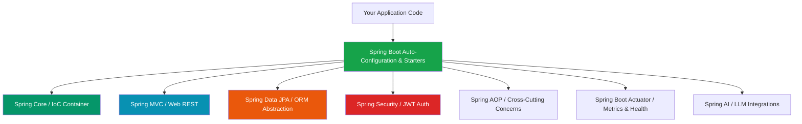

Understanding Spring Boot requires understanding the architectural history of Java enterprise development: **why Spring was created in 2003, and why Spring Boot was created in 2014 to revolutionize Spring itself.**

## 1. Historical Evolution: Why Was Spring Created?

In the early 2000s, Java Enterprise Edition (J2EE) relied on **Enterprise JavaBeans (EJB 2.x)** for server-side business logic. 

```text
EJB 2.x Architecture (Early 2000s):
├── Extremely verbose XML descriptor files (ejb-jar.xml).
├── Mandatory inheritance of heavy framework interfaces (EntityBean, SessionBean).
├── Hard to unit test outside heavy application servers (WebLogic, WebSphere).
└── High coupling between business logic and framework runtime.
```

In 2002, Rod Johnson published *Expert One-on-One J2EE Design and Development*, introducing a lightweight framework based on **POJOs (Plain Old Java Objects)**, **Inversion of Control (IoC)**, and **Dependency Injection (DI)**. This became the **Spring Framework**.

### Analogy: Workshop Evolution

```text
1. Manual Workshop (Raw Java / Servlets):
   Construct every tool by hand, wire sockets, write manual routing tables.

2. Heavy Machinery Factory (EJB 2.x):
   Powerful, but requires huge expensive machinery, rigid blueprints, and complex setup.

3. Modular Assembly Line (Spring Framework):
   Clean POJO components automatically wired together by an IoC Container.

4. Turn-Key Smart Factory (Spring Boot):
   Press one button. Auto-configures appliances, embeds power generators, and starts production immediately.
```

---

## 2. Spring Ecosystem Stack Architecture

The **Spring Ecosystem** is a modular collection of enterprise libraries built around **Spring Core**:



| Layer / Sub-project | Primary Responsibility | Key Annotations / Abstractions |
| :--- | :--- | :--- |
| **Spring Core** | IoC Container, Dependency Injection, Bean Lifecycle | `@Component`, `@Autowired`, `@Bean`, `@Configuration` |
| **Spring MVC** | HTTP Request Routing, REST Controllers, Content Negotiation | `@RestController`, `@GetMapping`, `@PostMapping`, `@PathVariable` |
| **Spring Data JPA** | Repositories, DB Abstraction, Automatic SQL Query Generation | `JpaRepository`, `@Entity`, `@Transactional`, `@Query` |
| **Spring Security** | Authentication, Authorization, Filter Chains, OAuth2/JWT | `SecurityFilterChain`, `AuthenticationManager`, `@PreAuthorize` |
| **Spring AOP** | Aspect-Oriented Programming (Logging, Transactions, Security) | `@Aspect`, `@Around`, `@Before`, `@Pointcut` |
| **Spring Boot Actuator** | Operational Monitoring, Health Metrics, Production Diagnostics | `/actuator/health`, `/actuator/metrics`, `/actuator/prometheus` |

---

## 3. What Problem Does Spring Boot Solve?

While the traditional Spring Framework brought loose coupling, configuring a enterprise Spring application in the early 2010s required **hundreds of lines of XML or Java `@Configuration` code**, manual Servlet registration, and external application server deployment (WAR files deployed to Tomcat/GlassFish).

**Spring Boot** was introduced to solve this configuration overhead through three core pillars:

```text
Spring Boot Core Pillars:
├── 1. Starter Dependencies       -> Curated dependency bundles (spring-boot-starter-web)
├── 2. Auto-Configuration         -> Intelligent defaults (@EnableAutoConfiguration)
└── 3. Embedded Web Server        -> Self-contained executable JAR (Embedded Tomcat/Jetty)
```

### The Rule to Memorize

> **Spring Boot is NOT a replacement for the Spring Framework.**
> Spring Boot is an **automation and bootstrapping layer** on top of the Spring Framework ecosystem. It uses traditional Spring capabilities under the hood, but automates setup through opinionated defaults.

---

## 4. What Does "Opinionated" Mean?

Spring Boot is described as **opinionated**. This means the framework comes with pre-selected production defaults so you do not have to make hundreds of decisions before writing code.

| Configuration Area | Unopinionated (Traditional Spring) | Opinionated Default (Spring Boot) |
| :--- | :--- | :--- |
| **Web Server** | Select, install, and configure external server. | Embedded **Apache Tomcat** on port `8080`. |
| **JSON Parser** | Choose Jackson, Gson, or Fastjson; write HttpMessageConverter. | Pre-configured **Jackson (`ObjectMapper`)**. |
| **Database Connection** | Manually setup DataSource, Driver, Connection Pool. | Auto-detects HikariCP pool if DB driver is on classpath. |
| **Logging** | Setup Logback, Log4j2, or SLF4J bindings manually. | Pre-configured **SLF4J with Logback**. |

* **Customization**: If you disagree with Spring Boot's opinion (e.g., you prefer Jetty over Tomcat, or Gson over Jackson), you can override any default easily in `pom.xml` or `application.properties`.

---

## 5. Embedded Server vs External Server Deployment

### Traditional WAR Deployment (Pre-Spring Boot)
1. Developers compile application into a `.war` (Web Application Archive).
2. Operations installs Apache Tomcat server on target Linux virtual machine.
3. Operations deploys `.war` file into Tomcat's `webapps/` folder.
4. Server mismatch issues: App developed on Tomcat 8 fails on Tomcat 7 in production.

### Spring Boot Executable JAR Deployment
1. Spring Boot packages application code **AND Tomcat inside a single executable `.jar` file**.
2. Run anywhere with standard Java: `java -jar application.jar`.
3. Perfect for Docker containers, Cloud environments, and CI/CD pipelines.

```mermaid
graph TD
    subgraph Executable JAR File
        AppCode[Your Application .class Files]
        SpringLibs[Spring Framework Libraries]
        EmbedTomcat[Embedded Apache Tomcat Server]
    end

    Executable JAR File -->|Executes Directly| JVM[Java Virtual Machine / Docker Container]

    style Executable JAR File fill:#7c3aed,color:#fff
    style EmbedTomcat fill:#ea580c,color:#fff
```

---

## 6. Spring Boot & Microservices Alignment

Is Spring Boot exclusively for Microservices? **No.**

* **Monolith vs Microservice**: Spring Boot builds both modular monolithic applications and distributed microservices with equal efficiency.
* **Why Microservices Love Spring Boot**: Microservice architectures require dozens or hundreds of small, independent web services. Spring Boot's lightweight executable JARs, fast startup, embedded servers, and Spring Cloud integration make it the industry standard for Java microservices.

---

## ❓ Knowledge Check

<Quiz question="Which statement accurately describes the relationship between Spring Framework and Spring Boot?" options={["Spring Boot replaces Spring Core and removes the IoC Container entirely", "Spring Boot is an automation and bootstrapping framework built on top of the Spring Framework ecosystem", "Spring Framework is deprecated and only Spring Boot can execute Java code", "Spring Boot is a hardware operating system for cloud servers"]} answerIndex={1}>
Spring Boot does **not** replace Spring; it sits on top of Spring Core, Spring MVC, Spring Data, etc., automating their setup with starters, auto-configuration, and embedded servers.
</Quiz>

<Quiz question="What is the primary operational advantage of an Embedded Web Server in Spring Boot?" options={["It speeds up database SQL queries by 100x", "It packages the web server inside the executable JAR, allowing deployment via 'java -jar app.jar' without external server installations", "It eliminates the need for any HTTP network protocols", "It encrypts all Java source code automatically"]} answerIndex={1}>
An embedded server packages Tomcat/Jetty directly inside the standalone executable JAR, eliminating external application server setups and ensuring environment consistency across dev and prod.
</Quiz>
