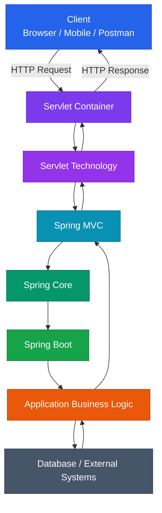
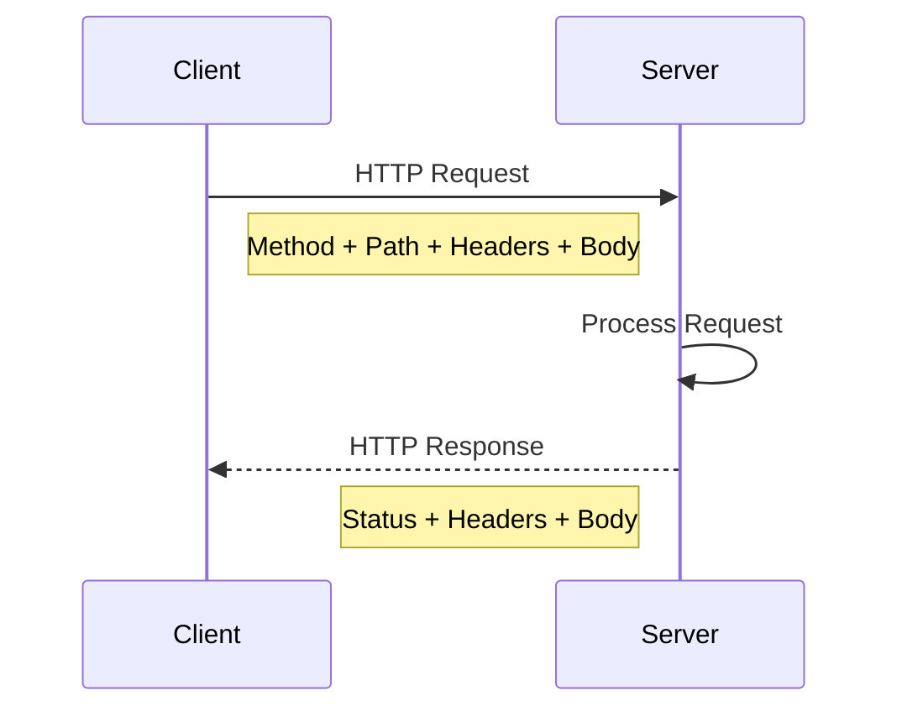
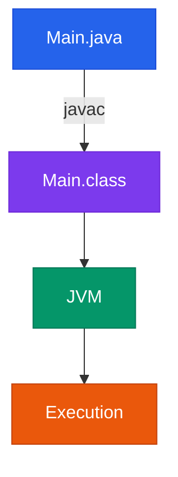

## 1. The Starting Point: How Web Applications Communicate

Before Spring or Spring Boot, there is a more fundamental problem: **how does code running on one machine communicate with code running on another machine?**

When a browser requests `www.amazon.com`, the browser is executing on a client device while the application is executing on a remote server. This is the foundation of **client-server architecture**: the client asks for something, and the server processes the request and responds.

Spring Boot exists much higher in this stack. It does not replace networking, HTTP, Java, the JVM, or Servlet technology. Instead, it sits on top of an existing ecosystem and removes large amounts of repetitive application configuration so developers can concentrate on application behavior.

### Analogy: A Restaurant

Think of a backend application as a restaurant:

| Technical Component | Real-World Equivalent                   |
| ------------------- | --------------------------------------- |
| Client              | Customer                                |
| HTTP request        | Customer's order                        |
| Server              | Restaurant                              |
| Servlet Container   | Reception + kitchen coordination system |
| Servlet             | Order-processing mechanism              |
| Spring MVC          | Organized waiter/order-routing layer    |
| Spring Core         | Restaurant management system            |
| Bean                | Managed employee/resource               |
| Database            | Warehouse/storage room                  |
| Spring Data         | Inventory access system                 |
| Spring Security     | Security guard + access policy          |
| Spring Boot         | Preconfigured restaurant setup          |
| Business Logic      | Actual cooking/business rules           |

The important insight is that **Spring Boot is not the restaurant itself**. It is a system that gets the restaurant infrastructure configured and operational quickly.

---

## 2. End-to-End Architecture

The complete conceptual journey described in the source material is:



The source explicitly presents the broader flow as:

**Browser → Servlet Container → Servlet technology → Spring MVC → Spring Core → Spring Boot → business logic.**

> The diagram is a conceptual stack rather than a literal statement that every request is sequentially "processed by Spring Boot" as an independent runtime layer. Spring Boot primarily configures and launches the Spring application.

---

# 3. Module Roadmap

| Module | Core Topics              | Key Focus & Engineering Concepts                  | Read Time |
| ------ | ------------------------ | ------------------------------------------------- | --------: |
| 01     | Client-Server            | Clients, servers, request-response architecture   |     8 min |
| 02     | HTTP                     | Methods, URLs, headers, bodies, status codes      |    12 min |
| 03     | JVM                      | Java source, bytecode, JVM execution              |     8 min |
| 04     | Java Networking          | `ServerSocket`, TCP streams, HTTP parsing         |    10 min |
| 05     | Servlets                 | Servlet lifecycle concept and request handling    |    12 min |
| 06     | Servlet Container        | Ports, parsing, threads, request/response objects |    10 min |
| 07     | Spring Framework         | IoC, DI, beans, configuration, loose coupling     |    15 min |
| 08     | Spring Ecosystem         | MVC, Data, Security, AOP, AI                      |    15 min |
| 09     | Spring Data              | JDBC, ORM, JPA, Hibernate, Spring Data JPA        |    12 min |
| 10     | Spring Boot              | Auto-configuration, starters, embedded servers    |    15 min |
| 11     | Microservices            | Architecture style vs implementation framework    |     8 min |
| 12     | Complete Request Journey | Connecting all layers                             |    15 min |

---

# 4. HTTP: The Language of the Web

HTTP stands for **HyperText Transfer Protocol**. It is the common rulebook used by clients and servers to communicate.

HTTP defines the structure of requests and responses, including the method, URL/path, headers, body, and status code. It operates as an application-layer protocol on top of TCP/IP.

### Analogy: A Courier Package

An HTTP request is similar to sending a package:

* **Method** → What action should happen?
* **URL/path** → Where should it go?
* **Headers** → Additional metadata about the package.
* **Body** → The actual contents.

For example:

```http
POST /login HTTP/1.1
Content-Type: application/json

{
  "email": "abc@gmail.com",
  "password": "12345"
}
```

The request communicates:

```text
POST
    "I am sending data."

/login
    "I want the login functionality."

Content-Type
    "The body is JSON."

Body
    "Here is the actual login data."
```

The source describes these four major request components as **method, URL/path, headers, and body**.

## HTTP Methods

| Method | Intended Meaning        | Example              |
| ------ | ----------------------- | -------------------- |
| GET    | Read data               | Fetch orders         |
| POST   | Create data             | Create an order      |
| PUT    | Replace data completely | Replace user profile |
| PATCH  | Partially update data   | Change phone number  |
| DELETE | Remove data             | Cancel an order      |

### Important Engineering Distinction

`PUT` and `PATCH` are not simply two random ways of updating data.

The material frames:

```text
PUT    → complete replacement
PATCH  → partial modification
```

Therefore, an API designer should select the method according to the semantic operation being represented.

---

# 5. HTTP Headers

Headers are key-value metadata attached to an HTTP request or response.

Examples include:

```http
Accept: application/json
Content-Type: application/json
Authorization: Bearer <token>
Host: www.example.com
```

The source specifically identifies headers as important for authentication, JSON communication, API communication, and request metadata.

### Analogy

Imagine a parcel:

```text
Package
├── Label
│   ├── Destination
│   ├── Sender information
│   └── Handling instructions
│
└── Contents
    └── Actual item
```

HTTP:

```text
Request
├── Headers
│   └── Metadata
│
└── Body
    └── Actual payload
```

---

# 6. HTTP Request vs Response

A request travels from client to server.

A response travels from server back to client.



A response commonly contains:

```text
Status Code
Headers
Body
```

Example:

```http
HTTP/1.1 200 OK
Content-Type: application/json

{
  "message": "Login successful"
}
```

The source identifies `200`, `404`, and `500` as common status-code examples:

| Status | Meaning               |
| -----: | --------------------- |
|    200 | Request successful    |
|    404 | Resource not found    |
|    500 | Internal server error |

---

# 7. Why Core Java Alone Does Not Automatically Become a Web Framework

Java provides fundamental programming capabilities:

* Classes
* Objects
* Inheritance
* Collections
* Threads
* Files
* Networking APIs

But HTTP-specific concepts such as:

* HTTP requests
* URLs
* Headers
* Cookies
* Sessions
* REST APIs

are not automatically interpreted by the Java language itself.

### Analogy: Knowing English vs Running a Post Office

Knowing how to write Java is like knowing English.

That does not automatically mean you know how to:

* receive parcels,
* identify addresses,
* route parcels,
* track deliveries,
* manage queues,
* return failed deliveries.

Similarly:

```java
while (true) {
    // Keep program alive
}
```

does not magically make the program understand:

```http
GET /hello HTTP/1.1
```

Something must interpret the network data and translate it into application-level operations.

---

# 8. Java Networking: The Raw Layer

Java can listen for network connections using APIs such as `ServerSocket`.

```java
ServerSocket server = new ServerSocket(8080);
```

This allows a Java program to listen on port `8080`.

However, receiving a TCP connection is not the same thing as understanding HTTP.

At the raw level, the program receives a stream of bytes.

Conceptually:

```text
Network
   ↓
TCP Connection
   ↓
Byte Stream
   ↓
"GET /users HTTP/1.1..."
```

Java does not inherently interpret this byte stream as:

```text
GET       → operation
/users    → endpoint
Host      → header
```

That interpretation has to be implemented somewhere.

---

# 9. What Would We Have to Build Manually?

If we built a web server using only low-level Core Java networking, we would need to implement substantial infrastructure ourselves:

```text
1. Open a port
2. Accept network connections
3. Read input streams
4. Parse HTTP
5. Extract method
6. Extract URL
7. Extract headers
8. Extract body
9. Route requests
10. Execute Java logic
11. Construct HTTP response
12. Manage multiple users/connections
13. Handle malformed requests
14. Handle connection behavior
```

The source explicitly lists these responsibilities as the work that would otherwise have to be handled manually.

For example:

```java
if (url.equals("/users")) {
    // User logic
} else if (url.equals("/orders")) {
    // Order logic
}
```

The problem is not that this code is impossible.

The problem is that it is **infrastructure code rather than business logic**.

---

# 10. Servlets: The Missing Translation Layer

The architectural gap can be visualized as:

```text
Browser
   │
   │ HTTP Request
   ▼
   ???
   │
   ▼
Java Code
```

The missing pieces are:

```text
Servlet Container
Servlet
```

The source describes a Servlet as a Java object designed to handle HTTP requests. Servlets execute inside a Servlet Container.

### Analogy: Translator

Imagine two people:

```text
HTTP World                Java World

"GET /hello"      →       sayHello()
"POST /users"     →       createUser()
```

The Servlet architecture provides the standardized web-side mechanism that translates HTTP communication into Java application handling.

---

# 11. Servlet Container

A Servlet itself does not exist in isolation.

It runs inside a **Servlet Container**.

Examples mentioned in the material include:

* Apache Tomcat
* Jetty
* Undertow

### What Does the Container Do?

The container handles low-level web infrastructure such as:

```text
Open port
   ↓
Listen for HTTP traffic
   ↓
Read TCP bytes
   ↓
Parse HTTP
   ↓
Create request/response objects
   ↓
Manage threads
   ↓
Call servlet methods
   ↓
Send HTTP response
```

These responsibilities are explicitly described in the source.

Instead of application developers manually processing raw byte streams, the container exposes Java-oriented request/response handling and servlet methods such as:

```java
doGet();
doPost();
```

---

# 12. Servlet Container vs Application Code

This distinction is fundamental.

```text
┌─────────────────────────────────────┐
│          Servlet Container          │
│                                     │
│ Port / Network / HTTP / Threads     │
│ Request / Response infrastructure   │
│                                     │
│        ┌─────────────────┐          │
│        │ Application     │          │
│        │ Servlet / Logic │          │
│        └─────────────────┘          │
└─────────────────────────────────────┘
```

The container handles the **web infrastructure**.

Your application handles the **application behavior**.

This separation is one of the major conceptual steps toward understanding Spring MVC and Spring Boot.

---

# 13. Why Spring Was Needed

Servlets solved the problem of communicating with HTTP clients, but enterprise applications became difficult to maintain when built directly around Servlet APIs.

The source identifies several problems:

* Boilerplate
* Configuration complexity
* Tight coupling
* Difficult testing
* Difficult maintenance
* Repeated code

### Analogy: From Manual Workshop to Managed Factory

Servlets provide the machinery required to operate the factory.

Spring provides a higher-level system for organizing the factory:

```text
Before:
Developer manually coordinates many objects.

After:
Spring manages object relationships and configuration.
```

This leads to the core Spring concepts:

```text
IoC
Dependency Injection
Bean Management
Configuration
Loose Coupling
```

---

# 14. Spring Core

Spring Core is the foundation of the Spring ecosystem.

The source identifies these key responsibilities:

* IoC
* Dependency Injection
* Bean Management
* Configuration
* `ApplicationContext`

### Mental Model

Without a dependency-management system:

```java
class OrderService {

    private PaymentService paymentService =
        new PaymentService();
}
```

The class directly creates its dependency.

Conceptually, dependency injection moves responsibility for obtaining dependencies toward the framework:

```text
Spring Container
      │
      ├── creates PaymentService
      │
      └── provides it to OrderService
```

The important principle is **loose coupling**: application classes should not unnecessarily own the responsibility of constructing all of their collaborators.

---

# 15. Spring MVC

Spring MVC is the Spring web-development module used to build web applications and REST APIs.

The source describes it as being built on:

```text
Servlets
   +
Spring Core
```

Instead of writing Servlet handling directly, developers can use a cleaner controller-based programming model.

Example:

```java
@GetMapping("/hello")
public String sayHello() {
    return "Hello World";
}
```

The key conceptual point is:

```text
HTTP
  ↓
Servlet infrastructure
  ↓
Spring MVC
  ↓
Controller
  ↓
Application logic
```

Spring MVC does not eliminate Servlet technology; it provides a higher-level programming model on top of it.

---

# 16. Spring Data: Database Abstraction

Most production applications need persistent storage.

Historically, Java applications commonly interacted with databases using JDBC.

With JDBC, developers had to handle repetitive responsibilities such as:

```text
Write SQL
   ↓
Open connection
   ↓
Execute query
   ↓
Process ResultSet
   ↓
Close resources
```

Hibernate introduced an ORM approach in which Java objects can be mapped to database tables.

### ORM Analogy

Imagine two languages:

```text
Application world:
Java Objects

Database world:
Tables / Rows / Columns
```

ORM acts as a translator between those representations.

---

# 17. JPA vs Hibernate vs Spring Data JPA

This distinction is frequently misunderstood.

| Technology      | Role                                                      |
| --------------- | --------------------------------------------------------- |
| JDBC            | Low-level Java database access                            |
| JPA             | Specification for persistence/ORM behavior                |
| Hibernate       | Popular JPA implementation                                |
| Spring Data JPA | Higher-level abstraction reducing persistence boilerplate |

The source explicitly describes JPA as a specification and Hibernate as an implementation.

The conceptual stack is:

```text
Spring Data JPA
       ↓
Hibernate
       ↓
JDBC
       ↓
Database
```

### The Key Rule

> **JPA defines what should be done; Hibernate provides an implementation of those rules.**

Spring Data JPA adds another abstraction layer that reduces repetitive persistence code.

---

# 18. Spring Security

Spring Security provides mechanisms for authentication and authorization.

The source identifies capabilities including:

* Login
* JWT
* OAuth
* Roles
* Permissions
* Password encoding
* CSRF protection
* Access control

### Authentication vs Authorization

```text
Authentication
    ↓
"Who are you?"

Authorization
    ↓
"What are you allowed to do?"
```

For example:

```text
User logs in
    ↓
Identity established
    ↓
Security context established
    ↓
Authorization rules evaluated
    ↓
Request allowed/denied
```

Spring Security exists to standardize this security infrastructure rather than requiring each application to reinvent it.

---

# 19. Spring AOP

AOP means **Aspect-Oriented Programming**.

The source describes AOP as a mechanism for separating **cross-cutting concerns** from business logic.

Examples include:

* Logging
* Security checks
* Transaction management
* Performance tracking
* Exception handling

### Analogy: Building Security

Suppose every room in a building needs:

```text
Security check
Logging
Access verification
```

You do not want to duplicate the same infrastructure inside every room.

Instead:

```text
Business Logic
      +
Cross-Cutting Concern
```

AOP provides a mechanism for keeping those concerns conceptually separate.

---

# 20. Spring AI

The source identifies Spring AI as a newer part of the Spring ecosystem for integrating AI capabilities into Spring applications.

It can work with concepts such as:

* OpenAI
* Gemini
* Anthropic
* Vector databases
* RAG
* Embeddings
* AI chat models

This illustrates an important characteristic of Spring:

> Spring is an ecosystem, not a single framework feature.

---

# 21. Spring Ecosystem at a Glance

| Spring Project  | Primary Responsibility            |
| --------------- | --------------------------------- |
| Spring Core     | IoC, DI, beans, configuration     |
| Spring MVC      | Web applications and REST APIs    |
| Spring Data     | Database/data-access abstractions |
| Spring Security | Authentication and authorization  |
| Spring AOP      | Cross-cutting concerns            |
| Spring AI       | AI application integration        |
| Spring Boot     | Automation and application setup  |

The source explicitly presents Spring as a broad ecosystem containing these projects.

---

# 22. Spring Boot

Spring Boot is frequently misunderstood as a replacement for Spring.

It is not.

The source describes Spring Boot as an **automation layer on top of Spring**. It provides:

* Auto-configuration
* Starter dependencies
* Embedded servers
* Sensible defaults
* Production-ready features
* Reduced manual configuration

### Analogy: Preconfigured Development Kit

Spring Framework gives you the machinery.

Spring Boot gives you a preconfigured kit containing sensible defaults so that you can start using that machinery much faster.

```text
Spring
    ↓
Core capabilities

Spring Boot
    ↓
Automatic setup
+ sensible defaults
+ embedded infrastructure
+ easier startup
```

---

# 23. What Does "Opinionated" Mean?

Spring Boot is described as **opinionated**.

An opinionated framework makes assumptions about common application requirements and provides defaults accordingly.

For example, when web dependencies are present, Spring Boot can configure infrastructure associated with:

```text
Embedded Tomcat
Spring MVC
JSON support
Default application setup
Basic error handling
```

This reduces configuration effort.

But an important engineering lesson remains:

> **Knowing Spring Boot annotations is not the same as understanding Spring.**

The source specifically emphasizes the importance of understanding:

```text
Spring Core
Spring MVC
Dependency Injection
IoC
Beans
Servlets
HTTP
Database concepts
Security concepts
```

---

# 24. Spring Framework vs Spring Boot

| Dimension          | Spring Framework         | Spring Boot                         |
| ------------------ | ------------------------ | ----------------------------------- |
| Primary role       | Core framework/ecosystem | Simplifies Spring application setup |
| Configuration      | More manual              | More automated                      |
| Defaults           | Flexible                 | Sensible/opinionated defaults       |
| Auto-configuration | Not the central purpose  | Major feature                       |
| Embedded server    | Not the defining feature | Commonly provided                   |
| Relationship       | Foundation               | Built on Spring                     |

### The Rule to Memorize

```text
Spring Boot uses Spring.
Spring Boot does not replace Spring.
```

---

# 25. Spring Boot and Microservices

Microservices are **not a Spring module**.

They are an **architecture style**.

In a microservices architecture, a large application is divided into smaller independently developed, deployed, and scalable services.

Example:

```text
                Application
                    │
       ┌────────────┼────────────┐
       ↓            ↓            ↓
 User Service   Order Service  Payment Service
       │            │            │
       └────────────┼────────────┘
                    ↓
             Notification Service
```

The source gives examples including:

* User Service
* Order Service
* Payment Service
* Notification Service
* Product Service

Each can be developed, deployed, and scaled independently.

### Critical Distinction

```text
Microservices
    = Architecture style

Spring Boot
    = Tool commonly used to build applications/services
```

Spring Boot is therefore an implementation technology that can be used to build microservices; it is not what makes an architecture microservices-based.

---

# 26. Normal Java Program vs Web Application

A normal Java application commonly follows:

```text
Start
  ↓
Execute instructions
  ↓
Finish
  ↓
Exit
```

A web application behaves differently:

```text
Start
  ↓
Keep running
  ↓
Wait for request
  ↓
Process request
  ↓
Send response
  ↓
Continue running
  ↺
```

The source explicitly contrasts these execution models and describes a web server as a continuously running process waiting for incoming requests.

### Analogy

A calculator program:

```text
Calculate
→ Print
→ Exit
```

A restaurant:

```text
Open
→ Wait for customer
→ Take order
→ Prepare order
→ Serve
→ Wait for next customer
→ ...
```

A backend server behaves much more like the restaurant.

---

# 27. JVM: Where Java Code Executes

A Java source file:

```text
Main.java
```

is compiled by `javac` into platform-independent bytecode:

```text
Main.class
```

The JVM loads and executes that bytecode.

Conceptually:



This is the foundation of Java's commonly described:

```text
Write once, run anywhere
```

The same bytecode can execute on different operating systems when an appropriate JVM is available.

---

# 28. The Complete Request Journey

Now combine the layers.

Suppose the client calls:

```http
GET /hello
Host: localhost:8080
```

The conceptual journey is:

```text
1. Client creates HTTP request
             ↓
2. Network carries request
             ↓
3. Servlet Container receives it
             ↓
4. Container handles HTTP infrastructure
             ↓
5. Servlet technology provides Java web handling
             ↓
6. Spring MVC provides application-level web abstraction
             ↓
7. Spring-managed objects participate
             ↓
8. Application business logic executes
             ↓
9. Response is produced
             ↓
10. Response travels back to client
```

The source's complete conceptual flow places the browser, Servlet Container, Servlet technology, Spring MVC, Spring Core, Spring Boot, and business logic into this overall journey.

---

# 29. Why This Historical Evolution Matters

A beginner may start with:

```java
@RestController
@GetMapping("/hello")
public String hello() {
    return "Hello";
}
```

and think:

> "Spring Boot magically understands my HTTP request."

It does not.

There is a chain of technologies underneath the annotation-based programming model:

```text
Client-Server
      ↓
HTTP
      ↓
TCP/IP networking
      ↓
Java networking
      ↓
Servlets
      ↓
Servlet Container
      ↓
Spring MVC
      ↓
Spring Core
      ↓
Spring Boot
      ↓
Application
```

The source explicitly emphasizes that understanding this evolution makes Spring Boot less "magical" and easier to learn, debug, and use in real projects.

---

# 30. Engineering Comparison Matrix

| Layer             | Problem Solved                  | Main Abstraction                            | Without It                                    |
| ----------------- | ------------------------------- | ------------------------------------------- | --------------------------------------------- |
| Client-Server     | Distributed communication model | Client / Server                             | No standardized web interaction model         |
| HTTP              | Communication rules             | Request / Response                          | No standardized web message format            |
| Java Networking   | Network connections             | `ServerSocket`, streams                     | No Java-level socket API                      |
| Servlet           | HTTP-to-Java web handling       | Servlet                                     | Application handles web protocol directly     |
| Servlet Container | Web infrastructure              | Request/response + lifecycle infrastructure | Manual port, parsing, thread, connection work |
| Spring Core       | Object/dependency management    | IoC / DI / Beans                            | More manual object wiring                     |
| Spring MVC        | Web application abstraction     | Controllers / mappings                      | More direct Servlet programming               |
| Spring Data       | Persistence abstraction         | Repositories / ORM integration              | More repetitive data-access code              |
| Spring Security   | Security infrastructure         | Authentication / authorization              | Reimplement security concerns                 |
| Spring Boot       | Spring setup automation         | Auto-configuration / starters               | More configuration and setup                  |
| Microservices     | Architectural decomposition     | Independent services                        | Monolithic deployment model                   |

---

# 31. Complexity and Responsibility Matrix

This topic is less about Big-O algorithms and more about **complexity ownership**.

| Approach            | Developer Responsibility       | Infrastructure Responsibility  | Typical Engineering Concern           |
| ------------------- | ------------------------------ | ------------------------------ | ------------------------------------- |
| Raw Java networking | Very high                      | Very low                       | HTTP parsing and connection handling  |
| Servlet             | Moderate                       | Higher                         | Servlet/container configuration       |
| Spring MVC          | Lower                          | Higher                         | Controller/application design         |
| Spring              | Lower object-management burden | Framework manages dependencies | Correct DI/configuration              |
| Spring Boot         | Lowest setup burden            | Strong defaults/automation     | Understanding and overriding defaults |

The central architectural progression is:

```text
Manual infrastructure
        ↓
Standardized infrastructure
        ↓
Framework abstractions
        ↓
Automated configuration
```

This is why Spring Boot increases developer productivity without eliminating the underlying technologies.

---

# 32. Production-Oriented Mental Model

When debugging a Spring Boot application, avoid thinking:

```text
"Spring Boot is broken."
```

Instead ask which layer owns the problem:

```text
Is the client creating the correct HTTP request?
        ↓
Is the network connection working?
        ↓
Is the Servlet Container receiving the request?
        ↓
Is request mapping correct?
        ↓
Is Spring MVC routing correctly?
        ↓
Are Spring dependencies configured?
        ↓
Is business logic correct?
        ↓
Is database access working?
        ↓
Is security rejecting the request?
        ↓
Is the response correctly constructed?
```

This layered debugging model follows directly from the architecture described throughout the source material.

---

# 33. Common Engineering Pitfalls

<Callout type="warn">

### Treating Spring Boot as a Replacement for Spring

Spring Boot is an automation layer built on Spring. Learning only annotations without understanding IoC, dependency injection, beans, Spring MVC, HTTP, and Servlets creates a shallow mental model.

</Callout>

<Callout type="warn">

### Confusing TCP With HTTP

A Java `ServerSocket` can receive a TCP connection, but that does not mean Java automatically understands HTTP semantics such as `GET`, `/users`, headers, and request bodies.

</Callout>

<Callout type="warn">

### Confusing JPA With Hibernate

JPA is a specification. Hibernate is an implementation of JPA. Spring Data JPA adds another abstraction layer.

```text
Spring Data JPA
       ↓
Hibernate
       ↓
JDBC
       ↓
Database
```

</Callout>

<Callout type="info">

### Learn the Stack From Bottom to Top

A useful learning progression is:

```text
HTTP
 ↓
Java Networking
 ↓
Servlets
 ↓
Spring Core
 ↓
Spring MVC
 ↓
Spring Data
 ↓
Spring Security
 ↓
Spring Boot
```

This prevents framework abstractions from appearing magical.

</Callout>

<Callout type="info">

### Use the Framework for Infrastructure, Not for Understanding

Spring Boot should reduce configuration work. It should not reduce your understanding of what the application is actually doing.

</Callout>

---

# 34. Quick Mental Cheat Sheet

```text
CLIENT
    ↓
HTTP REQUEST
    ↓
SERVLET CONTAINER
    ↓
SERVLET
    ↓
SPRING MVC
    ↓
SPRING CORE
    ↓
BUSINESS LOGIC
    ↓
SPRING DATA
    ↓
DATABASE
```

Supporting capabilities:

```text
Spring Security → Authentication / Authorization
Spring AOP      → Cross-cutting concerns
Spring AI       → AI integrations
Spring Boot     → Automation / Configuration
```

And:

```text
JPA
= Specification

Hibernate
= JPA Implementation

Spring Data JPA
= Higher-level data-access abstraction
```

Finally:

```text
Microservices ≠ Spring module

Microservices = Architecture style
Spring Boot   = Technology commonly used to build services
```

---

# 35. Final Evolution Map

The complete evolution presented by the source is:

```text
Client–Server Architecture
          ↓
HTTP Communication
          ↓
Core Java limitation for web applications
          ↓
Java networking with sockets
          ↓
Manual HTTP parsing problem
          ↓
Servlets + Servlet Containers
          ↓
Spring Framework
          ↓
Spring Ecosystem
          ↓
Spring Boot
```

The fundamental lesson is not merely how to write:

```java
@GetMapping("/hello")
```

It is understanding **why that annotation can exist at all**.

A browser speaks HTTP. Java provides the runtime and networking capabilities. Servlet technology standardizes Java web handling. Servlet containers provide the surrounding infrastructure. Spring provides dependency and application-management abstractions. Spring MVC provides a cleaner web programming model. Spring Data abstracts persistence. Spring Security addresses security concerns. Spring Boot automates configuration and startup.

Once those layers are understood, Spring Boot becomes a productivity tool rather than a black box.

---

# 36. Interactive Self-Assessment

<Quiz
question="A Java program creates a ServerSocket on port 8080. A browser sends GET /users HTTP/1.1. What is the fundamental problem Java still needs to solve before application code can treat /users as an endpoint?"
options={[
"The JVM must compile the Java source code again",
"The incoming network byte stream must be interpreted as an HTTP request and routed to Java logic",
"Spring Security must create a JWT before TCP can work",
"Hibernate must convert the HTTP request into a database row"
]}
answerIndex={1}>
The correct answer is **B**.

A `ServerSocket` provides the ability to listen for network connections, but the incoming data is fundamentally a stream of bytes. The application still needs infrastructure that understands HTTP semantics such as the method, path, headers, and body, and then routes that request to the appropriate Java code. This is the problem addressed by Servlet technology and the Servlet Container in the architecture described in the source.
</Quiz>

<Quiz
question="Which statement most accurately describes the relationship between JPA, Hibernate, and Spring Data JPA?"
options={[
"JPA is the implementation, Hibernate is the specification, and Spring Data JPA is the database",
"Hibernate replaces JDBC completely and JPA is only a Spring Boot configuration file",
"JPA defines persistence rules, Hibernate provides a JPA implementation, and Spring Data JPA provides a higher-level abstraction",
"Spring Data JPA is the specification implemented by JPA"
]}
answerIndex={2}>
The correct answer is **C**.

The source explicitly identifies JPA as a specification and Hibernate as a popular implementation of that specification. Spring Data JPA builds another abstraction layer on top of this stack to reduce repetitive persistence code.

The conceptual flow is:

```text
Spring Data JPA
      ↓
Hibernate
      ↓
JDBC
      ↓
Database
```
</Quiz>

<Quiz
question="Why is Spring Boot not accurately described as a replacement for the Spring Framework?"
options={[
"Spring Boot is a completely unrelated Java programming language",
"Spring Boot only provides database drivers",
"Spring Boot is an automation layer built on Spring that provides auto-configuration, starters, embedded servers, and sensible defaults",
"Spring Boot replaces Spring MVC with raw Java networking"
]}
answerIndex={2}>
The correct answer is **C**.

Spring provides the underlying ecosystem and capabilities such as Spring Core, Spring MVC, Spring Data, Spring Security, and Spring AOP. Spring Boot reduces the amount of configuration required to assemble and run those capabilities. Therefore, Spring Boot uses Spring rather than replacing it.
</Quiz>

<Quiz
question="Which statement correctly distinguishes microservices from Spring Boot?"
options={[
"Microservices are a Spring Boot dependency",
"Microservices are an architecture style, while Spring Boot is a technology commonly used to build independent services",
"Spring Boot is an architecture and microservices are a Java library",
"Microservices only apply to database applications"
]}
answerIndex={1}>
The correct answer is **B**.

Microservices describe an architectural approach in which an application is divided into smaller independently developed, deployed, and scalable services. Spring Boot is a technology commonly used to implement those services. The source explicitly makes this distinction.
</Quiz>

---

# 37. Mastery Checklist

Before moving deeper into Spring Boot, you should be able to explain these without memorizing definitions:

* [ ] What a client and server are
* [ ] Why HTTP exists
* [ ] The structure of an HTTP request
* [ ] The structure of an HTTP response
* [ ] The difference between GET, POST, PUT, PATCH, and DELETE
* [ ] Why a Java `ServerSocket` alone does not provide an HTTP framework
* [ ] What a Servlet is
* [ ] What a Servlet Container does
* [ ] Why Servlets became insufficient for large enterprise applications
* [ ] What Spring Core provides
* [ ] What IoC and dependency injection are intended to solve
* [ ] What Spring MVC provides
* [ ] The difference between JPA and Hibernate
* [ ] Where Spring Data JPA fits
* [ ] What Spring Security handles
* [ ] What cross-cutting concerns mean in AOP
* [ ] What Spring Boot adds to Spring
* [ ] Why Spring Boot is called opinionated
* [ ] Why microservices are an architecture style rather than a Spring module
* [ ] How an HTTP request eventually reaches application code

If these concepts are clear, the next Spring Boot topics—dependency injection, beans, application context, configuration, controllers, services, repositories, and security—can be understood as extensions of an architecture rather than isolated annotations.
