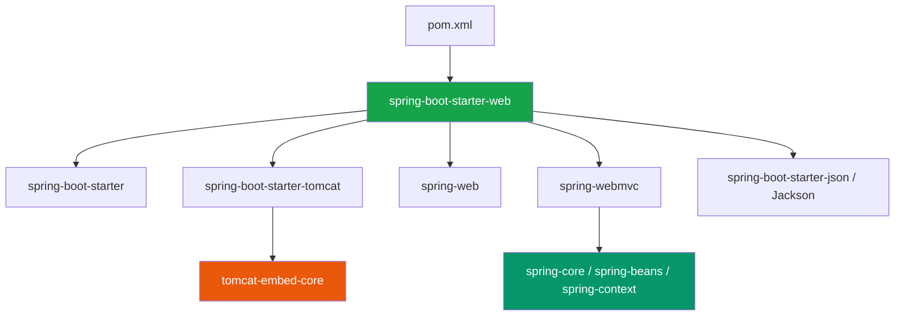
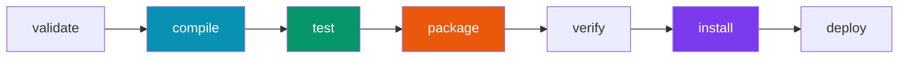

Apache Maven is the primary build automation, project management, and dependency resolution engine used across enterprise Java and Spring Boot applications.

## 1. What Is Maven & Why Do We Need It?

Before modern build tools like Maven or Gradle, Java developers managed project dependencies manually:
* Downloading `.jar` files individually from library websites.
* Creating a local `lib/` directory in the project.
* Adding 50+ JARs manually to the Java compiler `-classpath`.
* Facing "Jar Hell" when Library A required Version 1.2 of Library C, but Library B required Version 2.0.

```text
Maven Core Responsibilities:
├── 1. Project Object Model (pom.xml) -> Declarative XML blueprint of the project.
├── 2. Automated Dependency Resolution -> Downloads libraries automatically from central repositories.
├── 3. Standard Project Directory Structure -> Enforces unified project layouts.
└── 4. Build Lifecycle Automation     -> Compiles, tests, packages, and deploys applications.
```

---

## 2. GAV Coordinates: Identifying Java Artifacts

Every Java library published to Maven Central is uniquely identified by three mandatory coordinates known as **GAV (GroupId, ArtifactId, Version)**:

```xml
<groupId>org.springframework.boot</groupId>
<artifactId>spring-boot-starter-web</artifactId>
<version>3.2.4</version>
```

| Coordinate | Real-World Analogy | Purpose | Example |
| :--- | :--- | :--- | :--- |
| `groupId` | Company / Domain Name | Organization or namespace owning the library. Usually reverse domain. | `com.google.guava`, `org.springframework.boot` |
| `artifactId` | Product / Module Name | Name of the specific project or library artifact. | `spring-boot-starter-web`, `jackson-databind` |
| `version` | Product Release Serial | Specific release version number or build status. | `3.2.4`, `1.0.0-SNAPSHOT` |

---

## 3. `pom.xml` Architecture & Spring Boot Parent

The `pom.xml` (Project Object Model) file sits at the root of a Maven project. 

```xml
<?xml version="1.0" encoding="UTF-8"?>
<project xmlns="http://maven.apache.org/POM/4.0.0"
         xmlns:xsi="http://www.w3.org/2001/XMLSchema-instance"
         xsi:schemaLocation="http://maven.apache.org/POM/4.0.0 
                             https://maven.apache.org/xsd/maven-4.0.0.xsd">
    <modelVersion>4.0.0</modelVersion>

    <!-- 1. Spring Boot Parent Inheritance -->
    <parent>
        <groupId>org.springframework.boot</groupId>
        <artifactId>spring-boot-starter-parent</artifactId>
        <version>3.2.4</version>
        <relativePath/> 
    </parent>

    <!-- 2. Application Coordinates -->
    <groupId>com.kdev</groupId>
    <artifactId>demo-service</artifactId>
    <version>0.0.1-SNAPSHOT</version>
    <name>Demo Service</name>

    <properties>
        <java.version>17</java.version>
    </properties>

    <!-- 3. Dependency Declaration -->
    <dependencies>
        <dependency>
            <groupId>org.springframework.boot</groupId>
            <artifactId>spring-boot-starter-web</artifactId>
            <!-- Note: No <version> tag required! Controlled by parent BOM -->
        </dependency>
    </dependencies>

    <!-- 4. Build Plugin Engine -->
    <build>
        <plugins>
            <plugin>
                <groupId>org.springframework.boot</groupId>
                <artifactId>spring-boot-maven-plugin</artifactId>
            </plugin>
        </plugins>
    </build>
</project>
```

### Why `spring-boot-starter-parent` Is Crucial

Notice that inside `<dependencies>`, `spring-boot-starter-web` **omits the `<version>` tag!**

This is because `spring-boot-starter-parent` imports Spring Boot's **BOM (Bill of Materials)**. The BOM defines tested, compatible version matrices for 150+ third-party Java libraries (Jackson, Hibernate, Tomcat, SLF4J). 

> [!TIP]
> **Version Alignment Benefit**: By relying on the Parent BOM, you eliminate version incompatibility bugs between underlying libraries.

---

## 4. SNAPSHOT vs Release Semantics

In Maven, versions follow specific stability rules:

```text
Version Types:
├── 1. SNAPSHOT (e.g., 1.0.0-SNAPSHOT) -> Active development build. Mutable.
└── 2. RELEASE / Final (e.g., 1.0.0)    -> Production immutable release. Immutable.
```

* **`SNAPSHOT`**: Signals that code is under active development. Every time Maven builds with `mvn clean compile`, it re-checks remote repositories for new updates to that SNAPSHOT version.
* **`RELEASE`**: Signals a stable, production-ready artifact. Once a version like `1.0.0` is published to Maven Central, **it can never be altered or overwritten**.

---

## 5. Transitive Dependencies & Local `.m2` Repository

### Transitive Dependency Graph

When you add a single starter dependency like `spring-boot-starter-web`, Maven automatically resolves its **transitive dependencies** (the libraries that `spring-boot-starter-web` itself relies upon):



You can view your application's complete resolved dependency tree via shell:
```bash
mvn dependency:tree
```

### The Local `.m2` Repository Cache

When Maven resolves a dependency for the first time, it downloads the JAR from **Maven Central** (`https://repo1.maven.org/maven2/`) and stores it locally in the user's home directory under `~/.m2/repository/`.

```text
Local Cache Directory:
~/.m2/repository/org/springframework/boot/spring-boot-starter-web/3.2.4/
├── spring-boot-starter-web-3.2.4.jar
└── spring-boot-starter-web-3.2.4.pom
```

Subsequent Maven builds on your machine reuse the local `.m2` JARs, making builds instant without re-downloading over the network.

---

## 6. Maven Lifecycles & Phases

Maven operates on three built-in lifecycles: **`default`** (build & deployment), **`clean`** (cleanup), and **`site`** (documentation).

Executing a phase automatically executes **all preceding phases** in that lifecycle sequence:



| Phase | Description | Command |
| :--- | :--- | :--- |
| `clean` | Deletes the build output directory (`target/`). | `mvn clean` |
| `compile` | Compiles source Java code in `src/main/java` into `.class` files in `target/classes`. | `mvn compile` |
| `test` | Runs unit tests in `src/test/java` using Surefire plugin. | `mvn test` |
| `package` | Takes compiled code and packages it into JAR/WAR inside `target/`. | `mvn package` |
| `install` | Installs target JAR into local `~/.m2/repository` for local reuse. | `mvn install` |

---

## 7. `spring-boot-maven-plugin` Mechanics

Standard Java JAR files created by `mvn package` are plain JARs containing only your application classes; they do **not** contain third-party dependency JARs. Running `java -jar app.jar` on a standard JAR fails with `ClassNotFoundException`.

The **`spring-boot-maven-plugin`** hooks into the Maven `package` phase to execute a **repackage** goal:

```text
Repackaging Process:
Standard JAR  -->  spring-boot-maven-plugin  --> Fat / Uber Executable JAR
(Only app.class)                                (App.class + All Transitive JARs + Embedded Tomcat)
```

Inside the Fat JAR, Spring Boot embeds its custom launcher (`JarLauncher`) so the JVM can boot Tomcat and run the nested JARs seamlessly.

---

## ❓ Knowledge Check

<Quiz question="Why do dependencies declared inside a Spring Boot pom.xml usually omit the <version> element?" options={["Because Maven automatically picks random versions from the internet", "Because version management is handled centrally by inheriting from spring-boot-starter-parent BOM", "Because Spring Boot does not use Java JAR files", "Because version tags are forbidden in Maven 3"]} answerIndex={1}>
Inheriting from `spring-boot-starter-parent` provides a tested Bill of Materials (BOM) that manages library versions centrally, ensuring compatibility without manual version tags.
</Quiz>

<Quiz question="What is the primary role of the spring-boot-maven-plugin during 'mvn package'?" options={["It compiles Java code to C++", "It repackages standard JAR files into executable Fat JARs containing all transitive dependencies and embedded server launchers", "It deletes all unit tests", "It deploys the application to AWS automatically"]} answerIndex={1}>
The `spring-boot-maven-plugin` executes a `repackage` goal, embedding all dependency JARs and the launcher class inside a single standalone executable Fat JAR.
</Quiz>
