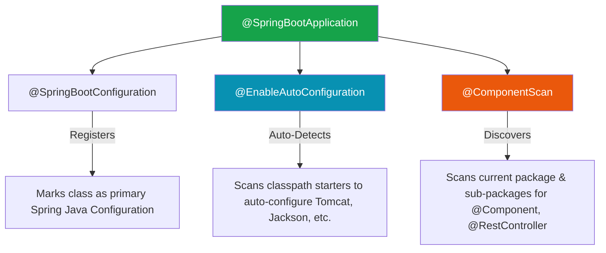
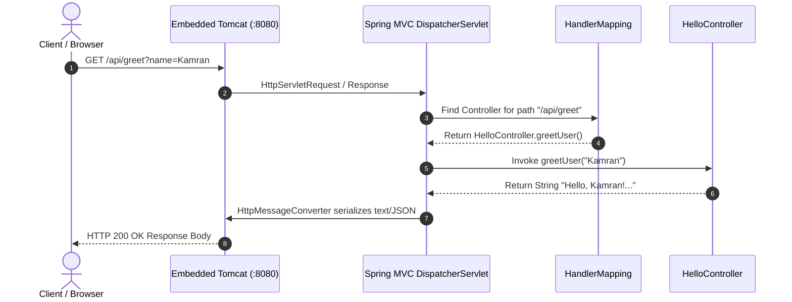

With our foundations in HTTP protocols, Servlets, and Maven build engineering, we are ready to create, configure, boot, and debug a production-ready **Spring Boot Web Application**.

## 1. Bootstrapping with Spring Initializr

**Spring Initializr** ([start.spring.io](https://start.spring.io)) is the official project generator for the Spring ecosystem.

```text
Initializr Selection Matrix:
├── Project Type  : Maven Project
├── Language      : Java
├── Spring Boot   : 3.2.x (RELEASE)
├── Java Version  : 17 or 21 (LTS releases)
└── Dependencies  : Spring Web (spring-boot-starter-web)
```

---

## 2. Standard Spring Boot Directory Structure

Spring Boot enforces standard Maven directory conventions:

```text
my-spring-boot-app/
├── pom.xml                                   # Maven configuration file
├── src/
│   ├── main/
│   │   ├── java/                             # Java source code
│   │   │   └── com/kdev/demo/
│   │   │       ├── DemoApplication.java      # Main Bootstrap Class
│   │   │       └── controller/
│   │   │           └── HelloController.java  # REST Controller
│   │   └── resources/                        # Non-Java application assets
│   │       ├── application.properties        # Application configuration key-values
│   │       ├── static/                       # Static web resources (HTML, CSS, JS)
│   │       └── templates/                    # Server-side templates (Thymeleaf)
│   └── test/
│       └── java/                             # Unit and integration test suites
│           └── com/kdev/demo/
│               └── DemoApplicationTests.java
```

| Directory | Purpose |
| :--- | :--- |
| `src/main/java` | Contains production Java source code. Package hierarchies start here. |
| `src/main/resources` | Contains application properties, database migrations, static web assets. |
| `application.properties` | Central key-value file for configuring port numbers, database URLs, logging levels. |

---

## 3. The Main Application Class: `@SpringBootApplication`

Every Spring Boot application requires a single bootstrap entry point containing a `main` method:

```java
package com.kdev.demo;

import org.springframework.boot.SpringApplication;
import org.springframework.boot.autoconfigure.SpringBootApplication;

@SpringBootApplication
public class DemoApplication {

    public static void main(String[] args) {
        // Bootstraps Spring IoC Container & launches Embedded Tomcat
        SpringApplication.run(DemoApplication.class, args);
    }
}
```

### Deconstructing `@SpringBootApplication`

`@SpringBootApplication` is a meta-annotation that combines three core Spring annotations:



> [!IMPORTANT]
> **Component Scanning Package Rule**:
> `@ComponentScan` scans for components in the **package containing `DemoApplication` AND all its sub-packages**. 
> If `DemoApplication` is in `com.kdev.demo`, Spring scans `com.kdev.demo.controller`, `com.kdev.demo.service`, etc. If a bean is placed outside in `com.other.stuff`, **Spring will ignore it!**

---

## 4. Writing Our First REST Controller

A **REST Controller** is a Spring-managed component that handles HTTP requests and returns data payloads (usually JSON) directly to the client.

```java
package com.kdev.demo.controller;

import org.springframework.web.bind.annotation.GetMapping;
import org.springframework.web.bind.annotation.RequestParam;
import org.springframework.web.bind.annotation.RestController;

@RestController
public class HelloController {

    // Maps HTTP GET requests for "/api/greet" to this method
    @GetMapping("/api/greet")
    public String greetUser(@RequestParam(defaultValue = "Guest") String name) {
        return "Hello, " + name + "! Welcome to Spring Boot.";
    }
}
```

### Key Annotations Explained

* **`@RestController`**: Combines `@Controller` and `@ResponseBody`. It tells Spring that method return values should be serialized directly into the HTTP response body (as text or JSON), rather than rendering an HTML template page.
* **`@GetMapping("/api/greet")`**: Shortcut annotation mapping incoming HTTP `GET` requests for the path `/api/greet` to the annotated method.

---

## 5. End-to-End Request Journey in Spring Boot

What actually happens when a user requests `http://localhost:8080/api/greet?name=Kamran` in their browser?



1. **Tomcat Acceptor**: Embedded Tomcat receives TCP packet on port `8080`.
2. **DispatcherServlet**: Tomcat delegates request to Spring MVC's central front controller, `DispatcherServlet`.
3. **Handler Mapping**: `DispatcherServlet` queries `HandlerMapping` to match `/api/greet` with `@GetMapping("/api/greet")` in `HelloController`.
4. **Execution**: Spring injects parameters (`name="Kamran"`) and executes `greetUser()`.
5. **Serialization**: The returned `String` is serialized by `HttpMessageConverter` into the HTTP response body.

---

## 6. Application Configuration: `application.properties`

You can customize runtime settings inside `src/main/resources/application.properties`:

```properties
# Server Port Configuration
server.port=8081

# Application Identity
spring.application.name=demo-service

# Logging Customization
logging.level.org.springframework.web=DEBUG
```

If you set `server.port=8081`, launching the app causes Tomcat to listen on port `8081` instead of `8080`.

---

## 7. Debugging Checklist: Resolving Common Startup & 404 Errors

### Pitfall 1: `404 Not Found` Error

```text
HTTP Status 404 – Not Found
Type: Status Report
Message: No static resource api/greet.
```

* **Cause A (Wrong Package Location)**: `HelloController` was placed in package `com.kdev.outside` while `DemoApplication` is in `com.kdev.demo`. `@ComponentScan` missed it.
  * **Fix**: Move `HelloController` into package `com.kdev.demo.controller`.
* **Cause B (Missing `@RestController`)**: Used `@Controller` instead of `@RestController` without adding `@ResponseBody`. Spring tried to find a HTML view template named `api/greet.html`.

### Pitfall 2: `PortAlreadyInUseException` (`WebServerException`)

```text
APPLICATION FAILED TO START
Description:
Web server failed to start. Port 8080 was already in use.
```

* **Cause**: Another process (e.g. another running instance of Tomcat or Docker container) is already bound to port 8080.
* **Fix**: Change port in `application.properties` (`server.port=8082`) or terminate the conflicting process.

---

## ❓ Knowledge Check

<Quiz question="What will happen if a developer places a @RestController in package 'com.company.util' when the @SpringBootApplication class is in package 'com.company.app'?" options={["Spring will automatically discover it regardless of package structure", "Spring will fail to scan the controller, resulting in HTTP 404 errors for all its endpoints", "The JVM will crash with a ClassCastException", "Maven will refuse to package the application"]} answerIndex={1}>
By default, `@ComponentScan` scans only the package of the `@SpringBootApplication` class and its sub-packages. Classes placed outside (like `com.company.util`) will be ignored, returning 404 Not Found.
</Quiz>

<Quiz question="What is the functional difference between @Controller and @RestController in Spring Boot?" options={["@Controller is for database repositories, @RestController is for web requests", "@RestController combines @Controller and @ResponseBody, automatically serializing return values into response bodies", "@Controller handles only HTTPS requests while @RestController handles HTTP", "There is no difference; they are exact aliases"]} answerIndex={1}>
`@RestController` is a convenient composite annotation combining `@Controller` and `@ResponseBody`, ensuring return values are written directly to the HTTP response payload rather than rendering HTML views.
</Quiz>
