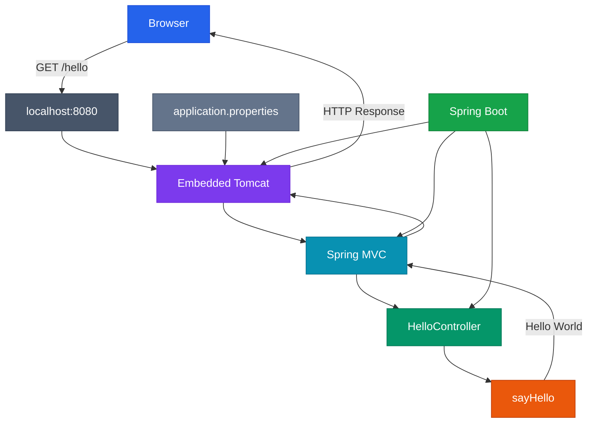
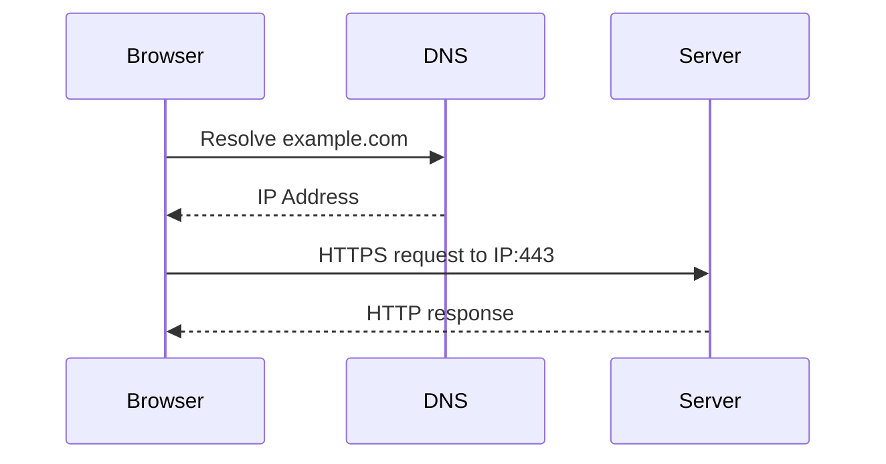
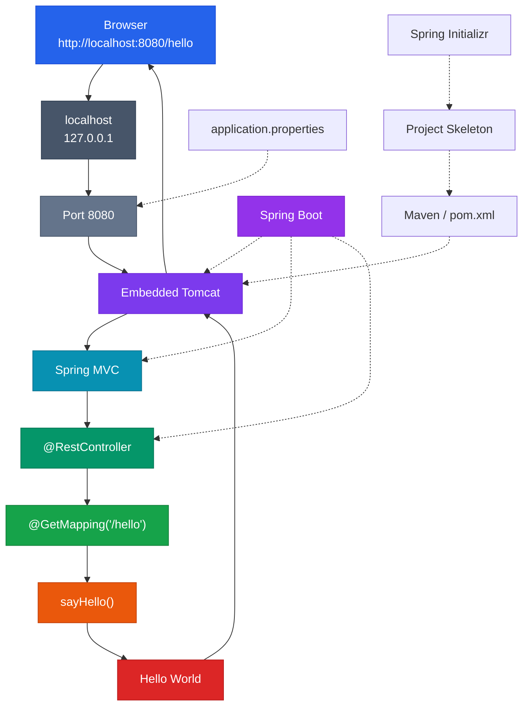

## 1. What Are We Actually Building?

A Spring Boot web application is a continuously running Java process that exposes functionality through HTTP. A browser sends a request such as `GET /hello`, the application receives it through its embedded web server, Spring MVC maps the request to Java code, and the resulting value becomes the HTTP response. The source material uses `localhost:8080/hello` as the first concrete example.

The important part is that the tiny amount of code we write hides a significant amount of infrastructure. Spring Boot creates the application context, starts embedded Tomcat, configures Spring MVC, discovers controllers, registers endpoint mappings, and handles the HTTP request/response lifecycle.

The goal of this note is therefore not merely to memorize:

```java
@GetMapping("/hello")
```

The goal is to understand what that line participates in.

---

## 2. The Core Mental Model

### Analogy: An Office Building

Think of your computer as an office building.

* The **IP address** identifies the building.
* The **port number** identifies a particular office/service inside that building.
* The **Spring Boot application** is one of those offices.

A request arriving at `192.168.1.10:8080` means:

```text
192.168.1.10  ↓ Which machine?
      :8080   ↓ Which application/service?
```

The source explicitly distinguishes the IP address as identifying the machine and the port as identifying the application listening inside that machine.

### Analogy Mapping

| Technical Concept | Real-World Equivalent |
| --- | --- |
| Computer/server | Building |
| IP address | Building address |
| Port | Office/unit number |
| Spring Boot application | Office/service |
| Browser | Visitor |
| HTTP request | Visitor's request |
| Controller | Receptionist |
| Endpoint | Specific service desk |
| Tomcat | Building's reception/infrastructure |
| Spring Initializr | Construction template |
| Dependency | External equipment/service |
| `application.properties` | Building configuration |
| `@RestController` | "This office handles visitors" |
| `@GetMapping("/hello")` | "Route /hello to this employee" |

---

## 3. Architecture of the First Application



The source's complete flow is:

```text
Browser → localhost:8080/hello → Embedded Tomcat → Spring MVC → /hello mapping → sayHello() → "Hello World" → Browser
```

---

## 4. Module Roadmap

| Module | Core Topics | Key Focus & Engineering Concepts | Read Time |
| --- | --- | --- | ---: |
| 01 | First Application | Request → response mental model | 5 min |
| 02 | IP & Ports | Addressing and process/service routing | 10 min |
| 03 | Localhost | Loopback networking and local development | 7 min |
| 04 | HTTP Ports | 80, 443, explicit application ports | 8 min |
| 05 | Spring Initializr | Project generation and metadata | 8 min |
| 06 | Dependencies | Libraries, Maven, `pom.xml` | 10 min |
| 07 | Project Structure | Source, resources, configuration | 10 min |
| 08 | Application Startup | Main class and Spring Boot startup | 10 min |
| 09 | Controllers | `@RestController` and endpoint ownership | 10 min |
| 10 | Request Mapping | `@GetMapping` and method dispatch | 10 min |
| 11 | Embedded Tomcat | Server startup and listening port | 12 min |
| 12 | Configuration | `server.port` and application properties | 8 min |
| 13 | Complete Lifecycle | End-to-end request pipeline | 12 min |
| 14 | Debugging | 404s, startup issues, routing failures | 15 min |

---

## 5. IP Address vs Port Number

This is one of the most important networking concepts to understand before working with Spring Boot.

Suppose a machine has `192.168.1.10` and several applications are running:

* Chrome → `5000`
* WhatsApp → `5222`
* Zoom → `8801`
* Spring Boot → `8080`

The operating system needs to determine which application should receive incoming network traffic. That is the purpose of the port.

```text
IP address  ↓ Identifies the machine
Port        ↓ Identifies the network service/application endpoint
```

### Analogy: Apartment Building

Imagine:

```text
Building: 192.168.1.10
  Apartment 5000 → Chrome
  Apartment 5222 → WhatsApp
  Apartment 8801 → Zoom
  Apartment 8080 → Spring Boot
```

The street address gets you to the building. The apartment number gets you to the correct destination inside the building.

---

## 6. What Does `localhost:8080` Actually Mean?

Consider: `http://localhost:8080/hello`

Break it apart:

```text
http://       ↓ Communication protocol
localhost     ↓ This machine
:8080         ↓ Port 8080
/hello        ↓ Requested endpoint/path
```

The source defines `localhost` as the local machine and identifies it with `127.0.0.1`.

Therefore, `localhost:8080` means: **Send the request to my own machine on port 8080.**

### Important Distinction

These are different concepts:

* `localhost` is a hostname referring to the local machine.
* `127.0.0.1` is the commonly used IPv4 loopback address.
* `192.168.1.10` is an example private-network IP address.
* `8080` is a port number.

---

## 7. URL Anatomy

A URL such as `http://localhost:8080/hello` can be mentally decomposed as:

| Scheme | Host | Port | Path |
| --- | --- | --- | --- |
| `http` | `localhost` | `8080` | `/hello` |

This is useful because each component participates in a different part of request routing:

```text
http       ↓ How to communicate
localhost  ↓ Which machine?
8080       ↓ Which service?
/hello     ↓ Which application endpoint?
```

---

## 8. Why Websites Usually Do Not Show Ports

When you type `https://example.com`, you usually do not type `https://example.com:443`. This is because protocols have default ports:

| Protocol | Default Port |
| --- | --- |
| HTTP | `80` |
| HTTPS | `443` |
| Spring Boot development server | `8080` |

Browsers assume port 80 for HTTP and 443 for HTTPS when no port is specified. Thus:

* `https://example.com` is conceptually equivalent to `https://example.com:443`
* `http://example.com` is conceptually equivalent to `http://example.com:80`
* `http://localhost:8080` explicitly specifies `8080` because the application is running there.

---

## 9. DNS + IP + Port

A production request commonly involves DNS. For example, for `https://www.example.com`:



The relationship is:

```text
DNS    ↓ Domain → IP address
HTTPS  ↓ Default port 443
```

### Analogy

```text
Domain name  ↓ Contact name
DNS          ↓ Phone directory
IP address   ↓ Phone number
Port         ↓ Extension number
```

---

## 10. Spring Initializr

Creating a Spring Boot project manually would require repetitive setup:
1. Create folders
2. Create Maven configuration
3. Choose Spring Boot version
4. Choose Java version
5. Add dependencies
6. Create package structure
7. Prepare project metadata

Spring Initializr exists specifically to automate this project-generation work.

### Analogy: Construction Blueprint

Imagine building a house.

Without a template: Measure everything, draw everything, plan every room, specify every material, create the structure.

With a standardized blueprint: Choose blueprint, choose options, generate structure, start customization.

Spring Initializr generates the initial project based on choices such as: Project type, Programming language, Spring Boot version, Project metadata, Packaging, Java version, and Dependencies.

---

## 11. What Is a Dependency?

A dependency is an external library required by a project. For example, if an application needs to communicate with MySQL, it needs an appropriate MySQL connector library.

Examples include: Spring Web, MySQL Connector, Spring Data JPA, Spring Security, Lombok, and Hibernate.

### Analogy: Tools in a Workshop

A carpenter does not manufacture every tool before building a table. They acquire a hammer, saw, drill, and measuring tool. Similarly, a Java application can depend on libraries that provide functionality it needs:

```text
Your application ──► uses ──► External libraries
```

The dependency-management system handles obtaining and incorporating those libraries into the project.

---

## 12. Maven and `pom.xml`

In a Maven-based Spring Boot project, dependencies are declared in `pom.xml`:

```xml
<dependencies>
    <dependency>
        <groupId>org.springframework.boot</groupId>
        <artifactId>spring-boot-starter-web</artifactId>
    </dependency>
</dependencies>
```

Conceptually:

```text
pom.xml ──► Project declares dependency ──► Maven resolves dependency ──► Required libraries available
```

This is why adding a dependency is more than merely copying a `.jar` file into a folder.

---

## 13. Choosing a Spring Boot Version

Spring Boot version categories:

| Version Type | Meaning | General Choice |
| --- | --- | --- |
| SNAPSHOT | Development/work in progress | Avoid for normal projects |
| RC (Release Candidate) | Near-final candidate | Avoid unless specifically needed |
| Stable | Final tested release | **Preferred** |

---

## 14. JAR Packaging

Modern Spring Boot applications commonly use JAR packaging.

JAR means **Java Archive**. A Spring Boot JAR contains the application and the necessary runtime setup, allowing the application to be run directly instead of requiring manual deployment to an external server.

```text
Application JAR ──► Portable application artifact ──► Run directly via java -jar
```

---

## 15. Standard Spring Boot Project Structure

A generated Spring Boot project structure:

```text
project/
├── src/
│   └── main/
│       ├── java/
│       └── resources/
├── pom.xml
└── application.properties
```

### Responsibility Matrix

| Location / File | Responsibility |
| --- | --- |
| `src/main/java` | Java source code |
| `src/main/resources` | Configuration and static resources |
| `pom.xml` | Maven project & dependency configuration |
| `application.properties` | Spring Boot application properties |
| Main Application Class | Entry point containing `main()` |

---

## 16. `src/main/java`

This is where application Java source code lives. A typical package structure might eventually evolve into:

```text
src/main/java
└── com.example.app
    ├── controller/
    ├── service/
    ├── repository/
    ├── entity/
    └── AppApplication.java
```

---

## 17. `src/main/resources`

This location contains configuration files and other application resources. One important file is `application.properties`.

For example, to change the server port:

```properties
server.port=9090
```

---

## 18. The Main Application Class

A generated Spring Boot application has a main class similar to:

```java
@SpringBootApplication
public class FirstSpringBootApplication {
    public static void main(String[] args) {
        SpringApplication.run(FirstSpringBootApplication.class, args);
    }
}
```

Mental model:

```text
main() ──► SpringApplication.run(...) ──► Spring Boot application startup
```

---

## 19. What Is a Controller?

A Controller is the entry point for incoming web requests. The receptionist analogy fits well: a request reaches the application, the controller receives it, and the controller determines the response.

```text
HTTP Request ──► Controller ──► Correct Java method ──► Response
```

---

## 20. `@RestController`

A simple controller:

```java
@RestController
public class HelloController {
}
```

`@RestController` tells Spring that the class can handle HTTP requests and return data directly as a response.

---

## 21. Creating the First Endpoint

The complete controller:

```java
@RestController
public class HelloController {

    @GetMapping("/hello")
    public String sayHello() {
        return "Hello World";
    }
}
```

Breakdown:
1. `@RestController`: This class participates in web request handling.
2. `@GetMapping("/hello")`: A `GET` request for `/hello` maps to this method.
3. `return "Hello World"`: The method produces the response data.

---

## 22. Endpoint Mapping

`@GetMapping("/hello")` can be mentally read as: *"When a GET request targets /hello, execute this Java method."*

```mermaid
graph LR
    A[GET /hello] --> B[Spring MVC]
    B --> C["@GetMapping('/hello')"]
    C --> D[sayHello()]
    D --> E["Hello World"]

    style A fill:#2563eb,stroke:#1d4ed8,color:#fff
    style B fill:#7c3aed,stroke:#6d28d9,color:#fff
    style C fill:#0891b2,stroke:#0e7490,color:#fff
    style D fill:#059669,stroke:#047857,color:#fff
    style E fill:#ea580c,stroke:#c2410c,color:#fff
```

---

## 23. The Complete Request Lifecycle

When you enter `http://localhost:8080/hello`:

```text
Browser ──► HTTP GET /hello ──► localhost ──► Port 8080 ──► Embedded Tomcat ──► Spring MVC ──► Find /hello ──► sayHello() ──► "Hello World" ──► Response ──► Browser
```

> **Critical Insight**: The browser does not directly call `sayHello()`. It sends an HTTP request. Spring MVC maps that HTTP request to the Java method.

---

## 24. Who Actually Listens on Port 8080?

When the application starts, you see: `Tomcat started on port 8080`.

Spring Boot includes and configures an embedded Tomcat server when the web dependency is used. Tomcat is the actual server listening on the configured port.

```text
Spring Boot     ↓ Configures and starts application
Embedded Tomcat ↓ Actually listens for HTTP traffic
```

---

## 25. Spring Boot vs Tomcat

| Component | Responsibility |
| --- | --- |
| **Spring Boot** | Application startup and configuration automation |
| **Tomcat** | Embedded web server / HTTP server infrastructure |
| **Spring MVC** | Request mapping and web programming model |
| **Controller** | Application endpoint logic |
| **Java method** | Actual application behavior |

---

## 26. Changing the Port

Spring Boot's default port is `8080`. It can be changed in `application.properties`:

```properties
server.port=9090
```

Configuration flow:

```text
application.properties ──► server.port=9090 ──► Spring Boot reads config ──► Embedded Tomcat listens on 9090
```

---

## 27. Why Spring Boot Feels Almost Magical

Behind a tiny controller, Spring Boot performs substantial setup:

```text
Create ApplicationContext ──► Start Embedded Tomcat ──► Configure Spring MVC ──► Detect Controller ──► Register /hello ──► Handle Request ──► Invoke Method ──► Return Response
```

---

## 28. Engineering Comparison Matrix

| Approach | Setup Effort | Developer Focus | Infrastructure Visibility | Typical Use |
| --- | --- | --- | --- | --- |
| **Raw Java Sockets** | Very high | Networking + business logic | Very high | Learning network infrastructure |
| **Servlets Directly** | High | Servlet APIs + business logic | High | Low-level Java web dev |
| **Spring MVC** | Moderate | Controllers + app logic | Moderate | Web/API applications |
| **Spring Boot** | Low | Application/business logic | Abstracted by defaults | Modern Spring applications |

---

## 29. Application Startup vs Request Handling

| Startup Phase | Request Phase |
| --- | --- |
| `main()` → `SpringApplication.run()` → Application Context init → Bean discovery → Spring MVC setup → Embedded Tomcat startup | Browser → HTTP request → Tomcat → Spring MVC → Controller mapping → Java method → HTTP response |

---

## 30. Debugging a 404

If `GET http://localhost:8080/hello` returns `404 Not Found`:

```text
Is application running?
  ↓
Is the correct port being used?
  ↓
Is the URL correct?
  ↓
Was the controller discovered? (Package scanning issue?)
  ↓
Was the controller bean created?
  ↓
Was /hello registered?
  ↓
Is the HTTP method correct (GET vs POST)?
```

---

## 31. Debugging a Controller That Never Receives a Request

| Possible Cause | Layer |
| --- | --- |
| Wrong port | Network/server |
| Wrong URL | HTTP/routing |
| Application not running | Application startup |
| Controller not detected | Spring component discovery |
| Incorrect annotation | Spring MVC |
| Request blocked by security | Security layer |

Debug from the outside inward: **Browser → Port → Tomcat → Spring MVC → Controller → Method.**

---

## 32. Debugging Slow Application Startup

Possible causes for slow startup:
* Too many beans
* Database connection delay
* Heavy startup logic inside `@PostConstruct`
* External service call blocking startup

---

## 33. Production Pitfall: Confusing Port With Endpoint

* `localhost:8080` → Where the server is listening.
* `/hello` → Application route.

Together: `http://localhost:8080/hello`.

---

## 34. Production Pitfall: Assuming Spring Boot Is the Web Server

Spring Boot bootstraps and configures the app. Embedded Tomcat listens for HTTP traffic.

---

## 35. Production Pitfall: Treating Annotations as the Whole Framework

Annotations are the interface to Spring, not a substitute for understanding framework internals.

---

## 36. Production Pitfall: Wrong Version Type

Always choose **Stable** releases for production and normal projects. Avoid SNAPSHOT or RC unless specifically testing bleeding-edge features.

---

## 37. Production Pitfall: Treating Project Structure as Decoration

Standard project conventions keep code organized and maintainable across teams.

---

## 38. High-Density Quick Reference

| Concept | Meaning | Example |
| --- | --- | --- |
| **IP address** | Identifies a machine | `192.168.1.10` |
| **Port** | Identifies a listening service | `8080` |
| **Localhost** | Local machine loopback | `127.0.0.1` |
| **Endpoint** | Application-accessible route | `/hello` |
| **URL** | Complete resource address | `http://localhost:8080/hello` |
| **DNS** | Domain-to-IP resolution | `example.com → IP` |
| **Spring Initializr** | Project generator | Initial project setup |
| **Dependency** | External library required by project | `spring-boot-starter-web` |
| **Maven** | Build/dependency management system | `pom.xml` |
| **JAR** | Java Archive | Executable artifact |
| **Controller** | Web request entry point | `HelloController` |
| **`@RestController`** | Declares REST/web controller | Controller annotation |
| **`@GetMapping`** | Maps GET request to method | `@GetMapping("/hello")` |
| **Tomcat** | Embedded web server | Listens on `8080` |
| **Spring MVC** | Web request mapping framework | `/hello → sayHello()` |
| **`server.port`** | Configures server port | `server.port=9090` |

---

## 39. Complete Application Example

### Main Application
```java
package com.example.demo;

import org.springframework.boot.SpringApplication;
import org.springframework.boot.autoconfigure.SpringBootApplication;

@SpringBootApplication
public class FirstSpringBootApplication {
    public static void main(String[] args) {
        SpringApplication.run(FirstSpringBootApplication.class, args);
    }
}
```

### Controller
```java
package com.example.demo.controller;

import org.springframework.web.bind.annotation.GetMapping;
import org.springframework.web.bind.annotation.RestController;

@RestController
public class HelloController {

    @GetMapping("/hello")
    public String sayHello() {
        return "Hello World";
    }
}
```

### Configuration (`application.properties`)
```properties
server.port=8080
```

---

## 40. The Most Important Distinctions

* **IP vs Port**: IP → Which machine? Port → Which service?
* **Port vs Endpoint**: Port → Where the server listens. Endpoint → What operation/path the application exposes.
* **Localhost vs IP**: `localhost` → Hostname for local machine. `127.0.0.1` → Loopback IP.
* **Spring Boot vs Tomcat**: Spring Boot → Configures/starts Tomcat. Tomcat → Listens for HTTP.
* **Controller vs Method**: Controller → Class handling web requests. Method → Specific handler.
* **Spring Initializr vs Maven**: Initializr → Generates skeleton. Maven → Builds/manages dependencies.

---

## 41. Master Mental Model

```text
http://localhost:8080/hello
           │
┌──────────┴──────────┐
│ Network Application │
│ localhost   /hello  │
│ 127.0.0.1  endpoint │
│  :8080              │
└──────────┬──────────┘
           │
           ▼
    Embedded Tomcat
           │
           ▼
       Spring MVC
           │
           ▼
    HelloController
           │
           ▼
       sayHello()
           │
           ▼
     "Hello World"
```

---

## 42. Final Architecture



---

## 43. Self-Assessment

<Quiz
question="A Spring Boot application is configured with server.port=9090, but a developer continues requesting http://localhost:8080/hello. Which layer is primarily responsible for determining that the request is being sent to the wrong destination?"
options={[
"The Java method sayHello()",
"The Spring MVC controller mapping",
"The network destination specified by the URL, specifically port 8080",
"The Maven dependency resolver"
]}
answerIndex={2}>
The correct answer is **C**.

The URL explicitly specifies port 8080. If the embedded Tomcat server has been configured to listen on 9090, the request is targeting the wrong port before `/hello` mapping or `sayHello()` can become relevant.

The mental model is:
```text
localhost → machine
9090      → configured server port
/hello    → application endpoint
```
Changing the endpoint mapping does not fix a request that never reaches the correct listening port.
</Quiz>

<Quiz
question="Why can a Spring Boot application report 'Tomcat started on port 8080' even though the developer never manually installed or configured an external Tomcat server?"
options={[
"Spring MVC creates a browser-side Tomcat process",
"Spring Boot can include and configure an embedded Tomcat server when the web dependency is used",
"Maven automatically converts every Java method into a Tomcat server",
"The JVM itself is the Tomcat server"
]}
answerIndex={1}>
The correct answer is **B**.

In the application model described by the source, Spring Boot includes and configures embedded Tomcat when the web dependency is present. Spring Boot starts the application, while the embedded Tomcat instance is the component that actually listens for HTTP requests on the configured port.
</Quiz>

<Quiz
question="What is the most accurate interpretation of @GetMapping('/hello') in the first Spring Boot application?"
options={[
"It starts a new TCP server on port 8080",
"It tells Maven to download a Hello World dependency",
"It associates an HTTP GET request for /hello with the annotated Java method",
"It converts localhost into the server's IP address"
]}
answerIndex={2}>
The correct answer is **C**.

`@GetMapping("/hello")` participates in Spring MVC's request-mapping mechanism. When Spring MVC receives a matching GET request for `/hello`, it can invoke the associated method.

The chain is: `GET /hello ──► Spring MVC ──► Mapping lookup ──► sayHello() ──► "Hello World"`
</Quiz>

<Quiz
question="A developer receives a 404 response from /hello. Which investigation best follows the layered architecture taught in this lecture?"
options={[
"Immediately change the Java return value from Hello World to another string",
"Check whether the application is running, the port and URL are correct, the controller was discovered, and the /hello mapping was registered",
"Delete the Maven pom.xml and recreate the project",
"Change the IP address even though localhost is being used"
]}
answerIndex={1}>
The correct answer is **B**.

A 404 means the request reached a web server but the requested resource/mapping was not found. Investigating the URL, port, controller detection, package structure, component scanning, bean creation, Spring MVC mapping, and whether Tomcat received the request follows the layered architecture.
</Quiz>

---

## 44. Mastery Checklist

* [ ] Explain the difference between an IP address and a port.
* [ ] Explain why multiple applications can run on one machine using different ports.
* [ ] Explain what `localhost` means.
* [ ] Explain why `localhost` commonly resolves to `127.0.0.1`.
* [ ] Explain the default ports for HTTP and HTTPS.
* [ ] Explain how DNS fits into a domain-based request.
* [ ] Explain what Spring Initializr generates.
* [ ] Define a dependency.
* [ ] Explain the purpose of `pom.xml`.
* [ ] Explain the purpose of `src/main/java`.
* [ ] Explain the purpose of `src/main/resources`.
* [ ] Explain what `application.properties` is used for.
* [ ] Explain what the main Spring Boot class does.
* [ ] Explain what a Controller represents.
* [ ] Explain `@RestController`.
* [ ] Explain `@GetMapping("/hello")`.
* [ ] Explain who actually listens on port 8080.
* [ ] Explain how `server.port=9090` changes the server destination.
* [ ] Trace `GET /hello` from browser to Java method.
* [ ] Explain why Spring Boot can make a tiny application appear deceptively simple.
* [ ] Diagnose a basic 404 Not Found using the application layers.
* [ ] Distinguish startup problems from request-routing problems.
