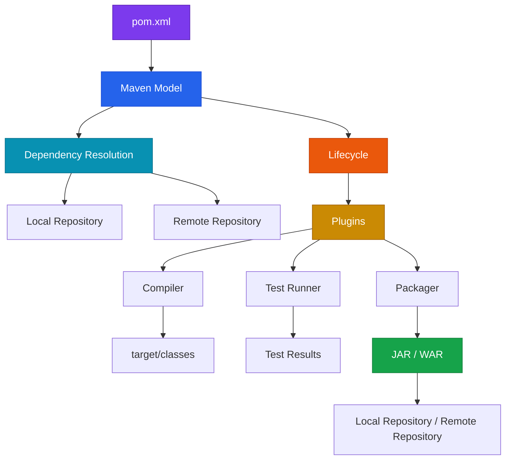
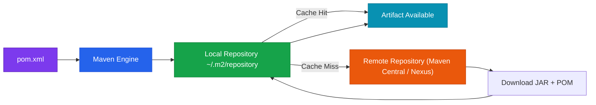
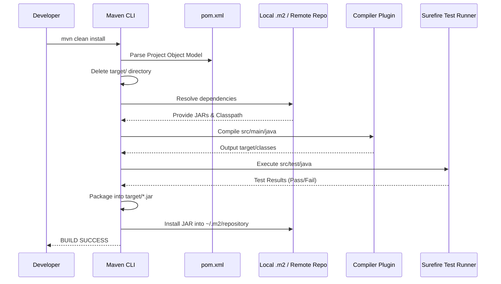

## 1. What Is Maven?

Maven is a **project management and build automation tool for Java projects**. It standardizes how a Java project is structured, how source code is compiled, how tests are executed, how dependencies are obtained, and how the resulting application or library is packaged. The underlying motivation is simple: a real Java application rarely consists of one `.java` file. It contains many classes, resources, tests, third-party libraries, build plugins, and configuration files. Maven provides a repeatable system for coordinating all of them.

The important distinction is that Maven is **not a Spring framework feature**. It is independent of Spring and can be used with Core Java, Spring, Spring Boot, Hibernate, and other Java technologies. At its core, Maven turns a collection of source files and dependency declarations into a deterministic build process that produces an artifact such as a JAR or WAR.

### The Mental Model: Maven as a Construction Manager

Imagine constructing a large building.

You have raw materials, a blueprint, subcontractors, inspection stages, construction phases, a final building, and a warehouse where finished components can be stored. Maven performs a similar coordination role for software.

| Software Concept | Construction Analogy |
| --- | --- |
| `pom.xml` | Blueprint / project contract |
| Java source | Raw construction material |
| Dependency | External component/material |
| Maven plugin | Specialized worker/tool |
| Repository | Warehouse |
| Local `.m2` repository | Local warehouse |
| Maven Central | Public supplier |
| `compile` | Transforming raw material into usable components |
| `test` | Inspection |
| `package` | Assembling the final product |
| `install` | Putting the finished product in your local warehouse |
| `deploy` | Shipping it to a remote warehouse |
| JAR | Packaged finished product |
| `target/` | Temporary construction site |

---

## 2. Java's Journey Before Maven

The fundamental Java execution pipeline is:

```text
Hello.java ──► javac ──► Hello.class ──► JVM ──► Program Output
```

A `.java` file is source code written by the developer. The Java compiler converts it into `.class` bytecode, and the JVM executes that bytecode. Java therefore does not normally execute the source `.java` file directly.

A real application may contain `User.java`, `Order.java`, `Payment.java`, `EmailService.java`, `InvoiceGenerator.java`, and `Main.java`. Manually distributing individual `.class` files quickly becomes problematic. The JAR format solves this as the standard packaging mechanism.

### The JAR Mental Model

Think of a JAR as a **Java-oriented ZIP archive**. It contains `.class` files, package/folder structures, images, properties files, configuration, and metadata.

```text
Many Java files ──► Compile ──► Many .class files ──► Package ──► application.jar
```

### Library JAR vs Application JAR

A JAR is a **packaging format**, not automatically an application.

| Type | Purpose | Typical Behavior |
| --- | --- | --- |
| **Library JAR** | Reusable code for other applications | Consumed as a dependency by another application |
| **Application JAR** | Complete runnable application | Contains an application entry point and required runtime structure |
| **Spring Boot Executable JAR** | Self-contained runnable Spring Boot app | Packages application code with embedded server & dependencies |

---

## 3. Maven Architecture

The complete high-level build flow is:



> **Key Architectural Principle**: Maven itself does not implement every build operation. Maven coordinates plugins and lifecycle phases that perform those operations.

---

## 4. Module Roadmap

| Module | Core Topics | Key Focus & Engineering Concepts | Read Time |
| --- | --- | --- | ---: |
| 01 | Java → JAR | Compilation, bytecode, packaging | 10 min |
| 02 | Maven Fundamentals | Build automation, conventions | 10 min |
| 03 | Maven Project Structure | `src`, `target`, resources | 10 min |
| 04 | `pom.xml` | Coordinates, packaging, properties | 15 min |
| 05 | Dependencies | Direct and transitive dependencies | 15 min |
| 06 | Repositories | Local, Central, remote repositories | 15 min |
| 07 | Dependency Resolution | Cache, POM metadata, classpath | 20 min |
| 08 | Maven Plugins | Build-time execution model | 15 min |
| 09 | Lifecycles | Clean, default, site | 20 min |
| 10 | Build Commands | `compile`, `package`, `install`, `deploy` | 15 min |
| 11 | Production Engineering | Reproducibility, dependency hygiene | 20 min |

---

## 5. Standard Maven Project Structure

Maven follows **Convention over Configuration**.

```text
my-maven-project/
│
├── pom.xml
│
├── src/
│   ├── main/
│   │   ├── java/
│   │   └── resources/
│   │
│   └── test/
│       ├── java/
│       └── resources/
│
└── target/
```

### Directory Responsibilities

| Directory | Responsibility | Generated? |
| --- | --- | --- |
| `src/main/java` | Production Java source | No |
| `src/main/resources` | Production resources (properties, XML, YAML) | No |
| `src/test/java` | Test Java source | No |
| `src/test/resources` | Test-only resources | No |
| `target/` | Build output (`.class` files, compiled artifacts) | **Yes** |
| `pom.xml` | Maven project definition | No |

<Callout type="warn" title="⚠️ Git Hygiene">
Do not commit `target/` to Git in a normal Maven project. It contains generated build artifacts rather than authoritative source code.
</Callout>

---

## 6. `pom.xml`: The Maven Blueprint

`pom.xml` stands for **Project Object Model**. It is the central project definition Maven reads to determine project identity, dependencies, plugins, packaging, and properties.

```xml
<?xml version="1.0" encoding="UTF-8"?>
<project xmlns="http://maven.apache.org/POM/4.0.0"
         xmlns:xsi="http://www.w3.org/2001/XMLSchema-instance"
         xsi:schemaLocation="
           http://maven.apache.org/POM/4.0.0
           https://maven.apache.org/xsd/maven-4.0.0.xsd">

    <modelVersion>4.0.0</modelVersion>

    <groupId>com.example</groupId>
    <artifactId>calculator-app</artifactId>
    <version>1.0.0</version>

</project>
```

### Maven Coordinates

The identity of a Maven artifact is uniquely defined by: `groupId` + `artifactId` + `version`.

* **`groupId`**: Logical organization or package namespace (`com.example`)
* **`artifactId`**: Specific project/module name (`calculator-app`)
* **`version`**: Artifact version string (`1.0.0`)

Combined coordinate string: `com.example:calculator-app:1.0.0`

---

## 7. SNAPSHOT Versions

| Version String | Meaning | Operational Rules |
| --- | --- | --- |
| `1.0.0` | Released / Stable Version | Immutable; artifact contents must never change |
| `1.0.0-SNAPSHOT` | Development Version | Mutable; represents ongoing work in progress |

<Callout type="info" title="💡 SNAPSHOT Behavior">
Maven re-checks repositories for updated `SNAPSHOT` artifacts during builds according to update policies, whereas stable release artifacts are fetched once and cached indefinitely.
</Callout>

---

## 8. Packaging

The `<packaging>` element defines the output format:

```xml
<packaging>jar</packaging>
```

Common packaging types:
* `jar`: Java Archive (Default if omitted)
* `war`: Web Application Archive for servlet container deployment
* `pom`: Parent or multi-module aggregator project

---

## 9. Properties

Properties centralize configuration values across the POM:

```xml
<properties>
    <maven.compiler.source>17</maven.compiler.source>
    <maven.compiler.target>17</maven.compiler.target>
    <project.build.sourceEncoding>UTF-8</project.build.sourceEncoding>
</properties>
```

---

## 10. Dependencies & Plugins

Dependencies are external libraries required by your application code:

```xml
<dependency>
    <groupId>mysql</groupId>
    <artifactId>mysql-connector-j</artifactId>
    <version>8.3.0</version>
</dependency>
```

### Dependency vs. Plugin

| Concept | Used By | Purpose |
| --- | --- | --- |
| **Dependency** | Application Code | Provides classes, APIs, and business functions at runtime/compile-time |
| **Plugin** | Maven Build Tooling | Executes build-time tasks (compiling, testing, packaging) |

---

## 11. Transitive Dependencies

If your application depends on Library A, and Library A depends on Library B, Maven automatically resolves Library B. Library B is a **transitive dependency**.

```text
Application ──► Declares Library A ──► Requires Library B ──► Requires Library C
```

Maven constructs and resolves a full **Dependency Graph**.

<Callout type="warn" title="⚠️ Transitive Conflict Warning">
Different libraries may transitively request different versions of the same artifact. Inspect the dependency tree (`mvn dependency:tree`) to prevent runtime `NoSuchMethodError` or `ClassNotFoundException` issues.
</Callout>

---

## 12. Classpath: The Bridge Between Your Code and JARs

Java needs a mechanism to locate `.class` files during compilation and execution. That mechanism is the **classpath**.

```text
src/main/java ──► compiler ──► [ Project Classes + External Dependency JARs ] ──► Compiler Classpath
```

* **Maven** resolves dependency declarations from repositories.
* **The JVM / Java Compiler** consumes the resolved file paths as the runtime/compile-time classpath.

---

## 13. Maven Repositories

A Maven repository is a storage directory for artifacts (`.jar`, `.pom`).



### 1. Local Repository
Stored at `~/.m2/repository` (Linux/macOS) or `C:\Users\<user>\.m2\repository` (Windows). Acts as a local cache for downloaded artifacts and locally installed project builds.

### 2. Maven Central
The default public repository hosting millions of open-source Java libraries.

### 3. Remote / Enterprise Repositories
Private organizational servers (e.g., Sonatype Nexus, JFrog Artifactory, GitHub Packages) hosting internal enterprise artifacts.

---

## 14. `settings.xml`

While `pom.xml` handles **project-specific configuration**, `settings.xml` handles **user- and machine-specific configuration** (located at `~/.m2/settings.xml`).

Contains:
* Private repository authentication credentials
* HTTP proxy settings
* Repository mirror configurations

---

## 15. Maven Plugins

Maven is fundamentally driven by plugins.

> **Lifecycle Phase = WHAT stage of the build we are in.**  
> **Plugin Goal = WHICH tool actually performs the work.**

Examples:
* `compile` phase → `maven-compiler-plugin:compile`
* `test` phase → `maven-surefire-plugin:test`
* `package` phase → `maven-jar-plugin:jar` or `spring-boot-maven-plugin:repackage`

---

## 16. Maven Lifecycles

Maven defines three built-in build lifecycles:

1. **Clean**: Deletes build artifacts from previous builds (`target/`).
2. **Default**: Handles main compilation, testing, packaging, and deployment.
3. **Site**: Generates documentation and site reports.

```text
validate ──► compile ──► test ──► package ──► verify ──► install ──► deploy
```

### The Fundamental Lifecycle Rule

> **If you invoke a specific phase, Maven automatically executes all preceding phases in that lifecycle first.**

Executing `mvn package` automatically runs `validate` → `compile` → `test` → `package`.

---

## 17. Default Lifecycle Phases

| Phase | Core Responsibility | Primary Output |
| --- | --- | --- |
| `validate` | Validates project structure and POM correctness | Validation status |
| `compile` | Compiles production code under `src/main/java` | `target/classes/*.class` |
| `test` | Compiles and executes unit tests under `src/test/java` | `target/surefire-reports` |
| `package` | Packages compiled classes into configured format | `target/app.jar` or `app.war` |
| `verify` | Executes integration tests and quality checks | Verification reports |
| `install` | Copies built artifact into local `~/.m2/repository` | Local cache entry |
| `deploy` | Copies built artifact to remote Maven repository | Remote repository entry |

---

## 18. What Does `mvn clean install` Actually Do?

`mvn clean install` combines two lifecycles:
1. **Clean Lifecycle**: Deletes the `target/` directory.
2. **Default Lifecycle up to `install`**: `validate` → `compile` → `test` → `package` → `verify` → `install`.

```text
Clean target/ ──► Compile Main ──► Run Tests ──► Create JAR ──► Copy to ~/.m2/repository
```

<Callout type="info" title="💡 target/ vs ~/.m2/repository">
* `target/`: Generated build directory for **this single project**. Can be safely deleted.
* `~/.m2/repository`: Global artifact cache for **all Java projects on your machine**.
</Callout>

---

## 19. Maven Build Pipeline



---

## 20. High-Density Command Matrix

| Command | Lifecycle / Action | Main Result |
| --- | --- | --- |
| `mvn validate` | Default: Validate | Validates POM structure and resources |
| `mvn compile` | Default: Compile | Compiles `src/main/java` to `target/classes` |
| `mvn test` | Default: Test | Runs JUnit tests and outputs test reports |
| `mvn package` | Default: Package | Builds executable JAR/WAR in `target/` |
| `mvn verify` | Default: Verify | Runs integration tests and verifies package quality |
| `mvn install` | Default: Install | Copies output JAR into `~/.m2/repository` |
| `mvn deploy` | Default: Deploy | Uploads output JAR to remote enterprise repository |
| `mvn clean` | Clean | Deletes `target/` build directory |
| `mvn site` | Site | Generates HTML documentation site in `target/site/` |
| `mvn dependency:tree` | Plugin Goal | Displays full tree of direct & transitive dependencies |

---

## 21. Common Misconceptions

| Misconception | Correct Engineering Reality |
| --- | --- |
| *"Maven is a Java compiler"* | Maven coordinates plugins. `maven-compiler-plugin` invokes `javac`. |
| *"A dependency is the same as a plugin"* | Dependencies are used by application code; plugins are executed by Maven during builds. |
| *"JAR means an executable application"* | A JAR is a packaging format. It can be a reusable library or an executable app. |
| *"`mvn package` only packages"* | Maven executes all preceding lifecycle phases (`compile`, `test`) first. |
| *"`mvn install` uploads to the internet"* | `install` copies to local `~/.m2`. `deploy` uploads to remote repositories. |
| *"Deleting `.m2` deletes the project build"* | Deleting `target/` removes project build output. Deleting `.m2` wipes cached dependencies. |

---

## 22. Interactive Self-Assessment

<Quiz
question="A Maven project declares dependency A. A depends on B, and B depends on C. What is the most accurate description of what Maven does when resolving A?"
options={[
"Maven downloads only A because dependencies must always be declared explicitly",
"Maven can resolve B and C transitively because they are dependencies of dependencies",
"Maven packages B and C inside A's source code before compilation",
"Maven ignores B and C until the JVM encounters a missing class at runtime"
]}
answerIndex={1}>
**Option B is correct.**

Maven constructs a dependency relationship graph. If the project directly declares A and A requires B while B requires C, Maven resolves the transitive dependency chain.

```text
Application ──► A ──► B ──► C
```

Maven resolves artifacts and their metadata so that all required libraries become available to the appropriate build classpaths.
</Quiz>

<Quiz
question="What is the key difference between mvn install and mvn deploy?"
options={[
"mvn install runs tests while mvn deploy skips tests",
"mvn install creates a JAR while mvn deploy creates a WAR",
"mvn install places the artifact in the local Maven repository while mvn deploy publishes it to a remote Maven repository",
"mvn install uploads source code to GitHub while mvn deploy uploads compiled classes"
]}
answerIndex={2}>
**Option C is correct.**

The distinction is the destination:
* `mvn install` copies the artifact to the local machine repository (`~/.m2/repository`).
* `mvn deploy` publishes the artifact to a remote Maven repository (e.g., Nexus, Artifactory, or Central).
</Quiz>

<Quiz
question="You execute mvn package on a Maven project. Why does Maven normally compile and test the project before creating the JAR?"
options={[
"Because package secretly belongs to the clean lifecycle",
"Because Maven phases in a lifecycle are ordered and invoking a later phase executes the required earlier phases first",
"Because JAR files cannot contain compiled classes unless Maven runs install first",
"Because package always downloads the project from Maven Central before execution"
]}
answerIndex={1}>
**Option B is correct.**

Maven lifecycle phases form an ordered pipeline (`validate` → `compile` → `test` → `package`). Requesting `package` automatically triggers all preceding phases in that lifecycle.
</Quiz>

<Quiz
question="A developer deletes target/ and the next Maven build recreates it, while deleting ~/.m2/repository/ causes Maven to download dependencies again. Why?"
options={[
"Both directories contain identical copies of the project but Maven uses different names",
"target/ is generated project build output, while ~/.m2/repository/ is Maven's local artifact repository/cache",
"~/.m2/repository/ contains source files and target/ contains only dependencies",
"Deleting target/ changes Maven's dependency versions"
]}
answerIndex={1}>
**Option B is correct.**

`target/` contains generated output for the specific project build, whereas `~/.m2/repository/` stores cached dependencies and locally installed artifacts shared across projects on the machine.
</Quiz>

---

## 23. Mastery Checklist

* [ ] Explain why `.java` files are compiled to `.class` bytecode before execution.
* [ ] Explain the purpose of a JAR file as a Java ZIP archive.
* [ ] Distinguish between a Library JAR and an Executable Spring Boot JAR.
* [ ] Define `groupId`, `artifactId`, and `version` coordinates.
* [ ] Explain the difference between `1.0.0` (Release) and `1.0.0-SNAPSHOT`.
* [ ] Differentiate between a Maven Dependency and a Maven Plugin.
* [ ] Explain how transitive dependencies work and how to view them (`mvn dependency:tree`).
* [ ] Explain the difference between `target/` and `~/.m2/repository/`.
* [ ] Explain the role of `settings.xml` versus `pom.xml`.
* [ ] List the primary phases of the Default lifecycle in order.
* [ ] Explain why `mvn package` automatically compiles code and runs tests.
* [ ] Explain the difference between `mvn install` and `mvn deploy`.
* [ ] Explain what `mvn clean install` executes step-by-step.
