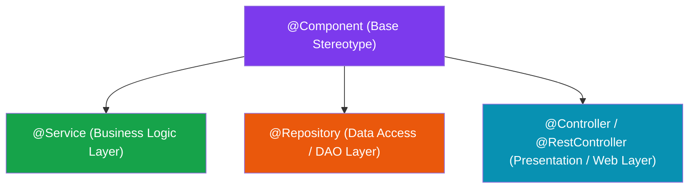

In the Spring ecosystem, managed application objects are called **Spring Beans**, and the environment that manages them is called the **Spring IoC Container** (`ApplicationContext`).

## 1. What Is a Spring Bean?

A **Spring Bean** is simply a Java object that is instantiated, assembled, wired, and managed by the Spring IoC Container, rather than manually created with `new`.

```text
Plain Java Object (POJO):
  User user = new User(); // You manage creation, wiring, garbage collection.

Spring Bean:
  Managed by ApplicationContext (Lifecycle, Dependency Injection, Scope, AOP Proxies).
```

### `ApplicationContext` vs `BeanFactory`

`ApplicationContext` is the advanced interface representing the Spring IoC Container:

```text
BeanFactory (Basic Container Interface)
   ▲
   │ (Extends)
ApplicationContext (Enterprise Container Interface)
   ├── Event Publication (ApplicationEvent)
   ├── Internationalization (MessageSource)
   ├── Environment / Profile Management (Environment)
   └── AOP & Annotation Integration
```

---

## 2. Stereotype Annotations (`@Component` & Derivatives)

To inform Spring that a Java class should be registered as a Spring Bean, you mark it with a **Stereotype Annotation**:



| Annotation | Application Layer | Special Spring Behavior |
| :--- | :--- | :--- |
| **`@Component`** | Generic Utility / Any Layer | General-purpose component managed by Spring. |
| **`@Service`** | Business Logic Layer | Indicates class holds domain business logic and transactions. |
| **`@Repository`** | Data Access Layer (DAO) | Catches SQL/Persistence exceptions and translates them into Spring's `DataAccessException` hierarchy. |
| **`@Controller`** | Presentation / Web Layer | Handles HTTP requests, web routing, and view rendering. |

---

## 3. Explicit Configuration: `@Configuration` & `@Bean`

Stereotype annotations (`@Component`) work great when you own the Java source code. **What if you need to register a bean from an external third-party library (e.g., `RestTemplate`, `ObjectMapper`, or Redis Connection Factory)?**

You cannot add `@Component` to third-party compiled `.class` files. Instead, you use explicit Java configuration via **`@Configuration`** and **`@Bean`**:

```java
package com.kdev.demo.config;

import org.springframework.context.annotation.Bean;
import org.springframework.context.annotation.Configuration;
import org.springframework.web.client.RestTemplate;

@Configuration // Marks class as a factory blueprint for Spring Beans
public class AppConfig {

    // Return value of this factory method is registered as a Spring Bean
    @Bean
    public RestTemplate restTemplate() {
        return new RestTemplate();
    }
}
```

### `@Component` vs `@Bean` Comparison

| Dimension | `@Component` (Class-Level) | `@Bean` (Method-Level) |
| :--- | :--- | :--- |
| **Target** | Placed on **Class declarations**. | Placed on **Factory Methods** inside `@Configuration`. |
| **Source Ownership** | Requires access to **source code**. | Works with **third-party libraries** and unmodifiable code. |
| **Custom Setup** | Automatic component scanning. | Allows complex multi-line custom initialization logic. |

---

## 4. `BeanDefinition` Metadata

Before Spring instantiates a bean, it reads annotations or XML configuration and creates a **`BeanDefinition`** object in memory.

A `BeanDefinition` acts as a **recipe/blueprint** specifying:
* Class implementation type (`com.kdev.demo.service.EmailService`).
* Scope (`singleton`, `prototype`).
* Dependency wiring references (`userRepository`).
* Primary/Qualifier priority flags.
* Initialization (`@PostConstruct`) and Destruction (`@PreDestroy`) callbacks.

---

## 5. Resolving Bean Ambiguity (`NoUniqueBeanDefinitionException`)

Suppose you define an interface `PaymentProcessor` with two concrete implementations registered as Spring Beans:

```java
public interface PaymentProcessor {
    void processPayment(double amount);
}

@Component
public class CreditCardProcessor implements PaymentProcessor { ... }

@Component
public class PaypalProcessor implements PaymentProcessor { ... }
```

If a service requests `PaymentProcessor` via Constructor Injection:

```java
@Service
public class CheckoutService {

    private final PaymentProcessor paymentProcessor;

    public CheckoutService(PaymentProcessor paymentProcessor) {
        this.paymentProcessor = paymentProcessor;
    }
}
```

Spring will fail on application startup with a fatal exception:
`NoUniqueBeanDefinitionException: No qualifying bean of type 'PaymentProcessor' available: expected single matching bean but found 2: creditCardProcessor, paypalProcessor`

### Solution 1: `@Primary` (Default Candidate)

Mark one implementation with `@Primary`. Spring will select it as the default whenever ambiguity occurs:

```java
@Component
@Primary // Selected by default
public class CreditCardProcessor implements PaymentProcessor { ... }
```

### Solution 2: `@Qualifier` (Explicit Target Selection)

Use `@Qualifier` to explicitly specify the target bean name at the injection site:

```java
@Service
public class CheckoutService {

    private final PaymentProcessor paymentProcessor;

    // Explicitly requests the 'paypalProcessor' bean
    public CheckoutService(@Qualifier("paypalProcessor") PaymentProcessor paymentProcessor) {
        this.paymentProcessor = paymentProcessor;
    }
}
```

---

## ❓ Knowledge Check

<Quiz question="What exception will Spring throw at startup if two beans implement the same interface and neither @Primary nor @Qualifier is specified at the injection site?" options={["NullPointerException", "NoUniqueBeanDefinitionException", "ClassNotFoundException", "BeanCreationException: Circular Dependency"]} answerIndex={1}>
Spring throws `NoUniqueBeanDefinitionException` because the container cannot decide which candidate bean to inject into the single interface reference.
</Quiz>

<Quiz question="When should a developer use @Configuration + @Bean factory methods instead of adding @Component to a class?" options={["When registering third-party library classes whose source code cannot be modified", "When building desktop applications", "When disabling all Spring Security filters", "When compiling code with Maven"]} answerIndex={0}>
`@Configuration` with `@Bean` factory methods allows registering objects from third-party JARs (like Jackson, RestTemplate) where adding class-level `@Component` annotations is impossible.
</Quiz>
