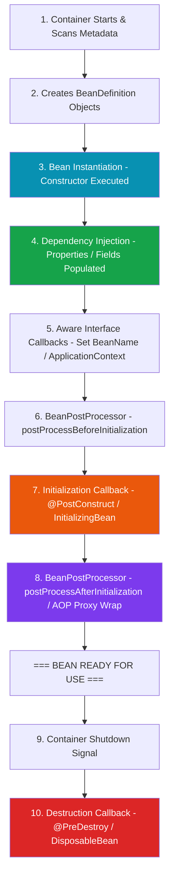

Understanding the **Spring Bean Lifecycle** is essential for advanced application architecture, debugging startup crashes, writing custom framework extensions, and preventing memory leaks.

## 1. The Complete Bean Lifecycle Pipeline

From container startup to application shutdown, every Spring Bean progresses through a deterministic multi-stage pipeline:



---

## 2. Step-by-Step Lifecycle Phase Breakdown

### Phase 1: Metadata Scanning & `BeanDefinition`
The container scans `@Component` classes and `@Bean` methods, populating `BeanDefinition` metadata recipes before any objects exist in memory.

### Phase 2: Instantiation (Constructor Execution)
Spring calls the constructor of the bean class to allocate heap memory for the raw Java instance.
> [!CAUTION]
> **Constructor Warning**: Inside the constructor, injected fields are still **`null`**! Do not attempt to call methods on injected dependencies inside a zero-arg constructor.

### Phase 3: Dependency Injection (Populating Properties)
Spring injects required dependencies into fields or setters.

### Phase 4: `Aware` Callbacks
If the bean implements framework `Aware` interfaces, Spring injects container infrastructure references:
* **`BeanNameAware`**: Injects the string ID of the bean (`setBeanName()`).
* **`ApplicationContextAware`**: Injects the `ApplicationContext` container instance (`setApplicationContext()`).

### Phase 5: `BeanPostProcessor` Pre-Initialization
Spring passes the bean to registered `BeanPostProcessor` instances, triggering `postProcessBeforeInitialization()`.

### Phase 6: Initialization (`@PostConstruct`)
Spring invokes custom initialization hooks where all dependencies are guaranteed to be fully injected and non-null:

```java
@Service
public class CacheManager {

    private final RedisRepository redisRepository;

    public CacheManager(RedisRepository redisRepository) {
        this.redisRepository = redisRepository;
        // WRONG: redisRepository is non-null here via constructor injection, 
        // but complex remote connections should be deferred to @PostConstruct!
    }

    @PostConstruct
    public void initCache() {
        // RIGHT: Executed after bean is fully constructed and container-ready
        System.out.println("Pre-loading cache entries from Redis...");
        redisRepository.loadDefaultKeys();
    }
}
```

### Phase 7: `BeanPostProcessor` Post-Initialization (AOP Proxies)
Spring passes the bean through `postProcessAfterInitialization()`. 

> [!IMPORTANT]
> **AOP Proxy Wrapping**: This is the exact phase where Spring wraps your bean in a **Dynamic Proxy** if the bean uses `@Transactional`, `@Async`, or `@PreAuthorize`.

### Phase 8: Bean Ready for Use
The bean resides in the container singleton registry, ready to serve incoming application requests.

### Phase 9: Destruction (`@PreDestroy`)
When the application context shuts down gracefully (`context.close()`), Spring triggers destruction hooks to clean up resources:

```java
@Component
public class DatabaseConnectionPool {

    @PreDestroy
    public void cleanupPool() {
        System.out.println("Closing database socket pools and releasing connections...");
        // Release connections, close thread pools, flush log buffers
    }
}
```

---

## 3. Initialization Options Comparison

Spring offers three ways to define initialization logic. Here is how they compare:

| Mechanism | Example | Framework Coupling | Execution Priority | Recommendation |
| :--- | :--- | :--- | :---: | :--- |
| **`@PostConstruct`** | `@PostConstruct public void init()` | Low (JSR-250 / Jakarta Standard) | **1st** | **Industry Standard ⭐** |
| **`InitializingBean`** | `implements InitializingBean` (`afterPropertiesSet()`) | High (Spring specific interface) | **2nd** | Legacy Spring |
| **Custom `@Bean` initMethod** | `@Bean(initMethod = "customInit")` | None (Decoupled method name) | **3rd** | Best for 3rd Party Code |

---

## ❓ Knowledge Check

<Quiz question="Why will calling a method on an @Autowired field inside a zero-argument class constructor throw a NullPointerException?" options={["Because Spring beans cannot use constructors", "Because field dependency injection occurs AFTER class instantiation (constructor execution) finishes", "Because Java 17 prohibits constructors", "Because @Autowired only works on static methods"]} answerIndex={1}>
Java constructor execution allocates the raw object instance first. Field dependencies are populated by Spring during Phase 3 **after** the constructor finishes, so fields remain `null` during constructor execution.
</Quiz>

<Quiz question="In which lifecycle phase does Spring generate dynamic AOP proxies for beans annotated with @Transactional or @Async?" options={["Phase 2: Instantiation", "Phase 4: Aware Callbacks", "Phase 7: BeanPostProcessor (postProcessAfterInitialization)", "Phase 9: Destruction (@PreDestroy)"]} answerIndex={2}>
Spring's `BeanPostProcessor` wraps the raw bean instance with a dynamic AOP proxy during the post-initialization phase, enabling transaction management and asynchronous execution.
</Quiz>
