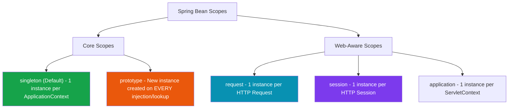
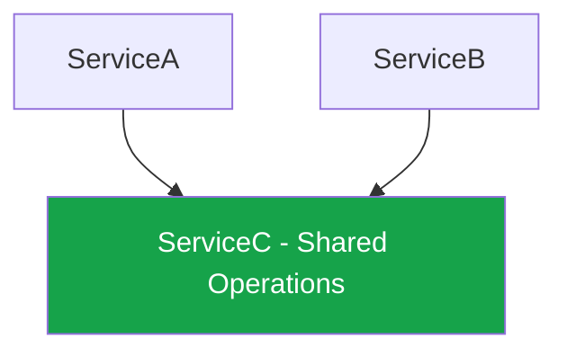

Beyond standard bean creation, advanced Spring development requires managing **bean lifespans (scopes)**, controlling **initialization timing (`@Lazy`)**, and resolving **circular dependency cycles**.


## 1. Spring Bean Scopes

A **Bean Scope** defines the lifespan and visibility of a bean instance created by the container.



### Core Scopes Matrix

| Scope | Instances Created | Lifespan | Primary Use Case |
| :--- | :--- | :--- | :--- |
| **`singleton`** (Default) | **Exactly ONE** shared instance per Spring container. | Duration of application runtime. | Stateless services (`@Service`, `@Repository`, `@RestController`). |
| **`prototype`** | **NEW instance created** every time bean is requested. | Created by container, caller manages garbage collection. | Stateful objects, user-specific task runners, non-thread-safe buffers. |
| **`request`** | One instance per incoming **HTTP request**. | Duration of single HTTP request. | Storing request-scoped headers, user audit context. |
| **`session`** | One instance per **HTTP Session**. | Duration of user login session. | Shopping cart state, user session profile. |

---

## 2. The Prototype-in-Singleton Injection Problem

What happens when you inject a **`prototype`** scope bean into a **`singleton`** scope bean?

```java
@Component
@Scope("prototype")
public class TokenGenerator {
    private String tokenId = UUID.randomUUID().toString();
    public String getTokenId() { return tokenId; }
}

@Service // Default Singleton Scope
public class AuthService {

    private final TokenGenerator tokenGenerator;

    public AuthService(TokenGenerator tokenGenerator) {
        this.tokenGenerator = tokenGenerator; // Injected ONLY ONCE at startup!
    }

    public String generateToken() {
        return tokenGenerator.getTokenId();
    }
}
```

### The Bug

Because `AuthService` is a `singleton`, Spring instantiates it **once** at application startup. During that single instantiation, Spring injects `TokenGenerator`. 

Even though `TokenGenerator` is marked `@Scope("prototype")`, `AuthService` holds onto that single injected reference forever! `generateToken()` will return the **exact same token ID** for every request!

---

### Solution 1: `ObjectProvider<T>` (Modern & Clean ⭐)

Instead of injecting `TokenGenerator` directly, inject an `ObjectProvider<TokenGenerator>`:

```java
@Service
public class AuthService {

    private final ObjectProvider<TokenGenerator> tokenProvider;

    public AuthService(ObjectProvider<TokenGenerator> tokenProvider) {
        this.tokenProvider = tokenProvider;
    }

    public String generateToken() {
        // Fetches a BRAND NEW prototype instance on demand
        return tokenProvider.getObject().getTokenId();
    }
}
```

---

## 3. Lazy Initialization (`@Lazy`)

By default, Spring instantiates all **`singleton`** beans eagerly at container startup. This ensures configuration errors fail fast when the application boots.

If an application has 500+ beans or heavy startup computations, eager loading can slow down startup. Adding **`@Lazy`** defers bean creation until the bean is requested for the first time:

```java
@Component
@Lazy // Instantiation deferred until first method call
public class HeavyReportGenerator {
    public HeavyReportGenerator() {
        System.out.println("HeavyReportGenerator initialized!");
    }
}
```

### `@Lazy` Injection Proxies

When injecting a `@Lazy` bean into another component, Spring injects a **Dynamic Lazy Proxy**:

```java
@Service
public class DashboardService {

    private final HeavyReportGenerator reportGenerator;

    // Spring injects a lightweight proxy object immediately.
    // Real HeavyReportGenerator is created ONLY when reportGenerator.generate() is called.
    public DashboardService(@Lazy HeavyReportGenerator reportGenerator) {
        this.reportGenerator = reportGenerator;
    }
}
```

---

## 4. Circular Dependencies

A **Circular Dependency** occurs when Bean A requires Bean B, and Bean B requires Bean A (either directly or transitively through Bean C).


```java
@Service
public class ServiceA {
    private final ServiceB serviceB;
    public ServiceA(ServiceB serviceB) { this.serviceB = serviceB; }
}

@Service
public class ServiceB {
    private final ServiceA serviceA;
    public ServiceB(ServiceA serviceA) { this.serviceA = serviceA; }
}
```

### Why Constructor Cycles Crash Application Startup

When Spring attempts to create `ServiceA`, it sees constructor parameter `ServiceB`.
Spring pauses `ServiceA` creation and tries to instantiate `ServiceB`.
To create `ServiceB`, it requires `ServiceA` (which is still in creation!).
Spring detects an infinite recursive loop and throws a fatal startup exception:

`BeanCurrentlyInCreationException: Error creating bean with name 'serviceA': Requested bean is currently in creation: Is there an unresolvable circular reference?`

---

## 5. Circular Dependency Resolution Strategies

### Strategy 1: Architectural Refactoring (Best Practice ⭐)

Circular dependencies are usually a symptom of poor architectural separation. Extract the shared logic into a third component, **`ServiceC`**:



### Strategy 2: `@Lazy` Injection Proxy

If refactoring is impossible in legacy code, break the startup instantiation loop using `@Lazy` on one constructor parameter:

```java
@Service
public class ServiceA {
    private final ServiceB serviceB;

    // Breaks cycle by injecting a Proxy for ServiceB at startup
    public ServiceA(@Lazy ServiceB serviceB) {
        this.serviceB = serviceB;
    }
}
```

---

## ❓ Knowledge Check

<Quiz question="What bug occurs when a prototype-scoped bean is injected directly into a standard singleton-scoped bean via constructor injection?" options={["Spring throws a ClassCastException at runtime", "The prototype bean acts like a singleton, returning the exact same instance forever because injection occurred only once", "The application crashes with a OutOfMemoryError immediately", "The prototype bean is recreated every 5 seconds by a background thread"]} answerIndex={1}>
Because the singleton outer bean is created only once at startup, its injected dependencies are populated only once. Thus, the prototype bean is never re-requested, neutralizing its prototype scope.
</Quiz>

<Quiz question="How does adding @Lazy to a constructor parameter break a circular dependency between two Spring services?" options={["It deletes one of the services from memory", "It injects a lightweight proxy object instantly, allowing the constructor to finish booting before the real target bean is created", "It converts the services to pure C code", "It forces the JVM to disable multithreading"]} answerIndex={1}>
`@Lazy` injects a dynamic proxy placeholder immediately without instantiating the real target bean during container boot, resolving the constructor creation deadlock.
</Quiz>
