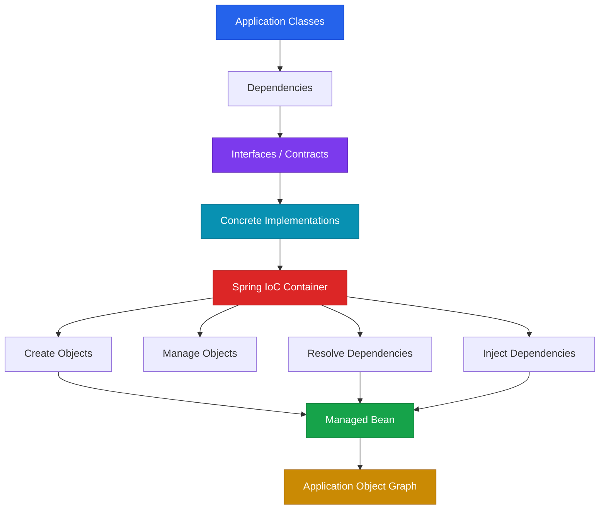
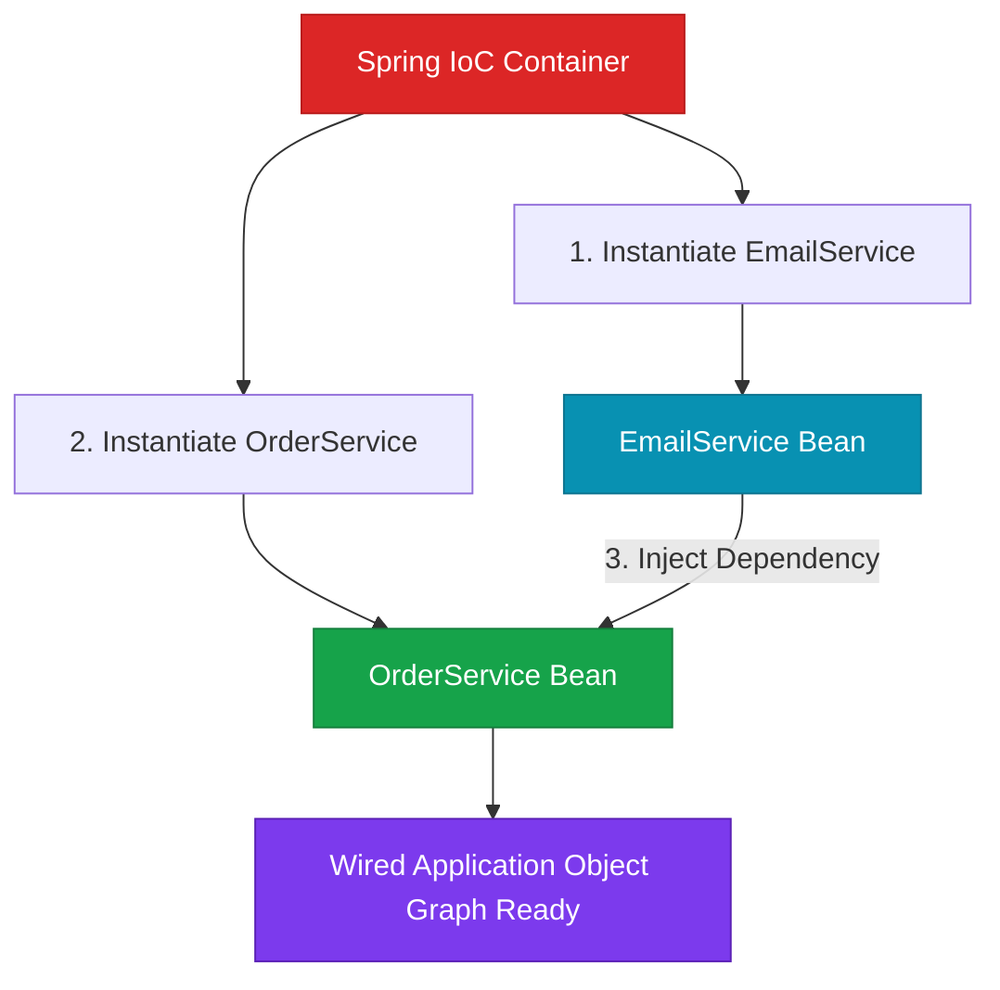

## 1. High-Level Concept Definition

Spring Core is the foundation of the Spring ecosystem. Its central responsibility is not HTTP, REST APIs, databases, or web applications; it is **object creation, dependency management, and object wiring**. Java already provides classes, interfaces, constructors, inheritance, and objects, but as an application grows, manually creating and connecting hundreds of dependent objects becomes difficult to maintain. Spring Core introduces an external **IoC container** that takes responsibility for this object graph.

The fundamental design shift is from **"a class creates the objects it needs"** to **"a class declares what it needs and receives those objects from outside."** This technique is called **Dependency Injection (DI)**. DI reduces coupling, makes implementations replaceable, improves testability, and separates business logic from object-construction logic. **Inversion of Control (IoC)** describes the broader reversal of control: object creation and wiring move from the business class to an external system. Spring automates this pattern through its IoC container.

---

## 2. The Core Mental Model: A Restaurant Kitchen

Imagine a restaurant. A chef's responsibility is to **prepare food**.

The chef should not also have to manufacture the oven, build the refrigerator, produce the plates, hire the delivery driver, or manufacture the ingredients.

The chef should simply say: *"I need an oven, ingredients, and cooking utensils."* Someone else supplies those resources.

This is the mental model behind Dependency Injection.

### Analogy Mapping

| Software Concept | Real-World Equivalent |
| --- | --- |
| **Business class** | Chef |
| **Dependency** | Equipment / resource the chef needs |
| **Interface** | Contract describing what service is required |
| **Concrete implementation** | Specific supplier / equipment |
| **Constructor** | Delivery point where required resources arrive |
| **IoC container** | Restaurant management system |
| **Bean** | Object registered and managed by restaurant management |
| **Dependency injection** | Supplying required resources from outside |
| **Object graph** | Complete network of chefs, equipment, suppliers, and resources |
| **Spring configuration** | Rules telling management what should exist and how components connect |

---

## 3. Spring Core Architecture



At a high level, Spring Core performs three fundamental jobs:

```text
Create objects ──► Manage objects ──► Connect objects together (Wiring)
```

---

## 4. Module Roadmap

| Module | Core Topics | Key Focus & Engineering Concepts | Read Time |
| --- | --- | --- | ---: |
| 01 | Dependencies | Dependency graphs and object relationships | 10 min |
| 02 | Tight Coupling | Concrete dependencies and change propagation | 15 min |
| 03 | Interfaces | Abstraction and substitutable implementations | 15 min |
| 04 | Dependency Injection | External dependency provisioning | 15 min |
| 05 | IoC | Reversal of object-creation responsibility | 15 min |
| 06 | DI Types | Constructor, setter, field injection | 15 min |
| 07 | Spring IoC Container | Object creation, management, wiring | 20 min |
| 08 | Beans | Spring-managed objects | 10 min |
| 09 | Object Graphs | Runtime dependency topology | 15 min |
| 10 | Testing | Fakes, mocks, implementation substitution | 15 min |
| 11 | Production Design | Coupling, SRP, OCP, maintainability | 20 min |

---

## 5. Dependency: The Foundation

A **dependency is something a class needs to complete its work**.

```java
class EmailService {
    public void sendEmail() {
        System.out.println("Email sent");
    }
}

class OrderService {
    private EmailService emailService = new EmailService();

    public void placeOrder() {
        System.out.println("Order placed");
        emailService.sendEmail();
    }
}
```

```text
OrderService ──► depends on ──► EmailService
```

The problem is not that the dependency exists. The problem is **who creates it**.

---

## 6. Tight Coupling

Tightly coupled code directly depends on a specific concrete class:

```java
class OrderService {
    private EmailService emailService = new EmailService(); // Tightly coupled!
}
```

If the notification requirement changes from `Email` to `SMS`:

```java
class OrderService {
    private SmsService smsService = new SmsService(); // OrderService had to be modified!
}
```

The notification requirement changed, but `OrderService` also had to change. This creates **change propagation**.

---

## 7. Coupling Comparison Matrix

| Design | Dependency Type | Changing Implementation | Testability |
| --- | --- | --- | --- |
| **Tight Coupling** | Concrete class (`new EmailService()`) | Consumer code must change | Poorer |
| **Interface + Manual `new`** | Interface type, concrete `new` | Consumer still changes | Better |
| **Dependency Injection (DI)** | Interface + external provisioning | Consumer unchanged | **High** |
| **Spring IoC Container** | Interface + automated container wiring | Consumer unchanged | **High** |

<Callout type="warn" title="⚠️ Interface + New Fallacy">
Simply changing the field type to an interface does **not** create loose coupling if the class still contains `new EmailService()`. The class still decides which concrete implementation to use.
</Callout>

---

## 8. Interface-Based Design

Introducing an abstraction interface:

```java
public interface NotificationService {
    void sendNotification();
}

public class EmailService implements NotificationService {
    @Override
    public void sendNotification() {
        System.out.println("Email sent");
    }
}

public class SmsService implements NotificationService {
    @Override
    public void sendNotification() {
        System.out.println("SMS sent");
    }
}
```

```text
                 NotificationService (Interface)
                    /                   \
                   /                     \
                  ▼                       ▼
          EmailService                 SmsService
```

---

## 9. Dependency Injection (DI)

Instead of `OrderService` creating its dependency internally:

```java
public class OrderService {

    private final NotificationService notificationService;

    // Constructor Dependency Injection
    public OrderService(NotificationService notificationService) {
        this.notificationService = notificationService;
    }

    public void placeOrder() {
        System.out.println("Order placed successfully");
        notificationService.sendNotification();
    }
}
```

Now `OrderService` does not know or care whether it receives `EmailService`, `SmsService`, or `FakeNotificationService`.

---

## 10. Dependency Injection Types

### 1. Constructor Injection (Industry Best Practice)

```java
public class OrderService {
    private final NotificationService notificationService;

    public OrderService(NotificationService notificationService) {
        this.notificationService = notificationService;
    }
}
```

* Enables `final` immutable fields.
* Guarantees that objects cannot be created in an un-initialized state.
* Simplifies unit testing without Spring context mocks.

### 2. Setter Injection (Optional / Mutable Dependencies)

```java
public class OrderService {
    private NotificationService notificationService;

    public void setNotificationService(NotificationService notificationService) {
        this.notificationService = notificationService;
    }
}
```

* Useful for optional dependencies or dependencies that can be reconfigured at runtime.

### 3. Field Injection (Not Recommended)

```java
public class OrderService {
    @Autowired
    private NotificationService notificationService;
}
```

* Hides dependencies from the constructor signature.
* Makes unit testing harder because reflection or Spring runner is required to inject mock instances.

---

## 11. Plain Java Dependency Injection

DI is a general object-oriented design pattern and does **not** require Spring:

```java
public class Main {
    public static void main(String[] args) {
        // Plain Java Dependency Injection
        NotificationService notificationService = new EmailService();
        OrderService orderService = new OrderService(notificationService);

        orderService.placeOrder();
    }
}
```

```text
Main ──► Creates EmailService ──► Passes into OrderService Constructor ──► Runs App
```

---

## 12. Inversion of Control (IoC) vs Dependency Injection (DI)

| Concept | Definition | Architectural Category |
| --- | --- | --- |
| **Inversion of Control (IoC)** | The principle of transferring control of object creation, lifecycle, and wiring outside the class | **Design Principle** |
| **Dependency Injection (DI)** | The specific pattern of passing dependent objects into a class via constructor/setter | **Pattern / Technique** |
| **Spring IoC Container** | The framework engine that automates IoC and DI across the entire application | **Framework Implementation** |

```text
Inversion of Control (Principle)
       │
       └──► Dependency Injection (Technique)
                 │
                 └──► Spring IoC Container (Framework Implementation)
```

---

## 13. Spring IoC Container & Spring Beans

When an application contains hundreds of services, manually wiring them in `main()` becomes unmaintainable. The **Spring IoC Container** automates object creation and dependency wiring.



### What is a Spring Bean?

A **Spring Bean** is simply a Java object that is instantiated, configured, assembled, and managed by the Spring IoC container.

```text
Every Spring Bean ──► Java Object
Not every Java Object ──► Spring Bean (e.g. local variables, unmanaged entities)
```

---

## 14. Testability & Implementation Substitution

DI enables seamless implementation substitution during testing:

```java
// Fake implementation for fast unit tests without network I/O
public class FakeNotificationService implements NotificationService {
    @Override
    public void sendNotification() {
        System.out.println("Fake notification triggered for testing");
    }
}

// Unit Test:
class OrderServiceTest {
    @Test
    void testPlaceOrder() {
        NotificationService fake = new FakeNotificationService();
        OrderService service = new OrderService(fake);

        service.placeOrder(); // Fast, isolated, reliable test!
    }
}
```

---

## 15. SOLID Principles & Dependency Injection

### Single Responsibility Principle (SRP)
`OrderService` should focus strictly on order domain logic, not on deciding how to construct or configure `EmailService`.

### Open/Closed Principle (OCP)
The application is **open for extension** (adding `WhatsAppService`) but **closed for modification** (`OrderService` code remains unchanged).

---

## 16. Common Design Anti-Patterns

1. **`new` Everywhere**: Instantiate dependencies inside service classes using `new`.
2. **Interface + Concrete `new`**: Declaring an interface variable but instantiating a concrete class (`private NotificationService service = new EmailService()`).
3. **Giant Constructor (God Object)**: A constructor taking 10+ dependencies indicates that the class has too many responsibilities and violates SRP.

---

## 17. High-Density Quick Reference

| Term | Meaning | Example |
| --- | --- | --- |
| **Dependency** | Object required by a class | `NotificationService` |
| **Tight Coupling** | Direct dependency on concrete class | `new EmailService()` inside `OrderService` |
| **Loose Coupling** | Dependency on interface abstraction | `OrderService(NotificationService service)` |
| **Interface** | Contract defining required behavior | `public interface NotificationService` |
| **Dependency Injection** | Passing dependencies from outside | Constructor parameter `this.service = service` |
| **Inversion of Control** | Reversing object creation ownership | Container instantiates dependencies |
| **Spring IoC Container** | Engine managing bean lifecycles | `ApplicationContext` |
| **Spring Bean** | Object managed by Spring IoC | `@Service class OrderService` |

---

## 18. Self-Assessment

<Quiz
question="Why is `private NotificationService service = new EmailService();` still considered coupled even though the field type is an interface?"
options={[
"Interfaces cannot be used as field types in Java",
"The interface forces the JVM to create every implementation",
"The class still decides and constructs the concrete EmailService implementation itself",
"Spring automatically converts the interface into a concrete dependency"
]}
answerIndex={2}>
**Option C is correct.**

The abstraction is present at the field type (`NotificationService`), but the class still contains `new EmailService()`. Therefore, `OrderService` still owns the concrete instantiation decision. True dependency injection changes the design to:

```java
public OrderService(NotificationService service) {
    this.service = service;
}
```
</Quiz>

<Quiz
question="What is the most accurate relationship between IoC and Dependency Injection?"
options={[
"IoC and DI are completely unrelated concepts",
"IoC is the design principle of reversing control, while DI is one specific technique for achieving that principle",
"DI is a specialized form of inheritance used by Spring",
"IoC means that every Java object must be created by Spring"
]}
answerIndex={1}>
**Option B is correct.**

IoC is the broad design principle of transferring object creation control outside the business class, whereas DI is the specific technique of passing dependencies into a class via constructor or setter.
</Quiz>

<Quiz
question="Why does constructor injection provide a stronger object contract for a required dependency than setter injection?"
options={[
"Constructor injection makes interfaces unnecessary",
"Constructor injection ensures the dependency is supplied during object construction, preventing uninitialized states",
"Setter injection always creates a concrete implementation",
"Constructor injection prevents all runtime dependency errors"
]}
answerIndex={1}>
**Option B is correct.**

Constructor injection guarantees that all mandatory dependencies are supplied at instantiation time, enabling `final` fields and preventing null pointer exceptions from partially configured objects.
</Quiz>

<Quiz
question="What fundamental architectural responsibility moves from OrderService to the Spring IoC container when Spring manages dependencies?"
options={[
"The business logic of placing an order",
"The implementation of the notification protocol",
"The responsibility for creating, managing, and wiring required objects",
"The Java compiler's responsibility for generating bytecode"
]}
answerIndex={2}>
**Option C is correct.**

The business logic remains inside `OrderService`. The responsibility for instantiating concrete components, managing their lifecycles, and wiring dependencies moves into the Spring IoC Container.
</Quiz>

---

## 19. Mastery Checklist

* [ ] Define what a dependency is in object-oriented software.
* [ ] Explain tight coupling and why it causes change propagation.
* [ ] Explain why an interface alone with `new Concrete()` does not solve tight coupling.
* [ ] Explain Dependency Injection as a pattern.
* [ ] Contrast Constructor Injection, Setter Injection, and Field Injection.
* [ ] Differentiate between Inversion of Control (Principle) and Dependency Injection (Technique).
* [ ] Explain what the Spring IoC Container does.
* [ ] Define a Spring Bean vs a standard Java Object.
* [ ] Explain how DI enables testability using fake or mock objects.
* [ ] Connect DI with Single Responsibility Principle (SRP) and Open/Closed Principle (OCP).
