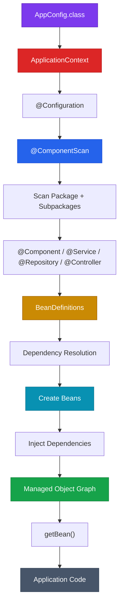

## 1. High-Level Concept Definition

A real Spring application is fundamentally an **object graph**: services depend on repositories, repositories depend on database clients, controllers depend on services, and so on. Java gives us the ability to create all these objects, but manually creating and connecting a large graph quickly becomes difficult to maintain. The Spring IoC Container solves this composition problem by taking responsibility for **creating objects, resolving dependencies, wiring objects together, and managing their lifecycle**. 

The central abstraction is the **Spring Bean**: an object whose creation, dependency wiring, and lifecycle are managed by the Spring IoC container. In annotation-based configuration, Spring discovers eligible classes through annotations such as `@Component`, reads configuration through `@Configuration` and `@ComponentScan`, constructs internal `BeanDefinition` metadata, resolves dependencies, creates the actual objects, and finally exposes them through an `ApplicationContext`.  

---

## 2. The Core Analogy: A Construction Company

Think of a large construction project. A building contains hundreds of components: electrical systems, plumbing, doors, elevators, security systems, HVAC, and structural components.

The architect should not personally manufacture every component and manually deliver each component to every worker.

Instead, a **construction management system** maintains:
1. what components exist,
2. how they should be created,
3. which components depend on others,
4. where each component belongs,
5. and when each component should be available.

Spring's IoC container plays a similar role.

### Analogy Mapping

| Software Concept | Construction Analogy |
| --- | --- |
| **Application** | Construction project |
| **Java class** | Component specification |
| **Object** | Physical component |
| **Spring Bean** | Managed component |
| **Dependency** | Required supporting component |
| **`@Component`** | "This component is eligible for registration" |
| **`@ComponentScan`** | "Search this construction area" |
| **`@Configuration`** | Construction blueprint |
| **`@Bean`** | Explicit manufacturing instruction |
| **BeanDefinition** | Component specification/metadata |
| **ApplicationContext** | Construction management system |
| **Dependency injection** | Delivering required component to another component |
| **`getBean()`** | Requesting a managed component |
| **`@Primary`** | Default supplier |
| **`@Qualifier`** | Explicit supplier selection |

---

## 3. Architecture Overview



```text
Configuration ──► Discovery ──► Bean Metadata ──► Dependency Resolution ──► Object Creation ──► Dependency Injection ──► Managed Bean
```

---

## 4. Module Roadmap

| Module | Core Topics | Key Focus & Engineering Concepts | Read Time |
| --- | --- | --- | ---: |
| 01 | IoC Fundamentals | Object creation and wiring | 10 min |
| 02 | Spring Beans | Managed object lifecycle | 10 min |
| 03 | Annotation Configuration | `@Configuration`, `@ComponentScan` | 15 min |
| 04 | ApplicationContext | Container abstraction and implementation | 15 min |
| 05 | Component Scanning | Classpath discovery and registration | 15 min |
| 06 | Constructor Injection | Dependency resolution | 15 min |
| 07 | Field & Setter Injection | Alternative injection mechanisms | 15 min |
| 08 | BeanDefinition | Container metadata model | 20 min |
| 09 | Multiple Beans | `@Primary`, `@Qualifier` | 20 min |
| 10 | `@Bean` | Explicit bean registration | 20 min |
| 11 | Bean Naming | Names, qualifiers, lookup | 15 min |
| 12 | Container Internals | Startup and object-graph construction | 20 min |
| 13 | Production Design | Registration strategy and anti-patterns | 20 min |

---

## 5. What Is a Spring Bean?

A **Spring Bean** is an object that is instantiated, configured, assembled, and managed by the Spring IoC container.

```text
Every Spring Bean ──► Java Object
Not every Java Object ──► Spring Bean
```

---

## 6. `@Component` vs `@ComponentScan`

```text
@Component     ↓ "What should be discovered?" (Marks class as eligible)
@ComponentScan ↓ "Where should discovery happen?" (Defines search boundary)
```

```java
@Component
public class PaymentService {
}

@Configuration
@ComponentScan("com.example")
public class AppConfig {
}
```

<Callout type="warn" title="⚠️ Package Scanning Boundary">
A correctly annotated `@Component` class will **not** be registered as a Spring bean if its package location lies outside the package tree declared by `@ComponentScan`.
</Callout>

---

## 7. Starting the Container with `ApplicationContext`

`ApplicationContext` represents the Spring IoC Container interface. The concrete implementation for annotation-driven setup is `AnnotationConfigApplicationContext`.

```java
public class Main {
    public static void main(String[] args) {
        // Bootstrap Spring IoC Container
        ApplicationContext context = 
            new AnnotationConfigApplicationContext(AppConfig.class);

        // Retrieve managed bean from container
        OrderService orderService = context.getBean(OrderService.class);
        orderService.placeOrder();
    }
}
```

---

## 8. Constructor Injection & Single-Constructor Rule

Constructor injection is the industry best practice in Spring Boot:

```java
@Component
public class OrderService {

    private final PaymentService paymentService;

    // Single constructor: @Autowired is OPTIONAL in modern Spring!
    public OrderService(PaymentService paymentService) {
        this.paymentService = paymentService;
    }
}
```

### Why Constructor Injection Is Superior
1. **Explicit Contract**: Required dependencies are declared upfront.
2. **Immutability**: Fields can be declared `final`.
3. **Pure Java Testability**: Can be instantiated in JUnit tests with `new OrderService(mockPaymentService)` without needing Spring test runners or reflection.

---

## 9. BeanDefinition: The Metadata Layer

Before Spring instantiates any object, it constructs `BeanDefinition` metadata.

```text
BeanDefinition Metadata
├── Bean Name: "paymentService"
├── Bean Class: com.example.service.PaymentService
├── Scope: singleton
├── Dependencies: []
└── Creation Strategy: Constructor
```

```text
Application Configuration ──► BeanDefinitions ──► Dependency Graph ──► Bean Instances
```

---

## 10. Resolving Ambiguity: `@Primary` vs `@Qualifier`

When multiple beans implement the same interface:

```java
public interface PaymentService { void pay(); }

@Component public class UPIPaymentService implements PaymentService { ... }
@Component public class CardPaymentService implements PaymentService { ... }
```

Spring cannot infer which implementation to inject into `OrderService`.

### 1. `@Primary` (Default Candidate)

```java
@Primary
@Component
public class UPIPaymentService implements PaymentService { ... }
```

### 2. `@Qualifier` (Explicit Candidate Selection)

```java
@Component
public class OrderService {
    private final PaymentService paymentService;

    public OrderService(@Qualifier("cardPaymentService") PaymentService paymentService) {
        this.paymentService = paymentService;
    }
}
```

> **Precedence Rule**: `@Qualifier` takes priority over `@Primary`.

---

## 11. Explicit Registration with `@Bean`

Use `@Bean` inside `@Configuration` classes when:
1. Instantiating classes from third-party external libraries (which cannot be annotated with `@Component`).
2. Customizing complex object construction logic.

```java
@Configuration
public class AppConfig {

    @Bean
    public EmailClient emailClient() {
        return new EmailClient("SECRET_API_KEY");
    }

    @Bean
    public OrderService orderService(PaymentService paymentService) {
        return new OrderService(paymentService);
    }
}
```

---

## 12. `@Component` vs `@Bean` Comparison

| Dimension | `@Component` | `@Bean` |
| --- | --- | --- |
| **Target Element** | Applied to Class level | Applied to Method level |
| **Registration Style** | Automatic discovery via scanning | Explicit programmatic registration |
| **Use Case** | Application-owned domain classes | External library objects / Custom logic |
| **Component Scanning** | Required | Not required for the return object |
| **Bean Name** | Derived from class name (camelCase) | Derived from method name |

---

## 13. High-Density Command & Annotation Matrix

| Annotation | Target | Purpose |
| --- | --- | --- |
| `@Configuration` | Class | Declares a Spring configuration blueprint source |
| `@Component` | Class | Marks class as eligible for component scanning |
| `@ComponentScan` | Class / Config | Specifies packages to search for `@Component` classes |
| `@Bean` | Method | Registers method return value as a container bean |
| `@Autowired` | Constructor / Method / Field | Requests dependency injection from container |
| `@Primary` | Class / Method | Marks bean as default injection candidate |
| `@Qualifier` | Parameter / Field | Specifies exact bean name to inject |

---

## 14. Interactive Self-Assessment

<Quiz
question="When Spring starts with new AnnotationConfigApplicationContext(AppConfig.class), why does Spring conceptually create BeanDefinitions before creating the actual bean objects?"
options={[
"BeanDefinitions are the same objects as the final beans and are used to execute business methods",
"Spring needs metadata describing which beans exist, their classes, scopes, dependencies, and creation strategy before constructing the object graph",
"BeanDefinitions are Java source files generated by the compiler",
"Spring creates BeanDefinitions only because Java constructors cannot be called directly"
]}
answerIndex={1}>
**Option B is correct.**

A `BeanDefinition` is metadata describing how a bean should be created, managed, and wired. Spring constructs a complete metadata model (`BeanDefinitions`) and dependency graph before instantiating actual bean objects on the Heap.
</Quiz>

<Quiz
question="Two Spring beans implement PaymentService, and OrderService requests PaymentService without a qualifier. What is the fundamental reason Spring cannot choose between them?"
options={[
"Spring cannot inject interfaces",
"Spring only resolves dependencies by class name and ignores interfaces",
"Both beans satisfy the required type, so type-based dependency resolution has multiple valid candidates",
"Spring always chooses the bean that was created first"
]}
answerIndex={2}>
**Option C is correct.**

Spring performs type-based dependency resolution by default. When multiple beans satisfy the requested interface type (`PaymentService`), the container experiences a bean ambiguity conflict. You must use `@Primary` (to designate a default) or `@Qualifier` (to specify an explicit bean name).
</Quiz>

<Quiz
question="Why can constructor injection allow OrderService to be tested without starting the Spring container?"
options={[
"Constructor injection automatically disables Spring",
"The dependency is supplied as an ordinary Java constructor argument, so the class can be instantiated directly with new OrderService(mock)",
"Spring converts constructor injection into static methods during compilation",
"Constructor injection removes the dependency from the class"
]}
answerIndex={1}>
**Option B is correct.**

With constructor injection, `OrderService` remains a standard POJO. You can instantiate it directly in plain JUnit tests via `new OrderService(fakePaymentService)` without launching an `ApplicationContext` or reflection runner.
</Quiz>

<Quiz
question="Which situation is the strongest reason to prefer @Bean over @Component?"
options={[
"You want Spring to automatically discover one of your application service classes",
"You want to register a class that belongs to an external library or requires explicit/custom construction",
"You want to avoid having an ApplicationContext",
"You want Spring to stop managing the object's lifecycle"
]}
answerIndex={1}>
**Option B is correct.**

`@Component` requires adding an annotation directly to the target class source code. When using third-party library classes (which cannot be edited) or when complex factory initialization is required, `@Bean` methods inside a `@Configuration` class provide explicit bean registration.
</Quiz>

---

## 15. Mastery Checklist

* [ ] Explain what `ApplicationContext` represents in Spring.
* [ ] Explain the relationship between `AppConfig.class` metadata and the container.
* [ ] Differentiate between `@Component` and `@ComponentScan`.
* [ ] Explain what a `BeanDefinition` is and why Spring creates it before instantiating beans.
* [ ] Explain the single-constructor `@Autowired` rule in modern Spring.
* [ ] Resolve bean ambiguity using `@Primary` vs. `@Qualifier`.
* [ ] Differentiate between `@Component` (class-level) and `@Bean` (method-level).
* [ ] Explain why field injection is discouraged in enterprise production code.
