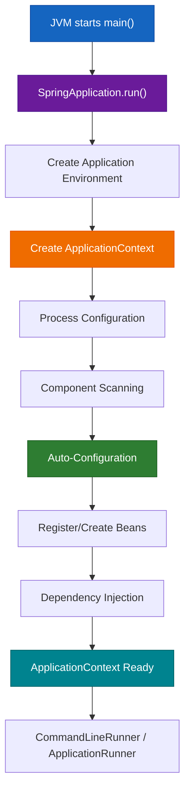

# Startup Mechanics & `SpringApplication.run()`

Spring Boot is a framework built on top of **Spring Core** that standardizes and simplifies how a Spring application is started, configured, and assembled.

---

## 1. What Is Spring Boot?

Spring Core provides the fundamental machinery: the IoC container, dependency injection, bean creation, configuration metadata, and application context. In a traditional Spring Core application, the developer commonly creates the `ApplicationContext`, supplies configuration, retrieves beans, and invokes application logic manually.

Spring Boot keeps that underlying Spring machinery but introduces a convention-driven startup system. Instead of repeatedly assembling the same infrastructure, the developer normally starts the application with:

```java
SpringApplication.run(MyApplication.class, args);
```

> **Spring Boot does not replace Spring Core. Spring Boot operationalizes Spring Core.**

Spring Boot can be used for console applications, web applications, database applications, batch processing, and microservices. It is therefore incorrect to think of Spring Boot as simply a "web API framework".

### Real-World Analogy: Factory Automation

Think of **Spring Core as an industrial factory** and **Spring Boot as the factory's automated startup and configuration system**.

| Spring Concept | Real-World Equivalent | Function |
| :--- | :--- | :--- |
| **Spring Core** | Factory machinery | Underlying runtime engine. |
| **IoC Container** | Factory management system | Controls component assembly and lifecycle. |
| **`ApplicationContext`** | Factory control room | Central state and registry repository. |
| **Bean** | Manufactured component | Managed application object instance. |
| **Dependency Injection** | Supplying components to another component | Wiring required parts at runtime. |
| **`@Component`** | "This component belongs in factory" label | Component discovery marker. |
| **`@ComponentScan`** | Worker searching factory for labeled components | Package inspection process. |
| **`@EnableAutoConfiguration`** | Automated factory setup system | Pre-written conditional infrastructure. |
| **Classpath** | Equipment currently available in factory | Available library environment. |
| **`@ConditionalOnClass`** | "Install machine only if equipment X exists" | Classpath-driven feature toggle. |
| **`@ConditionalOnMissingBean`** | "Install default machine only if none supplied" | Custom bean precedence rule. |
| **`SpringApplication.run()`** | Factory startup procedure | Master ignition pipeline. |
| **`CommandLineRunner`** | Startup task executed after operational status | Post-boot execution hook. |

---

## 2. Spring Core Startup vs Spring Boot Startup

### Traditional Spring Core Startup

In a pure Spring Core application, the developer is explicitly responsible for orchestrating container creation, component scanning, bean lookup, and business execution:

```java
// Developer manually constructs container and fetches bean
ApplicationContext context = 
        new AnnotationConfigApplicationContext(AppConfig.class);

OrderService orderService = context.getBean(OrderService.class);
orderService.placeOrder();
```

```text
Create ApplicationContext
        ↓
Provide configuration (@Configuration)
        ↓
Scan components (@ComponentScan)
        ↓
Create beans & resolve dependencies
        ↓
Fetch bean manually via context.getBean()
        ↓
Invoke application logic
```

### Spring Boot Standardized Startup

Spring Boot replaces manual boilerplate setup with a standardized boot pipeline:

```java
@SpringBootApplication
public class MyApplication {

    public static void main(String[] args) {
        SpringApplication.run(MyApplication.class, args);
    }
}
```

```text
main()
  │
  ▼
SpringApplication.run()
  │
  ▼
Spring Application Startup
  │
  ├── Create Application Environment
  ├── Create ApplicationContext
  ├── Process configuration
  ├── Component scanning
  ├── Auto-configuration
  ├── Bean registration & Dependency injection
  └── Startup callbacks (CommandLineRunner)
  │
  ▼
Application Ready
```

> **Engineering Principle**: Spring Boot removes **configuration ceremony**, not the underlying Spring container.

---

## 3. `SpringApplication.run()` Deep Dive

### Mental Model & Execution Pipeline

`SpringApplication.run(MyApplication.class, args)` acts as the **master ignition switch** for a Spring Boot application.



### Context Return Value vs Dependency Injection

`SpringApplication.run()` returns the underlying `ConfigurableApplicationContext`:

```java
ConfigurableApplicationContext context = 
        SpringApplication.run(MyApplication.class, args);

// Possible, but DISCOURAGED in production code:
OrderService orderService = context.getBean(OrderService.class);
orderService.placeOrder();
```

> [!WARNING]
> **Avoid the Service Locator Anti-Pattern**: Do not turn `ApplicationContext` into a global service locator merely because `SpringApplication.run()` returns it. Always prefer **Constructor Dependency Injection**.

```text
Service Locator Anti-Pattern (High Coupling):
OrderService ──► ApplicationContext ──► PaymentService

Dependency Injection (Clean & Loosely Coupled):
OrderService ──► PaymentService
```

```java
@Service
public class OrderService {

    private final PaymentService paymentService;

    // Clean Constructor Injection
    public OrderService(PaymentService paymentService) {
        this.paymentService = paymentService;
    }
}
```

---

## 4. Post-Boot Execution: `CommandLineRunner`

When building console apps, batch utilities, or startup initializers, use **`CommandLineRunner`** to execute code immediately after the application context becomes fully ready:

```java
@Component
public class AppRunner implements CommandLineRunner {

    private final OrderService orderService;

    public AppRunner(OrderService orderService) {
        this.orderService = orderService;
    }

    @Override
    public void run(String... args) throws Exception {
        System.out.println("Application Context is ready. Executing startup runner...");
        orderService.placeOrder();
    }
}
```

### Execution Flow:
```text
Application Starts ──> Context Created ──> Beans Instantiated ──> DI Completed ──> Context Ready ──> CommandLineRunner.run()
```

---

## ❓ Knowledge Check

<Quiz question="What is the primary role of SpringApplication.run() in a Spring Boot application?" options={["It compiles Java source files to Bytecode", "It orchestrates context creation, component scanning, auto-configuration, bean registration, and startup runner invocation", "It installs an external Tomcat server on Linux", "It replaces the Java Virtual Machine"]} answerIndex={1}>
`SpringApplication.run()` is the master bootstrap method that creates the application environment, instantiates the `ApplicationContext`, triggers scanning and auto-configuration, injects dependencies, and executes runners.
</Quiz>

<Quiz question="Why should application code prefer Constructor Injection over calling context.getBean() on the return value of SpringApplication.run()?" options={["context.getBean() causes compilation failures in Java 17", "Service locator patterns tightly couple code to the container, whereas constructor injection exposes dependencies explicitly and simplifies unit testing", "Constructor injection uses less RAM", "context.getBean() deletes all database entries"]} answerIndex={1}>
Using `context.getBean()` acts as a Service Locator, coupling code directly to Spring infrastructure. Constructor injection makes dependencies explicit, immutable, and easy to mock without starting a container.
</Quiz>
