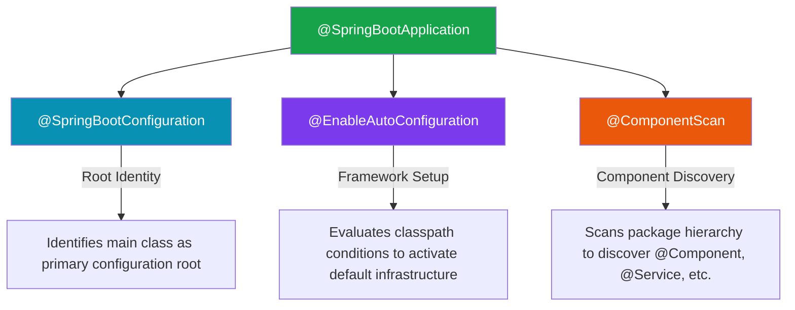
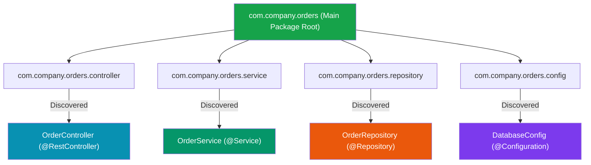

# `@SpringBootApplication` & Component Scanning

Understanding how Spring Boot discovers application components and configures its root boundaries is fundamental to building scalable, crash-free applications.

---

## 1. The Composite Architecture of `@SpringBootApplication`

The central annotation in any Spring Boot project is **`@SpringBootApplication`**:

```java
package com.company.orders;

import org.springframework.boot.SpringApplication;
import org.springframework.boot.autoconfigure.SpringBootApplication;

@SpringBootApplication
public class OrdersApplication {

    public static void main(String[] args) {
        SpringApplication.run(OrdersApplication.class, args);
    }
}
```

Conceptually, `@SpringBootApplication` is a **composite meta-annotation** that combines three core Spring annotations:



```java
// What @SpringBootApplication conceptually represents:
@SpringBootConfiguration
@EnableAutoConfiguration
@ComponentScan
public class OrdersApplication {
}
```

---

## 2. Spring Boot Annotation Taxonomy

| Annotation | Primary Responsibility | Target / Scope | Typical Result |
| :--- | :--- | :--- | :--- |
| **`@SpringBootApplication`** | Bootstraps entire application configuration | Main bootstrap class | Complete Spring Boot application context |
| **`@SpringBootConfiguration`** | Identifies primary Boot configuration root | Application class | Marks class as primary configuration blueprint |
| **`@ComponentScan`** | Discovers custom application beans | Package hierarchy | Registers discovered `@Component`, `@Service`, `@Repository`, `@Controller` |
| **`@EnableAutoConfiguration`** | Applies Spring Boot default infrastructure | Classpath + beans + props | Registers conditional beans (DataSource, Tomcat, Jackson, etc.) |
| **`@ConditionalOnClass`** | Evaluates class presence on classpath | Runtime classpath | Activates configuration if specified class exists |
| **`@ConditionalOnMissingBean`** | Evaluates bean absence in container | `ApplicationContext` | Registers fallback bean if developer supplied none |

---

## 3. `@SpringBootConfiguration` Deep Dive

`@SpringBootConfiguration` informs Spring Boot that the annotated class is the **primary configuration root** for the application.

Because of this, you can define `@Bean` factory methods directly inside your main application class:

```java
@SpringBootApplication
public class OrdersApplication {

    // Valid: Main application class acts as a configuration blueprint
    @Bean
    public PaymentService paymentService() {
        return new PaymentService();
    }

    public static void main(String[] args) {
        SpringApplication.run(OrdersApplication.class, args);
    }
}
```

> [!TIP]
> **Best Practice**: Keep the main bootstrap class clean and focused exclusively on launching `SpringApplication.run()`. Place explicit `@Bean` definitions in dedicated `@Configuration` classes inside a `config/` sub-package.

```java
@Configuration
public class PaymentConfig {

    @Bean
    public PaymentService paymentService() {
        return new PaymentService();
    }
}
```

---

## 4. `@ComponentScan` & Package Hierarchy Rules

### Mental Model: The Security Inspection Officer

Imagine a security inspector searching a building for employees wearing official identification badges. `@ComponentScan` tells Spring:

> *"Search this package and all its sub-packages for classes marked with component badges (`@Component`, `@Service`, `@Repository`, `@Controller`)."*



### Spring Boot's Default Package Scanning Rule

By default, `@ComponentScan` uses the **package of the `@SpringBootApplication` class as the root scanning boundary**.

* If `OrdersApplication` is in `com.company.orders`, Spring automatically scans `com.company.orders`, `com.company.orders.service`, `com.company.orders.controller`, etc.

### Production Anti-Pattern: Main Class Buried in Deep Sub-Package

```text
POOR PACKAGE HIERARCHY (Causes Component Misses & 404 Errors):

com.company.orders.app
└── OrdersApplication.java   <-- Main Class is buried here!

com.company.orders.service
└── OrderService.java        <-- OUTSIDE the scan tree! (IGNORED BY SPRING)
```

Because `OrdersApplication` is in `com.company.orders.app`, Spring scans ONLY `com.company.orders.app.*`. `OrderService` in `com.company.orders.service` is outside the scanning tree and will **NEVER be registered as a bean**, causing startup crashes or `404 Not Found` errors!

### Correct Architectural Package Layout

Always place the `@SpringBootApplication` main class at the **root package** of your application domain:

```text
RECOMMENDED PACKAGE LAYOUT:

com.company.orders            <-- Root Package
├── OrdersApplication.java   <-- Scans everything below!
├── controller/
│   └── OrderController.java
├── service/
│   └── OrderService.java
├── repository/
│   └── OrderRepository.java
└── config/
    └── AppConfig.java
```

> [!CAUTION]
> Avoid using `scanBasePackages = "com.company"` as a quick band-aid for bad package layouts. Structuring your project with the main application class at the root hierarchy solves component scanning cleanly without extra configuration code.

---

## ❓ Knowledge Check

<Quiz question="What are the three core annotations combined inside @SpringBootApplication?" options={["@Entity, @Table, @Column", "@SpringBootConfiguration, @EnableAutoConfiguration, @ComponentScan", "@RestController, @GetMapping, @PostMapping", "@Service, @Repository, @Autowired"]} answerIndex={1}>
`@SpringBootApplication` is a composite meta-annotation combining `@SpringBootConfiguration`, `@EnableAutoConfiguration`, and `@ComponentScan`.
</Quiz>

<Quiz question="What happens if a developer places a @Service class in package 'com.company.payment' when the @SpringBootApplication class is located in 'com.company.app'?" options={["Spring Boot automatically scans all packages on the machine", "The @Service bean will be ignored during component scanning, leading to NoSuchBeanDefinitionException", "Maven will throw a build error during 'mvn package'", "The application will run in web socket mode"]} answerIndex={1}>
Because `@SpringBootApplication` starts component scanning from its own package (`com.company.app`), classes in parallel or outer packages (like `com.company.payment`) fall outside the default scanning boundary and are ignored.
</Quiz>
