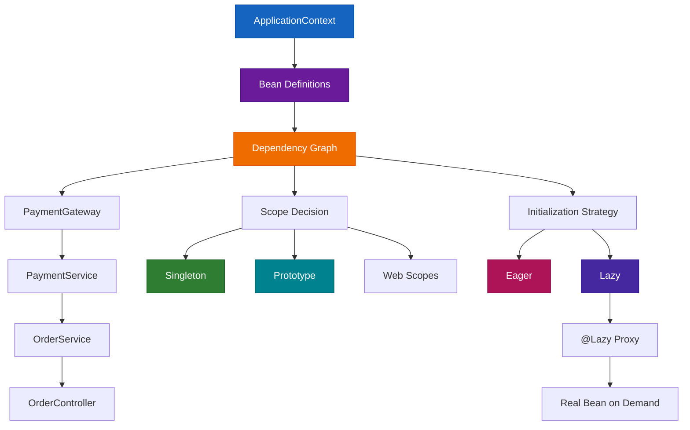
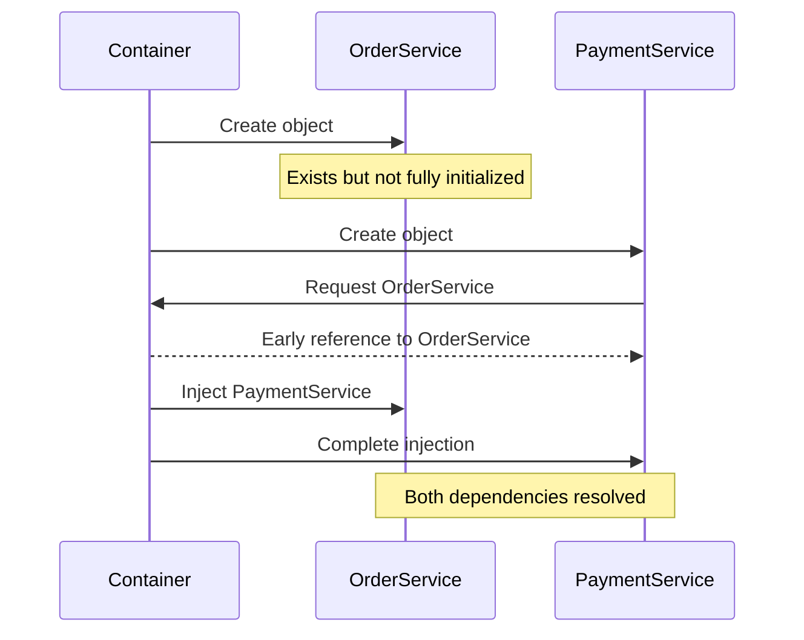
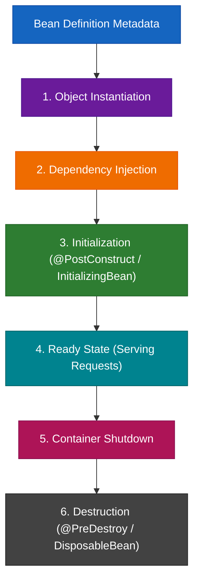

# Spring Core — Circular Dependency, Bean Scope & Initialization

## 1. High-Level Concept Definition

Spring Core is fundamentally an **object lifecycle and dependency management system**. Instead of application classes constructing their collaborators with `new`, the Spring IoC container discovers bean definitions, creates objects, resolves their dependencies, initializes them, and eventually destroys managed objects. Dependency Injection (DI) is therefore the mechanism through which Spring provides dependencies, while Inversion of Control (IoC) means that the container owns object creation and dependency management. 

Three mechanisms become particularly important once an application grows: **dependency ordering**, **bean scope**, and **initialization timing**. Spring must determine *which object to create first*, *how many instances to maintain*, and *when an instance should actually be created*. A circular dependency breaks the dependency ordering graph; scopes determine instance lifetime; eager/lazy initialization determines when object construction occurs.

### Analogy: Spring as an Engineering Workshop

Think of the Spring container as a **factory workshop**:
* **IoC Container** → Factory manager
* **Bean Definition** → Blueprint / manufacturing specification
* **Bean** → Manufactured machine/component
* **Dependency Injection** → Factory installs required components
* **Constructor Injection** → Required component must be available before assembly
* **Setter/Field Injection** → Machine can be assembled first and components installed afterward
* **Singleton Scope** → One shared machine kept by the factory
* **Prototype Scope** → Manufacture a fresh machine whenever requested
* **Eager Initialization** → Build the machine when the factory opens
* **Lazy Initialization** → Build it only when a customer asks
* **`@Lazy` injection** → Give the customer a controlled proxy/interface that obtains the real machine later
* **Circular Dependency** → Machine A requires B to assemble while B simultaneously requires A
* **Bean Lifecycle** → Blueprint → assembly → installation → calibration → operation → shutdown

### Spring Bean Dependency Flow



---

## 2. Structured Module Roadmap

| Module | Core Topics | Key Focus & Engineering Concepts | Read Time |
| --- | --- | --- | ---: |
| 01 | IoC, DI & Bean Definitions | Container responsibility, bean metadata, dependency graph | 8 min |
| 02 | Dependency Resolution | Dependency ordering, constructor semantics, circular graphs | 12 min |
| 03 | Circular Dependency | Constructor vs setter vs field, early references, refactoring | 15 min |
| 04 | Bean Scope | Singleton, prototype, request, session, application, WebSocket | 12 min |
| 05 | Eager & Lazy Initialization | Startup creation, `@Lazy`, dependency-triggered creation | 12 min |
| 06 | Lazy Injection & Proxies | Injection-point `@Lazy`, proxy indirection, runtime resolution | 10 min |
| 07 | Prototype + Singleton | Scope mismatch, `ObjectProvider`, fresh-instance lookup | 10 min |
| 08 | Bean Lifecycle | Definition → creation → injection → initialization → destruction | 12 min |
| 09 | Production Architecture | Design smells, refactoring, startup/runtime trade-offs | 10 min |
| 10 | Practice & Assessment | Output prediction, lifecycle reasoning, debugging | 15 min |

---

## 3. Quick Reference Matrix

### Bean Scope Matrix

| Scope | Instance Rule | Creation Timing | Typical Use | Important Caveat |
| --- | --- | --- | --- | --- |
| `singleton` | One object per bean definition/container | Eager by default | Stateless services, repositories, shared components | Shared mutable state can create concurrency problems |
| `prototype` | New object whenever requested | On request | Stateful objects requiring fresh instances | Injection into singleton does **not** automatically create new objects per method call |
| `request` | One object per HTTP request | Request lifecycle | Request-specific state | Requires web-aware context |
| `session` | One object per user session | Session lifecycle | User-session state | Requires web-aware context |
| `application` | One object per `ServletContext` | Application lifecycle | Application-wide web state | Web-specific |
| `websocket` | One object per WebSocket session | WebSocket lifecycle | WebSocket-specific state | Web-specific |

---

### Initialization Matrix

| Situation | Bean-Level `@Lazy` | Injection-Point `@Lazy` | Result |
| --- | --- | --- | --- |
| Normal singleton | No | No | Created during startup |
| Singleton + `@Lazy` | Yes | No | Normally created when requested |
| Eager bean → lazy dependency | Yes | No | Dependency may still be created during startup |
| Eager bean → `@Lazy` dependency | Yes/No | Yes | Proxy can be injected; real dependency resolves later |
| Prototype | Scope already implies request-based creation | Optional | New instance when requested |
| Global Spring Boot lazy mode | Global setting | Individual overrides possible | Creation delayed broadly |

---

## 4. Circular Dependencies

### 1. Constructor Circular Dependency (Fails at Startup)

```java
@Component
public class OrderService {
    public OrderService(PaymentService paymentService) {}
}

@Component
public class PaymentService {
    public PaymentService(OrderService orderService) {}
}
```

> **Result**: Fails on container startup with `BeanCurrentlyInCreationException`. Neither constructor can complete because its parameter is not yet created.

---

### 2. Setter / Field Circular Dependency (Resolves via Early References)

```java
@Component
public class OrderService {
    @Autowired
    private PaymentService paymentService;
}

@Component
public class PaymentService {
    @Autowired
    private OrderService orderService;
}
```

> **Result**: Succeeds because Spring instantiates the objects first, exposes an **early reference**, and injects the fields/setters afterwards.



---

## 5. Prototype Scope in Singleton Beans (Scope Mismatch)

When a `prototype` bean is constructor-injected directly into a `singleton` service:

```java
@Component
@Scope("prototype")
public class OrderRequest {}

@Component
public class OrderService {
    private final OrderRequest orderRequest;

    public OrderService(OrderRequest orderRequest) {
        this.orderRequest = orderRequest;
    }
}
```

> **Trap**: Calling `orderService.placeOrder()` 10 times will use the **same** single `OrderRequest` instance because the singleton service captured it during initial construction.

### Solution: `ObjectProvider<T>`

To obtain a fresh prototype instance on every method call:

```java
@Component
public class OrderService {
    private final ObjectProvider<OrderRequest> provider;

    public OrderService(ObjectProvider<OrderRequest> provider) {
        this.provider = provider;
    }

    public void placeOrder() {
        OrderRequest freshRequest = provider.getObject(); // Fresh prototype instance every time!
    }
}
```

---

## 6. `@Lazy` Injection & Proxy Indirection

Marking an injection point with `@Lazy` injects a dynamic CGLIB/JDK proxy instead of the real bean:

```java
@Component
public class UserService {

    private final EmailService emailService;

    public UserService(@Lazy EmailService emailService) {
        this.emailService = emailService;
    }

    public void registerUser() {
        System.out.println("User registered");
        emailService.sendEmail(); // Real EmailService is instantiated HERE on first invocation!
    }
}
```

```text
UserService ──► EmailService Proxy ──► (On method invocation) ──► Instantiates & Calls Real EmailService
```

---

## 7. The Full Bean Lifecycle



---

## 8. Interactive Self-Assessment

<Quiz
question="A singleton OrderService directly constructor-injects a prototype OrderRequest. OrderService.placeOrder() is called 10 times. How many OrderRequest objects are normally created by this direct injection?"
options={[
"10, because prototype means a new object for every method invocation",
"1, because the singleton captures one prototype reference when it is created",
"0, because prototype beans cannot be injected into singleton beans",
"11, because Spring creates one prototype for startup and one for every method call"
]}
answerIndex={1}>
**Option B is correct.**

The prototype scope means Spring creates a new instance whenever the prototype bean is requested from the container. Direct constructor injection occurs when the singleton itself is created. Spring therefore creates one `OrderRequest` and stores that reference inside the singleton.

If every method invocation requires a fresh prototype instance, inject an `ObjectProvider<OrderRequest>` and invoke `.getObject()` for each request.
</Quiz>

<Quiz
question="Why can setter-based circular dependency sometimes succeed when equivalent constructor-based circular dependency fails?"
options={[
"Setter injection disables Spring dependency checking",
"Setter injection allows Spring to create objects before injecting their dependencies",
"Setter injection converts all beans into prototype scope",
"Constructor injection is incompatible with singleton scope"
]}
answerIndex={1}>
**Option B is correct.**

Constructor injection requires the dependency to exist before the constructor method can finish. For `A → B → A`, neither constructor can complete first. Setter/field injection separates instantiation from dependency injection, enabling Spring to create raw object instances first, expose early references, and wire dependencies afterwards.
</Quiz>

<Quiz
question="A bean is annotated with @Lazy, but an eager singleton requires it through a normal constructor parameter. What should you expect during startup?"
options={[
"The lazy dependency is guaranteed never to be created during startup",
"Spring may create the lazy dependency during startup to satisfy the eager singleton",
"Spring automatically changes the eager singleton to prototype scope",
"Spring always throws BeanCurrentlyInCreationException"
]}
answerIndex={1}>
**Option B is correct.**

Bean-level `@Lazy` delays instantiation by default, but an eager singleton component requires a concrete constructor argument to complete its own startup creation. Spring will therefore instantiate the lazy bean to satisfy the eager bean's dependency contract. To defer resolution, mark `@Lazy` at the injection point parameter itself to inject a proxy.
</Quiz>

<Quiz
question="Two @Bean methods return the same Java type User and both use the default singleton scope. What does Spring create?"
options={[
"One User object because singleton means one object per Java class",
"Two User objects because each @Bean method defines a separate bean definition",
"Three User objects because each getBean call creates a new object",
"Zero User objects until one of the methods is explicitly invoked"
]}
answerIndex={1}>
**Option B is correct.**

Spring singleton scope means **one object instance per BeanDefinition in the IoC container**, not one object per Java class in the JVM. Each `@Bean` method creates a distinct `BeanDefinition`, resulting in two distinct managed singleton instances.
</Quiz>

---

## 9. Practical Engineering Problem

<Problem title="Problem: Refactoring a Circular Service Graph">
<ProblemDescription>
You have two Spring services:

```java
@Service
public class OrderService {
    private final PaymentService paymentService;

    public OrderService(PaymentService paymentService) {
        this.paymentService = paymentService;
    }
}

@Service
public class PaymentService {
    private final OrderService orderService;

    public PaymentService(OrderService orderService) {
        this.orderService = orderService;
    }
}
```

The application fails during startup because constructor injection produces the cyclic dependency graph `OrderService → PaymentService → OrderService`. Refactor the architecture so that the dependency graph becomes acyclic without relying on `@Lazy` workarounds.
</ProblemDescription>

<ProblemSolution>
The preferred solution is to eliminate the bidirectional service dependency by extracting shared capabilities into a dedicated third service component:

```java
@Service
public class PaymentProcessor {
    public void processPayment() {
        // Core payment processing logic
    }
}

@Service
public class OrderService {
    private final PaymentProcessor paymentProcessor;

    public OrderService(PaymentProcessor paymentProcessor) {
        this.paymentProcessor = paymentProcessor;
    }

    public void placeOrder() {
        paymentProcessor.processPayment();
    }
}

@Service
public class PaymentService {
    private final PaymentProcessor paymentProcessor;

    public PaymentService(PaymentProcessor paymentProcessor) {
        this.paymentProcessor = paymentProcessor;
    }
}
```

### Acyclic Dependency Graph

```text
OrderService ──────┐
                   ▼
            PaymentProcessor
                   ▲
                   │
PaymentService ────┘
```

The cycle is completely eliminated, eliminating startup deadlocks while keeping constructor injection contracts strict and immutable.
</ProblemSolution>
</Problem>

---

## 10. Mastery Checklist

* [ ] Explain why constructor-based circular dependency causes startup failures.
* [ ] Explain how Spring uses early references to resolve field/setter circular dependencies.
* [ ] Differentiate between `singleton` (per container/definition) and JVM singletons.
* [ ] Explain the scope mismatch problem when injecting a `prototype` bean into a `singleton`.
* [ ] Use `ObjectProvider<T>` to fetch fresh prototype instances dynamically.
* [ ] Explain how `@Lazy` on an injection point uses CGLIB/JDK proxies to defer bean creation.
* [ ] Trace the 6 phases of the Spring Bean Lifecycle (`BeanDefinition` → Creation → DI → `@PostConstruct` → Serving → `@PreDestroy`).
* [ ] Refactor circular service dependencies into acyclic dependency graphs.
