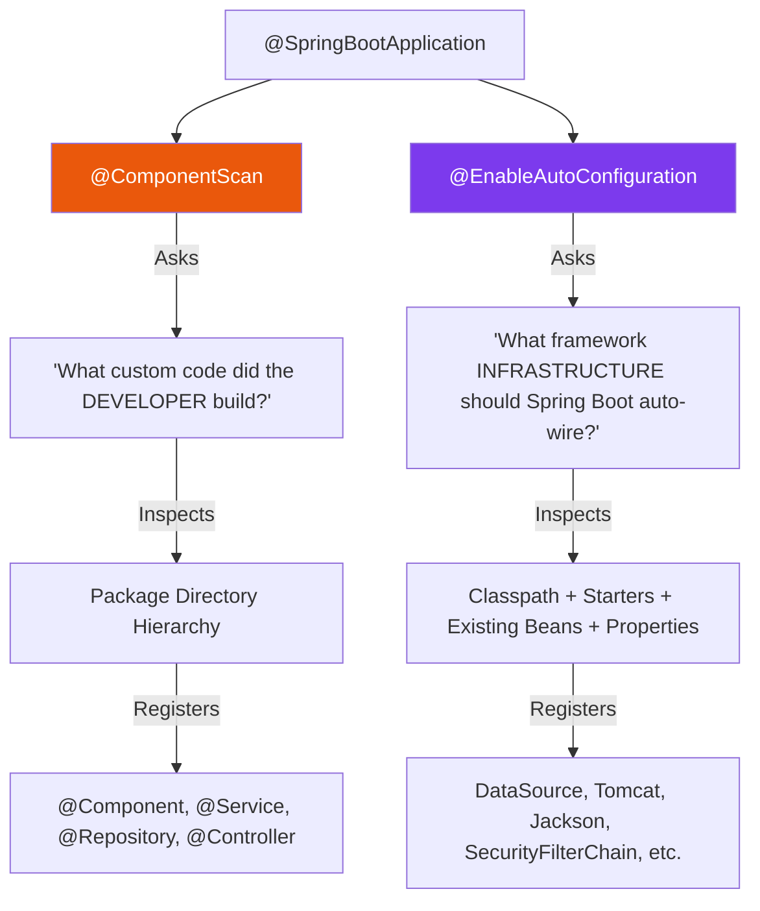
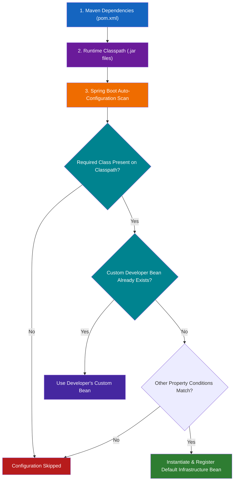

# Auto-Configuration & Classpath Signals

One of the most powerful and misunderstood features of Spring Boot is **Auto-Configuration**. Understanding how Spring Boot evaluates environment signals to configure application infrastructure separates junior developers from senior framework architects.

---

## 1. Component Scanning vs Auto-Configuration

Developers often confuse `@ComponentScan` and `@EnableAutoConfiguration`. They solve completely different problems:



### Detailed Comparison Matrix

| Architectural Question | `@ComponentScan` | `@EnableAutoConfiguration` |
| :--- | :--- | :--- |
| **Primary Purpose** | Discovers custom application components built by your team. | Applies pre-written Spring Boot framework configurations. |
| **Search Domain** | Package directory tree (`com.company.orders.*`). | Conditional rules, classpath JARs, environment properties. |
| **Configuration Source** | Application source code annotations (`@Service`, `@Repository`). | Spring Boot starter libraries (`spring-boot-autoconfigure.jar`). |
| **Core Question** | *"What business logic did the developer write?"* | *"What infrastructure components does this app require?"* |

---

## 2. `@EnableAutoConfiguration` Mechanics

Auto-configuration means:

> **Pre-written configuration + condition-based activation**

Spring Boot does **not** randomly guess what your application needs. Instead, it evaluates pre-written configuration templates against runtime conditions.

### Mental Model: The Automated Workshop

Imagine opening a professional manufacturing workshop with an automated setup system:

```text
Automated Workshop Logic:
├── Is there a welding torch on the tool shelf (classpath)?
│   ├── YES ──► Enable automated ventilation and safety power lines.
│   └── NO  ──► Skip welding setup.
│
└── Did the owner already bring a custom air compressor?
    ├── YES ──► Use the owner's custom compressor.
    └── NO  ──► Unpack and install the default factory compressor.
```

Spring Boot applies the exact same logic to backend infrastructure!

---

## 3. The Auto-Configuration Decision Pipeline

How does adding a single line to `pom.xml` change application behavior?



### The Causal Chain Rule to Memorize:

```text
Maven Dependency  ──►  Runtime Classpath  ──►  Condition Evaluation  ──►  Configuration Activation  ──►  Bean Registration
```

---

## 4. Classpath-Driven Configuration: Dependencies as Signals

In standard Java, dependencies are simply libraries you invoke in code. In Spring Boot, **dependencies act as configuration signals**.

### Example: Console App vs Web Application

Consider a standard Spring Boot application with only `spring-boot-starter`:

```xml
<dependency>
    <groupId>org.springframework.boot</groupId>
    <artifactId>spring-boot-starter</artifactId>
</dependency>
```

* **Classpath Environment**: Contains Spring Core, Logging, and basic Boot classes.
* **Result**: Spring Boot boots as a **lightweight Console Application**. It does NOT launch Tomcat or open port 8080.

Now, add `spring-boot-starter-web` to `pom.xml`:

```xml
<dependency>
    <groupId>org.springframework.boot</groupId>
    <artifactId>spring-boot-starter-web</artifactId>
</dependency>
```

* **Classpath Shift**: Transitive resolution brings Tomcat (`tomcat-embed-core.jar`), Spring MVC (`spring-webmvc.jar`), and Jackson (`jackson-databind.jar`) onto the classpath.
* **Auto-Configuration Evaluation**: `@ConditionalOnClass(DispatcherServlet.class)` evaluates to **TRUE**.
* **Result**: Spring Boot automatically configures `DispatcherServlet`, boots embedded Apache Tomcat on port `8080`, and turns the application into an HTTP REST web server!

```text
starter (Basic Dependencies)
    ↓
No Servlet/Tomcat classes on classpath
    ↓
Console Application

starter-web (Web Dependencies)
    ↓
Tomcat + DispatcherServlet detected on classpath
    ↓
Web Application (Port 8080 + Embedded Tomcat)
```

---

## ❓ Knowledge Check

<Quiz question="Why does adding spring-boot-starter-web to pom.xml cause Spring Boot to launch an embedded Tomcat web server on port 8080?" options={["Because starter-web rewrites Java source code at compile time", "Because starter-web adds Tomcat and Spring MVC classes to the classpath, causing web auto-configuration conditions to evaluate as TRUE", "Because Maven commands force the OS to open port 8080", "Because @SpringBootApplication works only with web apps"]} answerIndex={1}>
Adding `spring-boot-starter-web` adds web libraries to the runtime classpath. Spring Boot's auto-configuration evaluates class availability (`@ConditionalOnClass`), detects Tomcat and `DispatcherServlet`, and activates web server auto-configuration.
</Quiz>

<Quiz question="What is the key difference between @ComponentScan and @EnableAutoConfiguration?" options={["@ComponentScan configures databases while @EnableAutoConfiguration scans HTML files", "@ComponentScan discovers custom application components inside project packages, whereas @EnableAutoConfiguration applies framework defaults based on environmental conditions", "They are exact aliases and perform identical operations", "@EnableAutoConfiguration deletes all custom developer beans"]} answerIndex={1}>
`@ComponentScan` inspects project package trees to find application components (`@Component`, `@Service`), while `@EnableAutoConfiguration` evaluates classpath and bean conditions to register framework infrastructure.
</Quiz>
