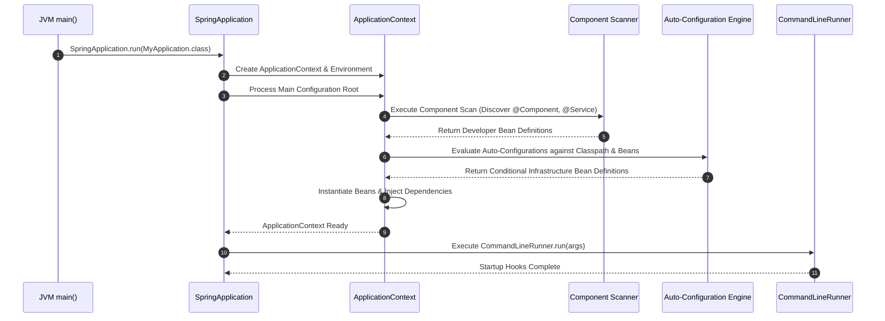

# Conditional Beans & Production Diagnostics

Auto-configuration relies on **Conditional Annotations** to inspect container state and classpath availability before instantiating beans.

---

## 1. Conditional Annotations: `@ConditionalOnClass` & `@ConditionalOnMissingBean`

A simplified Spring Boot auto-configuration class looks like:

```java
@AutoConfiguration
@ConditionalOnClass(PaymentGateway.class) // Condition 1: Class must exist on classpath
public class PaymentAutoConfiguration {

    @Bean
    @ConditionalOnMissingBean // Condition 2: Register ONLY IF developer supplied no custom bean
    public PaymentGateway paymentGateway() {
        return new DefaultPaymentGateway();
    }
}
```

```text
Decision Tree Execution:
Is PaymentGateway.class available on Classpath?
        │
        ├── NO  ──► Skip this entire Configuration class.
        │
        └── YES
             │
             ▼
      Does a PaymentGateway Bean ALREADY exist in ApplicationContext?
             │
             ├── YES ──► Yield precedence to developer's custom bean!
             │
             └── NO  ──► Register DefaultPaymentGateway bean.
```

---

### `@ConditionalOnClass` (Classpath Check)

`@ConditionalOnClass` guarantees that an auto-configuration blueprint activates **only if specified third-party classes exist on the runtime classpath**.

```java
@ConditionalOnClass(name = "org.postgresql.Driver")
public class PostgresAutoConfiguration { ... }
```

### `@ConditionalOnMissingBean` (Customization Hook)

`@ConditionalOnMissingBean` allows developers to override Spring Boot's defaults effortlessly.

If you do nothing, Spring Boot registers `DefaultPaymentGateway`. If you declare your own custom bean:

```java
@Configuration
public class CustomPaymentConfig {

    @Bean
    public PaymentGateway paymentGateway() {
        return new CustomStripePaymentGateway(); // Custom Developer Bean
    }
}
```

Because your custom bean exists in `ApplicationContext`, `@ConditionalOnMissingBean` evaluates to **FALSE**, and Spring Boot quietly skips instantiating `DefaultPaymentGateway`!

---

## 2. Developer Beans vs Auto-Configured Beans

| Property | Developer-Defined Bean | Auto-Configured Bean |
| :--- | :--- | :--- |
| **Source** | Written by application developer in project code. | Provided by Spring Boot or third-party starters. |
| **Discovery** | Component scanning (`@Component`, `@Service`) or `@Configuration`. | Pre-written `@AutoConfiguration` blueprints. |
| **Activation** | Explicitly declared. | Condition-driven (`@ConditionalOnClass`, etc.). |
| **Precedence** | **High Precedence** (Overrides defaults). | **Fallback Precedence** (Controlled by `@ConditionalOnMissingBean`). |

---

## 3. Complete Startup Lifecycle Architecture



### Startup State Machine

| Lifecycle State | Description | Primary Operational Task |
| :--- | :--- | :--- |
| `STARTING` | JVM invokes `main()` | Application initialization. |
| `BOOTSTRAPPING` | `SpringApplication.run()` called | Environment and banner setup. |
| `CONTEXT_CREATING` | `ApplicationContext` constructed | Resource allocation. |
| `DISCOVERY` | Component scanning executed | Package tree inspection for `@Component`. |
| `AUTO_CONFIGURATION` | Conditions evaluated | `@ConditionalOnClass` & `@ConditionalOnMissingBean` checks. |
| `BEAN_CREATION` | Instantiation & Wiring | Constructor execution & Dependency Injection. |
| `READY` | Context fully operational | Socket listener startup (Tomcat port 8080). |
| `RUNNERS` | Post-boot hooks executed | `CommandLineRunner.run()` invocation. |

---

## 4. Production Debugging Mental Model: The 5 Questions

When an infrastructure bean or custom component is unexpectedly missing or failing to configure, reason through these **5 Diagnostic Questions**:

```text
Production Debugging Steps:
├── Q1. Is the Maven dependency present in pom.xml? (Check runtime classpath)
├── Q2. Is the custom component inside the package scan tree? (Check root package hierarchy)
├── Q3. Is the relevant Auto-Configuration class triggered? (Check condition evaluations)
├── Q4. Did another custom bean satisfy @ConditionalOnMissingBean first? (Check bean overrides)
└── Q5. Are application.properties settings enabling/disabling the feature? (Check property toggles)
```

---

## 5. Common Production Anti-Patterns

### Anti-Pattern 1: Main Class Buried in Deep Sub-Package
* Placing `MyApplication.java` in `com.company.app.bootstrap` instead of root `com.company.app`, causing component scanning to miss services in sibling packages.

### Anti-Pattern 2: Using `ApplicationContext` as a Global Service Locator
* Injecting `ApplicationContext` to call `context.getBean(MyService.class)` inside methods instead of using Constructor Dependency Injection.

### Anti-Pattern 3: Treating Starters as Single Jar Libraries
* Assuming `spring-boot-starter-web` is one file, rather than a curated dependency bundle that shifts the entire runtime classpath.

### Anti-Pattern 4: Assuming Spring Boot Always Starts a Web Server
* Assuming `@SpringBootApplication` always opens port 8080, ignoring that web server auto-configuration activates **only when web starter dependencies exist on the classpath**.

---

## 6. Comprehensive Code Example

```java
package com.company.orders;

import org.springframework.boot.CommandLineRunner;
import org.springframework.boot.SpringApplication;
import org.springframework.boot.autoconfigure.SpringBootApplication;
import org.springframework.stereotype.Component;
import org.springframework.stereotype.Service;

@SpringBootApplication // Root package scan starts here!
public class OrdersApplication {

    public static void main(String[] args) {
        SpringApplication.run(OrdersApplication.class, args);
    }
}

@Service
class PaymentService {
    public void processPayment() {
        System.out.println("Processing payment via PaymentService...");
    }
}

@Service
class OrderService {
    private final PaymentService paymentService;

    // Clean Constructor Injection
    public OrderService(PaymentService paymentService) {
        this.paymentService = paymentService;
    }

    public void placeOrder() {
        paymentService.processPayment();
        System.out.println("Order successfully placed!");
    }
}

@Component
class StartupRunner implements CommandLineRunner {
    private final OrderService orderService;

    public StartupRunner(OrderService orderService) {
        this.orderService = orderService;
    }

    @Override
    public void run(String... args) {
        System.out.println("=== StartupRunner Executing ===");
        orderService.placeOrder();
    }
}
```

---

## ❓ Interactive Self-Assessment

<Quiz question="What happens when a custom developer bean matches a Spring Boot default bean annotated with @ConditionalOnMissingBean?" options={["Spring Boot creates both beans and throws a duplicate bean exception", "Spring Boot skips instantiating the default bean, yielding precedence to the developer's custom bean", "Spring Boot deletes the developer's custom bean", "Spring Boot shuts down port 8080"]} answerIndex={1}>
`@ConditionalOnMissingBean` checks if a bean of that type already exists. Because the developer supplied a custom bean, the condition evaluates to **FALSE**, and the auto-configuration default bean is skipped.
</Quiz>

<Quiz question="Why is placing the main @SpringBootApplication class in the root package (e.g., com.company.app) an architectural best practice?" options={["Java requires all classes to be in root packages", "It ensures default component scanning automatically discovers components across all sub-packages without manual configuration", "It disables all Maven dependencies", "It encrypts application properties"]} answerIndex={1}>
`@ComponentScan` defaults to scanning the package of the main application class and all its sub-packages. Placing it at the root package covers the entire component hierarchy automatically.
</Quiz>

<Problem title="Refactoring Service Locator Anti-Pattern">
<ProblemDescription>
Refactor a legacy Spring Boot class that injects `ApplicationContext` to manually fetch `PaymentService` via `context.getBean()` into clean Constructor Injection.
</ProblemDescription>
<ProblemSolution>

```java
// BEFORE (Service Locator Anti-Pattern - High Coupling):
@Service
public class OrderProcessor {
    private final ApplicationContext context;

    public OrderProcessor(ApplicationContext context) {
        this.context = context;
    }

    public void process() {
        PaymentService service = context.getBean(PaymentService.class);
        service.processPayment();
    }
}

// AFTER (Clean Constructor Injection):
@Service
public class OrderProcessor {
    private final PaymentService paymentService;

    public OrderProcessor(PaymentService paymentService) {
        this.paymentService = paymentService;
    }

    public void process() {
        paymentService.processPayment();
    }
}
```

**Architectural Advantage**: The refactored class declares its dependency contract explicitly, eliminates hidden container dependencies, and allows fast unit testing without launching Spring.
</ProblemSolution>
</Problem>
