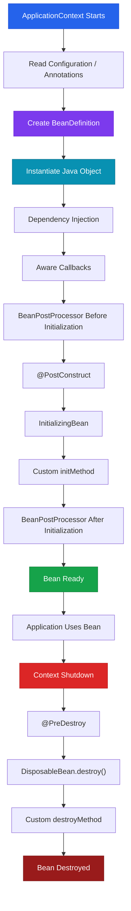

## 1. What Is the Spring Bean Lifecycle?

In ordinary Java, application code generally controls the entire lifetime of an object. You instantiate it with `new`, provide the required dependencies, invoke methods, and eventually release resources when appropriate.

```java
PaymentService paymentService = new PaymentService();
```

The developer controls the object's journey:

```text
Create ──► Configure ──► Use ──► Cleanup
```

Spring changes this ownership model. Instead of manually constructing important application objects, we describe which objects should be managed by the Spring container. Spring then discovers their definitions, creates instances, injects dependencies, executes lifecycle callbacks, exposes the initialized objects to the application, and performs destruction for scopes it manages.

A Spring-managed object is called a **bean**. The bean lifecycle is the complete journey of a bean from its registered definition through instantiation, dependency injection, initialization, usage, and eventual destruction.

### Analogy: Spring as an Object Factory + Operations Manager

Think of Spring's `ApplicationContext` as a sophisticated factory and operations department.

| Spring Concept | Real-World Analogy |
| --- | --- |
| `ApplicationContext` | Factory/operations manager |
| `BeanDefinition` | Employee/job specification |
| Bean | Employee hired by the factory |
| Constructor | Initial hiring/creation |
| Dependency Injection | Assigning required equipment/resources |
| `Aware` callbacks | Giving the employee information about the organization |
| `@PostConstruct` | Employee's onboarding/setup |
| `BeanPostProcessor` | Quality-control/customization pipeline |
| Singleton scope | One permanent employee reused by everyone |
| Prototype scope | Temporary worker created per request |
| `@PreDestroy` | Shutdown/exit procedure |
| `@Lazy` | Hire only when the employee is actually needed |

The critical mental model is:

> **Spring does not merely call `new`. It manages an object through a lifecycle pipeline.**

---

## 2. High-Level Bean Lifecycle

```text
Spring Container Starts
        ↓
Read Configuration / Annotations
        ↓
Create BeanDefinition
        ↓
Instantiate Bean
        ↓
Inject Dependencies
        ↓
Aware Callbacks
        ↓
BeanPostProcessor beforeInitialization
        ↓
Initialization Callbacks (@PostConstruct / InitializingBean / initMethod)
        ↓
BeanPostProcessor afterInitialization
        ↓
Bean Ready for Application Use
        ↓
Container Shutdown
        ↓
Destruction Callbacks (@PreDestroy / DisposableBean / destroyMethod)
        ↓
Bean Removed
```



---

## 3. Module Roadmap

| Module | Core Topics | Key Focus & Engineering Concepts | Read Time |
| --- | --- | --- | ---: |
| 01 | Container Startup | `ApplicationContext`, configuration metadata | 8 min |
| 02 | BeanDefinition | Metadata, scopes, dependencies, lifecycle metadata | 10 min |
| 03 | Instantiation | Constructor execution vs initialization | 8 min |
| 04 | Dependency Injection | Constructor, setter, field injection | 12 min |
| 05 | Aware Interfaces | Container callbacks and framework coupling | 8 min |
| 06 | Initialization | `@PostConstruct`, `InitializingBean`, `initMethod` | 12 min |
| 07 | BeanPostProcessor | Before/after initialization processing | 10 min |
| 08 | Destruction | `@PreDestroy`, `DisposableBean`, `destroyMethod` | 10 min |
| 09 | Scopes | Singleton vs prototype lifecycle ownership | 15 min |
| 10 | Lazy Beans | Deferred object creation | 8 min |
| 11 | Prototype Injection | Singleton → prototype problem and `ObjectProvider` | 12 min |
| 12 | Circular Dependencies | Constructor cycles and post-construction wiring | 10 min |
| 13 | Production Patterns | Resource management, lifecycle pitfalls, design trade-offs | 15 min |

---

## 4. Quick Reference: Lifecycle Phases & Scopes

### Lifecycle Phase Sequence

| Phase | What Happens | Object Exists? | Typical Mechanism |
| --- | --- | ---: | --- |
| **Definition** | Spring records bean metadata | No | `BeanDefinition` |
| **Instantiation** | Java object is created | Yes | Constructor |
| **Dependency Injection** | Dependencies are supplied | Yes | Constructor / Setter / Field |
| **Aware Callbacks** | Container information is supplied | Yes | `BeanNameAware`, `ApplicationContextAware` |
| **Pre-Initialization** | `BeanPostProcessor` executes | Yes | `postProcessBeforeInitialization()` |
| **Initialization** | Startup logic executes | Yes | `@PostConstruct`, `InitializingBean`, `initMethod` |
| **Post-Initialization** | Proxying / wrapping | Yes | `postProcessAfterInitialization()` |
| **Ready** | Bean services application requests | Yes | Normal business usage |
| **Destruction** | Cleanup callbacks execute | Yes → No | `@PreDestroy`, `DisposableBean`, `destroyMethod` |

---

### Scope Comparison: Singleton vs Prototype

| Property | Singleton | Prototype |
| --- | --- | --- |
| **Default Scope** | Yes | No |
| **Instance Rule** | One managed instance per definition | New instance per `getBean()` / injection lookup |
| **Creation Timing** | Eager (at container startup) | Lazy (on-demand when requested) |
| **Destruction Lifecycle** | Managed automatically by container | **NOT** automatically managed by container |
| **`@PreDestroy` Trigger** | Triggered on container shutdown | **Ignored** by container shutdown |

<Callout type="warn" title="⚠️ Prototype Destruction Memory Warning">
Spring creates and initializes `prototype` beans, but it does **not** track prototype instances for automatic destruction. Holding onto external resources in prototype beans without explicit manual cleanup can cause memory leaks.
</Callout>

---

## 5. Initialization Mechanism Priority Order

When multiple initialization hooks exist on the same bean, Spring executes them in the following strict order:

```java
@Component
public class PaymentService implements InitializingBean {

    public PaymentService() {
        System.out.println("1. Constructor Execution (Instantiation)");
    }

    @PostConstruct
    public void postConstruct() {
        System.out.println("2. @PostConstruct Execution");
    }

    @Override
    public void afterPropertiesSet() {
        System.out.println("3. InitializingBean.afterPropertiesSet() Execution");
    }

    public void customInit() {
        System.out.println("4. Custom initMethod Execution");
    }
}
```

```text
Constructor ──► @PostConstruct ──► InitializingBean.afterPropertiesSet() ──► Custom initMethod
```

---

## 6. Destruction Mechanism Priority Order

During container shutdown (`context.close()`), singleton bean destruction methods trigger in the following order:

```java
@Component
public class PaymentService implements DisposableBean {

    @PreDestroy
    public void preDestroy() {
        System.out.println("1. @PreDestroy Execution");
    }

    @Override
    public void destroy() {
        System.out.println("2. DisposableBean.destroy() Execution");
    }

    public void customDestroy() {
        System.out.println("3. Custom destroyMethod Execution");
    }
}
```

```text
@PreDestroy ──► DisposableBean.destroy() ──► Custom destroyMethod
```

---

## 7. Interactive Self-Assessment

<Quiz
question="A singleton OrderService directly receives a prototype PaymentSession through constructor injection. How many PaymentSession instances will normally exist when OrderService executes createOrder() 100 times?"
options={[
"100, because PaymentSession is prototype scoped",
"1, because the prototype was resolved when the singleton was created",
"0, because prototype beans cannot be injected into singleton beans",
"100, because Spring recreates prototype dependencies for every singleton method call"
]}
answerIndex={1}>
**Option B is correct.**

Prototype scope means Spring creates a new instance when requested from the IoC container. Constructor injection into a singleton occurs when the singleton itself is instantiated during container startup. Spring resolves one `PaymentSession` at that point and injects it into `OrderService`. All subsequent 100 calls to `createOrder()` reuse that single captured reference.

If every operation requires a fresh prototype instance, use `ObjectProvider<PaymentSession>` and call `getObject()` dynamically.
</Quiz>

<Quiz
question="Why does Spring normally NOT automatically invoke @PreDestroy for prototype beans when the ApplicationContext closes?"
options={[
"Prototype beans cannot contain @PreDestroy",
"Spring intentionally ignores all destruction callbacks",
"Spring does not retain references to every issued prototype instance for full destruction management to prevent memory leaks",
"Garbage collection always invokes @PreDestroy automatically"
]}
answerIndex={2}>
**Option C is correct.**

Spring hands prototype objects off to the caller after creation and initialization. If Spring retained references to every prototype instance created during runtime to invoke `@PreDestroy` later, those references would prevent Java Garbage Collection from reclaiming memory, creating massive memory leaks.
</Quiz>

<Quiz
question="Which sequence most accurately represents the initialization portion of the Spring bean lifecycle?"
options={[
"Constructor → @PreDestroy → @PostConstruct → Bean ready",
"Dependency injection → Aware callbacks → @PostConstruct → BeanPostProcessor after initialization",
"BeanPostProcessor after initialization → constructor → dependency injection → @PostConstruct",
"Constructor → @PreDestroy → InitializingBean → Bean ready"
]}
answerIndex={1}>
**Option B is correct.**

After object instantiation and dependency injection, Spring invokes `Aware` callbacks (e.g. `BeanNameAware`), followed by `BeanPostProcessor.postProcessBeforeInitialization()`, `@PostConstruct`, `InitializingBean`, custom `initMethod`, and finally `BeanPostProcessor.postProcessAfterInitialization()`. `@PreDestroy` belongs strictly to the shutdown phase.
</Quiz>

<Quiz
question="What is the fundamental difference between a BeanDefinition and a bean instance?"
options={[
"BeanDefinition is the actual Java object while the bean instance is configuration metadata",
"BeanDefinition describes how Spring should manage an object; the bean instance is the actual Java object on the Heap",
"They are two names for the same object",
"BeanDefinition exists only for prototype beans"
]}
answerIndex={1}>
**Option B is correct.**

A `BeanDefinition` is metadata describing characteristics such as bean class, scope, lazy status, dependencies, and lifecycle callback methods. The bean instance is the actual instantiated Java object created on the JVM heap based on that metadata blueprint.
</Quiz>

---

## 8. Practical Engineering Challenge

<Problem title="Problem: Diagnosing a Singleton-to-Prototype Lifecycle Bug">
<ProblemDescription>
You have a singleton `OrderService` that receives a prototype `PaymentSession` through constructor injection:

```java
@Component
public class OrderService {
    private final PaymentSession paymentSession;

    public OrderService(PaymentSession paymentSession) {
        this.paymentSession = paymentSession;
    }

    public void createOrder() {
        paymentSession.start();
    }
}

@Component
@Scope("prototype")
public class PaymentSession { ... }
```

The team expects a completely new `PaymentSession` for every call to `createOrder()`. Explain why that expectation is incorrect and refactor `OrderService` so that each invocation obtains a fresh prototype instance.
</ProblemDescription>

<ProblemSolution>
### Diagnosis
The prototype dependency is resolved when the singleton `OrderService` is instantiated during container startup. The singleton stores that single `PaymentSession` reference permanently in its field.

### Solution with `ObjectProvider`
Inject an `ObjectProvider<PaymentSession>` to defer prototype retrieval to runtime:

```java
@Component
public class OrderService {

    private final ObjectProvider<PaymentSession> paymentSessionProvider;

    public OrderService(ObjectProvider<PaymentSession> paymentSessionProvider) {
        this.paymentSessionProvider = paymentSessionProvider;
    }

    public void createOrder() {
        // Obtains a fresh prototype instance on every method invocation!
        PaymentSession session = paymentSessionProvider.getObject();
        session.start();
    }
}
```
</ProblemSolution>
</Problem>

---

## 9. Mastery Checklist

* [ ] Explain the difference between `BeanDefinition` metadata and Java heap object instances.
* [ ] Trace the 9-stage Spring Bean Lifecycle from startup to container shutdown.
* [ ] List the execution order of initialization hooks (`@PostConstruct` → `InitializingBean` → `initMethod`).
* [ ] List the execution order of destruction hooks (`@PreDestroy` → `DisposableBean` → `destroyMethod`).
* [ ] Explain why Spring does not track or execute `@PreDestroy` for `prototype` scoped beans.
* [ ] Resolve singleton-to-prototype scope mismatch using `ObjectProvider<T>`.
* [ ] Differentiate between Java Garbage Collection and Spring container destruction callbacks.
