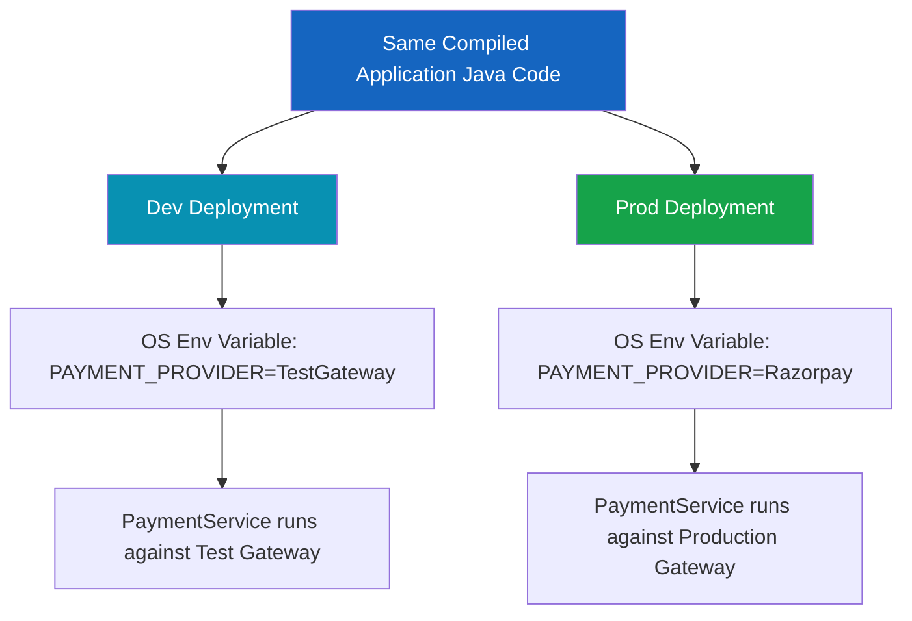

# Configuration Sources, Properties & YAML

Spring Boot configuration separates **changeable deployment settings from Java business logic**. Instead of hardcoding values like payment providers, retry counts, timeouts, database URLs, API keys, or feature flags inside Java classes, Spring Boot enables supplying these values dynamically.

---

## 1. High-Level Concept & Real-World Analogy

### The Restaurant Control Room Analogy

Think of a restaurant chain operating in multiple cities:

* **Java Business Logic**: The restaurant's standardized operating procedure manual.
* **Configuration**: The store manager's control panel.
* **`application.properties` / `application.yml`**: The written settings sheet inside the store.
* **`@Value`**: Asking the manager for one specific setting (e.g. "What is today's discount rate?").
* **`@ConfigurationProperties`**: Receiving the entire "Payment Configuration Binder".
* **`Environment`**: The central configuration registry resolving property values.
* **Spring Bean**: A managed employee operating inside the restaurant.
* **`CommandLineRunner` / `ApplicationRunner`**: Employees instructed to perform a task immediately after the store opens.

```text
Development Environment  ──►  Test Payment Gateway + Retry Count = 1
Production Environment   ──►  Razorpay Gateway     + Retry Count = 3
(The exact same Java code executes in both environments!)
```

> **The Core Engineering Rule**: Code describes application behavior; configuration describes deployment-specific choices.

---

## 2. The Hardcoding Problem & Configuration Boundaries

Consider a payment service with hardcoded parameters:

```java
// POOR ARCHITECTURE (Hardcoded settings inside business logic)
@Component
public class PaymentService {

    private String providerName = "Razorpay";
    private int retryCount = 3;

    public void pay() {
        System.out.println("Payment done using " + providerName);
        System.out.println("Retry count: " + retryCount);
    }
}
```

If production moves from **Razorpay** to **Stripe**, hardcoded logic requires:
1. Modifying Java source code.
2. Recompiling `.class` files.
3. Rebuilding the JAR artifact.
4. Redeploying the entire service.

### Decoupled Configuration Boundary

By externalizing settings to properties:

```properties
payment.provider=Razorpay
payment.retry-count=3
```

The Java service consumes externalized configuration rather than owning deployment values:

```text
┌─────────────────────────────────────────────────────────┐
│                      APPLICATION                        │
│   Business Logic                                        │
│   ┌─────────────────────────────────────────────────┐   │
│   │ PaymentService                                  │   │
│   │ "How should payment execution work?"            │   │
│   └─────────────────────────────────────────────────┘   │
│                          ▲                              │
│                          │ Injected Configuration       │
│   ┌─────────────────────────────────────────────────┐   │
│   │ Configuration                                   │   │
│   │ provider = Razorpay                             │   │
│   │ retry-count = 3                                 │   │
│   └─────────────────────────────────────────────────┘   │
└─────────────────────────────────────────────────────────┘
```

---

## 3. `application.properties` vs `application.yml`

Spring Boot automatically reads configuration files placed in `src/main/resources` by convention.

### `application.properties` (Flat Key-Value Syntax)

```properties
payment.provider=Razorpay
payment.retry-count=3
payment.enabled=true
payment.timeout=5000
```

* **Structure**: Uses dot notation (`payment.timeout`) to form logical namespaces.

### `application.yml` (Hierarchical YAML Syntax)

```yaml
payment:
  provider: Razorpay
  retry-count: 3
  enabled: true
  timeout: 5000
```

* **Structure**: Uses indentation tree structures to eliminate repeated key prefixes.
* Both formats express the exact same conceptual configuration namespace.

---

## 4. Packaged Resources vs True Externalized Configuration

> [!WARNING]
> **Crucial Distinction**: `application.properties` inside `src/main/resources/` is NOT truly external configuration once built.
> Files inside `src/main/resources` are compiled directly inside the executable `.jar` artifact. Changing them requires re-packaging the JAR!

### Spring Boot Externalized Configuration Sources

Spring Boot evaluates configuration from multiple sources, ordered by precedence (highest overrides lowest):

```text
SPRING BOOT CONFIGURATION PRECEDENCE HIERARCHY:
├── 1. Command-Line Arguments (e.g. java -jar app.jar --payment.provider=Stripe)
├── 2. Java System Properties (e.g. -Dpayment.provider=Stripe)
├── 3. OS Environment Variables (e.g. export PAYMENT_PROVIDER=Stripe)
├── 4. External application.properties (Outside executable JAR)
└── 5. Packaged application.properties / application.yml (Inside src/main/resources)
```

This architecture allows a single built JAR artifact to be deployed to Dev, Staging, and Production without re-compilation, simply by supplying OS Environment Variables or CLI arguments.

---

## 5. Environment-Specific Deployment Configurations



---

## ❓ Knowledge Check

<Quiz question="Why is a file located inside src/main/resources/application.properties not considered fully externalized configuration for a deployed JAR?" options={["Because Spring Boot ignores application.properties", "Because files in src/main/resources are compiled inside the executable JAR, requiring a rebuild if modified", "Because property files can contain only numbers", "Because YAML is required for external configuration"]} answerIndex={1}>
Files inside `src/main/resources` are bundled inside the JAR at build time. True externalized configuration is supplied at runtime via environment variables, CLI arguments, or external property files without rebuilding the artifact.
</Quiz>

<Quiz question="What happens if a developer passes '--payment.provider=Stripe' via command-line arguments when launching a Spring Boot JAR?" options={["The application throws an invalid argument exception", "The CLI argument overrides both packaged properties and OS environment variables for payment.provider", "Spring Boot deletes the application.properties file", "The application runs in XML configuration mode"]} answerIndex={1}>
Command-line arguments have higher precedence than packaged property files and environment variables, overriding default settings dynamically.
</Quiz>
