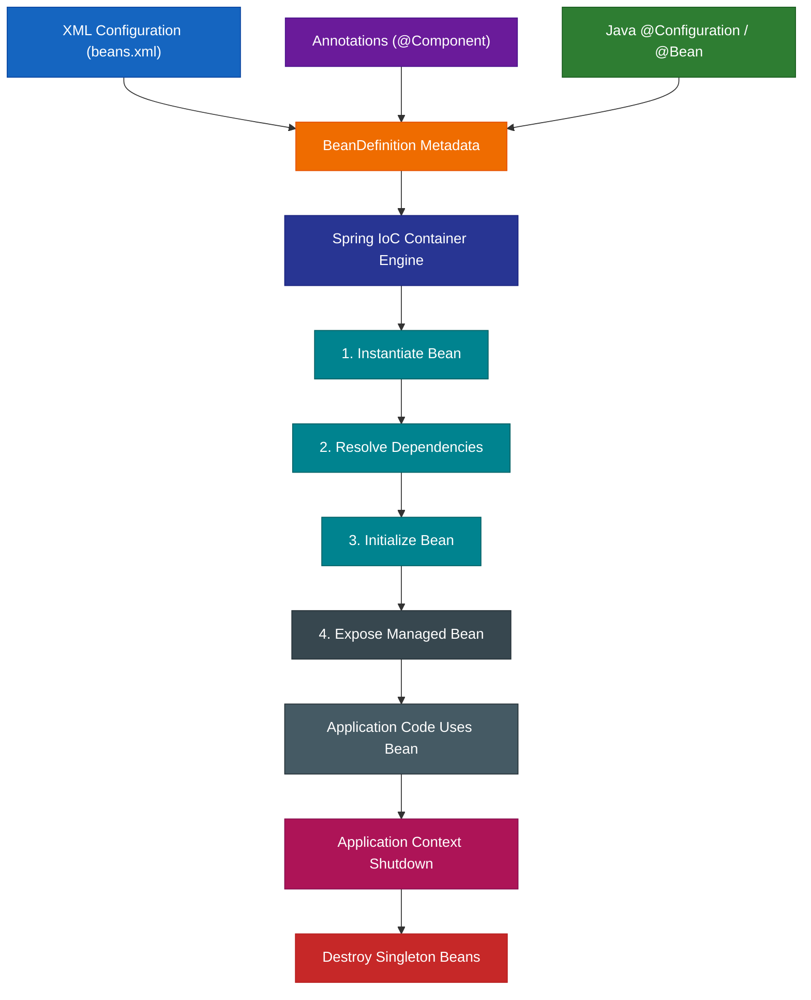

# Spring XML-Based Configuration Engineering Hub

## 1. High-Level Concept Definition

Spring XML-based configuration is a mechanism for supplying **configuration metadata** to the Spring IoC container through XML documents. Instead of placing configuration directly inside Java classes through annotations or Java configuration classes, the application declares beans, dependencies, names, scopes, and lifecycle behavior in an external XML file.

The important architectural point is that XML is **not the IoC container itself**. XML is merely one input format for describing what the container should manage. Spring parses XML metadata into internal `BeanDefinition` objects, and the IoC container uses those definitions to create, wire, initialize, expose, and eventually destroy managed objects. XML, annotations, and Java `@Configuration` classes therefore represent different configuration front ends converging on the exact same container model.

### The Real-World Analogy: A Factory Blueprint

Think of Spring's IoC container as a sophisticated manufacturing facility.

| Spring XML Concept | Real-World Analogy |
| --- | --- |
| **Spring IoC Container** | The factory that creates and manages products |
| **XML configuration** | The factory's blueprint / order sheet |
| **`<bean>`** | A production instruction saying "manufacture this object" |
| **`id`** | The object's catalog identifier |
| **`class`** | The manufacturing specification / class to instantiate |
| **`ref`** | "Use this already-produced component" |
| **`value`** | "Use this literal raw material" |
| **Constructor injection** | Components supplied while product is being assembled |
| **Setter injection** | Components attached after product has been constructed |
| **Singleton scope** | Manufacture one shared unit and reuse it |
| **Prototype scope** | Manufacture a new unit for every request |
| **`init-method`** | Factory startup / calibration procedure |
| **`destroy-method`** | Factory shutdown / cleanup procedure |
| **`<import>`** | Compose several smaller blueprints into one master blueprint |
| **Autowiring** | Let factory automatically determine compatible components |

### Spring XML Configuration Pipeline



---

## 2. Module Roadmap

| Module | Core Topics | Key Focus & Engineering Concepts | Read Time |
| --- | --- | --- | ---: |
| 01 | Configuration Metadata | XML vs annotations vs Java config, `BeanDefinition` | 8 min |
| 02 | XML Project Structure | Classpath, `src/main/resources`, `ClassPathXmlApplicationContext` | 6 min |
| 03 | Bean Registration | `<bean>`, `id`, `class`, bean identity | 8 min |
| 04 | Bean Retrieval & Naming | `getBean`, `id`, `name`, aliases, type lookup | 10 min |
| 05 | Constructor Injection | `ref`, `value`, index, name, type matching | 12 min |
| 06 | Setter Injection | `<property>`, setter resolution, `value` vs `ref` | 10 min |
| 07 | Ambiguous Dependencies | Multiple candidates, explicit wiring, `primary` | 8 min |
| 08 | XML Autowiring | `byName`, `byType`, `constructor` | 10 min |
| 09 | Bean Scopes | Singleton, prototype, mixed-scope behavior | 12 min |
| 10 | Lifecycle | Constructor, initialization, destruction, context close | 12 min |
| 11 | Collection Injection | `List`, `Map`, structured XML values | 8 min |
| 12 | Modular XML | `<import>`, configuration decomposition | 8 min |
| 13 | XML + Annotations | Component scanning and mixed configuration | 8 min |
| 14 | Production Engineering | Naming, explicit wiring, lifecycle hazards, legacy maintenance | 12 min |

---

## 3. Configuration Styles Comparison Matrix

| Dimension | XML Configuration | Annotation Configuration | Java `@Configuration` |
| --- | --- | --- | --- |
| **Location** | External XML file (`beans.xml`) | Direct Java class annotations | Java `@Configuration` classes |
| **Declaration Tag** | `<bean id="..." class="...">` | `@Component`, `@Service`, `@Repository` | `@Bean public TargetClass beanName()` |
| **Discovery Mechanism** | XML parser/reader | Classpath component scanning | Configuration processor |
| **Dependency Syntax** | `<constructor-arg>`, `<property>` | `@Autowired`, `@Qualifier` | Method parameters / direct calls |
| **Externalized Wiring** | **High** (change without recompiling) | Low (recompilation required) | Moderate (recompilation required) |
| **Primary Use Case** | Legacy enterprise systems / strict external configuration | Modern application services | Programmatic bean assembly & 3rd-party libs |

---

## 4. XML Bean Declaration & Retrieval

### 1. Minimal `beans.xml` Schema Blueprint

```xml
<?xml version="1.0" encoding="UTF-8"?>
<beans xmlns="http://www.springframework.org/schema/beans"
       xmlns:xsi="http://www.w3.org/2001/XMLSchema-instance"
       xsi:schemaLocation="
           http://www.springframework.org/schema/beans
           http://www.springframework.org/schema/beans/spring-beans.xsd">

    <!-- Bean Declaration -->
    <bean id="paymentService" class="in.strikes.PaymentService" />

</beans>
```

### 2. Bootstrapping with `ClassPathXmlApplicationContext`

```java
public class Main {
    public static void main(String[] args) {
        // Bootstrap IoC Container from classpath XML
        ApplicationContext context = 
            new ClassPathXmlApplicationContext("beans.xml");

        // Type-safe lookup by bean name and interface/class
        PaymentService paymentService = 
            context.getBean("paymentService", PaymentService.class);

        paymentService.pay();
    }
}
```

---

## 5. Dependency Injection: Constructor vs. Setter Injection

### 1. Constructor Injection (`<constructor-arg>`)

```xml
<bean id="paymentService" class="in.strikes.PaymentService">
    <!-- Literal primitive value injection -->
    <constructor-arg name="providerName" value="Razorpay" />
    <constructor-arg name="retryCount" value="3" />
</bean>

<bean id="orderService" class="in.strikes.OrderService">
    <!-- Reference injection pointing to another container bean -->
    <constructor-arg ref="paymentService" />
</bean>
```

### 2. Setter Injection (`<property>`)

```xml
<bean id="orderService" class="in.strikes.OrderService">
    <!-- Invokes setPaymentService(PaymentService ps) -->
    <property name="paymentService" ref="paymentService" />
</bean>
```

<Callout type="tip" title="💡 Value vs. Ref Rule of Thumb">
* **`value`**: Injects simple literal configuration data (`String`, `int`, `boolean`).
* **`ref`**: Injects a reference to another **Spring-managed bean** in the container.
</Callout>

---

## 6. XML Autowiring Modes

| Autowire Mode | Matching Mechanism | Key Risk / Failure Mode |
| --- | --- | --- |
| `autowire="byName"` | Property name matches XML bean `id` | Breaks silently if bean ID is renamed |
| `autowire="byType"` | Property type matches bean class | Throws `NoUniqueBeanDefinitionException` if 2+ candidates exist |
| `autowire="constructor"` | Constructor parameters match bean types | Ambiguity when multiple matching types exist |

```xml
<!-- Autowiring OrderService by matching property names to bean IDs -->
<bean id="orderService" class="in.strikes.OrderService" autowire="byName" />
```

---

## 7. XML Lifecycle Callbacks (`init-method` & `destroy-method`)

```xml
<bean id="paymentService" 
      class="in.strikes.PaymentService"
      init-method="init"
      destroy-method="cleanup"
      scope="singleton">
    <constructor-arg value="Razorpay" />
</bean>
```

```java
public class PaymentService {
    public PaymentService(String provider) { System.out.println("1. Constructor"); }
    public void init() { System.out.println("2. Custom init-method"); }
    public void pay() { System.out.println("3. Business method execution"); }
    public void cleanup() { System.out.println("4. Custom destroy-method"); }
}
```

```text
Constructor ──► Dependency Injection ──► init-method ──► Ready ──► (Context Close) ──► destroy-method
```

---

## 8. Modularizing XML Configuration (`<import>`)

Split monolithic XML files into domain-driven blueprints and compose them using `<import>`:

```xml
<!-- applicationContext.xml -->
<beans xmlns="http://www.springframework.org/schema/beans" ...>

    <import resource="orderContext.xml" />
    <import resource="userContext.xml" />
    <import resource="paymentContext.xml" />

</beans>
```

---

## 9. Combining XML with Annotation Component Scanning

Enable annotation scanning inside an XML-configured system using `<context:component-scan>`:

```xml
<beans xmlns="http://www.springframework.org/schema/beans"
       xmlns:context="http://www.springframework.org/schema/context"
       xsi:schemaLocation="
           http://www.springframework.org/schema/beans
           http://www.springframework.org/schema/beans/spring-beans.xsd
           http://www.springframework.org/schema/context
           http://www.springframework.org/schema/context/spring-context.xsd">

    <!-- Scans package for @Component, @Service, @Repository -->
    <context:component-scan base-package="in.strikes" />

</beans>
```

---

## 10. Interactive Self-Assessment

<Quiz
question="A singleton OrderService has a prototype PaymentService injected through its constructor. What happens when OrderService.placeOrder() is called multiple times?"
options={[
"A new PaymentService is created for every placeOrder() call.",
"The same PaymentService instance injected when OrderService was created is reused.",
"Spring throws an exception because singleton and prototype scopes cannot be combined.",
"The prototype PaymentService is automatically destroyed after every placeOrder() call."
]}
answerIndex={1}>
**Option B is correct.**

The prototype scope controls creation when the bean is requested from the container. During construction of the singleton `OrderService`, Spring obtains a prototype `PaymentService` and injects that instance. The singleton then retains the reference permanently. Calling methods on `OrderService` does not automatically trigger another container lookup, so the same injected `PaymentService` is reused.
</Quiz>

<Quiz
question="Two PaymentService beans exist in the Spring container. What happens when context.getBean(PaymentService.class) is called without additional qualification?"
options={[
"Spring randomly chooses the first PaymentService bean.",
"Spring creates a third temporary PaymentService bean.",
"Spring cannot uniquely resolve the dependency and throws NoUniqueBeanDefinitionException.",
"Spring always chooses the bean whose XML id is alphabetically first."
]}
answerIndex={2}>
**Option C is correct.**

Type-only lookup requires a unique matching bean. When multiple beans satisfy the requested type, Spring cannot safely infer which object the application intended, throwing a `NoUniqueBeanDefinitionException`. Explicit bean-name lookup (`context.getBean("paymentService", PaymentService.class)`) or explicit `ref` wiring resolves the ambiguity.
</Quiz>

<Quiz
question="Which statement correctly describes the difference between XML value and ref injection?"
options={[
"value injects another Spring bean while ref injects a primitive value.",
"Both value and ref always create new objects.",
"value supplies a simple configured value while ref resolves another Spring-managed bean.",
"ref is only valid for prototype beans."
]}
answerIndex={2}>
**Option C is correct.**

`value` represents simple configuration data such as strings, integers, and booleans. `ref` represents a relationship pointing to another object managed by the Spring IoC container.
</Quiz>

<Quiz
question="Why does a configured destroy-method not automatically provide cleanup for a prototype bean when the ApplicationContext closes?"
options={[
"Prototype beans never execute initialization callbacks.",
"Prototype beans are completely unmanaged, including during creation.",
"Spring does not manage the complete lifecycle of prototype instances after creation.",
"destroy-method is only valid for beans created through annotations."
]}
answerIndex={2}>
**Option C is correct.**

Spring manages the creation and initialization of prototype objects, but it does not retain complete lifecycle responsibility for them after handing them to the application. Consequently, context shutdown does not automatically invoke their destruction callbacks.
</Quiz>

---

## 11. Practical Engineering Challenge

<Problem title="Problem: Refactoring Ambiguous XML Dependency Wiring">
<ProblemDescription>
You maintain a legacy Spring XML application containing two implementations of `PaymentService`:

```xml
<bean id="razorpayPaymentService" class="in.strikes.RazorpayPaymentService" />
<bean id="stripePaymentService" class="in.strikes.StripePaymentService" />
```

`OrderService` requires a `PaymentService` through its constructor. A developer configured it using implicit type-based autowiring:

```xml
<bean id="orderService" class="in.strikes.OrderService" autowire="constructor" />
```

The application fails at startup with `NoUniqueBeanDefinitionException`. Refactor the XML so that the dependency wiring is deterministic and explicit.
</ProblemDescription>

<ProblemSolution>
Replace the implicit `autowire="constructor"` attribute with explicit `<constructor-arg ref="...">` wiring:

```xml
<bean id="razorpayPaymentService" class="in.strikes.RazorpayPaymentService" />
<bean id="stripePaymentService" class="in.strikes.StripePaymentService" />

<!-- Explicit, deterministic constructor wiring -->
<bean id="orderService" class="in.strikes.OrderService">
    <constructor-arg ref="razorpayPaymentService" />
</bean>
```

### Deterministic Dependency Graph

```text
OrderService ──► (ref="razorpayPaymentService") ──► RazorpayPaymentService Bean
```
</ProblemSolution>
</Problem>

---

## 12. Mastery Checklist

* [ ] Explain why XML configuration is metadata rather than the IoC container itself.
* [ ] Differentiate between `<constructor-arg value="...">` and `<constructor-arg ref="...">`.
* [ ] Differentiate between `autowire="byName"`, `autowire="byType"`, and `autowire="constructor"`.
* [ ] Configure custom initialization and destruction callbacks (`init-method` and `destroy-method`).
* [ ] Explain why Spring does not invoke `destroy-method` for prototype beans on context shutdown.
* [ ] Decompose monolithic XML configurations using `<import resource="..." />`.
* [ ] Enable component scanning inside XML files using `<context:component-scan>`.
