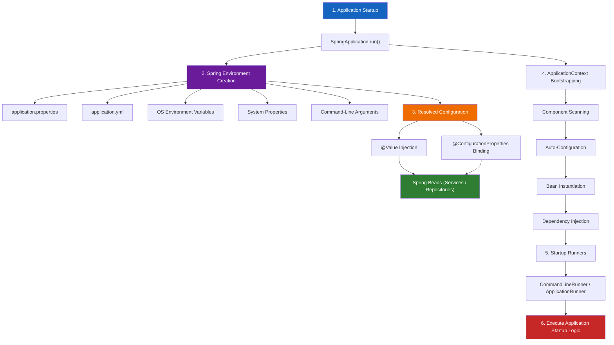

# End-to-End Configuration Pipeline & Pitfalls

Understanding how external configuration flows through the `Environment`, binds to beans, and triggers post-boot execution completes the Spring Boot configuration masterclass.

---

## 1. End-to-End Architecture Data Flow



---

## 2. Configuration-to-Bean Execution Pipeline

```text
Configuration Sources (properties, yml, env, args)
       │
       ▼
Spring Environment (Central Property Resolver)
       │
       ├─────────────────────────────────┐
       ▼                                 ▼
   @Value                       @ConfigurationProperties
(Injects single field)          (Binds grouped namespace object)
       │                                 │
       └────────────────┬────────────────┘
                        ▼
            Spring Beans (Services)
                        │
                        ▼
       Application Context Ready
                        │
            ┌───────────┴───────────┐
            ▼                       ▼
   CommandLineRunner        ApplicationRunner
            │                       │
            └───────────┬───────────┘
                        ▼
              Execute Startup Logic
```

---

## 3. Complexity & Engineering Trade-Off Matrix

| Scenario / Complexity | Recommended Injection Approach | Architectural Reason |
| :--- | :--- | :--- |
| **1–2 Simple Flags** (e.g. `payment.enabled=true`) | **`@Value`** | Direct, minimal boilerplate for single standalone values. |
| **4+ Related Properties** (e.g. timeout, retry, url, key) | **`@ConfigurationProperties`** | Models a cohesive domain configuration object. |
| **Relaxed Naming Needs** (`PAYMENT_RETRY_COUNT` in Docker) | **`@ConfigurationProperties`** | Full support for camelCase to UPPERCASE relaxed binding. |
| **Shared Settings Across 5 Services** | **`@ConfigurationProperties`** | Inject single properties bean into all 5 services without repeating `@Value`. |
| **Simple CLI Script** | **`CommandLineRunner`** | Simple raw `String... args` processing. |
| **Enterprise CLI Tool with `--flags`** | **`ApplicationRunner`** | Native support for structured `ApplicationArguments`. |

---

## 4. Production Pitfalls Checklist

### Pitfall 1: Assuming `src/main/resources/application.properties` Is Truly External
* **Mistake**: Thinking changing `application.properties` in project source updates a deployed production JAR.
* **Fix**: Use true external configuration (OS Environment Variables or `--server.port=8081` flags) for production overrides.

### Pitfall 2: Excessive `@Value` Proliferation
* **Mistake**: Adding 20 `@Value` fields across multiple classes, scattering configuration keys.
* **Fix**: Refactor related settings into a single `@ConfigurationProperties(prefix = "...")` bean.

### Pitfall 3: Missing Required Configuration
* **Mistake**: Using `@Value("${payment.provider}")` without a default value when the property might be missing.
* **Fix**: Provide a safe fallback: `@Value("${payment.provider:DefaultProvider}")`.

### Pitfall 4: Manual Bean Retrieval in `main()`
* **Mistake**: Calling `context.getBean(MyService.class)` inside `main()`.
* **Fix**: Implement `CommandLineRunner` or `ApplicationRunner` to let Spring manage execution via DI.

---

## 5. Comprehensive End-to-End Code Example

### 1. `application.properties`
```properties
payment.provider=Razorpay
payment.retry-count=3
payment.enabled=true
payment.timeout=5000
```

### 2. Grouped Configuration Object
```java
@Component
@ConfigurationProperties(prefix = "payment")
public class PaymentProperties {

    private String provider;
    private int retryCount;
    private boolean enabled;
    private int timeout;

    // Getters and Setters
    public String getProvider() { return provider; }
    public void setProvider(String provider) { this.provider = provider; }

    public int getRetryCount() { return retryCount; }
    public void setRetryCount(int retryCount) { this.retryCount = retryCount; }

    public boolean isEnabled() { return enabled; }
    public void setEnabled(boolean enabled) { this.enabled = enabled; }

    public int getTimeout() { return timeout; }
    public void setTimeout(int timeout) { this.timeout = timeout; }
}
```

### 3. Business Service
```java
@Component
public class PaymentService {

    private final PaymentProperties properties;

    public PaymentService(PaymentProperties properties) {
        this.properties = properties;
    }

    public void pay() {
        if (!properties.isEnabled()) {
            System.out.println("Payment disabled.");
            return;
        }

        System.out.println("Payment provider: " + properties.getProvider());
        System.out.println("Retry count: " + properties.getRetryCount());
        System.out.println("Timeout: " + properties.getTimeout() + "ms");
    }
}
```

### 4. Post-Boot Startup Runner
```java
@Component
public class AppRunner implements CommandLineRunner {

    private final PaymentService paymentService;

    public AppRunner(PaymentService paymentService) {
        this.paymentService = paymentService;
    }

    @Override
    public void run(String... args) {
        System.out.println("=== Spring Boot Bootstrapped Successfully ===");
        paymentService.pay();
    }
}
```

---

## ❓ Interactive Self-Assessment

<Quiz question="A Spring Boot app has payment.provider, payment.retry-count, payment.enabled, and payment.timeout. Which design is most scalable?" options={["Inject four independent @Value fields throughout every service", "Create a PaymentProperties object using @ConfigurationProperties(prefix = \"payment\") and inject it where needed", "Hardcode values in Java source code", "Read application.properties manually with java.io.File"]} answerIndex={1}>
`@ConfigurationProperties(prefix = "payment")` encapsulates all four related properties under one cohesive, type-safe Java object that can be injected as a Spring bean.
</Quiz>

<Quiz question="What is the key difference between CommandLineRunner and ApplicationRunner?" options={["CommandLineRunner runs before container creation, ApplicationRunner after", "CommandLineRunner receives raw String... args, while ApplicationRunner receives structured ApplicationArguments with option parsing", "CommandLineRunner works only in web apps", "ApplicationRunner requires XML configuration"]} answerIndex={1}>
`CommandLineRunner` exposes raw `String... args`, whereas `ApplicationRunner` exposes `ApplicationArguments`, allowing options like `--provider=Razorpay` to be queried via `getOptionValues("provider")`.
</Quiz>

<Problem title="Refactoring Scattered @Value Injections">
<ProblemDescription>
A legacy application has 4 scattered `@Value` injections in `PaymentService`. Refactor this design using `@ConfigurationProperties`.
</ProblemDescription>
<ProblemSolution>

```java
// BEFORE (Fragmented @Value Injections):
@Component
public class PaymentService {
    @Value("${payment.provider}") private String provider;
    @Value("${payment.retry-count}") private int retryCount;
    @Value("${payment.enabled}") private boolean enabled;
    @Value("${payment.timeout}") private int timeout;
}

// AFTER (Cohesive Configuration Object):
@Component
@ConfigurationProperties(prefix = "payment")
public class PaymentProperties {
    private String provider;
    private int retryCount;
    private boolean enabled;
    private int timeout;
    // getters and setters
}

@Component
public class PaymentService {
    private final PaymentProperties properties;

    public PaymentService(PaymentProperties properties) {
        this.properties = properties;
    }
}
```

**Architectural Benefit**: Grouping properties under `@ConfigurationProperties` creates a clear configuration boundary, supports relaxed binding, and avoids duplicating `@Value` expressions across classes.
</ProblemSolution>
</Problem>
