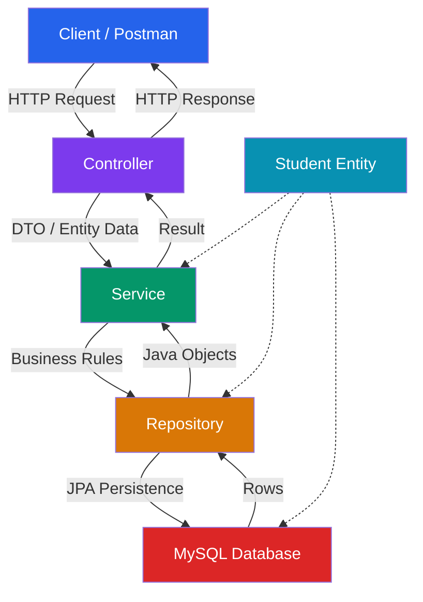

# Layered Architecture & Responsibilities

CRUD stands for **Create, Read, Update, and Delete**—the four fundamental operations performed against persistent application data. While CRUD is often introduced as beginner material, it forms the structural foundation behind enterprise backend systems including ordering engines, payment portals, and inventory management.

In Spring Boot, CRUD is executed through a strict request-to-database pipeline across decoupled application layers.

---

## 1. High-Level Concept & Restaurant Kitchen Analogy

Think of a backend CRUD system like a high-end restaurant:

* **Client / Postman**: Customer placing a food order.
* **Controller**: Waiter receiving the order and returning the response.
* **Service**: Kitchen manager receiving the order ticket and applying cooking recipes/rules.
* **Repository**: Pantry clerk fetching raw ingredients from storage.
* **Database**: Warehouse containing persistent inventory.
* **Entity / Model**: Standardized food container/tray traveling through the kitchen.

```text
┌──────────────────────────────────────────────────────────┐
│               RESTAURANT RESPONSIBILITY RULE             │
│  The waiter should not cook the food, nor should the     │
│  pantry clerk interact directly with the dining customer.│
└──────────────────────────────────────────────────────────┘
```

> **Core Rule**: A `@RestController` must not perform direct database operations, execute raw SQL, or enforce domain validation rules internally.

### Request Pipeline Diagram



---

## 2. The "God Controller" Anti-Pattern vs Layered Architecture

A naive implementation mixes all concerns into a single controller class:

```java
// POOR ARCHITECTURE: "God Controller" Anti-Pattern
@RestController
public class StudentController {
    // 1. Receives HTTP request
    // 2. Validates JSON payload
    // 3. Executes SQL queries directly via JDBC
    // 4. Applies business/discount rules
    // 5. Handles hard/soft deletion flags
    // 6. Constructs HTTP response manually
}
```

### Why Layered Architecture Matters

| Application Layer | Primary Responsibility | Knows HTTP? | Knows Business Rules? | Knows DB SQL? |
| :--- | :--- | :--- | :--- | :--- |
| **Controller** | API boundary (receives requests, returns responses) | Yes | Limited | No |
| **Service** | Business rules, validation, domain decisions | No | Yes | Indirectly |
| **Repository** | Data persistence operations (Spring Data JPA) | No | No | Yes |
| **Entity** | Persistent data representation | No | Domain state | Table mapping |

---

## 3. Canonical Project Package Layout & Component Scanning

To ensure Spring's `@ComponentScan` automatically discovers all managed components, place your main `@SpringBootApplication` class in the root package, with functional layers organized in dedicated sub-packages:

```text
com.coderarmy.studentcrud
│
├── StudentCrudApplication.java   <-- @SpringBootApplication (Component Scan Root)
│
├── controller
│   └── StudentController.java    <-- @RestController
│
├── service
│   └── StudentService.java       <-- @Service
│
├── repository
│   └── StudentRepository.java    <-- @Repository / JpaRepository
│
└── entity
    └── Student.java              <-- @Entity
```

> [!IMPORTANT]
> Any `@Component`, `@Service`, or `@RestController` placed outside `com.coderarmy.studentcrud` (e.g. in `com.otherpackage`) will NOT be scanned automatically unless explicitly declared in `@ComponentScan(basePackages = "...")`.

---

## 4. MySQL Tooling Topology: Server vs Client vs Workbench

Developers often confuse the underlying database engine with management interfaces:

```text
Bank Analogy:
├── Bank Vault                   ──► MySQL Server (Database Engine)
├── Bank Teller Terminal         ──► MySQL Client (CLI tool mysql)
└── Bank Administrative Dashboard ──► MySQL Workbench / DBeaver (GUI Manager)
```

| Component | Nature | Operational Role |
| :--- | :--- | :--- |
| **MySQL Server** | Database Engine Daemon (`mysqld`) | Listens on port `3306`, manages tables, indexes, and storage. |
| **MySQL Client** | Command-Line Interface (`mysql -u root -p`) | Terminal client executing raw SQL scripts. |
| **MySQL Workbench** | Graphical Desktop Application | Visual schema design, user administration, and query execution. |

---

## ❓ Knowledge Check

<Quiz question="Why should a Controller delegate business logic to a Service class instead of handling it directly?" options={["Controllers cannot access Java methods", "To maintain separation of concerns so that API transport mechanics are decoupled from business decisions and database persistence", "Because Services run faster than Controllers", "Because Controllers delete database tables automatically"]} answerIndex={1}>
Decoupling layers ensures that HTTP transport logic remains separate from business rules, making business logic reusable across CLI runners, web controllers, and automated unit tests.
</Quiz>

<Quiz question="What happens if a @Service class is placed in package 'com.external.service' when the @SpringBootApplication class is in 'com.myapp'?" options={["The application compiles but Spring fails to auto-discover the @Service bean unless configured explicitly in @ComponentScan", "Spring Boot throws a C++ syntax error", "The MySQL database drops all tables", "The Service is converted into an XML file"]} answerIndex={0}>
By default, `@SpringBootApplication` scans only its host package and sub-packages. Classes outside that hierarchy will not be registered in the `ApplicationContext` without explicit scanning configuration.
</Quiz>
