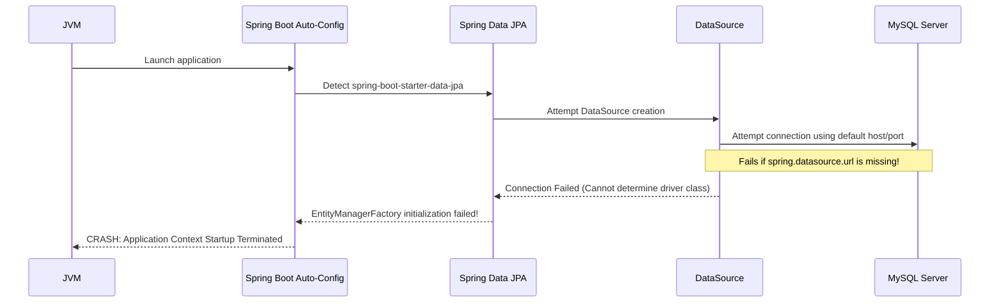

# JPA Entities, ORM & Database Auto-Configuration

In a Spring Boot CRUD application, **Spring Data JPA** and **Hibernate** bridge the gap between Java Object-Oriented paradigms and Relational Database Management Systems (RDBMS).

---

## 1. Entity vs Flow Layer: The Standardized Form Analogy

Unlike Controllers, Services, and Repositories (which are execution flow layers), an **Entity** is a data-carrying domain object:

```text
The Standardized Department Form Analogy:
├── Controller receives customer input and fills out a "Student Form" (Entity).
├── Service reads the "Student Form", checks rules, and updates fields.
├── Repository takes the "Student Form" and hands it to Hibernate.
└── Hibernate translates the "Student Form" into a SQL INSERT/UPDATE statement.
```

---

## 2. Entity Mapping & Object-Relational Mapping (ORM)

```java
package com.coderarmy.studentcrud.entity;

import jakarta.persistence.*;

@Entity
@Table(name = "students") // Maps Java class to "students" SQL table
public class Student {

    @Id
    @GeneratedValue(strategy = GenerationType.IDENTITY) // Auto-increment Primary Key
    private Long id;

    @Column(nullable = false)
    private String name;

    private String email;
    private String course;
    private int age;

    @Column(name = "roll_no")
    private int rollNo;

    private boolean isDeleted; // Flag for Soft Delete

    // No-arg constructor required by JPA/Hibernate spec
    public Student() {}

    // Getters and Setters
    public Long getId() { return id; }
    public String getName() { return name; }
    public void setName(String name) { this.name = name; }

    public String getEmail() { return email; }
    public void setEmail(String email) { this.email = email; }

    public String getCourse() { return course; }
    public void setCourse(String course) { this.course = course; }

    public int getAge() { return age; }
    public void setAge(int age) { this.age = age; }

    public int getRollNo() { return rollNo; }
    public void setRollNo(int rollNo) { this.rollNo = rollNo; }

    public boolean isDeleted() { return isDeleted; }
    public void setDeleted(boolean deleted) { isDeleted = deleted; }
}
```

### Java Object ↔ Database Row Transformation

```text
Java Student Object                          MySQL "students" Table Row
┌───────────────────────────────┐            ┌──────────────────────────────────────────────┐
│ id     = 1L                   │    JPA /   │ id │ name         │ email             │ age │
│ name   = "Rahul Sharma"       │  Hibernate │────┼──────────────┼───────────────────┼─────│
│ email  = "rahul@example.com"  │ ─────────► │ 1  │ Rahul Sharma │ rahul@example.com │ 22  │
│ course = "Spring Boot"        │            └──────────────────────────────────────────────┘
│ age    = 22                   │
└───────────────────────────────┘
```

---

## 3. Dependency Stack & Abstraction Layers

To build a RESTful JPA application, three primary dependencies are declared in Maven/Gradle:

| Starter Dependency | Component Function | What It Enables |
| :--- | :--- | :--- |
| `spring-boot-starter-web` | Web / REST Engine | Embedded Tomcat, `DispatcherServlet`, `@RestController` |
| `spring-boot-starter-data-jpa` | Persistence Framework | JPA Annotations, Hibernate ORM, `JpaRepository` |
| `mysql-connector-j` | JDBC Database Driver | Low-level TCP/IP binary communication with MySQL Server |

### The Persistence Abstraction Hierarchy

```text
Application Code (studentRepository.save(student))
      │
      ▼
Spring Data Repository (JpaRepository Abstraction)
      │
      ▼
JPA (Jakarta Persistence API Specifications)
      │
      ▼
Hibernate (ORM Implementation Provider)
      │
      ▼
JDBC Driver (mysql-connector-j)
      │
      ▼
MySQL Database Server (Storage Engine)
```

---

## 4. Why Empty Database Apps Crash on Startup

When `spring-boot-starter-data-jpa` and `mysql-connector-j` exist on the classpath, Spring Boot's auto-configuration detects them and assumes:

> *"The developer wants to connect to a relational database immediately."*

It automatically attempts to construct a `DataSource` bean and initialize an `EntityManagerFactory`.



### The Required Configuration Remedy

To prevent startup crash, define database connection properties in `application.properties`:

```properties
# MySQL Datasource Settings
spring.datasource.url=jdbc:mysql://localhost:3306/student_crud_db?useSSL=false&serverTimezone=UTC
spring.datasource.username=root
spring.datasource.password=rootpassword
spring.datasource.driver-class-name=com.mysql.cj.jdbc.Driver

# JPA / Hibernate DDL Auto-Generation
spring.jpa.hibernate.ddl-auto=update
spring.jpa.show-sql=true
spring.jpa.properties.hibernate.format_sql=true
```

> [!WARNING]
> `spring.jpa.hibernate.ddl-auto=update` automatically creates or updates database table schemas at startup to match your `@Entity` classes. In production environments, use migration tools like Flyway or Liquibase instead (`ddl-auto=validate`).

---

## ❓ Knowledge Check

<Quiz question="What causes a Spring Boot application to crash during startup immediately after adding spring-boot-starter-data-jpa without database configuration?" options={["Spring Boot requires all controllers to be named MainController", "Auto-configuration detects JPA starters and attempts to create a DataSource bean, which fails without connection properties", "MySQL deletes the project directory", "Hibernate requires a paid license for local development"]} answerIndex={1}>
Spring Boot's auto-configuration detects database starters on the classpath and attempts to assemble a `DataSource` and `EntityManagerFactory`. Without `spring.datasource.url` and credentials, `DataSource` initialization fails, stopping application startup.
</Quiz>

<Quiz question="Which annotation marks a Java class for Object-Relational Mapping to a relational database table?" options={["@RestController", "@Entity", "@Service", "@Repository"]} answerIndex={1}>
`@Entity` specifies that the Java class is a JPA entity whose fields map to table columns in a relational database.
</Quiz>
