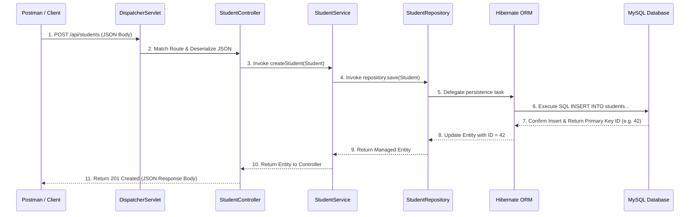

# REST Controllers, `ResponseEntity` & Jackson

The **Controller Layer** serves as the protocol boundary translating raw HTTP bytes into typed Java method calls and serializing domain results back into JSON HTTP responses.

---

## 1. Controller Protocol Boundary

```java
@RestController
@RequestMapping("/api/students")
public class StudentController {

    private final StudentService service;

    // Constructor Injection
    public StudentController(StudentService service) {
        this.service = service;
    }
}
```

* **`@RestController`**: Composite annotation combining `@Controller` and `@ResponseBody`, instructing Spring MVC to serialize return values directly into the HTTP response body.
* **`@RequestMapping("/api/students")`**: Defines the common base URI route for all endpoints within the controller class.

---

## 2. Explicit HTTP Control via `ResponseEntity<T>`

An HTTP response consists of three core elements:
1. **HTTP Status Code** (e.g. `200 OK`, `201 Created`, `404 Not Found`)
2. **HTTP Headers** (e.g. `Content-Type: application/json`)
3. **HTTP Response Body** (e.g. JSON bytes)

`ResponseEntity<T>` provides explicit programmatic control over all three elements:

```java
// Returning 201 Created with created object
return ResponseEntity.status(HttpStatus.CREATED).body(createdStudent);

// Returning 200 OK with body
return ResponseEntity.ok(activeStudents);

// Returning 404 Not Found without body
return ResponseEntity.notFound().build();

// Returning 204 No Content for successful deletion
return ResponseEntity.noContent().build();
```

### Standard CRUD HTTP Status Codes

| CRUD Operation | Success Status Code | Failure Status Code |
| :--- | :--- | :--- |
| **`POST` (Create)** | `201 Created` | `400 Bad Request` / `409 Conflict` |
| **`GET` (Read Single)** | `200 OK` | `404 Not Found` |
| **`GET` (Read List)** | `200 OK` (Empty list `[]` if none) | `500 Internal Server Error` |
| **`PUT` (Update)** | `200 OK` | `404 Not Found` / `400 Bad Request` |
| **`DELETE` (Delete)** | `204 No Content` | `404 Not Found` |

---

## 3. Jackson Serialization & Deserialization Pipeline

Spring Web uses the **Jackson** library (`ObjectMapper`) to marshal data between JSON text strings and Java domain objects:

```text
HTTP Request Body (JSON) ──► Jackson Deserialization ──► Java Student Object
                                                              │
                                                        Service/JPA Processing
                                                              │
HTTP Response Body (JSON) ◄── Jackson Serialization ◄─── Java Student Object
```

---

## 4. Handling `Optional<T>` Cleanly

`repository.findById(id)` returns an `Optional<Student>`. Handling this cleanly in the Controller avoids throwing unhandled `NoSuchElementException` exceptions:

```java
@GetMapping("/{id}")
public ResponseEntity<Student> getStudentById(@PathVariable Long id) {
    return service.getStudentById(id)
            .map(ResponseEntity::ok)                           // Returns 200 OK if present
            .orElseGet(() -> ResponseEntity.notFound().build()); // Returns 404 Not Found if absent
}
```

---

## 5. Complete 11-Step Bidirectional Execution Pipeline



---

## ❓ Knowledge Check

<Quiz question="What is the purpose of ResponseEntity in Spring Boot REST controllers?" options={["To convert Java classes into SQL scripts", "To allow programmatic control over HTTP Status Codes, Headers, and Response Body returned to the client", "To encrypt database passwords", "To automatically restart Tomcat"]} answerIndex={1}>
`ResponseEntity<T>` provides explicit programmatic control over the HTTP status code (e.g. `201 Created`, `404 Not Found`), HTTP headers, and the serialized response body.
</Quiz>

<Quiz question="How does Jackson participate in Spring Web execution?" options={["Jackson compiles Java into C++", "Jackson marshals incoming HTTP JSON request bodies into Java objects (deserialization) and converts Java objects into JSON responses (serialization)", "Jackson executes SQL queries on MySQL", "Jackson generates CSS stylesheets"]} answerIndex={1}>
Jackson acts as the default JSON Object Mapper in Spring Web, handling serialization and deserialization between JSON text payloads and Java objects.
</Quiz>
