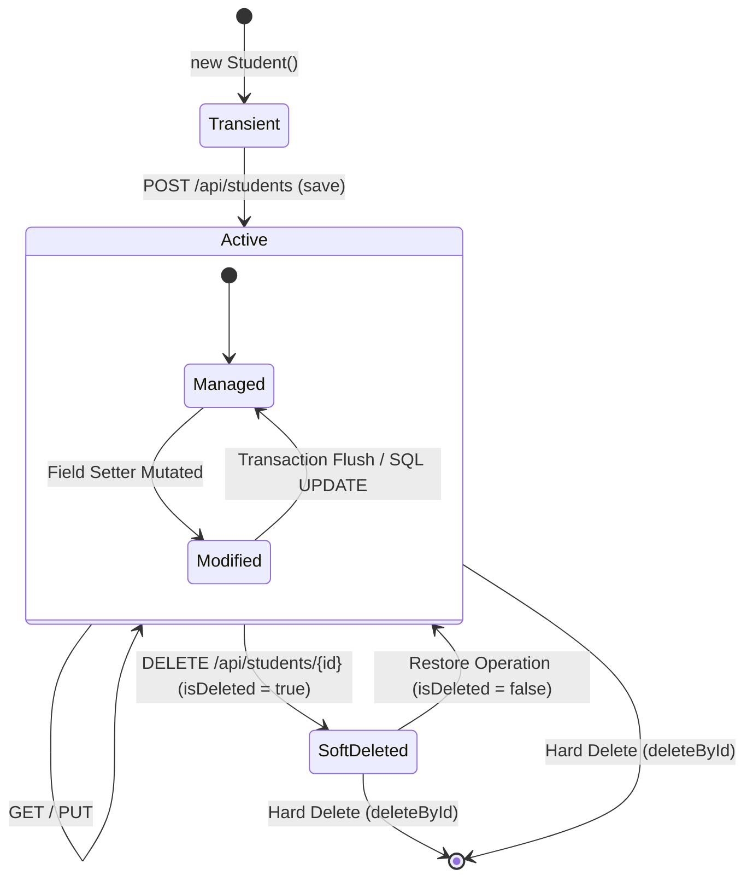

# DTOs, State Machines, Anti-Patterns & Debugging

Decoupling API contracts from database schemas using **Data Transfer Objects (DTOs)**, managing state machine transitions, and executing structured debugging ensures production reliability.

---

## 1. DTOs vs Persistence Entities

Exposing database `@Entity` classes directly in REST API payloads creates severe architectural risks:
* **Over-Posting Attacks**: Clients can send unexpected JSON fields (e.g. `"isDeleted": true` or `"id": 9999`) to alter internal state.
* **Schema Tight Coupling**: Modifying a database table column instantly breaks external API contracts.

### Modern DTO Decoupled Architecture (Java Records)

```java
// Request DTO (Immutable Input Contract)
public record CreateStudentRequest(
        String name,
        String email,
        Integer age,
        String mobile
) {}

// Response DTO (Immutable Output Contract)
public record StudentResponse(
        Long id,
        String name,
        String email,
        Integer age,
        String mobile
) {}
```

```text
HTTP Request (JSON) ──► CreateStudentRequest DTO ──► Service (Maps DTO ──► Student Entity) ──► Repository/DB
                                                                                                 │
HTTP Response (JSON) ◄── StudentResponse DTO ◄─── Service (Maps Student Entity ──► DTO) ◄────────┘
```

---

## 2. Entity State Machine Transitions



---

## 3. Time-of-Check / Time-of-Use (`existsById` Double Query)

A common pattern in service layers involves checking existence before deletion:

```java
// TIME-OF-CHECK / TIME-OF-USE (TOCTOU) PATTERN
public boolean deleteStudent(Long id) {
    if (!repository.existsById(id)) { // Query 1: Check existence
        return false;
    }
    repository.deleteById(id);       // Query 2: Execute deletion
    return true;
}
```

### Architectural Trade-off
While acceptable in simple applications, issuing two sequential SQL queries introduces a potential race condition where another transaction could delete or alter the row between Query 1 and Query 2. In production systems, execute single atomic delete statements or handle `EmptyResultDataAccessException` directly.

---

## 4. Common Production Anti-Patterns

1. **Direct Entity Exposure**: Returning `@Entity` objects directly from REST controllers instead of clean DTO records.
2. **`Optional.get()` Abuse**: Invoking `.get()` on empty `Optional` results without checking, causing `NoSuchElementException`.
3. **Unbounded `findAll()`**: Exposing endpoints that fetch millions of database rows without `Pageable` pagination.
4. **Uncontrolled `ddl-auto=update`**: Relying on Hibernate auto-schema updates in production databases instead of Flyway/Liquibase migration scripts.
5. **Ignoring HTTP Status Codes**: Returning `200 OK` for every response, including errors and creation events.

---

## 5. Outside-In Layered Debugging Checklist

When a Spring Boot CRUD operation fails, debug systematically from the outside inward:

```text
1. HTTP / NETWORK LAYER
   └── Is URL correct? Is HTTP verb (POST/GET/PUT) correct? Is Content-Type application/json?

2. CONTROLLER LAYER
   └── Is @RestController present? Are @PathVariable and @RequestBody annotations mapped?

3. SERVICE LAYER
   └── Is business logic throwing an exception? Is soft-delete filtering (isDeleted = false) applied?

4. REPOSITORY / ORM LAYER
   └── Does repository extend JpaRepository<Entity, ID>? Is derived query method naming correct?

5. DATABASE LAYER
   └── Is MySQL running on port 3306? Does database schema exist? Are spring.datasource credentials valid?
```

---

## ❓ Interactive Self-Assessment

<Quiz question="What security risk is mitigated by using DTOs (Data Transfer Objects) instead of exposing @Entity classes directly?" options={["DTOs make the server run 10x faster", "Over-posting attacks, where clients send JSON payload fields to alter internal flags (e.g. isDeleted or role) that should not be client-writable", "DTOs eliminate the need for MySQL databases", "DTOs compile Java into JavaScript"]} answerIndex={1}>
Using DTOs restricts incoming payload fields to only those explicitly defined in the request contract, preventing clients from modifying protected entity fields like primary keys, audit dates, or deletion flags.
</Quiz>

<Problem title="Refactoring Unsafe Optional.get() in Controller">
<ProblemDescription>
A legacy controller method retrieves a student using `studentRepository.findById(id).get()` directly. Refactor this code to return proper HTTP `200 OK` or `404 Not Found` responses using `ResponseEntity` and `Optional` handling.
</ProblemDescription>
<ProblemSolution>

```java
// BEFORE (Unsafe Optional.get()):
@GetMapping("/{id}")
public Student getStudent(@PathVariable Long id) {
    return studentRepository.findById(id).get(); // Throws NoSuchElementException if missing!
}

// AFTER (Clean ResponseEntity Optional Handling):
@GetMapping("/{id}")
public ResponseEntity<Student> getStudent(@PathVariable Long id) {
    return studentService.getStudentById(id)
            .map(ResponseEntity::ok)
            .orElseGet(() -> ResponseEntity.notFound().build());
}
```

**Architectural Benefit**: Using `.map(ResponseEntity::ok).orElseGet(...)` returns a clean HTTP `404 Not Found` response when a record is absent, eliminating unhandled 500 runtime exceptions.
</ProblemSolution>
</Problem>
