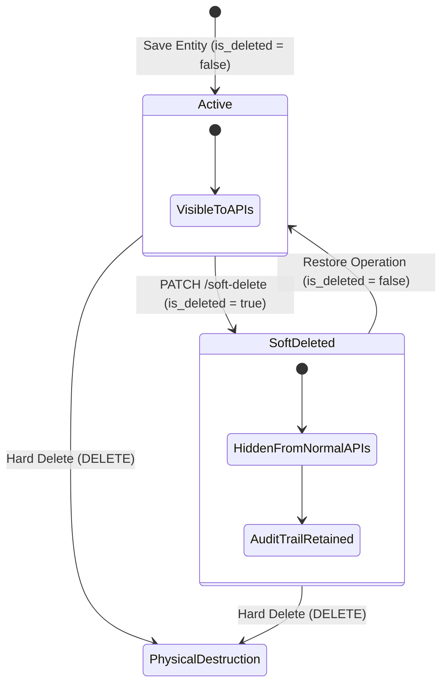

# Logical Deletion Semantics & Entity Mapping

**Soft Delete** is a deletion strategy where an application does not physically destroy a database row. Instead, it mutates a status flag—such as `is_deleted`—to mark the record as logically inactive.

```text
Hard Delete:  DELETE FROM students WHERE id = 1   ──► Row physically destroyed
Soft Delete:  UPDATE students SET is_deleted = true ──► Row physically retained, logically hidden
```

---

## 1. High-Level Concept & The Archive Cabinet Analogy

Think of a filing cabinet at a university registrar's office:

```text
THE ARCHIVE CABINET ANALOGY:
├── Active Student Record   ──► File remains in the active drawer (is_deleted = false)
├── Archived Student Record ──► File is stamped "ARCHIVED" and moved to rear storage (is_deleted = true)
├── Hard Delete Operation   ──► Shredding the paper file permanently
└── Soft Delete Operation   ──► Stamping the file "ARCHIVED" without destroying it
```

| Database / API Concept | Archive Cabinet Equivalent | Operational Role |
| :--- | :--- | :--- |
| **Database Row** | Student Paper File | Physical container of record data |
| **`is_deleted = false`** | Active File | Visible to normal everyday operations |
| **`is_deleted = true`** | Archived File | Retained for audit/history, hidden from normal reads |
| **`PATCH /soft-delete`** | Stamp "ARCHIVED" | Partial state update operation |
| **`DELETE /students/{id}`** | Paper Shredder | Permanent physical row destruction |

> **Core Architectural Rule**: Physical database existence and application-level visibility are distinct concepts. Soft deletion changes a row's state; application queries must enforce visibility filtering rules.

---

## 2. Hard Delete vs Soft Delete Comparison

| Property Metric | Hard Delete (`DELETE`) | Soft Delete (`PATCH /soft-delete`) |
| :--- | :--- | :--- |
| **Database State** | Row physically removed | Row physically retained |
| **HTTP Verb Semantics** | `DELETE /api/students/{id}` | `PATCH /api/students/{id}/soft-delete` |
| **Data Audit Trail** | Lost permanently | Fully preserved |
| **Application Recovery** | Difficult (requires DB backups) | Simple (toggle `is_deleted = false`) |
| **Query Requirement** | Standard SQL queries | Queries MUST explicitly filter `WHERE is_deleted = false` |

---

## 3. Entity Mapping: `Boolean` vs Primitive `boolean`

```java
@Entity
@Table(name = "students")
public class Student {

    @Id
    @GeneratedValue(strategy = GenerationType.IDENTITY)
    private Long id;

    private String name;

    @Column(name = "is_deleted", nullable = false)
    private Boolean isDeleted = false; // Initialized to active state

    public Student() {}

    public Long getId() { return id; }
    public String getName() { return name; }
    public void setName(String name) { this.name = name; }

    public Boolean getIsDeleted() { return isDeleted; }
    public void setIsDeleted(Boolean isDeleted) { this.isDeleted = isDeleted; }
}
```

> [!WARNING]
> **Nullability Trap**: Wrapper `Boolean` allows three states (`true`, `false`, `null`). If `null` has no business meaning, enforce non-null integrity at the database column level (`nullable = false`) or use primitive `boolean` to prevent `null` visibility bugs.

---

## 4. Entity State Machine Transitions



---

## ❓ Knowledge Check

<Quiz question="What is the fundamental difference between hard delete and soft delete at the database level?" options={["Hard delete updates a boolean flag, while soft delete drops the database table", "Hard delete physically removes the SQL row, while soft delete mutates a status flag (is_deleted = true) to keep the row physically stored but logically hidden", "Hard delete works only in C++", "Soft delete deletes the primary key index"]} answerIndex={1}>
Hard deletion physically removes the SQL row using `DELETE FROM`, whereas soft deletion updates a marker field (`UPDATE ... SET is_deleted = true`) to preserve the row for auditing while hiding it from normal reads.
</Quiz>

<Quiz question="Why is PATCH preferred over DELETE for soft-deletion HTTP endpoints?" options={["Because DELETE is banned in HTTP specifications", "Because soft-deletion is a partial resource update (changing only the isDeleted field), matching PATCH HTTP semantics", "Because PATCH runs 100x faster than DELETE", "Because PATCH creates a new database table"]} answerIndex={1}>
HTTP `PATCH` represents partial modification of an existing resource's fields (mutating `isDeleted`), whereas HTTP `DELETE` signals complete removal of the resource.
</Quiz>
