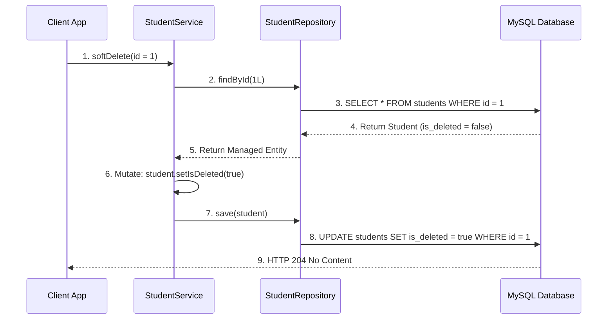

# Derived Query Methods & The `findById` Trap

In a soft-delete architecture, using default Spring Data JPA repository methods like `findAll()` or `findById()` leads to severe data leakage because physically existing archived records continue to be returned.

---

## 1. The `findAll()` Data Leakage Trap

Suppose a database contains three records:

| `id` | `name` | `is_deleted` |
| :--- | :--- | :--- |
| **1** | Rahul | `false` (Active) |
| **2** | Priya | `true` (Soft-Deleted) |
| **3** | Aman | `false` (Active) |

If your REST controller calls standard `repository.findAll()`, Spring Data issues:

```sql
SELECT * FROM students; -- Returns ALL 3 rows including Priya!
```

> [!WARNING]
> **Data Leakage Risk**: Standard `findAll()` ignores soft-delete markers and leaks logically deleted records into your active API responses!

---

## 2. Spring Data JPA Derived Query Methods

To enforce active record filtering, declare a derived query method in your repository interface:

```java
public interface StudentRepository extends JpaRepository<Student, Long> {

    // Spring Data parses this method name to append "WHERE is_deleted = false"
    List<Student> findByIsDeletedFalse();
}
```

### Method Name Parsing Breakdown

```text
findBy    ──► Generates SELECT query
IsDeleted ──► Targets entity field "isDeleted"
False     ──► Constrains value to false (WHERE is_deleted = false)
```

Generated SQL:
```sql
SELECT * FROM students WHERE is_deleted = false;
```

---

## 3. The `findById()` Leakage Trap & Solution

A subtle bug occurs when single-record lookup uses standard `findById(id)`:

```java
// UNSAFE: Returns archived student if id = 2 physically exists!
Optional<Student> student = studentRepository.findById(2L);
```

Because `findById(id)` checks only physical primary key existence (`WHERE id = ?`), a soft-deleted record is returned as present!

### The Soft-Delete-Aware Solution

```java
public interface StudentRepository extends JpaRepository<Student, Long> {

    List<Student> findByIsDeletedFalse();

    // Enforces BOTH Primary Key match AND Active State!
    Optional<Student> findByIdAndIsDeletedFalse(Long id);
}
```

### Method Parsing Breakdown

```text
findBy    ──► Generates SELECT query
Id        ──► Constrains WHERE id = ?
And       ──► Appends AND operator
IsDeleted ──► Targets entity field "isDeleted"
False     ──► Constrains WHERE is_deleted = false
```

Generated SQL:
```sql
SELECT * FROM students WHERE id = ? AND is_deleted = false;
```

---

## 4. Repository Method Strategy Comparison

| Method | Soft-Deleted Records Returned? | Safe for Soft-Delete Active APIs? |
| :--- | :--- | :--- |
| **`findAll()`** | **Yes (Leaked)** | ❌ Unsafe |
| **`findByIsDeletedFalse()`** | **No (Filtered)** | ✅ Safe for List Endpoints |
| **`findById(id)`** | **Yes (Leaked)** | ❌ Unsafe |
| **`findByIdAndIsDeletedFalse(id)`** | **No (Filtered)** | ✅ Safe for Single Read Endpoints |

---

## 5. Soft Delete Execution Pipeline

Executing a soft delete follows a 3-step pipeline: **Fetch ──► Mutate ──► Save**.



---

## ❓ Knowledge Check

<Quiz question="Why is standard repository.findById(id) unsafe in a soft-delete architecture?" options={["Because findById() throws a syntax error on MySQL", "Because findById() checks only physical primary key existence; if a soft-deleted row physically exists, it will still be returned to the client", "Because findById() deletes the primary key index", "Because findById() requires XML files"]} answerIndex={1}>
`findById(id)` checks only `WHERE id = ?`. Since soft-deleted rows physically remain in the table, `findById` returns them. Use `findByIdAndIsDeletedFalse(id)` instead.
</Quiz>

<Quiz question="What SQL clause does Spring Data JPA generate when parsing the repository method findByIsDeletedFalse()?" options={["DROP TABLE students", "SELECT * FROM students WHERE is_deleted = false", "UPDATE students SET is_deleted = true", "INSERT INTO students VALUES (...)"]} answerIndex={1}>
Spring Data parses `findBy` (SELECT), `IsDeleted` (is_deleted), and `False` (false) to generate `SELECT * FROM students WHERE is_deleted = false`.
</Quiz>
