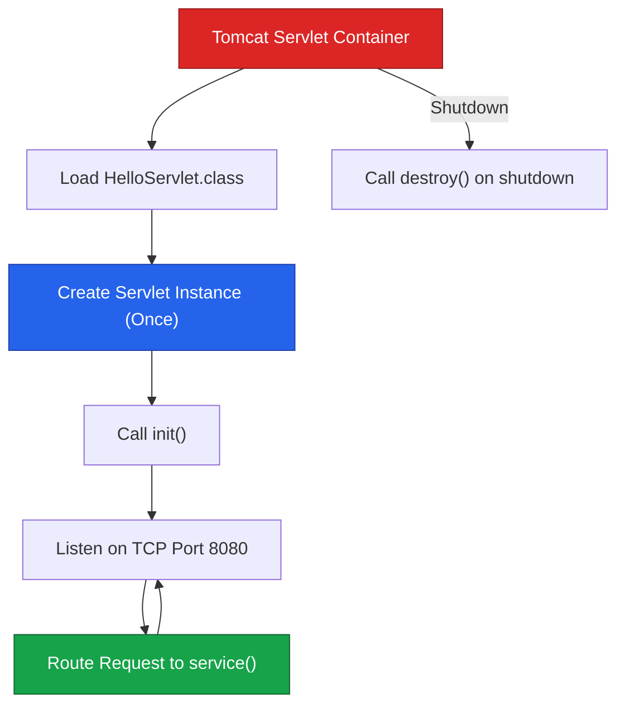

# Servlets Fundamentals & Restaurant Analogy

A **Servlet** is a Java class managed by a Servlet Container (such as Apache Tomcat) that executes server-side logic in response to incoming HTTP requests. The Servlet does not listen on a network socket directly; Tomcat handles network listening, parses HTTP streams into Java objects, and invokes the appropriate Servlet.

---

## 1. The Core Analogy: Restaurant Kitchen

Think of a web application as a restaurant operation:

```text
RESTAURANT KITCHEN ANALOGY:
├── Customer               ──► HTTP Browser Client
├── Order Ticket           ──► HttpServletRequest
├── Completed Meal         ──► HttpServletResponse
├── Front Desk Coordinator ──► Apache Tomcat (Servlet Container)
├── Station Chef           ──► Java Servlet Instance
└── Order Station Routing  ──► URL Mapping (/hello ──► HelloServlet)
```

| Servlet World | Restaurant Equivalent | Architectural Role |
| :--- | :--- | :--- |
| **Browser** | Customer | Sends raw HTTP request |
| **Tomcat Container** | Front Desk & Coordinator | Owns network port 8080, receives requests, dispatches tasks |
| **`HttpServletRequest`** | Order Ticket | Parsed input parameters, headers, and body |
| **`HttpServletResponse`** | Completed Meal | Output stream for status, headers, and payload |
| **Servlet** | Station Chef | Java business logic execution component |

> **Fundamental Principle**: The browser does not call your Servlet. Tomcat receives the HTTP request, instantiates/manages your Servlet, and invokes its handler methods.

---

## 2. Why Java `ServerSocket` Is Not Enough

Java provides raw networking via `java.net.ServerSocket`:

```java
// Open port 8080 manually
ServerSocket serverSocket = new ServerSocket(8080);
Socket socket = serverSocket.accept();
```

While functional, building a web application over raw sockets forces developers to manually write infrastructure logic:

```text
WITHOUT SERVLETS:
Browser ──► Raw TCP Socket ──► Manual HTTP Text Parsing ──► Manual Routing ──► Manual Threading ──► Business Logic

WITH SERVLETS:
Browser ──► Tomcat Container ──► HttpServletRequest/Response ──► Servlet (Business Logic Only)
```

### Mandatory Infrastructure Tasks Managed by Tomcat
1. Parsing raw HTTP protocol text streams into structured objects
2. Extracting headers, query strings, cookies, and multi-part bodies
3. Managing multithreaded worker pools (`ExecutorService`)
4. Routing URL patterns to registered application components
5. Formatting and sending HTTP status headers and payload bytes

---

## 3. Static vs Dynamic Web Processing

```text
STATIC REQUEST:  GET /index.html ──► Tomcat reads index.html from disk ──► Returns file bytes directly
DYNAMIC REQUEST: GET /user?id=101 ──► Tomcat invokes UserServlet ──► Queries DB ──► Generates custom response
```

* **Static Sites**: Return pre-existing disk assets (HTML, CSS, JS, PNG) without executing Java logic.
* **Dynamic Sites**: Require server-side Java code execution to evaluate parameters, fetch database state, and format dynamic output.

---

## 4. Servlet Container & Inversion of Control (IoC)

In standard Java applications, application code controls object instantiation and execution:

```java
// Traditional Java: Application code owns object lifecycle
HelloServlet servlet = new HelloServlet();
servlet.doGet(request, response);
```

In a Servlet environment, **Tomcat controls object lifecycle and execution**:



> **Inversion of Control (IoC)**: You write the Servlet class, but Tomcat decides when to instantiate it, when to initialize it, when to invoke its `service()` method, and when to destroy it.

---

## ❓ Knowledge Check

<Quiz question="Who is actually listening on TCP port 8080 in a Java web application?" options={["The HelloServlet class", "Apache Tomcat (Servlet Container)", "The browser client", "The doGet() method"]} answerIndex={1}>
Tomcat is the network-facing server process that binds to port 8080, receives raw HTTP socket streams, converts them to `HttpServletRequest`, and invokes the matching Servlet.
</Quiz>

<Quiz question="What is Inversion of Control (IoC) in the context of Java Servlets?" options={["The application code creating Tomcat objects using new", "Tomcat managing the Servlet lifecycle (instantiation, init, service dispatch, destroy) instead of application code", "Converting Java code into C++ binaries", "Handling HTML forms without Java"]} answerIndex={1}>
Inversion of Control means control over object creation and execution sequence is inverted from user application code to the container (Tomcat).
</Quiz>
