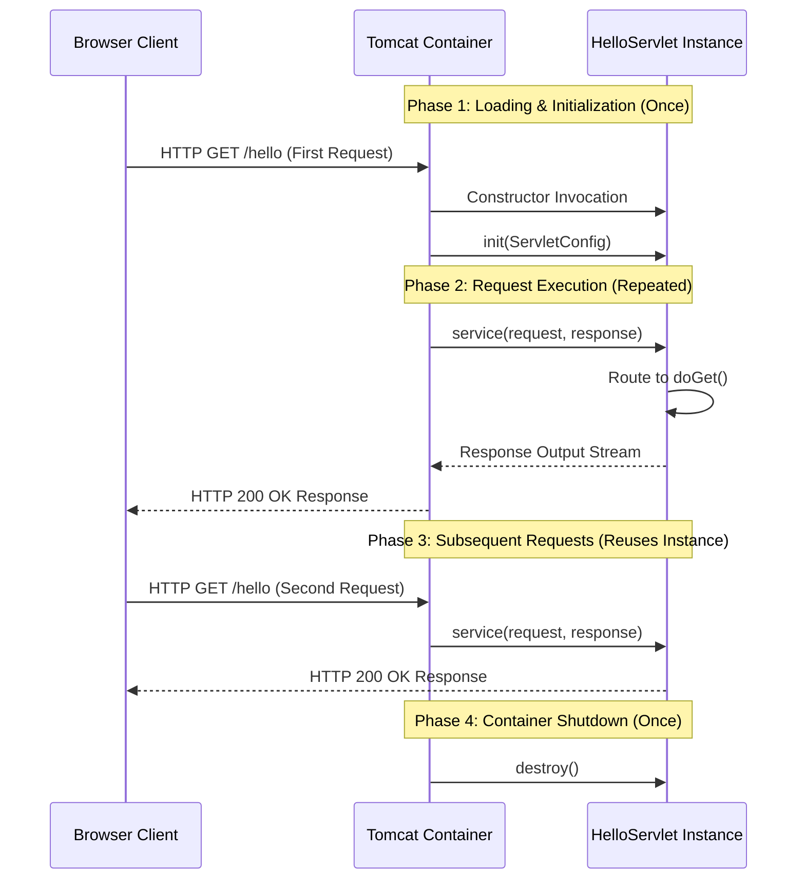

# Servlet Lifecycle, Concurrency & Request Pipeline

Understanding how Tomcat initializes, reuses, and dispatches requests to Servlets is essential for preventing concurrency bugs and resource leaks in enterprise Java applications.

---

## 1. The Servlet Lifecycle Pipeline

The Servlet lifecycle is strictly managed by the Servlet Container through four core stages:



---

## 2. One Servlet Object, Many Requests (Concurrency Trap)

By default, Tomcat instantiates **only ONE instance of a Servlet class** to handle all concurrent incoming requests across multiple threads.

```text
Concurrent Thread 1 (User A) ──┐
Concurrent Thread 2 (User B) ──┼──► [ SINGLE SERVLET INSTANCE ]
Concurrent Thread 3 (User C) ──┘
```

### 🔴 Dangerous Pattern: Shared Mutable Instance Variables

```java
// UNSAFE: Instance variables are shared across ALL concurrent user threads!
public class CounterServlet extends HttpServlet {

    private int requestCounter = 0; // SHARED MUTABLE STATE

    @Override
    protected void doGet(HttpServletRequest req, HttpServletResponse resp) {
        requestCounter++; // RACE CONDITION! Thread-unsafe state mutation
    }
}
```

> [!WARNING]
> **Concurrency Hazard**: Do NOT store request-specific state in Servlet instance fields. Because one Servlet instance serves thousands of concurrent requests, instance fields create high-severity race conditions and cross-user data leakage.

### ✅ Safe Pattern: Local Variables inside Handlers

```java
public class SafeServlet extends HttpServlet {

    @Override
    protected void doGet(HttpServletRequest req, HttpServletResponse resp) {
        // SAFE: Method-local variable allocated on the thread stack
        String userId = req.getParameter("id");
        processUser(userId);
    }
}
```

---

## 3. `service()` Method & HTTP Handler Routing

The primary request entry point invoked by Tomcat is `service()`:

```java
// Conceptual routing inside HttpServlet.service()
@Override
public void service(ServletRequest req, ServletResponse res) {
    HttpServletRequest request = (HttpServletRequest) req;
    String method = request.getMethod();

    if ("GET".equals(method)) {
        doGet(request, (HttpServletResponse) res);
    } else if ("POST".equals(method)) {
        doPost(request, (HttpServletResponse) res);
    } else if ("PUT".equals(method)) {
        doPut(request, (HttpServletResponse) res);
    } else if ("DELETE".equals(method)) {
        doDelete(request, (HttpServletResponse) res);
    }
}
```

---

## 4. Lifecycle Method Summary Matrix

| Lifecycle Method | Execution Frequency | Primary Responsibility | Request Specific? |
| :--- | :--- | :--- | :--- |
| **Constructor** | Once per Servlet instance | Memory allocation | ❌ No |
| **`init()`** | Once after instantiation | One-time resource setup (DB connections, caches) | ❌ No |
| **`service()`** | Every incoming request | Examines HTTP verb & dispatches handler | ✅ Yes |
| **`doGet()` / `doPost()`** | Every matching request | Business logic execution for specific HTTP verb | ✅ Yes |
| **`destroy()`** | Once on application shutdown | Cleanup connection pools & flush buffers | ❌ No |

---

## ❓ Knowledge Check

<Quiz question="If 1,000 users concurrently send requests to a Servlet, how many instances of that Servlet class does Tomcat create by default?" options={["1,000 instances", "1 instance (shared concurrently across worker threads)", "10 instances", "0 instances"]} answerIndex={1}>
By default, Tomcat creates only ONE instance of the Servlet class. Tomcat assigns each incoming HTTP request to a worker thread that concurrently invokes methods on that single instance.
</Quiz>

<Quiz question="Why are instance variables inside a Servlet considered dangerous?" options={["Because Java disables instance variables", "Because all concurrent user threads share the same Servlet instance, causing race conditions and cross-user data leaks", "Because instance variables take up 100GB of RAM", "Because Tomcat deletes instance variables automatically"]} answerIndex={1}>
Because a single Servlet instance handles multiple request threads concurrently, instance fields represent shared mutable state, introducing severe race conditions unless synchronized or scoped locally.
</Quiz>
