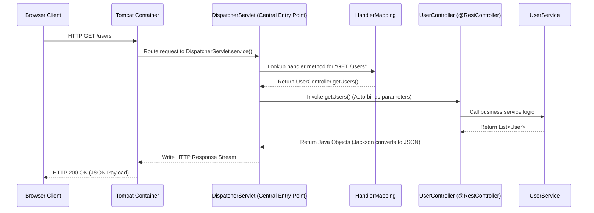

# DispatcherServlet, Spring MVC & Production Pitfalls

Spring MVC does not replace the Servlet model—it builds a powerful high-level framework on top of Servlets using a single master entry point called the `DispatcherServlet`.

---

## 1. Traditional Servlet Scaling Bottlenecks

In traditional Java web applications, every distinct URL path required a separate custom Servlet class:

```text
TRADITIONAL SERVLET SCALING BOTTLENECK:
GET  /users    ──► UserServlet (Manual parameter parsing, JSON serialization, DB calls)
POST /orders   ──► OrderServlet (Manual parameter parsing, JSON serialization, DB calls)
PUT  /products ──► ProductServlet (Manual parameter parsing, JSON serialization, DB calls)
```

As application size scales to hundreds of endpoints, managing dozens of independent Servlet mappings in `web.xml` causes massive boilerplate, duplicated parameter parsing, and fragmented exception handling.

---

## 2. Spring MVC & `DispatcherServlet` Front Controller Pattern

Spring MVC resolves this bottleneck by registering **one single master Servlet**—the **`DispatcherServlet`**—with Tomcat.



---

## 3. The Complete 6-Stage Architectural Progression

```text
1. Raw Java Sockets (java.net.ServerSocket)
   └── Low-level TCP byte streams, manual HTTP parsing
2. Servlet Container (Apache Tomcat)
   └── Managed network listening, multithreading, URL routing
3. Servlet API (jakarta.servlet.http.HttpServlet)
   └── Request/Response object abstractions (init, service, destroy)
4. Front Controller Pattern (DispatcherServlet)
   └── Single entry-point Servlet routing to annotated controllers
5. Spring MVC Framework
   └── Automatic parameter binding, JSON conversion (Jackson), exception handling
6. Spring Boot
   └── Auto-configuration, opinionated defaults, embedded Tomcat JAR deployment
```

---

## 4. Production Pitfall Matrix

| Production Pitfall | Common Misconception | Correct Engineering Reality |
| :--- | :--- | :--- |
| **1. Servlet Port Ownership** | "My `HelloServlet` listens on port 8080" | **Tomcat** listens on port 8080; Tomcat dispatches requests to Servlets |
| **2. Per-Request Instantiation** | "Tomcat creates a new Servlet object for every request" | Tomcat creates **one Servlet instance** reused across all request threads |
| **3. Shared Instance State** | Storing request data in Servlet instance fields | Store state ONLY in **method-local variables** on the thread stack |
| **4. Bundling Container APIs** | Omitting `<scope>provided</scope>` in Maven | Mark Servlet API as `provided` to avoid classloader collisions |
| **5. Overriding `service()`** | Replacing `service()` directly in `HttpServlet` | Override `doGet()`, `doPost()`, `doPut()`, `doDelete()` instead |
| **6. Replacing Container Model** | "Spring Boot eliminated Servlets" | Spring Boot **uses Servlets under the hood** via embedded Tomcat |

---

## ❓ Interactive Self-Assessment

<Quiz question="What is the central role of DispatcherServlet in Spring MVC?" options={["It acts as a single Front Controller Servlet that receives all HTTP requests from Tomcat and dispatches them to annotated Controller methods", "It deletes external Tomcat configuration files", "It converts Java code into C++ headers", "It replaces the MySQL database engine"]} answerIndex={0}>
`DispatcherServlet` is Spring MVC's central Front Controller. Registered as a Servlet with Tomcat, it receives all incoming HTTP requests and routes them to appropriate Spring `@Controller` handler methods.
</Quiz>

<Problem title="Servlet Execution Pipeline Debugging Challenge">
<ProblemDescription>
A developer claims: "My custom `OrderServlet` opens port 8080 using `new ServerSocket(8080)` and creates a new `OrderServlet` instance every time a client sends an HTTP GET request."

Identify the 2 major architectural errors in the developer's statement and write down the correct execution sequence.
</ProblemDescription>
<ProblemSolution>

**Architectural Errors Identified:**
1. **Port Ownership Error**: `OrderServlet` does NOT open network ports using `ServerSocket`. Apache Tomcat owns port 8080 and handles network listening.
2. **Lifecycle Instantiation Error**: Tomcat does NOT create a new Servlet object per request. It instantiates `OrderServlet` **once** and reuses that single instance across all concurrent request threads.

**Correct Execution Pipeline:**
```text
Browser Client ──► HTTP GET /orders ──► Tomcat Listening on Port 8080
   ──► Tomcat converts socket stream to HttpServletRequest/Response
   ──► Tomcat calls OrderServlet.service() on the single shared instance
   ──► HttpServlet.service() dispatches request to OrderServlet.doGet()
   ──► doGet() executes business logic and writes to HttpServletResponse stream
   ──► Tomcat sends HTTP 200 OK back to Browser Client
```
</ProblemSolution>
</Problem>
