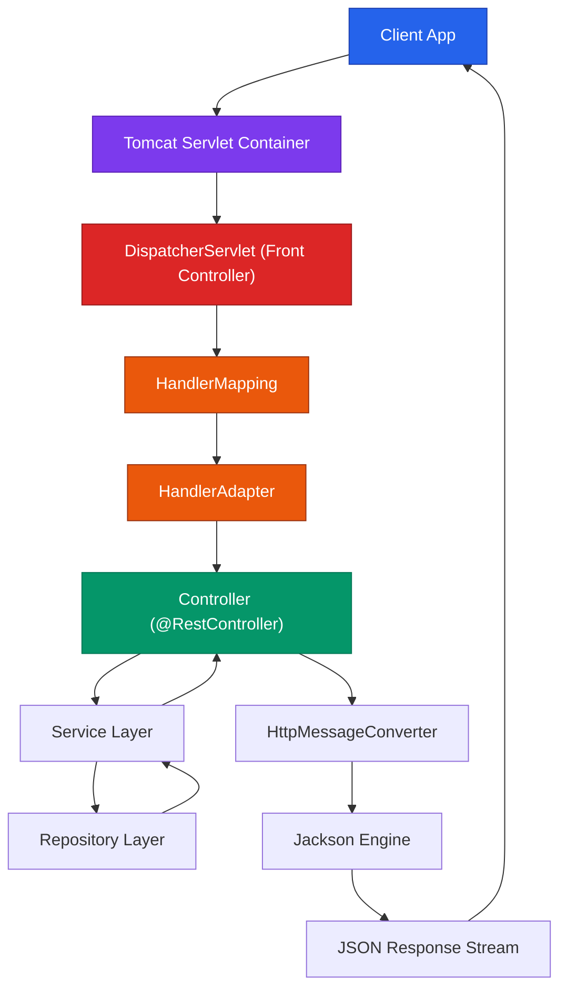

# Front Controller & DispatcherServlet

**Spring Web MVC** is Spring's flagship web framework built on top of the Servlet API (`jakarta.servlet`). Even when developers annotate code with `@GetMapping` or `@RestController`, the underlying execution begins with standard Servlet request handling inside Apache Tomcat.

---

## 1. The Core Analogy: Airport Control Tower

Think of a busy international airport:

```text
AIRPORT CONTROL TOWER ANALOGY:
├── Incoming Passenger / Aircraft ──► HTTP Client Request
├── Airport Terminal Gate        ──► Apache Tomcat (Servlet Container)
├── Central Control Tower        ──► DispatcherServlet (Front Controller)
├── Flight Radar & Gate Index    ──► HandlerMapping
├── Ground Crew Dispatcher       ──► HandlerAdapter
├── Operations Desk              ──► Spring Controller (@RestController)
└── Language Translator          ──► HttpMessageConverter (Jackson JSON Engine)
```

| Component | Role | Input | Output / Action |
| :--- | :--- | :--- | :--- |
| **`DispatcherServlet`** | Central Coordinator | HTTP Request Stream | Delegates to mappings, adapters, converters |
| **`HandlerMapping`** | URL Directory | Request Metadata (URL + Verb) | Identifies target Controller Method |
| **`HandlerAdapter`** | Invocation Engine | Selected Method + Request | Binds arguments & invokes method |
| **`HttpMessageConverter`** | Wire-Format Translator | Java Object / JSON String | Converts Java Object ↔ JSON stream |
| **`Jackson`** | JSON Serialization | Java Instance | Structured JSON bytes |

> **Key Architectural Insight**: `DispatcherServlet` coordinates request execution; it does NOT process business logic or build responses itself. It delegates specialized tasks to decoupled framework components.

---

## 2. Front Controller Pattern vs Multi-Servlet Chaos

Without a central Front Controller, traditional Servlet applications require registering dozens of independent Servlets in `web.xml`:

```text
WITHOUT FRONT CONTROLLER (Multi-Servlet Chaos):
/students/create ──► CreateStudentServlet (Duplicated JSON parsing, DB setup, Error handling)
/students/update ──► UpdateStudentServlet (Duplicated JSON parsing, DB setup, Error handling)
/students/delete ──► DeleteStudentServlet (Duplicated JSON parsing, DB setup, Error handling)

WITH SPRING MVC FRONT CONTROLLER:
All HTTP Traffic ──► [ DispatcherServlet ] ──► Routes to Controller Methods (@GetMapping, @PostMapping)
```

---

## 3. High-Level Architecture Flow



---

## 4. `@Controller` vs `@RestController` Semantics

| Dimension | `@Controller` (Server-Rendered) | `@RestController` (REST API) |
| :--- | :--- | :--- |
| **Primary Goal** | Returns HTML pages | Returns raw data (JSON / XML) |
| **Return Value Meaning** | Logical View Name (e.g., `"home"` ──► `home.jsp`) | Domain DTO / Entity serialized directly to response body |
| **Resolution Mechanism** | `ViewResolver` (`InternalResourceViewResolver`) | `HttpMessageConverter` + Jackson |
| **Underlying Composition** | Standard `@Controller` annotation | Meta-annotation: `@Controller` + `@ResponseBody` |

---

## ❓ Knowledge Check

<Quiz question="What is the primary role of DispatcherServlet in Spring MVC?" options={["It compiles Java code into C++ headers", "It serves as the central Front Controller that orchestrates request routing, handler invocation, and response conversion", "It replaces the MySQL database engine", "It stores CSS files on disk"]} answerIndex={1}>
`DispatcherServlet` is Spring MVC's central Front Controller. It receives all HTTP requests from Tomcat and coordinates mapping lookup, controller method invocation, argument resolution, and response conversion.
</Quiz>

<Quiz question="What is the difference between returning 'home' from a @Controller vs a @RestController?" options={["@Controller converts 'home' to JSON, while @RestController drops the database table", "@Controller treats 'home' as a logical view name resolved to a JSP page via ViewResolver; @RestController writes 'home' directly to the HTTP response body as text/JSON", "Both return an image file", "There is no difference"]} answerIndex={1}>
In `@Controller`, returning `"home"` tells the `ViewResolver` to look for a view file like `/WEB-INF/views/home.jsp`. In `@RestController`, `@ResponseBody` is implicitly active, writing `"home"` directly to the response output stream.
</Quiz>
