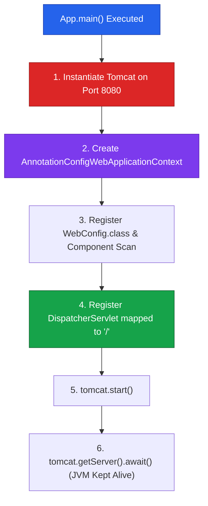

# Manual Spring MVC & Embedded Tomcat Bootstrap

To understand what Spring Boot automates under the hood, developers can construct a fully functional Spring MVC application manually using embedded Apache Tomcat.

---

## 1. The Manual Spring MVC Dependency Triad

Building manual Spring MVC requires three core Maven dependencies in `pom.xml`:

```xml
<dependencies>
    <!-- 1. Spring MVC Framework Infrastructure -->
    <dependency>
        <groupId>org.springframework</groupId>
        <artifactId>spring-webmvc</artifactId>
        <version>6.1.6</version>
    </dependency>

    <!-- 2. Embedded Apache Tomcat Container -->
    <dependency>
        <groupId>org.apache.tomcat.embed</groupId>
        <artifactId>tomcat-embed-core</artifactId>
        <version>10.1.20</version>
    </dependency>

    <!-- 3. Jackson JSON Serialization Engine -->
    <dependency>
        <groupId>com.fasterxml.jackson.core</groupId>
        <artifactId>jackson-databind</artifactId>
        <version>2.17.0</version>
    </dependency>
</dependencies>
```

---

## 2. Spring Java Configuration (`WebConfig`)

```java
package in.strikes.config;

import org.springframework.context.annotation.ComponentScan;
import org.springframework.context.annotation.Configuration;
import org.springframework.web.servlet.config.annotation.EnableWebMvc;

@Configuration
@EnableWebMvc // Enables HandlerMapping, HandlerAdapter, and MessageConverters
@ComponentScan(basePackages = "in.strikes") // Scans for @RestController, @Service, @Repository
public class WebConfig {
}
```

* **`@Configuration`**: Registers the class as a Spring configuration bean definition source.
* **`@EnableWebMvc`**: Imports core Spring MVC infrastructure components (`RequestMappingHandlerMapping`, `RequestMappingHandlerAdapter`).
* **`@ComponentScan`**: Directs Spring IoC container to discover annotated controllers, services, and repositories.

---

## 3. Complete Manual Bootstrap Blueprint (`App.java`)

```java
package in.strikes;

import in.strikes.config.WebConfig;
import org.apache.catalina.Context;
import org.apache.catalina.startup.Tomcat;
import org.springframework.web.context.support.AnnotationConfigWebApplicationContext;
import org.springframework.web.servlet.DispatcherServlet;

import java.io.File;

public class App {

    public static void main(String[] args) throws Exception {

        // Step 1: Create Embedded Tomcat Instance
        Tomcat tomcat = new Tomcat();
        tomcat.setPort(8080);
        tomcat.getConnector(); // Initializes HTTP connector socket

        // Step 2: Create Web Application Context
        String contextPath = "";
        String docBase = new File("src/main/webapp").getAbsolutePath();
        Context context = tomcat.addContext(contextPath, docBase);

        // Step 3: Create Spring IoC Web Application Context
        AnnotationConfigWebApplicationContext springContext = new AnnotationConfigWebApplicationContext();
        springContext.register(WebConfig.class);

        // Step 4: Create DispatcherServlet instance bound to Spring Context
        DispatcherServlet dispatcherServlet = new DispatcherServlet(springContext);

        // Step 5: Register DispatcherServlet with Tomcat Container
        Tomcat.addServlet(context, "dispatcherServlet", dispatcherServlet);
        context.addServletMappingDecoded("/", "dispatcherServlet"); // Route ALL requests to DispatcherServlet

        // Step 6: Start Server & Block Main Thread to keep JVM alive
        tomcat.start();
        tomcat.getServer().await(); // Prevents process termination
    }
}
```

---

## 4. Manual Bootstrap Execution Sequence



---

## ❓ Knowledge Check

<Quiz question="Why is tomcat.getServer().await() necessary at the end of the manual App.java main method?" options={["To compile JSP files into C++", "To block the main thread and keep the embedded Tomcat process alive; without it, main() exits immediately and the server terminates", "To format JSON outputs", "To delete temporary files"]} answerIndex={1}>
`tomcat.getServer().await()` puts the main thread into a waiting state, keeping the JVM process active to serve incoming HTTP requests. Without it, `main()` exits immediately.
</Quiz>

<Quiz question="What does @EnableWebMvc do when placed on a Spring configuration class?" options={["It deletes embedded Tomcat", "It imports mandatory Spring MVC infrastructure beans such as RequestMappingHandlerMapping and RequestMappingHandlerAdapter", "It converts Java code to Python", "It installs MySQL Server"]} answerIndex={1}>
`@EnableWebMvc` imports and registers default Spring MVC infrastructure beans required for routing, argument resolution, and JSON message conversion.
</Quiz>
