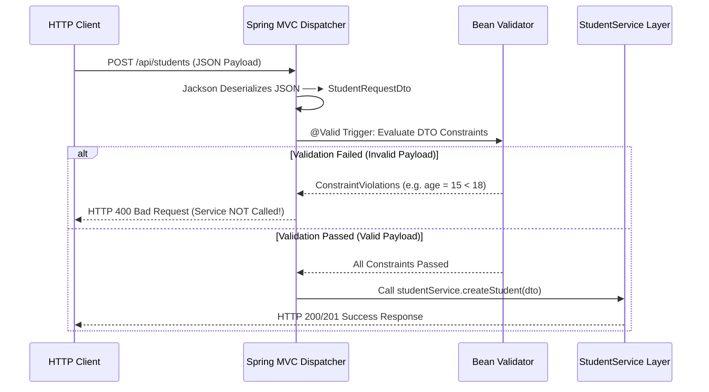

# Bean Validation Annotations & `@Valid` Trigger

While DTOs specify **which fields** can cross API boundaries, **Bean Validation** enforces **what values** are legally acceptable before executing business logic.

---

## 1. Adding Spring Boot Validation Starter

Spring Boot validation support requires `spring-boot-starter-validation` in `pom.xml`:

```xml
<dependency>
    <groupId>org.springframework.boot</groupId>
    <artifactId>spring-boot-starter-validation</artifactId>
</dependency>
```

---

## 2. `@NotNull` vs `@NotBlank` vs `@NotEmpty`

Choosing the correct constraint annotation prevents common edge-case validation bugs:

```java
public class StudentRequestDto {

    // 1. @NotBlank: Rejects null, "", and whitespace "   "
    @NotBlank(message = "Name is mandatory and cannot be blank")
    @Size(min = 2, max = 50, message = "Name must be 2 to 50 characters")
    private String name;

    // 2. @Email: Enforces valid email pattern
    @NotBlank(message = "Email is mandatory")
    @Email(message = "Email must be a valid email format")
    private String email;

    // 3. @NotNull: Rejects null (Used for numbers/dates where String logic does not apply)
    @NotNull(message = "Age is mandatory")
    @Min(value = 18, message = "Age must be at least 18")
    @Max(value = 60, message = "Age must not exceed 60")
    private Integer age;
}
```

### Constraint Comparison Matrix

| Annotation | Rejects `null`? | Rejects `""` (Empty)? | Rejects `"   "` (Whitespace)? | Target Data Type |
| :--- | :--- | :--- | :--- | :--- |
| **`@NotNull`** | ✅ Yes | ❌ No | ❌ No | Numbers, Dates, Objects |
| **`@NotEmpty`** | ✅ Yes | ✅ Yes | ❌ No | Strings, Collections, Arrays |
| **`@NotBlank`** | ✅ Yes | ✅ Yes | ✅ Yes | `String` text fields only |

---

## 3. `@Valid`: Triggering Validation at the Controller Boundary

Placing constraint annotations on DTO fields does NOT automatically execute validation. The Controller MUST declare **`@Valid`** on the `@RequestBody` parameter:

```java
@RestController
@RequestMapping("/api/students")
public class StudentController {

    private final StudentService service;

    public StudentController(StudentService service) {
        this.service = service;
    }

    // @Valid triggers Spring to evaluate DTO constraints before invoking createStudent
    @PostMapping
    public StudentResponseDto createStudent(@Valid @RequestBody StudentRequestDto requestDto) {
        return service.createStudent(requestDto);
    }
}
```

```text
Constraint Annotations (@NotBlank, @Min) ──► Rule Book (Defines validation constraints)
@Valid Annotation                        ──► Security Guard (Triggers execution of rules)
```

---

## 4. Internal Validation Execution Pipeline



> **Crucial Guarantee**: If validation fails, Spring MVC aborts execution at the Controller boundary and returns an **HTTP 400 Bad Request**. The Service Layer is never invoked with invalid data!

---

## ❓ Knowledge Check

<Quiz question="What is the difference between @NotBlank and @NotNull in Bean Validation?" options={["@NotNull converts strings to numbers; @NotBlank deletes spaces", "@NotNull rejects null but accepts empty strings '' and whitespace '   '; @NotBlank rejects null, empty strings '', AND whitespace '   '", "@NotBlank works only on integers", "There is no difference"]} answerIndex={1}>
`@NotNull` only checks for non-null states, accepting empty or whitespace strings. `@NotBlank` is stricter for text, rejecting `null`, `""`, and `"   "`.
</Quiz>

<Quiz question="What happens if a client submits an invalid request payload to a Controller method annotated with @Valid @RequestBody?" options={["Spring MVC saves the invalid entity to the database anyway", "Spring MVC intercepts the request, evaluates constraints, detects violations, and returns HTTP 400 Bad Request without executing the Service method", "Tomcat crashes", "The request is forwarded to Nginx"]} answerIndex={1}>
`@Valid` causes Spring MVC to validate constraints before calling the handler method. Violations result in an immediate `HTTP 400 Bad Request` response, short-circuiting Service execution.
</Quiz>
