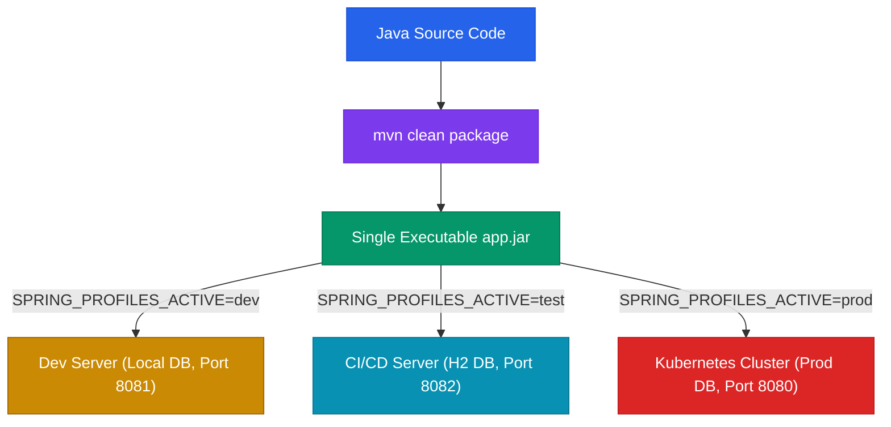

# Profile-Specific Configuration & Activation

Spring Profiles allow developers to segregate parts of application configuration and make them available only in specific environments (e.g. `dev`, `test`, `staging`, `prod`).

---

## 1. Profile-Specific Configuration Files

Spring Boot automatically scans for profile-specific configuration files matching the naming convention `application-{profile}.yml` or `application-{profile}.properties`.

```text
PROJECT CONFIGURATION LAYOUT:
src/main/resources/
├── application.yml          ──► Shared base configuration (common across ALL environments)
├── application-dev.yml      ──► Development environment overrides
├── application-test.yml     ──► Test environment overrides
└── application-prod.yml     ──► Production environment overrides
```

### Property Override Priority
When a profile is activated, settings in `application-{profile}.yml` **override** matching settings in `application.yml`:

```yaml
# application.yml (Base Defaults)
server:
  port: 8080
spring:
  application:
    name: student-management-app
```

```yaml
# application-dev.yml (Dev Overrides)
server:
  port: 8081      # OVERRIDES base port 8080!
spring:
  datasource:
    url: jdbc:mysql://localhost:3306/student_dev
```

---

## 2. Profile Activation Mechanisms

Spring Boot provides four primary mechanisms to activate profiles:

```text
PROFILE ACTIVATION MECHANISMS:
├── 1. Environment Variable  ──► export SPRING_PROFILES_ACTIVE=prod (RECOMMENDED FOR PROD)
├── 2. Command-Line Argument ──► java -jar app.jar --spring.profiles.active=prod
├── 3. Maven Command         ──► mvn spring-boot:run -Dspring-boot.run.profiles=dev
└── 4. In-file Property       ──► spring.profiles.active=dev (LOCAL DEV ONLY)
```

---

## 3. Production Deployment Rule: Build Once, Deploy Anywhere

<Callout type="important">

**Production Golden Rule**: Build the packaged application artifact (`app.jar`) ONCE. Never rebuild code or edit source configuration files merely to deploy to a different environment. Activate profiles externally at runtime!

</Callout>



---

## 4. Environment Strategy Matrix

| Concern | Development (`dev`) | Testing (`test`) | Production (`prod`) |
| :--- | :--- | :--- | :--- |
| **Database Target** | `localhost:3306/student_dev` | In-memory H2 / Test DB | Dedicated Prod Cluster |
| **Server Port** | `8081` | `8082` | Platform Default (`8080`) |
| **Hibernate DDL** | `update` | `create-drop` | `validate` / Flyway migrations |
| **Logging Level** | `DEBUG` | `INFO` | `WARN` / `ERROR` |
| **Profile Activation** | `spring.profiles.active=dev` | `SPRING_PROFILES_ACTIVE=test` | `SPRING_PROFILES_ACTIVE=prod` |

---

## ❓ Knowledge Check

<Quiz question="What is the primary benefit of activating Spring profiles externally via environment variables in production?" options={["It deletes unneeded Java classes", "It allows the exact same compiled app.jar artifact to run across Dev, Staging, and Production environments without recompilation or source editing", "It bypasses MySQL authentication", "It enables auto-reloading of HTML files"]} answerIndex={1}>
External profile activation supports the "Build Once, Deploy Anywhere" principle. The exact same `app.jar` artifact can be deployed to any environment by injecting `SPRING_PROFILES_ACTIVE` at runtime.
</Quiz>

<Quiz question="If server.port=8080 is defined in application.yml and server.port=8081 is defined in application-dev.yml, which port is used when the dev profile is active?" options={["Port 8080", "Port 8081", "Port 8082", "Spring Boot throws a duplicate property exception"]} answerIndex={1}>
Profile-specific files (`application-dev.yml`) take precedence over the base configuration (`application.yml`), overriding `server.port` to `8081`.
</Quiz>
