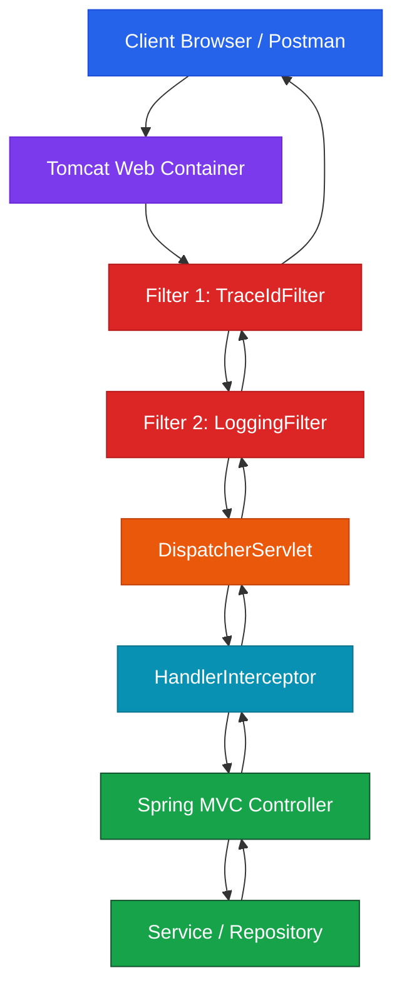

# Servlet Filter Fundamentals & Lifecycle

A **Servlet Filter** is an HTTP-level checkpoint positioned around Spring Boot's web container execution. It intercepts incoming HTTP requests **before** they reach Spring MVC's `DispatcherServlet` and executes post-processing after downstream handlers return.

---

## 1. Mental Model: Building Security Checkpoint

Imagine entering a high-security corporate skyscraper:

```text
BUILDING SECURITY CHECKPOINT ANALOGY:
├── Visitor (Client)       ──► Arrives at the building entrance with an HTTP request
├── Building Entrance      ──► Tomcat / Embedded Servlet Container
├── Security Checkpoint    ──► Servlet Filter (Inspects badge, logs entry time, injects Trace ID)
├── Reception Desk         ──► DispatcherServlet (Routes visitor to the right department)
├── Dept Checkpoint        ──► HandlerInterceptor (Department-specific inspection)
└── Employee Office        ──► Controller / Service (Executes core business logic)
```

> **Core Architectural Rule**:
> **Filter = Servlet Layer Interception** (Below Spring MVC; knows HTTP metadata, but does NOT naturally know the target Controller method).

---

## 2. Architecture and Request Lifecycle Pipeline



---

## 3. Filter Lifecycle Interface (`jakarta.servlet.Filter`)

A filter implements the standard Servlet API contract. In Spring Boot 3+, use the `jakarta.servlet` package:

```java
package jakarta.servlet;

import java.io.IOException;

public interface Filter {

    // Called once by the Servlet container during startup
    default void init(FilterConfig filterConfig) throws ServletException {}

    // Executed on EVERY matching incoming HTTP request
    void doFilter(
        ServletRequest request,
        ServletResponse response,
        FilterChain chain
    ) throws IOException, ServletException;

    // Called once by the Servlet container during shutdown
    default void destroy() {}
}
```

### Namespace Migration Rule
```text
Spring Boot 2.x  ──► javax.servlet.Filter
Spring Boot 3.x+ ──► jakarta.servlet.Filter
```

---

## 4. Cross-Cutting Concerns Taxonomy

Filters handle **cross-cutting concerns**—infrastructure logic that applies globally across endpoints:

* **Request/Response Logging**: HTTP method, URI, status codes, elapsed timing
* **Correlation / Trace IDs**: Injecting `X-Request-Id` UUID headers for microservice tracing
* **Security & Auth Boundaries**: Early token validation, blocking invalid requests before Spring MVC
* **Character Encoding**: Enforcing `UTF-8` request/response encoding
* **Response Headers**: Injecting security headers (`X-Content-Type-Options: nosniff`)

---

## 5. Architectural Matrix: Filter vs Interceptor vs Controller vs Spring Security

| Feature | Servlet Filter | HandlerInterceptor | `@RestController` | Spring Security |
| :--- | :--- | :--- | :--- | :--- |
| **Execution Layer** | **Servlet Container** (Below Spring MVC) | **Spring MVC** Framework | **Application Domain** | Security Filter Chain |
| **Executes Before `DispatcherServlet`?** | ✅ **Yes** | ❌ No | ❌ No | ✅ Yes |
| **Knows Target Controller Method?** | ❌ No | ✅ **Yes** (`Object handler`) | ✅ **Yes** | ❌ No |
| **Best For** | Request logging, headers, timing, early rejection | Controller pre/post handling | Business logic & REST JSON | Enterprise AuthN/AuthZ |

---

## ❓ Knowledge Check

<Quiz question="Where does a Servlet Filter execute in relation to Spring MVC's DispatcherServlet?" options={["Inside the database engine", "Before DispatcherServlet, at the Servlet container layer", "Inside the Service layer", "After the Controller returns the HTTP response to the browser"]} answerIndex={1}>
A Servlet Filter operates at the Servlet container layer, intercepting incoming HTTP requests BEFORE they reach Spring MVC's `DispatcherServlet`.
</Quiz>

<Quiz question="Which Java package must be imported for Servlet Filters in Spring Boot 3?" options={["javax.servlet.Filter", "jakarta.servlet.Filter", "org.springframework.web.Filter", "com.sun.net.httpserver.Filter"]} answerIndex={1}>
Spring Boot 3 migrated from `javax.servlet.*` to `jakarta.servlet.*` as part of the Jakarta EE 9+ baseline upgrade.
</Quiz>
