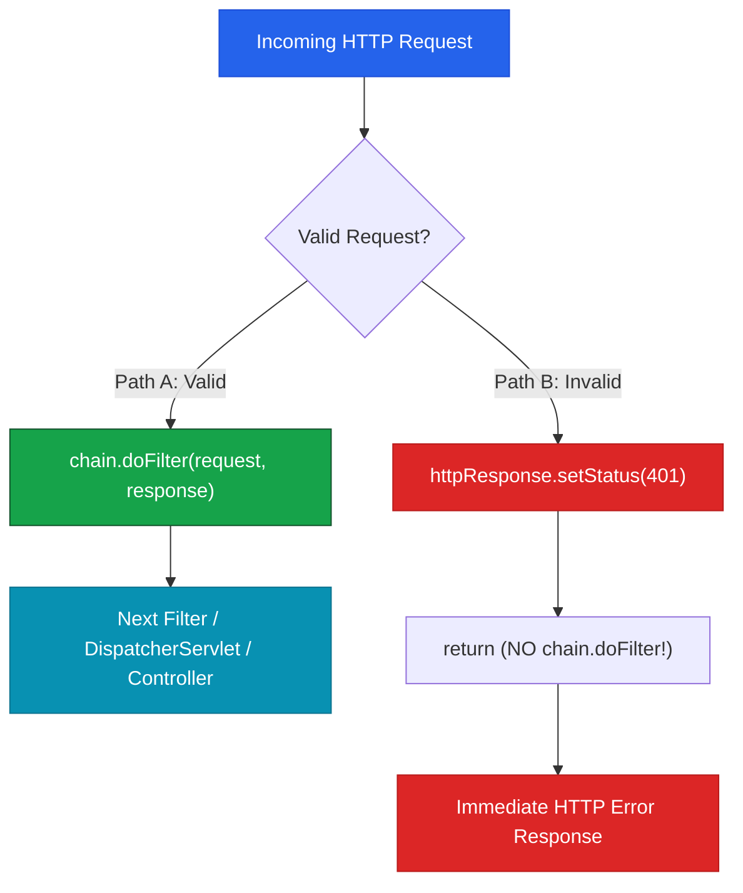

# `doFilter` Continuation, Blocking & Ordering

The heart of every Servlet Filter is the **`doFilter()`** method, which receives the request, response, and the **`FilterChain`** continuation object.

---

## 1. `doFilter()` Execution Structure

```java
@Component
public class ExecutionDemoFilter implements Filter {

    @Override
    public void doFilter(
            ServletRequest request,
            ServletResponse response,
            FilterChain chain
    ) throws IOException, ServletException {

        // 1. PRE-PROCESSING (Forward Execution Order)
        System.out.println("PRE: Request entering filter");

        // 2. CONTINUATION: Pass request downstream to next Filter or DispatcherServlet
        chain.doFilter(request, response);

        // 3. POST-PROCESSING (Reverse Response Order)
        System.out.println("POST: Response returning through filter");
    }
}
```

---

## 2. Control Flow: Continuation vs Blocking

A Filter has two explicit control-flow choices:



* **Path A (Continue)**: Calling `chain.doFilter()` passes control down the pipeline.
* **Path B (Block/Reject)**: Setting an HTTP status code (e.g. `401 Unauthorized`) and returning **without calling `chain.doFilter()`** aborts downstream execution immediately.

---

## 3. Casting Generic Servlet Objects to HTTP Types

The generic `ServletRequest` and `ServletResponse` interface types must be cast to `HttpServletRequest` and `HttpServletResponse` to access HTTP-specific metadata:

```java
HttpServletRequest httpRequest = (HttpServletRequest) request;
HttpServletResponse httpResponse = (HttpServletResponse) response;

// Inspect HTTP Metadata
String method = httpRequest.getMethod();           // "GET", "POST"
String path = httpRequest.getRequestURI();          // "/api/v1/students"
String authHeader = httpRequest.getHeader("Authorization");

// Mutate HTTP Response
httpResponse.setHeader("X-Server-Time", String.valueOf(System.currentTimeMillis()));
```

---

## 4. Filter Ordering via `@Order`

When multiple Filters are registered, Spring Boot orders them using the **`@Order(value)`** annotation:

```java
@Component
@Order(1) // Executed FIRST on request path
public class AuthenticationFilter implements Filter { ... }

@Component
@Order(2) // Executed SECOND on request path
public class LoggingFilter implements Filter { ... }
```

### The Nested Stack Execution Model
Filters execute in a **nested stack structure**:

```text
AuthenticationFilter (PRE - Order 1)
  └── LoggingFilter (PRE - Order 2)
        └── Controller Execution
  ┌── LoggingFilter (POST - Order 2)
AuthenticationFilter (POST - Order 1)
```

> **Execution Sequence**:
> `AuthFilter (PRE)` ──► `LoggingFilter (PRE)` ──► `Controller` ──► `LoggingFilter (POST)` ──► `AuthFilter (POST)`

---

## ❓ Knowledge Check

<Quiz question="What happens if a Filter fails to invoke chain.doFilter(request, response)?" options={["The request automatically retries 3 times", "Downstream processing halts immediately; downstream filters and controllers are NEVER executed", "Tomcat crashes", "Spring MVC bypasses the filter"]} answerIndex={1}>
`chain.doFilter()` is the continuation trigger. Omitting it stops the request pipeline entirely, preventing downstream filters, `DispatcherServlet`, and controllers from executing.
</Quiz>

<Quiz question="In what order do filter post-processing steps execute after a controller returns?" options={["In the exact same order as pre-processing (@Order(1) first)", "In reverse order of pre-processing (@Order(2) before @Order(1))", "Randomly", "Post-processing never executes"]} answerIndex={1}>
Because `chain.doFilter()` behaves like a nested method invocation stack, post-processing code (after `chain.doFilter()`) runs in reverse order relative to pre-processing.
</Quiz>
