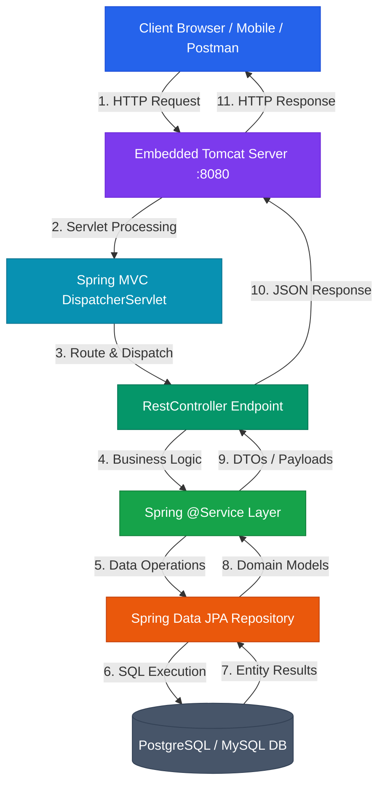

Spring Boot is VMware/Broadcom's production-ready, opinionated framework built on top of the **Spring Framework** ecosystem. Designed around the principle of *"Convention over Configuration"*, Spring Boot enables developers to build self-contained, enterprise-grade Java web applications and microservices with minimal manual configuration.

* **Analogy**: *A Fully Equipped Ghost Kitchen & Turn-Key Smart Factory.*
  - **Traditional Spring Framework**: Building a commercial kitchen from scratch—buying stoves, installing gas lines, running ventilation, wiring electrical systems, and assembling XML configuration blueprints before cooking your first dish.
  - **Spring Boot**: A turn-key, pre-configured commercial ghost kitchen container. Plug it into power (`java -jar app.jar`), turn the key, and start cooking immediately.
  - **Auto-Configuration (`@EnableAutoConfiguration`)**: The smart building system that detects ingredients on the shelf (dependencies on classpath) and automatically configures appliances (beans) without manual wiring.
  - **Embedded Tomcat Server**: The built-in power generator and reception desk packaged directly inside your container—no external server installation required.

---

## 🗺️ Spring Boot Learning Modules & Navigation Roadmap

Explore our structured, analogy-driven Spring Boot masterclass modules below. Each module covers deep architectural mechanics, request lifecycles, code examples, debugging strategies, and production best practices.

| Module | Core Topics | Key Focus & Engineering Concepts | Read Time |
| :--- | :--- | :--- | :--- |
| **[1. Introduction to Spring & Spring Boot](./01-introduction-to-spring-and-spring-boot)** | HTTP, Sockets, Servlets, Servlet Container, Spring Core, Spring MVC, Spring Data, Security, AOP, AI, Spring Boot, Microservices | End-to-end web architecture, client-server model, historical evolution, and framework layer responsibilities | ~15 mins |
| **[2. Writing Our First Application](./02-writing-our-first-spring-boot-application)** | IP Addressing, Ports, `localhost`, Spring Initializr, Dependencies, `pom.xml`, `@RestController`, `@GetMapping`, Embedded Tomcat | Creating a runnable Spring Boot app, URL decomposition, controller dispatching, embedded server execution, and 404 debugging | ~15 mins |
| **[3. Maven Engineering Hub](./03-maven-engineering-hub)** | Compilation, JAR packaging, `pom.xml`, Coordinates, SNAPSHOTs, Transitive Dependencies, Repositories, Lifecycles, Plugins | Java build pipeline, dependency resolution graph, classpath mechanics, local `.m2` caching, and production build engineering | ~20 mins |
| **[4. Spring Core — DI & IoC](./04-spring-core-dependency-injection-and-ioc)** | Object creation, Tight vs Loose Coupling, Interfaces, Dependency Injection, Inversion of Control, Constructor Injection, Spring Beans, IoC Container | Object wiring mechanics, runtime object graphs, testability substitution, SRP/OCP alignment, and container responsibilities | ~20 mins |
| **[5. Spring IoC, Beans & Annotations](./05-spring-ioc-container-beans-and-annotations)** | `ApplicationContext`, Spring Beans, `@Component`, `@ComponentScan`, `@Configuration`, `@Bean`, `BeanDefinition`, `@Primary`, `@Qualifier` | Container startup pipeline, component discovery boundaries, explicit factory methods, dependency resolution, and bean ambiguity | ~20 mins |
| **[6. Circular Dependency & Scopes](./06-spring-core-circular-dependency-scopes-and-lazy-init)** | Constructor vs Field cycles, Early references, `singleton` vs `prototype`, `ObjectProvider`, `@Lazy` proxies, Bean Lifecycle | Circular dependency resolution, prototype scope mismatch in singletons, lazy proxy injection, and bean lifecycle phases | ~20 mins |
| **[7. Spring Bean Lifecycle](./07-spring-bean-lifecycle)** | `BeanDefinition`, Instantiation, Dependency Injection, `Aware` callbacks, `BeanPostProcessor`, `@PostConstruct`, `InitializingBean`, `@PreDestroy`, Scope Cleanup | Complete container pipeline from metadata scanning to destruction, initialization hook ordering, destruction mechanics, and memory leak prevention | ~20 mins |
| **[8. Spring XML-Based Configuration](./08-spring-xml-based-configuration)** | `beans.xml`, `<bean>`, `id`, `class`, `<constructor-arg>`, `<property>`, `value` vs `ref`, `autowire` (`byName`/`byType`), `init-method`, `destroy-method`, `<import>` | Legacy enterprise XML configuration, explicit ref wiring, collection injection, modular XML blueprints, and annotation scanning integration | ~20 mins |

---

## ⚡ Quick Reference & Comparison Matrices

### 1. Spring Framework vs. Spring Boot Comparison

| Dimension | Traditional Spring Framework | Spring Boot |
| :--- | :--- | :--- |
| **Primary Role** | Core application framework & dependency injection engine | Automation & bootstrapping layer built on Spring |
| **Configuration** | Manual (XML configuration files or verbose `@Configuration` classes) | Automatic (Opinionated auto-configuration based on classpath starters) |
| **Server Deployment** | Requires external Servlet Container (WAR deployment to Tomcat/GlassFish) | Embedded web server (Tomcat/Jetty/Undertow inside executable JAR) |
| **Dependency Setup** | Manual declaration of individual library versions and transitive JARs | Starter dependencies (`spring-boot-starter-web`, `spring-boot-starter-data-jpa`) |
| **Production Readiness** | Manual metric collection and health monitoring setup | Built-in production metrics and health monitoring via Spring Boot Actuator |

---

### 2. Spring Ecosystem Stack Layers

| Layer / Technology | Primary Responsibility | Key Abstractions & Annotations |
| :--- | :--- | :--- |
| **Spring Core** | Inversion of Control (IoC), Dependency Injection (DI), Bean Lifecycle | `@Component`, `@Service`, `@Repository`, `@Bean`, `@Autowired` |
| **Spring MVC** | Web request routing, HTTP protocol interpretation, REST APIs | `@RestController`, `@RequestMapping`, `@GetMapping`, `@PostMapping` |
| **Spring Data JPA** | Database abstraction, ORM integration, boilerplate query generation | `JpaRepository`, `@Entity`, `@Transactional`, `@Query` |
| **Spring Security** | Authentication, authorization, stateless JWT protection | `SecurityFilterChain`, `AuthenticationManager`, `@EnableWebSecurity` |
| **Spring Boot Actuator** | Operational monitoring, health checks, runtime metrics | `/actuator/health`, `/actuator/metrics`, `/actuator/prometheus` |

---

## ❓ Self-Assessment Knowledge Check

<Quiz question="What is the primary role of Spring Boot in relation to the Spring Framework?" options={["Spring Boot is a complete replacement for Java and the JVM", "Spring Boot is an automation and bootstrapping layer built on top of Spring that provides auto-configuration, starter dependencies, and embedded servers", "Spring Boot replaces Spring MVC with raw TCP socket handling", "Spring Boot is an external database engine"]} answerIndex={1}>
Spring Boot does **not** replace the Spring Framework. It acts as an automation and configuration layer built on top of Spring capabilities (Core, MVC, Data, Security), providing sensible defaults, starter dependencies, and auto-configuration to streamline application development.
</Quiz>

<Quiz question="Which component actually listens for incoming HTTP network connections on port 8080 when a Spring Boot Web application is running?" options={["The Java Virtual Machine (JVM) compiler", "Spring Data JPA Repository", "The Embedded Web Server (e.g., Tomcat, Jetty, or Undertow)", "The Maven pom.xml file"]} answerIndex={2}>
Spring Boot bootstraps and configures the application, but the **Embedded Web Server** (such as Tomcat) is the component that opens the network socket and actually listens for HTTP traffic on the configured port.
</Quiz>

---

## 🚀 Get Started

Begin your journey with **[Module 1: Introduction to Spring & Spring Boot](./01-introduction-to-spring-and-spring-boot)** to master client-server communication, JVM and Servlet architecture, and the complete HTTP request pipeline!
