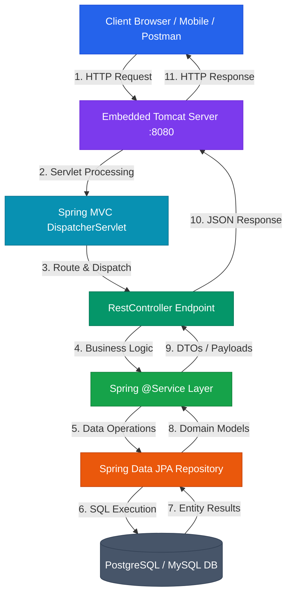

# Spring Boot Engineering Hub

Spring Boot is VMware/Broadcom's production-ready, opinionated framework built on top of the **Spring Framework** ecosystem. Designed around the principle of *"Convention over Configuration"*, Spring Boot enables developers to build self-contained, enterprise-grade Java web applications and microservices with minimal manual configuration.

* **Analogy**: *A Fully Equipped Ghost Kitchen & Turn-Key Smart Factory.*
  - **Traditional Spring Framework**: Building a commercial kitchen from scratch—buying stoves, installing gas lines, running ventilation, wiring electrical systems, and assembling XML configuration blueprints before cooking your first dish.
  - **Spring Boot**: A turn-key, pre-configured commercial ghost kitchen container. Plug it into power (`java -jar app.jar`), turn the key, and start cooking immediately.
  - **Auto-Configuration (`@EnableAutoConfiguration`)**: The smart building system that detects ingredients on the shelf (dependencies on classpath) and automatically configures appliances (beans) without manual wiring.
  - **Embedded Tomcat Server**: The built-in power generator and reception desk packaged directly inside your container—no external server installation required.

---

## 🗺️ Spring Boot Digital Textbook Modules & Navigation Roadmap

Explore our structured, modular Spring Boot masterclass below. Organized like a digital textbook, each module covers deep architectural mechanics, request lifecycles, code examples, debugging strategies, and production best practices.

| Module | Core Topics | Key Focus & Engineering Concepts | Read Time |
| :--- | :--- | :--- | :--- |
| **[1. Foundations & Architecture](./01-foundations-and-architecture/01-client-server-and-http-protocol)** | HTTP, Sockets, Servlets, Tomcat, Spring Framework, Spring Boot, Microservices | Web primitives, request translation layer, thread-per-request model, auto-configuration | ~20 mins |
| **[2. Build Tooling & Setup](./02-build-tooling-and-first-app/01-maven-build-engineering)** | Maven, `pom.xml`, GAV, SNAPSHOTs, Initializr, `@SpringBootApplication`, `@RestController` | Build lifecycle, transitive dependency tree, embedded Tomcat execution, 404 debugging | ~20 mins |
| **[3. Spring Core — IoC & DI](./03-spring-core-ioc-and-di/01-ioc-and-dependency-injection)** | IoC, Dependency Injection, `@Component`, `@ComponentScan`, `@Configuration`, `@Bean`, `@Qualifier` | Tight vs loose coupling, constructor injection, component scanning boundaries, bean ambiguity | ~20 mins |
| **[4. Bean Lifecycle & Scopes](./04-bean-lifecycle-and-advanced-container/01-bean-lifecycle-and-hooks)** | Lifecycle Pipeline, `BeanPostProcessor`, `@PostConstruct`, Scopes (`singleton`, `prototype`), `@Lazy` | 10-stage container execution, AOP proxies, prototype-in-singleton fix, circular dependencies | ~25 mins |
| **[5. Legacy XML Configuration](./05-legacy-configuration/01-xml-configuration-and-interop)** | `beans.xml`, `<bean>`, `<constructor-arg>`, `<property>`, `value` vs `ref`, `@ImportResource` | Legacy XML blueprints, autowire modes, collection injection, hybrid Spring Boot interop | ~15 mins |
| **[6. Boot Annotations & Bootstrap](./06-spring-boot-annotations-and-bootstrap/01-startup-mechanics-and-springapplication)** | `SpringApplication.run()`, `@SpringBootApplication`, `@SpringBootConfiguration`, `@ComponentScan` | Master ignition pipeline, Service Locator vs DI, composite annotations, root package rules | ~20 mins |
| **[7. Auto-Config & Conditionals](./07-auto-configuration-and-conditionals/01-auto-configuration-and-classpath-signals)** | `@EnableAutoConfiguration`, Classpath Signals, `@ConditionalOnClass`, `@ConditionalOnMissingBean` | Auto-config decision pipeline, starters as signals, developer bean precedence, 5 debugging steps | ~25 mins |
| **[8. External Config & Binding](./08-externalized-configuration-and-binding/01-configuration-sources-properties-and-yaml)** | `application.properties`, `application.yml`, `@Value`, `@ConfigurationProperties`, Relaxed Binding | Code vs Config boundary, packaged resources vs externalized env variables, kebab-case to camelCase | ~20 mins |
| **[9. Runners & Startup Pipeline](./09-runner-interfaces-and-startup-pipeline/01-commandlinerunner-vs-applicationrunner)** | `CommandLineRunner`, `ApplicationRunner`, `ApplicationArguments`, End-to-End Startup Pipeline | Non-web startup tasks, raw vs structured CLI args, configuration-to-bean execution flow, pitfalls | ~20 mins |
| **[10. Layered Architecture & JPA](./10-layered-architecture-and-jpa-persistence/01-layered-architecture-and-responsibilities)** | Controller-Service-Repository, God Controller, Package Layout, JPA Entities, ORM, DataSource Crash | Kitchen analogy, strict component boundaries, ORM mapping mechanics, missing property startup crashes | ~25 mins |
| **[11. REST CRUD & Production Patterns](./11-rest-crud-implementation-and-production-patterns/01-rest-mapping-and-crud-operations)** | `POST`, `GET`, `PUT`, `DELETE`, `@PathVariable`, Hard vs Soft Delete, 10-Step Request Flow | REST vocabulary, 3-step update workflow, soft delete audit strategies, query complexity matrix | ~25 mins |
| **[12. Spring Data JPA & ORM Engineering](./12-spring-data-jpa-orm-and-repository-engineering/01-orm-hibernate-mechanics-and-datasource-config)** | Object-Relational Impedance Mismatch, JPA vs Hibernate, JDBC URL, `ddl-auto`, Persistence Context | ORM mapping contracts, Flyway/Liquibase schema migrations, dirty checking, B-Tree complexity | ~25 mins |
| **[13. Advanced REST & Production Architecture](./13-advanced-rest-controllers-dtos-and-production-architecture/01-rest-controllers-responseentity-and-jackson)** | `@RestController`, `ResponseEntity`, Jackson JSON, DTOs, State Machines, TOCTOU Race Conditions | HTTP status codes, over-posting protection, 11-step execution sequence, outside-in debugging | ~25 mins |
| **[14. Soft Delete Architecture & JPA Filtering](./14-soft-delete-architecture-and-jpa-filtering/01-logical-deletion-semantics-and-entity-mapping)** | Logical Deletion, `is_deleted` Column, `PATCH` Semantics, `findAll()` Trap, Derived Queries | Archive cabinet analogy, database existence vs application visibility, `findByIsDeletedFalse` | ~20 mins |
| **[15. Soft Delete Production Patterns & Indexing](./15-soft-delete-production-patterns-and-indexing/01-controller-service-pipeline-and-patch-semantics)** | `@PatchMapping`, `@Transactional` State Mutations, Low-Cardinality Indexing, Pitfalls Checklist | 3-step soft delete pipeline, boolean composite index analysis, 7 critical pitfalls refactoring | ~20 mins |
| **[16. Servlets Architecture & Container Lifecycle](./16-servlets-architecture-and-container-lifecycle/01-servlets-fundamentals-and-restaurant-analogy)** | Java Servlets, Restaurant Kitchen Analogy, Tomcat Container, `ServerSocket` vs Servlets, IoC | Network listener mechanics, `init`/`service`/`destroy` lifecycle, multithreaded single-instance concurrency | ~25 mins |
| **[17. Servlet Deployment & Spring MVC Progression](./17-servlet-deployment-tomcat-and-spring-mvc-progression/01-war-packaging-provided-scope-and-embedded-tomcat)** | WAR Packaging, Maven `provided` Scope, Embedded Tomcat, `DispatcherServlet`, Architectural Pipeline | Classloader collision prevention, Front Controller pattern, 6-stage progression, production pitfalls | ~25 mins |
| **[18. Spring MVC Core Architecture & Dispatching](./18-spring-mvc-core-architecture-and-dispatching/01-front-controller-and-dispatcherservlet)** | Spring Web MVC, Airport Control Tower Analogy, Front Controller, `DispatcherServlet`, Argument Resolvers | `@Controller` vs `@RestController`, startup mapping metadata construction, Jackson `HttpMessageConverter` | ~25 mins |
| **[19. Manual Spring MVC, JSP & Spring Boot Auto-Config](./19-manual-spring-mvc-jsp-and-spring-boot-auto-config/01-manual-spring-mvc-and-embedded-tomcat-bootstrap)** | Embedded Tomcat Bootstrap, `AnnotationConfigWebApplicationContext`, `ViewResolver`, JSP, Spring Boot | Complete manual `App.java`, `WEB-INF` security, model data flow, `HashMap` vs Database complexity | ~25 mins |
| **[20. DTOs & Architectural Boundary Decoupling](./20-dtos-and-architectural-boundary-decoupling/01-entity-exposure-hazards-and-security-gate-model)** | Data Transfer Objects, Security Gate Analogy, Entity Exposure Hazards, Request/Response DTOs | Mass assignment protection, sensitive data leakage prevention, API contract stability | ~25 mins |
| **[21. Bean Validation & API Contract Enforcement](./21-bean-validation-and-api-contract-enforcement/01-bean-validation-annotations-and-valid-trigger)** | `spring-boot-starter-validation`, `@NotBlank`, `@NotNull`, `@Valid` Trigger, HTTP 400 Bad Request | Constraint comparison matrix, skip-service validation rule, structured error response contract | ~25 mins |
| **[22. HTTP Response Semantics & Custom Exceptions](./22-http-response-semantics-and-custom-exceptions/01-http-response-anatomy-and-responseentity)** | Emergency Department Analogy, HTTP Status Taxonomy, `ResponseEntity`, Custom Exceptions, `orElseThrow` | Status decision matrix, explicit response construction, unchecked exception signaling | ~25 mins |
| **[23. Global Exception Handling & Error Contracts](./23-global-exception-handling-and-error-contracts/01-restcontrolleradvice-and-exceptionhandlers)** | `@RestControllerAdvice`, `@ExceptionHandler`, `ErrorResponseDto`, `400` vs `409`, Production Safety | Centralized exception mapping, field-level validation errors, stack trace leakage protection | ~25 mins |
| **[24. Externalized Configuration, Properties & YAML](./24-externalized-configuration-properties-and-yaml/01-configuration-fundamentals-and-properties-vs-yaml)** | Hotel Control Panel Analogy, Code vs Config vs Secrets, `application.properties`, YAML Syntax | `.properties` vs YAML matrix, `@Value` vs `@ConfigurationProperties`, relaxed binding | ~25 mins |
| **[25. Spring Profiles & Environment Decoupling](./25-spring-profiles-and-environment-decoupling/01-profile-specific-configuration-and-activation)** | Profiles (`dev`, `test`, `prod`), `application-{profile}.yml`, Profile Activation, `@Profile` Beans | Property override hierarchy, Build-Once-Deploy-Anywhere principle, implementation switching | ~25 mins |
| **[26. Servlet Filters & Request Interception Pipeline](./26-servlet-filters-and-request-interception-pipeline/01-servlet-filter-fundamentals-and-lifecycle)** | Security Checkpoint Analogy, Request Pipeline, `jakarta.servlet.Filter`, `doFilter()` Continuation | Filter vs Interceptor vs Security matrix, `@Order` ordering, HttpServletRequest casting | ~25 mins |
| **[27. Production Filter Patterns & Security](./27-production-filter-patterns-security-and-best-practices/01-production-logging-timing-and-trace-ids)** | Request Logging, `try-finally` Timing, `X-Request-Id` Trace IDs, Early Rejection (401), Anti-Patterns | Response commitment rules, thread-safety singleton rules, decision tree & checklists | ~25 mins |
| **[28. Request/Response Wrappers & Body Caching](./28-request-response-wrappers-and-body-caching/01-response-mutation-and-contentcachingresponsewrapper)** | Response Headers, Response Commitment, `ContentCachingResponseWrapper`, `HttpServletRequestWrapper` | Stream consumption rules, Tape Recorder model, `CachedBodyHttpServletRequest`, $O(N)$ memory costs | ~25 mins |
| **[29. Advanced Filter Registration & OncePerRequestFilter](./29-advanced-filter-registration-onceperrequestfilter-and-layer-selection/01-filter-registration-bean-and-url-scoping)** | `@Component` vs `FilterRegistrationBean`, URL Scoping (`/api/*`), Duplicate Registration Bug | `OncePerRequestFilter`, `shouldNotFilter()`, DispatcherTypes, Architectural layer selection map | ~25 mins |

---

### Module 1: Foundations & Architecture
* **[1.1 Client-Server & HTTP Protocol](./01-foundations-and-architecture/01-client-server-and-http-protocol)**: Web communication primitives, IP addressing, ports, sockets, URL anatomy, HTTP methods (GET, POST, PUT, PATCH, DELETE), headers, status codes, and idempotency rules.
* **[1.2 Servlets & Servlet Containers](./01-foundations-and-architecture/02-servlets-and-servlet-containers)**: Low-level `ServerSocket` handling vs Servlet translation API (`HttpServlet`), Tomcat container mechanics, thread-per-request execution model, and concurrency safety.
* **[1.3 Spring Ecosystem & Boot Overview](./01-foundations-and-architecture/03-spring-ecosystem-and-boot-overview)**: Historical evolution from EJB 2.x to Spring, Framework vs Boot distinction, Spring ecosystem stack layers, opinionated defaults, embedded server execution model, and microservices alignment.

### Module 2: Build Tooling & Application Setup
* **[2.1 Maven Build Engineering](./02-build-tooling-and-first-app/01-maven-build-engineering)**: Apache Maven build pipeline, `pom.xml` architecture, GAV coordinates, SNAPSHOT vs Release semantics, transitive dependency resolution, local `.m2` caching, and `spring-boot-maven-plugin` Fat JAR repackaging.
* **[2.2 Bootstrap & First Controller](./02-build-tooling-and-first-app/02-bootstrap-and-first-controller)**: Spring Initializr, canonical project layout, `@SpringBootApplication` meta-annotation breakdown, `@RestController`, request routing, application properties, request lifecycle, and step-by-step 404/startup debugging.

### Module 3: Spring Core — IoC & Dependency Injection
* **[3.1 Inversion of Control & Dependency Injection](./03-spring-core-ioc-and-di/01-ioc-and-dependency-injection)**: Tight vs loose coupling, interface abstraction, IoC container principles, Constructor vs Field vs Setter injection styles, SRP/OCP alignment, and unit testing mockability.
* **[3.2 Spring Beans & Component Scanning](./03-spring-core-ioc-and-di/02-beans-and-component-scanning)**: `ApplicationContext` vs `BeanFactory`, Stereotype annotations (`@Component`, `@Service`, `@Repository`), `@ComponentScan` boundaries, explicit Java config (`@Configuration` & `@Bean`), `BeanDefinition` metadata, and resolving bean ambiguity with `@Primary` and `@Qualifier`.

### Module 4: Bean Lifecycle & Advanced Container Mechanics
* **[4.1 Spring Bean Lifecycle & Hooks](./04-bean-lifecycle-and-advanced-container/01-bean-lifecycle-and-hooks)**: Complete 10-stage container execution pipeline from scanning and instantiation to `BeanPostProcessor` interception, AOP proxy wrapping, `@PostConstruct`, and `@PreDestroy` resource cleanup.
* **[4.2 Bean Scopes, Lazy Initialization & Circular Dependencies](./04-bean-lifecycle-and-advanced-container/02-scopes-lazy-init-and-circular-deps)**: Core (`singleton`, `prototype`) and web scopes (`request`, `session`), resolving the prototype-in-singleton injection problem via `ObjectProvider`, `@Lazy` proxies, circular dependency deadlock mechanics, and refactoring strategies.

### Module 5: Legacy Configuration & Hybrid Interop
* **[5.1 Legacy XML Configuration & Hybrid Interop](./05-legacy-configuration/01-xml-configuration-and-interop)**: Legacy XML blueprints (`beans.xml`), `<bean>` declarations, `value` vs `ref` wiring, collection injection, XML autowiring modes, custom lifecycle hooks (`init-method`, `destroy-method`), and hybrid integration via `@ImportResource`.

### Module 6: Spring Boot Annotations & Bootstrap
* **[6.1 Startup Mechanics & SpringApplication.run()](./06-spring-boot-annotations-and-bootstrap/01-startup-mechanics-and-springapplication)**: Spring Core vs Spring Boot startup, `SpringApplication.run()` execution stages, `ApplicationContext` creation, DI vs Service Locator patterns, and `CommandLineRunner`.
* **[6.2 @SpringBootApplication & Component Scanning](./06-spring-boot-annotations-and-bootstrap/02-springbootapplication-and-component-scan)**: `@SpringBootApplication` composite meta-annotation breakdown (`@SpringBootConfiguration`, `@EnableAutoConfiguration`, `@ComponentScan`), annotation taxonomy matrix, and root package scanning rules.

### Module 7: Auto-Configuration & Conditional Mechanics
* **[7.1 Auto-Configuration & Classpath Signals](./07-auto-configuration-and-conditionals/01-auto-configuration-and-classpath-signals)**: `@ComponentScan` vs `@EnableAutoConfiguration`, automated workshop mental model, auto-configuration decision pipeline, starters as signals, and console vs web app auto-detection.
* **[7.2 Conditional Beans & Production Diagnostics](./07-auto-configuration-and-conditionals/02-conditional-beans-and-production-diagnostics)**: `@ConditionalOnClass`, `@ConditionalOnMissingBean`, developer vs auto-configured bean precedence, full startup state machine, 5 production debugging questions, and anti-patterns.

### Module 8: Externalized Configuration & Property Binding
* **[8.1 Configuration Sources, Properties & YAML](./08-externalized-configuration-and-binding/01-configuration-sources-properties-and-yaml)**: Code vs Config boundary, `application.properties` vs `application.yml`, packaged resources vs true externalized configuration, OS environment variables, and environment-specific settings.
* **[8.2 @Value vs @ConfigurationProperties & Relaxed Binding](./08-externalized-configuration-and-binding/02-value-vs-configuration-properties-and-relaxed-binding)**: Single property resolution via `@Value`, default value syntax (`${key:default}`), `@ConfigurationProperties` grouped binding, relaxed binding mechanics (kebab-case to camelCase), and trade-off matrices.

### Module 9: Runner Interfaces & Startup Pipeline
* **[9.1 CommandLineRunner vs ApplicationRunner](./09-runner-interfaces-and-startup-pipeline/01-commandlinerunner-vs-applicationrunner)**: Non-web startup tasks vs HTTP controllers, manual bean lookup anti-patterns, raw `String... args` vs structured `ApplicationArguments` (`--key=value` option flags).
* **[9.2 End-to-End Configuration Pipeline & Pitfalls](./09-runner-interfaces-and-startup-pipeline/02-end-to-end-configuration-pipeline-and-pitfalls)**: Complete Spring Boot startup data flow (Mermaid sequence), configuration-to-bean execution pipeline, production pitfalls, end-to-end code example, and self-assessment challenges.

### Module 10: Layered Architecture & JPA Persistence
* **[10.1 Layered Architecture & Responsibilities](./10-layered-architecture-and-jpa-persistence/01-layered-architecture-and-responsibilities)**: Restaurant kitchen analogy, Controller-Service-Repository separation, God Controller anti-pattern, package layout, `@SpringBootApplication` component scanning, and MySQL Server vs Client vs Workbench tooling.
* **[10.2 JPA Entities, ORM & Database Auto-Configuration](./10-layered-architecture-and-jpa-persistence/02-jpa-entities-orm-and-database-autoconfiguration)**: Entity vs flow layer mental model, `@Entity` mapping, ORM object-to-row transformation, dependency stack, and why adding database starters without properties causes startup crashes.

### Module 11: REST CRUD Implementation & Production Patterns
* **[11.1 REST Mapping & CRUD Operations](./11-rest-crud-implementation-and-production-patterns/01-rest-mapping-and-crud-operations)**: REST endpoint matrix, `@PathVariable` vs `@RequestBody`, step-by-step Create/Read/Update implementations, 3-step update workflow, and 10-step request execution pipeline.
* **[11.2 Hard vs Soft Delete, Pitfalls & Refactoring](./11-rest-crud-implementation-and-production-patterns/02-hard-vs-soft-delete-pitfalls-and-refactoring)**: Hard delete vs soft delete (`isDeleted` flag), entity state transition model, database operation complexity matrix, 5 production pitfalls, and God Controller refactoring.

### Module 12: Spring Data JPA, ORM & Repository Engineering
* **[12.1 ORM, Hibernate Mechanics & DataSource Configuration](./12-spring-data-jpa-orm-and-repository-engineering/01-orm-hibernate-mechanics-and-datasource-config)**: Restaurant analogy table, Object-Relational Impedance Mismatch, JPA vs Hibernate, JDBC URL breakdown, `ddl-auto` setting matrix, and Flyway/Liquibase schema migrations.
* **[12.2 Entity Design, Repository Proxies & Persistence Context](./12-spring-data-jpa-orm-and-repository-engineering/02-entity-design-repository-proxies-and-persistence-context)**: `@Entity` mapping blueprint, JDK dynamic proxies for repository interfaces, Persistence Context dirty checking mechanics, B-Tree index lookup complexity $O(\log_B N)$, and `findAll()` heap memory traps vs `Pageable`.

### Module 13: Advanced REST Controllers, DTOs & Production Architecture
* **[13.1 REST Controllers, ResponseEntity & Jackson](./13-advanced-rest-controllers-dtos-and-production-architecture/01-rest-controllers-responseentity-and-jackson)**: `@RestController` protocol boundary, `ResponseEntity<T>` structure, standard CRUD HTTP status codes, Jackson serialization pipeline, clean `Optional<T>` handling, and 11-step execution sequence.
* **[13.2 DTOs, State Machines, Anti-Patterns & Debugging](./13-advanced-rest-controllers-dtos-and-production-architecture/02-dtos-state-machines-anti-patterns-and-debugging)**: DTO records vs Entity over-posting risks, Mermaid entity state machine, TOCTOU race conditions, 5 production anti-patterns, and outside-in debugging checklists.

### Module 14: Soft Delete Architecture & JPA Filtering
* **[14.1 Logical Deletion Semantics & Entity Mapping](./14-soft-delete-architecture-and-jpa-filtering/01-logical-deletion-semantics-and-entity-mapping)**: Hard delete (`DELETE`) vs Soft delete (`PATCH /soft-delete`), archive cabinet analogy, physical existence vs application visibility, `@Column(name = "is_deleted")`, and state machine transitions.
* **[14.2 Derived Query Methods & The findById Trap](./14-soft-delete-architecture-and-jpa-filtering/02-derived-query-methods-and-the-findbyid-trap)**: The `findAll()` and `findById()` data leakage traps, derived query syntax (`findByIsDeletedFalse`, `findByIdAndIsDeletedFalse`), and 3-step soft delete execution pipeline.

### Module 15: Soft Delete Production Patterns & Indexing
* **[15.1 Controller-Service Pipeline & PATCH Semantics](./15-soft-delete-production-patterns-and-indexing/01-controller-service-pipeline-and-patch-semantics)**: REST `@PatchMapping("/{id}/soft-delete")` controller boundary, `@Transactional` service state mutations, complete reference code implementation, and end-to-end mental model.
* **[15.2 Indexing, Anti-Patterns & Refactoring](./15-soft-delete-production-patterns-and-indexing/02-indexing-anti-patterns-and-refactoring)**: Database indexing caveats for low-cardinality boolean flags, composite index solutions, operational query complexity matrix, 7 production pitfalls, and API refactoring.

### Module 16: Servlets Architecture & Container Lifecycle
* **[16.1 Servlets Fundamentals & Restaurant Analogy](./16-servlets-architecture-and-container-lifecycle/01-servlets-fundamentals-and-restaurant-analogy)**: Java Servlets fundamentals, Restaurant Kitchen mental model, why raw `ServerSocket` is insufficient, static vs dynamic sites, and Servlet container IoC.
* **[16.2 Servlet Lifecycle, Concurrency & Request Pipeline](./16-servlets-architecture-and-container-lifecycle/02-servlet-lifecycle-concurrency-and-request-pipeline)**: Complete 4-phase lifecycle pipeline (`init`, `service`, `destroy`), single-instance multithreaded concurrency hazards, and `HttpServletRequest`/`HttpServletResponse` abstractions.

### Module 17: Servlet Deployment & Spring MVC Progression
* **[17.1 WAR Packaging, Provided Scope & Embedded Tomcat](./17-servlet-deployment-tomcat-and-spring-mvc-progression/01-war-packaging-provided-scope-and-embedded-tomcat)**: Web Application Archive (`.war`) structure, Maven `<scope>provided</scope>` classloader isolation rule, external Tomcat administration, and Spring Boot embedded container model.
* **[17.2 DispatcherServlet, Spring MVC & Production Pitfalls](./17-servlet-deployment-tomcat-and-spring-mvc-progression/02-dispatcherservlet-spring-mvc-and-production-pitfalls)**: Traditional Servlet scaling bottlenecks, `DispatcherServlet` Front Controller pattern, 6-stage architectural progression, production pitfalls matrix, and debugging challenges.

### Module 18: Spring MVC Core Architecture & Dispatching
* **[18.1 Front Controller & DispatcherServlet](./18-spring-mvc-core-architecture-and-dispatching/01-front-controller-and-dispatcherservlet)**: Spring Web MVC fundamentals, Airport Control Tower mental model, Front Controller pattern vs multi-servlet chaos, and `@Controller` vs `@RestController`.
* **[18.2 HandlerMapping, HandlerAdapter & Argument Resolution](./18-spring-mvc-core-architecture-and-dispatching/02-handlermapping-handleradapter-and-argument-resolution)**: Startup-time mapping metadata construction, `HandlerAdapter` invocation, method argument resolution (`@PathVariable`, `@RequestParam`, `@RequestBody`), and Jackson `HttpMessageConverter`.

### Module 19: Manual Spring MVC, JSP & Spring Boot Auto-Config
* **[19.1 Manual Spring MVC & Embedded Tomcat Bootstrap](./19-manual-spring-mvc-jsp-and-spring-boot-auto-config/01-manual-spring-mvc-and-embedded-tomcat-bootstrap)**: Manual dependency triad (`spring-webmvc`, `tomcat-embed-core`, `jackson-databind`), `@EnableWebMvc` setup, `AnnotationConfigWebApplicationContext`, `DispatcherServlet` registration, and `App.java` blueprint.
* **[19.2 ViewResolver, JSP Pipeline & Spring Boot Automation](./19-manual-spring-mvc-jsp-and-spring-boot-auto-config/02-viewresolver-jsp-pipeline-and-spring-boot-automation)**: `InternalResourceViewResolver`, JSP pipeline, `WEB-INF` security boundary, Spring Boot auto-configuration, and in-memory `HashMap` vs database complexity.

### Module 20: DTOs & Architectural Boundary Decoupling
* **[20.1 Entity Exposure Hazards & Security Gate Model](./20-dtos-and-architectural-boundary-decoupling/01-entity-exposure-hazards-and-security-gate-model)**: Building Security Gate mental model, mass assignment vulnerabilities, sensitive data leakage, Entity vs DTO comparison matrix, and architectural boundary rules.
* **[20.2 Request/Response DTOs & Mapping Pipelines](./20-dtos-and-architectural-boundary-decoupling/02-request-response-dtos-and-mapping-pipelines)**: Request DTO vs Response DTO specifications, explicit service mapping functions (`mapToEntity`, `mapToResponseDto`), and production CRUD controller implementations.

### Module 21: Bean Validation & API Contract Enforcement
* **[21.1 Bean Validation Annotations & @Valid Trigger](./21-bean-validation-and-api-contract-enforcement/01-bean-validation-annotations-and-valid-trigger)**: `spring-boot-starter-validation`, `@NotBlank` vs `@NotNull` vs `@NotEmpty` comparison matrix, `@Valid` validation trigger, and skip-service execution pipeline.
* **[21.2 Error Contracts, Anti-Patterns & Refactoring](./21-bean-validation-and-api-contract-enforcement/02-error-contracts-anti-patterns-and-refactoring)**: HTTP 400 Bad Request semantics, structured validation error response contracts, production anti-patterns matrix, and refactoring entity-coupled CRUD APIs.

### Module 22: HTTP Response Semantics & Custom Exceptions
* **[22.1 HTTP Response Anatomy & ResponseEntity](./22-http-response-semantics-and-custom-exceptions/01-http-response-anatomy-and-responseentity)**: Emergency Department mental model, HTTP status taxonomy (200, 201, 204, 400, 404, 409, 500), decision matrix, and `ResponseEntity` construction.
* **[22.2 Custom Exceptions & Service-Layer Signaling](./22-http-response-semantics-and-custom-exceptions/02-custom-exceptions-and-service-layer-signaling)**: Why error handling must leave controllers, domain unchecked exceptions (`ResourceNotFoundException`, `DuplicateResourceException`), and `Optional.orElseThrow()` signals.

### Module 23: Global Exception Handling & Error Contracts
* **[23.1 @RestControllerAdvice & Exception Mappings](./23-global-exception-handling-and-error-contracts/01-restcontrolleradvice-and-exceptionhandlers)**: `@RestControllerAdvice` vs `@ControllerAdvice`, `ErrorResponseDto` envelope, request URI logging, and `400 Bad Request` vs `409 Conflict` critical distinction.
* **[23.2 Validation Errors, Parsing & Production Safety](./23-global-exception-handling-and-error-contracts/02-validation-parsing-errors-and-production-safety)**: Handling `MethodArgumentNotValidException` with `fieldErrors`, malformed JSON parsing errors, production stack trace leakage security, and exception handler hierarchy.

### Module 24: Externalized Configuration, Properties & YAML
* **[24.1 Configuration Fundamentals & Properties vs YAML](./24-externalized-configuration-properties-and-yaml/01-configuration-fundamentals-and-properties-vs-yaml)**: Hotel Control Panel mental model, code vs config vs secrets boundaries, `application.properties` key-value spreadsheets, YAML indentation rules, and list representations.
* **[24.2 Configuration Binding: @Value vs @ConfigurationProperties](./24-externalized-configuration-properties-and-yaml/02-configuration-binding-value-vs-configurationproperties)**: Single property injection with `@Value`, type-safe grouped binding with `@ConfigurationProperties`, relaxed binding mechanics, and database/JPA configuration blueprints.

### Module 25: Spring Profiles & Environment Decoupling
* **[25.1 Profile-Specific Configuration & Activation](./25-spring-profiles-and-environment-decoupling/01-profile-specific-configuration-and-activation)**: Profiles as operating modes (`dev`, `test`, `prod`), `application-{profile}.yml` override hierarchy, activation mechanisms (CLI, env vars), and build-once-deploy-anywhere principles.
* **[25.2 Conditional Beans with @Profile & Production Patterns](./25-spring-profiles-and-environment-decoupling/02-conditional-beans-with-profile-and-production-patterns)**: Changing values (profile files) vs changing beans (`@Profile`), interface implementation switching (`DevNotificationService` vs `ProdNotificationService`), resolving bean ambiguity, and production anti-patterns.

### Module 26: Servlet Filters & Request Interception Pipeline
* **[26.1 Servlet Filter Fundamentals & Lifecycle](./26-servlet-filters-and-request-interception-pipeline/01-servlet-filter-fundamentals-and-lifecycle)**: Security Checkpoint mental model, request pipeline execution, `jakarta.servlet.Filter` lifecycle, Spring Boot 3 namespace migration, and cross-cutting concerns matrix.
* **[26.2 doFilter Continuation, Blocking & Ordering](./26-servlet-filters-and-request-interception-pipeline/02-dofilter-continuation-blocking-and-ordering)**: `chain.doFilter()` continuation vs early request blocking, casting `ServletRequest` to `HttpServletRequest`, `@Order` execution stack, and `DispatcherServlet` boundary rules.

### Module 27: Production Filter Patterns & Security
* **[27.1 Production Logging, Timing & Trace IDs](./27-production-filter-patterns-security-and-best-practices/01-production-logging-timing-and-trace-ids)**: Request logging filter blueprint, guaranteed timing with `try-finally`, correlation trace IDs (`X-Request-Id`), response commitment rules, and sensitive data logging security.
* **[27.2 Blocking, Anti-Patterns & Thread-Safety](./27-production-filter-patterns-security-and-best-practices/02-blocking-anti-patterns-and-thread-safety)**: Early request rejection with direct JSON error responses (`401 Unauthorized`), thread-safety singleton rules, production anti-patterns, and architectural decision trees.

### Module 28: Request/Response Wrappers & Body Caching
* **[28.1 Response Mutation & ContentCachingResponseWrapper](./28-request-response-wrappers-and-body-caching/01-response-mutation-and-contentcachingresponsewrapper)**: Response headers, response commitment rules, sealed envelope mental model, `ContentCachingResponseWrapper`, `resetBuffer()`, and `copyBodyToResponse()`.
* **[28.2 Request Wrappers & Repeatable Body Caching](./28-request-response-wrappers-and-body-caching/02-request-wrappers-and-repeatable-body-caching)**: `HttpServletRequestWrapper` header/parameter substitution, stream consumption rules, Tape Recorder model, classic filter stream bug, and `CachedBodyHttpServletRequest` re-readable body caching blueprint.

### Module 29: Advanced Filter Registration & OncePerRequestFilter
* **[29.1 FilterRegistrationBean & URL Scoping](./29-advanced-filter-registration-onceperrequestfilter-and-layer-selection/01-filter-registration-bean-and-url-scoping)**: `@Component` vs `FilterRegistrationBean`, explicit URL mapping (`/api/*`), preventing duplicate filter registration bugs, and URL scoping strategies.
* **[29.2 OncePerRequestFilter & Architectural Layer Selection](./29-advanced-filter-registration-onceperrequestfilter-and-layer-selection/02-onceperrequestfilter-and-architectural-layer-selection)**: `OncePerRequestFilter`, `doFilterInternal()`, `shouldNotFilter()`, Servlet dispatch types (`REQUEST`, `ASYNC`, `ERROR`), and complete architectural layer selection map.

---

### Module 1: Foundations & Architecture
* **[1.1 Client-Server & HTTP Protocol](./01-foundations-and-architecture/01-client-server-and-http-protocol)**: Web communication primitives, IP addressing, ports, sockets, URL anatomy, HTTP methods (GET, POST, PUT, PATCH, DELETE), headers, status codes, and idempotency rules.
* **[1.2 Servlets & Servlet Containers](./01-foundations-and-architecture/02-servlets-and-servlet-containers)**: Low-level `ServerSocket` handling vs Servlet translation API (`HttpServlet`), Tomcat container mechanics, thread-per-request execution model, and concurrency safety.
* **[1.3 Spring Ecosystem & Boot Overview](./01-foundations-and-architecture/03-spring-ecosystem-and-boot-overview)**: Historical evolution from EJB 2.x to Spring, Framework vs Boot distinction, Spring ecosystem stack layers, opinionated defaults, embedded server execution model, and microservices alignment.

### Module 2: Build Tooling & Application Setup
* **[2.1 Maven Build Engineering](./02-build-tooling-and-first-app/01-maven-build-engineering)**: Apache Maven build pipeline, `pom.xml` architecture, GAV coordinates, SNAPSHOT vs Release semantics, transitive dependency resolution, local `.m2` caching, and `spring-boot-maven-plugin` Fat JAR repackaging.
* **[2.2 Bootstrap & First Controller](./02-build-tooling-and-first-app/02-bootstrap-and-first-controller)**: Spring Initializr, canonical project layout, `@SpringBootApplication` meta-annotation breakdown, `@RestController`, request routing, application properties, request lifecycle, and step-by-step 404/startup debugging.

### Module 3: Spring Core — IoC & Dependency Injection
* **[3.1 Inversion of Control & Dependency Injection](./03-spring-core-ioc-and-di/01-ioc-and-dependency-injection)**: Tight vs loose coupling, interface abstraction, IoC container principles, Constructor vs Field vs Setter injection styles, SRP/OCP alignment, and unit testing mockability.
* **[3.2 Spring Beans & Component Scanning](./03-spring-core-ioc-and-di/02-beans-and-component-scanning)**: `ApplicationContext` vs `BeanFactory`, Stereotype annotations (`@Component`, `@Service`, `@Repository`), `@ComponentScan` boundaries, explicit Java config (`@Configuration` & `@Bean`), `BeanDefinition` metadata, and resolving bean ambiguity with `@Primary` and `@Qualifier`.

### Module 4: Bean Lifecycle & Advanced Container Mechanics
* **[4.1 Spring Bean Lifecycle & Hooks](./04-bean-lifecycle-and-advanced-container/01-bean-lifecycle-and-hooks)**: Complete 10-stage container execution pipeline from scanning and instantiation to `BeanPostProcessor` interception, AOP proxy wrapping, `@PostConstruct`, and `@PreDestroy` resource cleanup.
* **[4.2 Bean Scopes, Lazy Initialization & Circular Dependencies](./04-bean-lifecycle-and-advanced-container/02-scopes-lazy-init-and-circular-deps)**: Core (`singleton`, `prototype`) and web scopes (`request`, `session`), resolving the prototype-in-singleton injection problem via `ObjectProvider`, `@Lazy` proxies, circular dependency deadlock mechanics, and refactoring strategies.

### Module 5: Legacy Configuration & Hybrid Interop
* **[5.1 Legacy XML Configuration & Hybrid Interop](./05-legacy-configuration/01-xml-configuration-and-interop)**: Legacy XML blueprints (`beans.xml`), `<bean>` declarations, `value` vs `ref` wiring, collection injection, XML autowiring modes, custom lifecycle hooks (`init-method`, `destroy-method`), and hybrid integration via `@ImportResource`.

### Module 6: Spring Boot Annotations & Bootstrap
* **[6.1 Startup Mechanics & SpringApplication.run()](./06-spring-boot-annotations-and-bootstrap/01-startup-mechanics-and-springapplication)**: Spring Core vs Spring Boot startup, `SpringApplication.run()` execution stages, `ApplicationContext` creation, DI vs Service Locator patterns, and `CommandLineRunner`.
* **[6.2 @SpringBootApplication & Component Scanning](./06-spring-boot-annotations-and-bootstrap/02-springbootapplication-and-component-scan)**: `@SpringBootApplication` composite meta-annotation breakdown (`@SpringBootConfiguration`, `@EnableAutoConfiguration`, `@ComponentScan`), annotation taxonomy matrix, and root package scanning rules.

### Module 7: Auto-Configuration & Conditional Mechanics
* **[7.1 Auto-Configuration & Classpath Signals](./07-auto-configuration-and-conditionals/01-auto-configuration-and-classpath-signals)**: `@ComponentScan` vs `@EnableAutoConfiguration`, automated workshop mental model, auto-configuration decision pipeline, starters as signals, and console vs web app auto-detection.
* **[7.2 Conditional Beans & Production Diagnostics](./07-auto-configuration-and-conditionals/02-conditional-beans-and-production-diagnostics)**: `@ConditionalOnClass`, `@ConditionalOnMissingBean`, developer vs auto-configured bean precedence, full startup state machine, 5 production debugging questions, and anti-patterns.

### Module 8: Externalized Configuration & Property Binding
* **[8.1 Configuration Sources, Properties & YAML](./08-externalized-configuration-and-binding/01-configuration-sources-properties-and-yaml)**: Code vs Config boundary, `application.properties` vs `application.yml`, packaged resources vs true externalized configuration, OS environment variables, and environment-specific settings.
* **[8.2 @Value vs @ConfigurationProperties & Relaxed Binding](./08-externalized-configuration-and-binding/02-value-vs-configuration-properties-and-relaxed-binding)**: Single property resolution via `@Value`, default value syntax (`${key:default}`), `@ConfigurationProperties` grouped binding, relaxed binding mechanics (kebab-case to camelCase), and trade-off matrices.

### Module 9: Runner Interfaces & Startup Pipeline
* **[9.1 CommandLineRunner vs ApplicationRunner](./09-runner-interfaces-and-startup-pipeline/01-commandlinerunner-vs-applicationrunner)**: Non-web startup tasks vs HTTP controllers, manual bean lookup anti-patterns, raw `String... args` vs structured `ApplicationArguments` (`--key=value` option flags).
* **[9.2 End-to-End Configuration Pipeline & Pitfalls](./09-runner-interfaces-and-startup-pipeline/02-end-to-end-configuration-pipeline-and-pitfalls)**: Complete Spring Boot startup data flow (Mermaid sequence), configuration-to-bean execution pipeline, production pitfalls, end-to-end code example, and self-assessment challenges.

### Module 10: Layered Architecture & JPA Persistence
* **[10.1 Layered Architecture & Responsibilities](./10-layered-architecture-and-jpa-persistence/01-layered-architecture-and-responsibilities)**: Restaurant kitchen analogy, Controller-Service-Repository separation, God Controller anti-pattern, package layout, `@SpringBootApplication` component scanning, and MySQL Server vs Client vs Workbench tooling.
* **[10.2 JPA Entities, ORM & Database Auto-Configuration](./10-layered-architecture-and-jpa-persistence/02-jpa-entities-orm-and-database-autoconfiguration)**: Entity vs flow layer mental model, `@Entity` mapping, ORM object-to-row transformation, dependency stack, and why adding database starters without properties causes startup crashes.

### Module 11: REST CRUD Implementation & Production Patterns
* **[11.1 REST Mapping & CRUD Operations](./11-rest-crud-implementation-and-production-patterns/01-rest-mapping-and-crud-operations)**: REST endpoint matrix, `@PathVariable` vs `@RequestBody`, step-by-step Create/Read/Update implementations, 3-step update workflow, and 10-step request execution pipeline.
* **[11.2 Hard vs Soft Delete, Pitfalls & Refactoring](./11-rest-crud-implementation-and-production-patterns/02-hard-vs-soft-delete-pitfalls-and-refactoring)**: Hard delete vs soft delete (`isDeleted` flag), entity state transition model, database operation complexity matrix, 5 production pitfalls, and God Controller refactoring.

### Module 12: Spring Data JPA, ORM & Repository Engineering
* **[12.1 ORM, Hibernate Mechanics & DataSource Configuration](./12-spring-data-jpa-orm-and-repository-engineering/01-orm-hibernate-mechanics-and-datasource-config)**: Restaurant analogy table, Object-Relational Impedance Mismatch, JPA vs Hibernate, JDBC URL breakdown, `ddl-auto` setting matrix, and Flyway/Liquibase schema migrations.
* **[12.2 Entity Design, Repository Proxies & Persistence Context](./12-spring-data-jpa-orm-and-repository-engineering/02-entity-design-repository-proxies-and-persistence-context)**: `@Entity` mapping blueprint, JDK dynamic proxies for repository interfaces, Persistence Context dirty checking mechanics, B-Tree index lookup complexity $O(\log_B N)$, and `findAll()` heap memory traps vs `Pageable`.

### Module 13: Advanced REST Controllers, DTOs & Production Architecture
* **[13.1 REST Controllers, ResponseEntity & Jackson](./13-advanced-rest-controllers-dtos-and-production-architecture/01-rest-controllers-responseentity-and-jackson)**: `@RestController` protocol boundary, `ResponseEntity<T>` structure, standard CRUD HTTP status codes, Jackson serialization pipeline, clean `Optional<T>` handling, and 11-step execution sequence.
* **[13.2 DTOs, State Machines, Anti-Patterns & Debugging](./13-advanced-rest-controllers-dtos-and-production-architecture/02-dtos-state-machines-anti-patterns-and-debugging)**: DTO records vs Entity over-posting risks, Mermaid entity state machine, TOCTOU race conditions, 5 production anti-patterns, and outside-in debugging checklists.

### Module 14: Soft Delete Architecture & JPA Filtering
* **[14.1 Logical Deletion Semantics & Entity Mapping](./14-soft-delete-architecture-and-jpa-filtering/01-logical-deletion-semantics-and-entity-mapping)**: Hard delete (`DELETE`) vs Soft delete (`PATCH /soft-delete`), archive cabinet analogy, physical existence vs application visibility, `@Column(name = "is_deleted")`, and state machine transitions.
* **[14.2 Derived Query Methods & The findById Trap](./14-soft-delete-architecture-and-jpa-filtering/02-derived-query-methods-and-the-findbyid-trap)**: The `findAll()` and `findById()` data leakage traps, derived query syntax (`findByIsDeletedFalse`, `findByIdAndIsDeletedFalse`), and 3-step soft delete execution pipeline.

### Module 15: Soft Delete Production Patterns & Indexing
* **[15.1 Controller-Service Pipeline & PATCH Semantics](./15-soft-delete-production-patterns-and-indexing/01-controller-service-pipeline-and-patch-semantics)**: REST `@PatchMapping("/{id}/soft-delete")` controller boundary, `@Transactional` service state mutations, complete reference code implementation, and end-to-end mental model.
* **[15.2 Indexing, Anti-Patterns & Refactoring](./15-soft-delete-production-patterns-and-indexing/02-indexing-anti-patterns-and-refactoring)**: Database indexing caveats for low-cardinality boolean flags, composite index solutions, operational query complexity matrix, 7 production pitfalls, and API refactoring.

### Module 16: Servlets Architecture & Container Lifecycle
* **[16.1 Servlets Fundamentals & Restaurant Analogy](./16-servlets-architecture-and-container-lifecycle/01-servlets-fundamentals-and-restaurant-analogy)**: Java Servlets fundamentals, Restaurant Kitchen mental model, why raw `ServerSocket` is insufficient, static vs dynamic sites, and Servlet container IoC.
* **[16.2 Servlet Lifecycle, Concurrency & Request Pipeline](./16-servlets-architecture-and-container-lifecycle/02-servlet-lifecycle-concurrency-and-request-pipeline)**: Complete 4-phase lifecycle pipeline (`init`, `service`, `destroy`), single-instance multithreaded concurrency hazards, and `HttpServletRequest`/`HttpServletResponse` abstractions.

### Module 17: Servlet Deployment & Spring MVC Progression
* **[17.1 WAR Packaging, Provided Scope & Embedded Tomcat](./17-servlet-deployment-tomcat-and-spring-mvc-progression/01-war-packaging-provided-scope-and-embedded-tomcat)**: Web Application Archive (`.war`) structure, Maven `<scope>provided</scope>` classloader isolation rule, external Tomcat administration, and Spring Boot embedded container model.
* **[17.2 DispatcherServlet, Spring MVC & Production Pitfalls](./17-servlet-deployment-tomcat-and-spring-mvc-progression/02-dispatcherservlet-spring-mvc-and-production-pitfalls)**: Traditional Servlet scaling bottlenecks, `DispatcherServlet` Front Controller pattern, 6-stage architectural progression, production pitfalls matrix, and debugging challenges.

### Module 18: Spring MVC Core Architecture & Dispatching
* **[18.1 Front Controller & DispatcherServlet](./18-spring-mvc-core-architecture-and-dispatching/01-front-controller-and-dispatcherservlet)**: Spring Web MVC fundamentals, Airport Control Tower mental model, Front Controller pattern vs multi-servlet chaos, and `@Controller` vs `@RestController`.
* **[18.2 HandlerMapping, HandlerAdapter & Argument Resolution](./18-spring-mvc-core-architecture-and-dispatching/02-handlermapping-handleradapter-and-argument-resolution)**: Startup-time mapping metadata construction, `HandlerAdapter` invocation, method argument resolution (`@PathVariable`, `@RequestParam`, `@RequestBody`), and Jackson `HttpMessageConverter`.

### Module 19: Manual Spring MVC, JSP & Spring Boot Auto-Config
* **[19.1 Manual Spring MVC & Embedded Tomcat Bootstrap](./19-manual-spring-mvc-jsp-and-spring-boot-auto-config/01-manual-spring-mvc-and-embedded-tomcat-bootstrap)**: Manual dependency triad (`spring-webmvc`, `tomcat-embed-core`, `jackson-databind`), `@EnableWebMvc` setup, `AnnotationConfigWebApplicationContext`, `DispatcherServlet` registration, and `App.java` blueprint.
* **[19.2 ViewResolver, JSP Pipeline & Spring Boot Automation](./19-manual-spring-mvc-jsp-and-spring-boot-auto-config/02-viewresolver-jsp-pipeline-and-spring-boot-automation)**: `InternalResourceViewResolver`, JSP pipeline, `WEB-INF` security boundary, Spring Boot auto-configuration, and in-memory `HashMap` vs database complexity.

### Module 20: DTOs & Architectural Boundary Decoupling
* **[20.1 Entity Exposure Hazards & Security Gate Model](./20-dtos-and-architectural-boundary-decoupling/01-entity-exposure-hazards-and-security-gate-model)**: Building Security Gate mental model, mass assignment vulnerabilities, sensitive data leakage, Entity vs DTO comparison matrix, and architectural boundary rules.
* **[20.2 Request/Response DTOs & Mapping Pipelines](./20-dtos-and-architectural-boundary-decoupling/02-request-response-dtos-and-mapping-pipelines)**: Request DTO vs Response DTO specifications, explicit service mapping functions (`mapToEntity`, `mapToResponseDto`), and production CRUD controller implementations.

### Module 21: Bean Validation & API Contract Enforcement
* **[21.1 Bean Validation Annotations & @Valid Trigger](./21-bean-validation-and-api-contract-enforcement/01-bean-validation-annotations-and-valid-trigger)**: `spring-boot-starter-validation`, `@NotBlank` vs `@NotNull` vs `@NotEmpty` comparison matrix, `@Valid` validation trigger, and skip-service execution pipeline.
* **[21.2 Error Contracts, Anti-Patterns & Refactoring](./21-bean-validation-and-api-contract-enforcement/02-error-contracts-anti-patterns-and-refactoring)**: HTTP 400 Bad Request semantics, structured validation error response contracts, production anti-patterns matrix, and refactoring entity-coupled CRUD APIs.

### Module 22: HTTP Response Semantics & Custom Exceptions
* **[22.1 HTTP Response Anatomy & ResponseEntity](./22-http-response-semantics-and-custom-exceptions/01-http-response-anatomy-and-responseentity)**: Emergency Department mental model, HTTP status taxonomy (200, 201, 204, 400, 404, 409, 500), decision matrix, and `ResponseEntity` construction.
* **[22.2 Custom Exceptions & Service-Layer Signaling](./22-http-response-semantics-and-custom-exceptions/02-custom-exceptions-and-service-layer-signaling)**: Why error handling must leave controllers, domain unchecked exceptions (`ResourceNotFoundException`, `DuplicateResourceException`), and `Optional.orElseThrow()` signals.

### Module 23: Global Exception Handling & Error Contracts
* **[23.1 @RestControllerAdvice & Exception Mappings](./23-global-exception-handling-and-error-contracts/01-restcontrolleradvice-and-exceptionhandlers)**: `@RestControllerAdvice` vs `@ControllerAdvice`, `ErrorResponseDto` envelope, request URI logging, and `400 Bad Request` vs `409 Conflict` critical distinction.
* **[23.2 Validation Errors, Parsing & Production Safety](./23-global-exception-handling-and-error-contracts/02-validation-parsing-errors-and-production-safety)**: Handling `MethodArgumentNotValidException` with `fieldErrors`, malformed JSON parsing errors, production stack trace leakage security, and exception handler hierarchy.

### Module 24: Externalized Configuration, Properties & YAML
* **[24.1 Configuration Fundamentals & Properties vs YAML](./24-externalized-configuration-properties-and-yaml/01-configuration-fundamentals-and-properties-vs-yaml)**: Hotel Control Panel mental model, code vs config vs secrets boundaries, `application.properties` key-value spreadsheets, YAML indentation rules, and list representations.
* **[24.2 Configuration Binding: @Value vs @ConfigurationProperties](./24-externalized-configuration-properties-and-yaml/02-configuration-binding-value-vs-configurationproperties)**: Single property injection with `@Value`, type-safe grouped binding with `@ConfigurationProperties`, relaxed binding mechanics, and database/JPA configuration blueprints.

### Module 25: Spring Profiles & Environment Decoupling
* **[25.1 Profile-Specific Configuration & Activation](./25-spring-profiles-and-environment-decoupling/01-profile-specific-configuration-and-activation)**: Profiles as operating modes (`dev`, `test`, `prod`), `application-{profile}.yml` override hierarchy, activation mechanisms (CLI, env vars), and build-once-deploy-anywhere principles.
* **[25.2 Conditional Beans with @Profile & Production Patterns](./25-spring-profiles-and-environment-decoupling/02-conditional-beans-with-profile-and-production-patterns)**: Changing values (profile files) vs changing beans (`@Profile`), interface implementation switching (`DevNotificationService` vs `ProdNotificationService`), resolving bean ambiguity, and production anti-patterns.

### Module 26: Servlet Filters & Request Interception Pipeline
* **[26.1 Servlet Filter Fundamentals & Lifecycle](./26-servlet-filters-and-request-interception-pipeline/01-servlet-filter-fundamentals-and-lifecycle)**: Security Checkpoint mental model, request pipeline execution, `jakarta.servlet.Filter` lifecycle, Spring Boot 3 namespace migration, and cross-cutting concerns matrix.
* **[26.2 doFilter Continuation, Blocking & Ordering](./26-servlet-filters-and-request-interception-pipeline/02-dofilter-continuation-blocking-and-ordering)**: `chain.doFilter()` continuation vs early request blocking, casting `ServletRequest` to `HttpServletRequest`, `@Order` execution stack, and `DispatcherServlet` boundary rules.

### Module 27: Production Filter Patterns & Security
* **[27.1 Production Logging, Timing & Trace IDs](./27-production-filter-patterns-security-and-best-practices/01-production-logging-timing-and-trace-ids)**: Request logging filter blueprint, guaranteed timing with `try-finally`, correlation trace IDs (`X-Request-Id`), response commitment rules, and sensitive data logging security.
* **[27.2 Blocking, Anti-Patterns & Thread-Safety](./27-production-filter-patterns-security-and-best-practices/02-blocking-anti-patterns-and-thread-safety)**: Early request rejection with direct JSON error responses (`401 Unauthorized`), thread-safety singleton rules, production anti-patterns, and architectural decision trees.

---

### Module 1: Foundations & Architecture
* **[1.1 Client-Server & HTTP Protocol](./01-foundations-and-architecture/01-client-server-and-http-protocol)**: Web communication primitives, IP addressing, ports, sockets, URL anatomy, HTTP methods (GET, POST, PUT, PATCH, DELETE), headers, status codes, and idempotency rules.
* **[1.2 Servlets & Servlet Containers](./01-foundations-and-architecture/02-servlets-and-servlet-containers)**: Low-level `ServerSocket` handling vs Servlet translation API (`HttpServlet`), Tomcat container mechanics, thread-per-request execution model, and concurrency safety.
* **[1.3 Spring Ecosystem & Boot Overview](./01-foundations-and-architecture/03-spring-ecosystem-and-boot-overview)**: Historical evolution from EJB 2.x to Spring, Framework vs Boot distinction, Spring ecosystem stack layers, opinionated defaults, embedded server execution model, and microservices alignment.

### Module 2: Build Tooling & Application Setup
* **[2.1 Maven Build Engineering](./02-build-tooling-and-first-app/01-maven-build-engineering)**: Apache Maven build pipeline, `pom.xml` architecture, GAV coordinates, SNAPSHOT vs Release semantics, transitive dependency resolution, local `.m2` caching, and `spring-boot-maven-plugin` Fat JAR repackaging.
* **[2.2 Bootstrap & First Controller](./02-build-tooling-and-first-app/02-bootstrap-and-first-controller)**: Spring Initializr, canonical project layout, `@SpringBootApplication` meta-annotation breakdown, `@RestController`, request routing, application properties, request lifecycle, and step-by-step 404/startup debugging.

### Module 3: Spring Core — IoC & Dependency Injection
* **[3.1 Inversion of Control & Dependency Injection](./03-spring-core-ioc-and-di/01-ioc-and-dependency-injection)**: Tight vs loose coupling, interface abstraction, IoC container principles, Constructor vs Field vs Setter injection styles, SRP/OCP alignment, and unit testing mockability.
* **[3.2 Spring Beans & Component Scanning](./03-spring-core-ioc-and-di/02-beans-and-component-scanning)**: `ApplicationContext` vs `BeanFactory`, Stereotype annotations (`@Component`, `@Service`, `@Repository`), `@ComponentScan` boundaries, explicit Java config (`@Configuration` & `@Bean`), `BeanDefinition` metadata, and resolving bean ambiguity with `@Primary` and `@Qualifier`.

### Module 4: Bean Lifecycle & Advanced Container Mechanics
* **[4.1 Spring Bean Lifecycle & Hooks](./04-bean-lifecycle-and-advanced-container/01-bean-lifecycle-and-hooks)**: Complete 10-stage container execution pipeline from scanning and instantiation to `BeanPostProcessor` interception, AOP proxy wrapping, `@PostConstruct`, and `@PreDestroy` resource cleanup.
* **[4.2 Bean Scopes, Lazy Initialization & Circular Dependencies](./04-bean-lifecycle-and-advanced-container/02-scopes-lazy-init-and-circular-deps)**: Core (`singleton`, `prototype`) and web scopes (`request`, `session`), resolving the prototype-in-singleton injection problem via `ObjectProvider`, `@Lazy` proxies, circular dependency deadlock mechanics, and refactoring strategies.

### Module 5: Legacy Configuration & Hybrid Interop
* **[5.1 Legacy XML Configuration & Hybrid Interop](./05-legacy-configuration/01-xml-configuration-and-interop)**: Legacy XML blueprints (`beans.xml`), `<bean>` declarations, `value` vs `ref` wiring, collection injection, XML autowiring modes, custom lifecycle hooks (`init-method`, `destroy-method`), and hybrid integration via `@ImportResource`.

### Module 6: Spring Boot Annotations & Bootstrap
* **[6.1 Startup Mechanics & SpringApplication.run()](./06-spring-boot-annotations-and-bootstrap/01-startup-mechanics-and-springapplication)**: Spring Core vs Spring Boot startup, `SpringApplication.run()` execution stages, `ApplicationContext` creation, DI vs Service Locator patterns, and `CommandLineRunner`.
* **[6.2 @SpringBootApplication & Component Scanning](./06-spring-boot-annotations-and-bootstrap/02-springbootapplication-and-component-scan)**: `@SpringBootApplication` composite meta-annotation breakdown (`@SpringBootConfiguration`, `@EnableAutoConfiguration`, `@ComponentScan`), annotation taxonomy matrix, and root package scanning rules.

### Module 7: Auto-Configuration & Conditional Mechanics
* **[7.1 Auto-Configuration & Classpath Signals](./07-auto-configuration-and-conditionals/01-auto-configuration-and-classpath-signals)**: `@ComponentScan` vs `@EnableAutoConfiguration`, automated workshop mental model, auto-configuration decision pipeline, starters as signals, and console vs web app auto-detection.
* **[7.2 Conditional Beans & Production Diagnostics](./07-auto-configuration-and-conditionals/02-conditional-beans-and-production-diagnostics)**: `@ConditionalOnClass`, `@ConditionalOnMissingBean`, developer vs auto-configured bean precedence, full startup state machine, 5 production debugging questions, and anti-patterns.

### Module 8: Externalized Configuration & Property Binding
* **[8.1 Configuration Sources, Properties & YAML](./08-externalized-configuration-and-binding/01-configuration-sources-properties-and-yaml)**: Code vs Config boundary, `application.properties` vs `application.yml`, packaged resources vs true externalized configuration, OS environment variables, and environment-specific settings.
* **[8.2 @Value vs @ConfigurationProperties & Relaxed Binding](./08-externalized-configuration-and-binding/02-value-vs-configuration-properties-and-relaxed-binding)**: Single property resolution via `@Value`, default value syntax (`${key:default}`), `@ConfigurationProperties` grouped binding, relaxed binding mechanics (kebab-case to camelCase), and trade-off matrices.

### Module 9: Runner Interfaces & Startup Pipeline
* **[9.1 CommandLineRunner vs ApplicationRunner](./09-runner-interfaces-and-startup-pipeline/01-commandlinerunner-vs-applicationrunner)**: Non-web startup tasks vs HTTP controllers, manual bean lookup anti-patterns, raw `String... args` vs structured `ApplicationArguments` (`--key=value` option flags).
* **[9.2 End-to-End Configuration Pipeline & Pitfalls](./09-runner-interfaces-and-startup-pipeline/02-end-to-end-configuration-pipeline-and-pitfalls)**: Complete Spring Boot startup data flow (Mermaid sequence), configuration-to-bean execution pipeline, production pitfalls, end-to-end code example, and self-assessment challenges.

### Module 10: Layered Architecture & JPA Persistence
* **[10.1 Layered Architecture & Responsibilities](./10-layered-architecture-and-jpa-persistence/01-layered-architecture-and-responsibilities)**: Restaurant kitchen analogy, Controller-Service-Repository separation, God Controller anti-pattern, package layout, `@SpringBootApplication` component scanning, and MySQL Server vs Client vs Workbench tooling.
* **[10.2 JPA Entities, ORM & Database Auto-Configuration](./10-layered-architecture-and-jpa-persistence/02-jpa-entities-orm-and-database-autoconfiguration)**: Entity vs flow layer mental model, `@Entity` mapping, ORM object-to-row transformation, dependency stack, and why adding database starters without properties causes startup crashes.

### Module 11: REST CRUD Implementation & Production Patterns
* **[11.1 REST Mapping & CRUD Operations](./11-rest-crud-implementation-and-production-patterns/01-rest-mapping-and-crud-operations)**: REST endpoint matrix, `@PathVariable` vs `@RequestBody`, step-by-step Create/Read/Update implementations, 3-step update workflow, and 10-step request execution pipeline.
* **[11.2 Hard vs Soft Delete, Pitfalls & Refactoring](./11-rest-crud-implementation-and-production-patterns/02-hard-vs-soft-delete-pitfalls-and-refactoring)**: Hard delete vs soft delete (`isDeleted` flag), entity state transition model, database operation complexity matrix, 5 production pitfalls, and God Controller refactoring.

### Module 12: Spring Data JPA, ORM & Repository Engineering
* **[12.1 ORM, Hibernate Mechanics & DataSource Configuration](./12-spring-data-jpa-orm-and-repository-engineering/01-orm-hibernate-mechanics-and-datasource-config)**: Restaurant analogy table, Object-Relational Impedance Mismatch, JPA vs Hibernate, JDBC URL breakdown, `ddl-auto` setting matrix, and Flyway/Liquibase schema migrations.
* **[12.2 Entity Design, Repository Proxies & Persistence Context](./12-spring-data-jpa-orm-and-repository-engineering/02-entity-design-repository-proxies-and-persistence-context)**: `@Entity` mapping blueprint, JDK dynamic proxies for repository interfaces, Persistence Context dirty checking mechanics, B-Tree index lookup complexity $O(\log_B N)$, and `findAll()` heap memory traps vs `Pageable`.

### Module 13: Advanced REST Controllers, DTOs & Production Architecture
* **[13.1 REST Controllers, ResponseEntity & Jackson](./13-advanced-rest-controllers-dtos-and-production-architecture/01-rest-controllers-responseentity-and-jackson)**: `@RestController` protocol boundary, `ResponseEntity<T>` structure, standard CRUD HTTP status codes, Jackson serialization pipeline, clean `Optional<T>` handling, and 11-step execution sequence.
* **[13.2 DTOs, State Machines, Anti-Patterns & Debugging](./13-advanced-rest-controllers-dtos-and-production-architecture/02-dtos-state-machines-anti-patterns-and-debugging)**: DTO records vs Entity over-posting risks, Mermaid entity state machine, TOCTOU race conditions, 5 production anti-patterns, and outside-in debugging checklists.

### Module 14: Soft Delete Architecture & JPA Filtering
* **[14.1 Logical Deletion Semantics & Entity Mapping](./14-soft-delete-architecture-and-jpa-filtering/01-logical-deletion-semantics-and-entity-mapping)**: Hard delete (`DELETE`) vs Soft delete (`PATCH /soft-delete`), archive cabinet analogy, physical existence vs application visibility, `@Column(name = "is_deleted")`, and state machine transitions.
* **[14.2 Derived Query Methods & The findById Trap](./14-soft-delete-architecture-and-jpa-filtering/02-derived-query-methods-and-the-findbyid-trap)**: The `findAll()` and `findById()` data leakage traps, derived query syntax (`findByIsDeletedFalse`, `findByIdAndIsDeletedFalse`), and 3-step soft delete execution pipeline.

### Module 15: Soft Delete Production Patterns & Indexing
* **[15.1 Controller-Service Pipeline & PATCH Semantics](./15-soft-delete-production-patterns-and-indexing/01-controller-service-pipeline-and-patch-semantics)**: REST `@PatchMapping("/{id}/soft-delete")` controller boundary, `@Transactional` service state mutations, complete reference code implementation, and end-to-end mental model.
* **[15.2 Indexing, Anti-Patterns & Refactoring](./15-soft-delete-production-patterns-and-indexing/02-indexing-anti-patterns-and-refactoring)**: Database indexing caveats for low-cardinality boolean flags, composite index solutions, operational query complexity matrix, 7 production pitfalls, and API refactoring.

### Module 16: Servlets Architecture & Container Lifecycle
* **[16.1 Servlets Fundamentals & Restaurant Analogy](./16-servlets-architecture-and-container-lifecycle/01-servlets-fundamentals-and-restaurant-analogy)**: Java Servlets fundamentals, Restaurant Kitchen mental model, why raw `ServerSocket` is insufficient, static vs dynamic sites, and Servlet container IoC.
* **[16.2 Servlet Lifecycle, Concurrency & Request Pipeline](./16-servlets-architecture-and-container-lifecycle/02-servlet-lifecycle-concurrency-and-request-pipeline)**: Complete 4-phase lifecycle pipeline (`init`, `service`, `destroy`), single-instance multithreaded concurrency hazards, and `HttpServletRequest`/`HttpServletResponse` abstractions.

### Module 17: Servlet Deployment & Spring MVC Progression
* **[17.1 WAR Packaging, Provided Scope & Embedded Tomcat](./17-servlet-deployment-tomcat-and-spring-mvc-progression/01-war-packaging-provided-scope-and-embedded-tomcat)**: Web Application Archive (`.war`) structure, Maven `<scope>provided</scope>` classloader isolation rule, external Tomcat administration, and Spring Boot embedded container model.
* **[17.2 DispatcherServlet, Spring MVC & Production Pitfalls](./17-servlet-deployment-tomcat-and-spring-mvc-progression/02-dispatcherservlet-spring-mvc-and-production-pitfalls)**: Traditional Servlet scaling bottlenecks, `DispatcherServlet` Front Controller pattern, 6-stage architectural progression, production pitfalls matrix, and debugging challenges.

### Module 18: Spring MVC Core Architecture & Dispatching
* **[18.1 Front Controller & DispatcherServlet](./18-spring-mvc-core-architecture-and-dispatching/01-front-controller-and-dispatcherservlet)**: Spring Web MVC fundamentals, Airport Control Tower mental model, Front Controller pattern vs multi-servlet chaos, and `@Controller` vs `@RestController`.
* **[18.2 HandlerMapping, HandlerAdapter & Argument Resolution](./18-spring-mvc-core-architecture-and-dispatching/02-handlermapping-handleradapter-and-argument-resolution)**: Startup-time mapping metadata construction, `HandlerAdapter` invocation, method argument resolution (`@PathVariable`, `@RequestParam`, `@RequestBody`), and Jackson `HttpMessageConverter`.

### Module 19: Manual Spring MVC, JSP & Spring Boot Auto-Config
* **[19.1 Manual Spring MVC & Embedded Tomcat Bootstrap](./19-manual-spring-mvc-jsp-and-spring-boot-auto-config/01-manual-spring-mvc-and-embedded-tomcat-bootstrap)**: Manual dependency triad (`spring-webmvc`, `tomcat-embed-core`, `jackson-databind`), `@EnableWebMvc` setup, `AnnotationConfigWebApplicationContext`, `DispatcherServlet` registration, and `App.java` blueprint.
* **[19.2 ViewResolver, JSP Pipeline & Spring Boot Automation](./19-manual-spring-mvc-jsp-and-spring-boot-auto-config/02-viewresolver-jsp-pipeline-and-spring-boot-automation)**: `InternalResourceViewResolver`, JSP pipeline, `WEB-INF` security boundary, Spring Boot auto-configuration, and in-memory `HashMap` vs database complexity.

### Module 20: DTOs & Architectural Boundary Decoupling
* **[20.1 Entity Exposure Hazards & Security Gate Model](./20-dtos-and-architectural-boundary-decoupling/01-entity-exposure-hazards-and-security-gate-model)**: Building Security Gate mental model, mass assignment vulnerabilities, sensitive data leakage, Entity vs DTO comparison matrix, and architectural boundary rules.
* **[20.2 Request/Response DTOs & Mapping Pipelines](./20-dtos-and-architectural-boundary-decoupling/02-request-response-dtos-and-mapping-pipelines)**: Request DTO vs Response DTO specifications, explicit service mapping functions (`mapToEntity`, `mapToResponseDto`), and production CRUD controller implementations.

### Module 21: Bean Validation & API Contract Enforcement
* **[21.1 Bean Validation Annotations & @Valid Trigger](./21-bean-validation-and-api-contract-enforcement/01-bean-validation-annotations-and-valid-trigger)**: `spring-boot-starter-validation`, `@NotBlank` vs `@NotNull` vs `@NotEmpty` comparison matrix, `@Valid` validation trigger, and skip-service execution pipeline.
* **[21.2 Error Contracts, Anti-Patterns & Refactoring](./21-bean-validation-and-api-contract-enforcement/02-error-contracts-anti-patterns-and-refactoring)**: HTTP 400 Bad Request semantics, structured validation error response contracts, production anti-patterns matrix, and refactoring entity-coupled CRUD APIs.

### Module 22: HTTP Response Semantics & Custom Exceptions
* **[22.1 HTTP Response Anatomy & ResponseEntity](./22-http-response-semantics-and-custom-exceptions/01-http-response-anatomy-and-responseentity)**: Emergency Department mental model, HTTP status taxonomy (200, 201, 204, 400, 404, 409, 500), decision matrix, and `ResponseEntity` construction.
* **[22.2 Custom Exceptions & Service-Layer Signaling](./22-http-response-semantics-and-custom-exceptions/02-custom-exceptions-and-service-layer-signaling)**: Why error handling must leave controllers, domain unchecked exceptions (`ResourceNotFoundException`, `DuplicateResourceException`), and `Optional.orElseThrow()` signals.

### Module 23: Global Exception Handling & Error Contracts
* **[23.1 @RestControllerAdvice & Exception Mappings](./23-global-exception-handling-and-error-contracts/01-restcontrolleradvice-and-exceptionhandlers)**: `@RestControllerAdvice` vs `@ControllerAdvice`, `ErrorResponseDto` envelope, request URI logging, and `400 Bad Request` vs `409 Conflict` critical distinction.
* **[23.2 Validation Errors, Parsing & Production Safety](./23-global-exception-handling-and-error-contracts/02-validation-parsing-errors-and-production-safety)**: Handling `MethodArgumentNotValidException` with `fieldErrors`, malformed JSON parsing errors, production stack trace leakage security, and exception handler hierarchy.

### Module 24: Externalized Configuration, Properties & YAML
* **[24.1 Configuration Fundamentals & Properties vs YAML](./24-externalized-configuration-properties-and-yaml/01-configuration-fundamentals-and-properties-vs-yaml)**: Hotel Control Panel mental model, code vs config vs secrets boundaries, `application.properties` key-value spreadsheets, YAML indentation rules, and list representations.
* **[24.2 Configuration Binding: @Value vs @ConfigurationProperties](./24-externalized-configuration-properties-and-yaml/02-configuration-binding-value-vs-configurationproperties)**: Single property injection with `@Value`, type-safe grouped binding with `@ConfigurationProperties`, relaxed binding mechanics, and database/JPA configuration blueprints.

### Module 25: Spring Profiles & Environment Decoupling
* **[25.1 Profile-Specific Configuration & Activation](./25-spring-profiles-and-environment-decoupling/01-profile-specific-configuration-and-activation)**: Profiles as operating modes (`dev`, `test`, `prod`), `application-{profile}.yml` override hierarchy, activation mechanisms (CLI, env vars), and build-once-deploy-anywhere principles.
* **[25.2 Conditional Beans with @Profile & Production Patterns](./25-spring-profiles-and-environment-decoupling/02-conditional-beans-with-profile-and-production-patterns)**: Changing values (profile files) vs changing beans (`@Profile`), interface implementation switching (`DevNotificationService` vs `ProdNotificationService`), resolving bean ambiguity, and production anti-patterns.

---

### Module 1: Foundations & Architecture
* **[1.1 Client-Server & HTTP Protocol](./01-foundations-and-architecture/01-client-server-and-http-protocol)**: Web communication primitives, IP addressing, ports, sockets, URL anatomy, HTTP methods (GET, POST, PUT, PATCH, DELETE), headers, status codes, and idempotency rules.
* **[1.2 Servlets & Servlet Containers](./01-foundations-and-architecture/02-servlets-and-servlet-containers)**: Low-level `ServerSocket` handling vs Servlet translation API (`HttpServlet`), Tomcat container mechanics, thread-per-request execution model, and concurrency safety.
* **[1.3 Spring Ecosystem & Boot Overview](./01-foundations-and-architecture/03-spring-ecosystem-and-boot-overview)**: Historical evolution from EJB 2.x to Spring, Framework vs Boot distinction, Spring ecosystem stack layers, opinionated defaults, embedded server execution model, and microservices alignment.

### Module 2: Build Tooling & Application Setup
* **[2.1 Maven Build Engineering](./02-build-tooling-and-first-app/01-maven-build-engineering)**: Apache Maven build pipeline, `pom.xml` architecture, GAV coordinates, SNAPSHOT vs Release semantics, transitive dependency resolution, local `.m2` caching, and `spring-boot-maven-plugin` Fat JAR repackaging.
* **[2.2 Bootstrap & First Controller](./02-build-tooling-and-first-app/02-bootstrap-and-first-controller)**: Spring Initializr, canonical project layout, `@SpringBootApplication` meta-annotation breakdown, `@RestController`, request routing, application properties, request lifecycle, and step-by-step 404/startup debugging.

### Module 3: Spring Core — IoC & Dependency Injection
* **[3.1 Inversion of Control & Dependency Injection](./03-spring-core-ioc-and-di/01-ioc-and-dependency-injection)**: Tight vs loose coupling, interface abstraction, IoC container principles, Constructor vs Field vs Setter injection styles, SRP/OCP alignment, and unit testing mockability.
* **[3.2 Spring Beans & Component Scanning](./03-spring-core-ioc-and-di/02-beans-and-component-scanning)**: `ApplicationContext` vs `BeanFactory`, Stereotype annotations (`@Component`, `@Service`, `@Repository`), `@ComponentScan` boundaries, explicit Java config (`@Configuration` & `@Bean`), `BeanDefinition` metadata, and resolving bean ambiguity with `@Primary` and `@Qualifier`.

### Module 4: Bean Lifecycle & Advanced Container Mechanics
* **[4.1 Spring Bean Lifecycle & Hooks](./04-bean-lifecycle-and-advanced-container/01-bean-lifecycle-and-hooks)**: Complete 10-stage container execution pipeline from scanning and instantiation to `BeanPostProcessor` interception, AOP proxy wrapping, `@PostConstruct`, and `@PreDestroy` resource cleanup.
* **[4.2 Bean Scopes, Lazy Initialization & Circular Dependencies](./04-bean-lifecycle-and-advanced-container/02-scopes-lazy-init-and-circular-deps)**: Core (`singleton`, `prototype`) and web scopes (`request`, `session`), resolving the prototype-in-singleton injection problem via `ObjectProvider`, `@Lazy` proxies, circular dependency deadlock mechanics, and refactoring strategies.

### Module 5: Legacy Configuration & Hybrid Interop
* **[5.1 Legacy XML Configuration & Hybrid Interop](./05-legacy-configuration/01-xml-configuration-and-interop)**: Legacy XML blueprints (`beans.xml`), `<bean>` declarations, `value` vs `ref` wiring, collection injection, XML autowiring modes, custom lifecycle hooks (`init-method`, `destroy-method`), and hybrid integration via `@ImportResource`.

### Module 6: Spring Boot Annotations & Bootstrap
* **[6.1 Startup Mechanics & SpringApplication.run()](./06-spring-boot-annotations-and-bootstrap/01-startup-mechanics-and-springapplication)**: Spring Core vs Spring Boot startup, `SpringApplication.run()` execution stages, `ApplicationContext` creation, DI vs Service Locator patterns, and `CommandLineRunner`.
* **[6.2 @SpringBootApplication & Component Scanning](./06-spring-boot-annotations-and-bootstrap/02-springbootapplication-and-component-scan)**: `@SpringBootApplication` composite meta-annotation breakdown (`@SpringBootConfiguration`, `@EnableAutoConfiguration`, `@ComponentScan`), annotation taxonomy matrix, and root package scanning rules.

### Module 7: Auto-Configuration & Conditional Mechanics
* **[7.1 Auto-Configuration & Classpath Signals](./07-auto-configuration-and-conditionals/01-auto-configuration-and-classpath-signals)**: `@ComponentScan` vs `@EnableAutoConfiguration`, automated workshop mental model, auto-configuration decision pipeline, starters as signals, and console vs web app auto-detection.
* **[7.2 Conditional Beans & Production Diagnostics](./07-auto-configuration-and-conditionals/02-conditional-beans-and-production-diagnostics)**: `@ConditionalOnClass`, `@ConditionalOnMissingBean`, developer vs auto-configured bean precedence, full startup state machine, 5 production debugging questions, and anti-patterns.

### Module 8: Externalized Configuration & Property Binding
* **[8.1 Configuration Sources, Properties & YAML](./08-externalized-configuration-and-binding/01-configuration-sources-properties-and-yaml)**: Code vs Config boundary, `application.properties` vs `application.yml`, packaged resources vs true externalized configuration, OS environment variables, and environment-specific settings.
* **[8.2 @Value vs @ConfigurationProperties & Relaxed Binding](./08-externalized-configuration-and-binding/02-value-vs-configuration-properties-and-relaxed-binding)**: Single property resolution via `@Value`, default value syntax (`${key:default}`), `@ConfigurationProperties` grouped binding, relaxed binding mechanics (kebab-case to camelCase), and trade-off matrices.

### Module 9: Runner Interfaces & Startup Pipeline
* **[9.1 CommandLineRunner vs ApplicationRunner](./09-runner-interfaces-and-startup-pipeline/01-commandlinerunner-vs-applicationrunner)**: Non-web startup tasks vs HTTP controllers, manual bean lookup anti-patterns, raw `String... args` vs structured `ApplicationArguments` (`--key=value` option flags).
* **[9.2 End-to-End Configuration Pipeline & Pitfalls](./09-runner-interfaces-and-startup-pipeline/02-end-to-end-configuration-pipeline-and-pitfalls)**: Complete Spring Boot startup data flow (Mermaid sequence), configuration-to-bean execution pipeline, production pitfalls, end-to-end code example, and self-assessment challenges.

### Module 10: Layered Architecture & JPA Persistence
* **[10.1 Layered Architecture & Responsibilities](./10-layered-architecture-and-jpa-persistence/01-layered-architecture-and-responsibilities)**: Restaurant kitchen analogy, Controller-Service-Repository separation, God Controller anti-pattern, package layout, `@SpringBootApplication` component scanning, and MySQL Server vs Client vs Workbench tooling.
* **[10.2 JPA Entities, ORM & Database Auto-Configuration](./10-layered-architecture-and-jpa-persistence/02-jpa-entities-orm-and-database-autoconfiguration)**: Entity vs flow layer mental model, `@Entity` mapping, ORM object-to-row transformation, dependency stack, and why adding database starters without properties causes startup crashes.

### Module 11: REST CRUD Implementation & Production Patterns
* **[11.1 REST Mapping & CRUD Operations](./11-rest-crud-implementation-and-production-patterns/01-rest-mapping-and-crud-operations)**: REST endpoint matrix, `@PathVariable` vs `@RequestBody`, step-by-step Create/Read/Update implementations, 3-step update workflow, and 10-step request execution pipeline.
* **[11.2 Hard vs Soft Delete, Pitfalls & Refactoring](./11-rest-crud-implementation-and-production-patterns/02-hard-vs-soft-delete-pitfalls-and-refactoring)**: Hard delete vs soft delete (`isDeleted` flag), entity state transition model, database operation complexity matrix, 5 production pitfalls, and God Controller refactoring.

### Module 12: Spring Data JPA, ORM & Repository Engineering
* **[12.1 ORM, Hibernate Mechanics & DataSource Configuration](./12-spring-data-jpa-orm-and-repository-engineering/01-orm-hibernate-mechanics-and-datasource-config)**: Restaurant analogy table, Object-Relational Impedance Mismatch, JPA vs Hibernate, JDBC URL breakdown, `ddl-auto` setting matrix, and Flyway/Liquibase schema migrations.
* **[12.2 Entity Design, Repository Proxies & Persistence Context](./12-spring-data-jpa-orm-and-repository-engineering/02-entity-design-repository-proxies-and-persistence-context)**: `@Entity` mapping blueprint, JDK dynamic proxies for repository interfaces, Persistence Context dirty checking mechanics, B-Tree index lookup complexity $O(\log_B N)$, and `findAll()` heap memory traps vs `Pageable`.

### Module 13: Advanced REST Controllers, DTOs & Production Architecture
* **[13.1 REST Controllers, ResponseEntity & Jackson](./13-advanced-rest-controllers-dtos-and-production-architecture/01-rest-controllers-responseentity-and-jackson)**: `@RestController` protocol boundary, `ResponseEntity<T>` structure, standard CRUD HTTP status codes, Jackson serialization pipeline, clean `Optional<T>` handling, and 11-step execution sequence.
* **[13.2 DTOs, State Machines, Anti-Patterns & Debugging](./13-advanced-rest-controllers-dtos-and-production-architecture/02-dtos-state-machines-anti-patterns-and-debugging)**: DTO records vs Entity over-posting risks, Mermaid entity state machine, TOCTOU race conditions, 5 production anti-patterns, and outside-in debugging checklists.

### Module 14: Soft Delete Architecture & JPA Filtering
* **[14.1 Logical Deletion Semantics & Entity Mapping](./14-soft-delete-architecture-and-jpa-filtering/01-logical-deletion-semantics-and-entity-mapping)**: Hard delete (`DELETE`) vs Soft delete (`PATCH /soft-delete`), archive cabinet analogy, physical existence vs application visibility, `@Column(name = "is_deleted")`, and state machine transitions.
* **[14.2 Derived Query Methods & The findById Trap](./14-soft-delete-architecture-and-jpa-filtering/02-derived-query-methods-and-the-findbyid-trap)**: The `findAll()` and `findById()` data leakage traps, derived query syntax (`findByIsDeletedFalse`, `findByIdAndIsDeletedFalse`), and 3-step soft delete execution pipeline.

### Module 15: Soft Delete Production Patterns & Indexing
* **[15.1 Controller-Service Pipeline & PATCH Semantics](./15-soft-delete-production-patterns-and-indexing/01-controller-service-pipeline-and-patch-semantics)**: REST `@PatchMapping("/{id}/soft-delete")` controller boundary, `@Transactional` service state mutations, complete reference code implementation, and end-to-end mental model.
* **[15.2 Indexing, Anti-Patterns & Refactoring](./15-soft-delete-production-patterns-and-indexing/02-indexing-anti-patterns-and-refactoring)**: Database indexing caveats for low-cardinality boolean flags, composite index solutions, operational query complexity matrix, 7 production pitfalls, and API refactoring.

### Module 16: Servlets Architecture & Container Lifecycle
* **[16.1 Servlets Fundamentals & Restaurant Analogy](./16-servlets-architecture-and-container-lifecycle/01-servlets-fundamentals-and-restaurant-analogy)**: Java Servlets fundamentals, Restaurant Kitchen mental model, why raw `ServerSocket` is insufficient, static vs dynamic sites, and Servlet container IoC.
* **[16.2 Servlet Lifecycle, Concurrency & Request Pipeline](./16-servlets-architecture-and-container-lifecycle/02-servlet-lifecycle-concurrency-and-request-pipeline)**: Complete 4-phase lifecycle pipeline (`init`, `service`, `destroy`), single-instance multithreaded concurrency hazards, and `HttpServletRequest`/`HttpServletResponse` abstractions.

### Module 17: Servlet Deployment & Spring MVC Progression
* **[17.1 WAR Packaging, Provided Scope & Embedded Tomcat](./17-servlet-deployment-tomcat-and-spring-mvc-progression/01-war-packaging-provided-scope-and-embedded-tomcat)**: Web Application Archive (`.war`) structure, Maven `<scope>provided</scope>` classloader isolation rule, external Tomcat administration, and Spring Boot embedded container model.
* **[17.2 DispatcherServlet, Spring MVC & Production Pitfalls](./17-servlet-deployment-tomcat-and-spring-mvc-progression/02-dispatcherservlet-spring-mvc-and-production-pitfalls)**: Traditional Servlet scaling bottlenecks, `DispatcherServlet` Front Controller pattern, 6-stage architectural progression, production pitfalls matrix, and debugging challenges.

### Module 18: Spring MVC Core Architecture & Dispatching
* **[18.1 Front Controller & DispatcherServlet](./18-spring-mvc-core-architecture-and-dispatching/01-front-controller-and-dispatcherservlet)**: Spring Web MVC fundamentals, Airport Control Tower mental model, Front Controller pattern vs multi-servlet chaos, and `@Controller` vs `@RestController`.
* **[18.2 HandlerMapping, HandlerAdapter & Argument Resolution](./18-spring-mvc-core-architecture-and-dispatching/02-handlermapping-handleradapter-and-argument-resolution)**: Startup-time mapping metadata construction, `HandlerAdapter` invocation, method argument resolution (`@PathVariable`, `@RequestParam`, `@RequestBody`), and Jackson `HttpMessageConverter`.

### Module 19: Manual Spring MVC, JSP & Spring Boot Auto-Config
* **[19.1 Manual Spring MVC & Embedded Tomcat Bootstrap](./19-manual-spring-mvc-jsp-and-spring-boot-auto-config/01-manual-spring-mvc-and-embedded-tomcat-bootstrap)**: Manual dependency triad (`spring-webmvc`, `tomcat-embed-core`, `jackson-databind`), `@EnableWebMvc` setup, `AnnotationConfigWebApplicationContext`, `DispatcherServlet` registration, and `App.java` blueprint.
* **[19.2 ViewResolver, JSP Pipeline & Spring Boot Automation](./19-manual-spring-mvc-jsp-and-spring-boot-auto-config/02-viewresolver-jsp-pipeline-and-spring-boot-automation)**: `InternalResourceViewResolver`, JSP pipeline, `WEB-INF` security boundary, Spring Boot auto-configuration, and in-memory `HashMap` vs database complexity.

### Module 20: DTOs & Architectural Boundary Decoupling
* **[20.1 Entity Exposure Hazards & Security Gate Model](./20-dtos-and-architectural-boundary-decoupling/01-entity-exposure-hazards-and-security-gate-model)**: Building Security Gate mental model, mass assignment vulnerabilities, sensitive data leakage, Entity vs DTO comparison matrix, and architectural boundary rules.
* **[20.2 Request/Response DTOs & Mapping Pipelines](./20-dtos-and-architectural-boundary-decoupling/02-request-response-dtos-and-mapping-pipelines)**: Request DTO vs Response DTO specifications, explicit service mapping functions (`mapToEntity`, `mapToResponseDto`), and production CRUD controller implementations.

### Module 21: Bean Validation & API Contract Enforcement
* **[21.1 Bean Validation Annotations & @Valid Trigger](./21-bean-validation-and-api-contract-enforcement/01-bean-validation-annotations-and-valid-trigger)**: `spring-boot-starter-validation`, `@NotBlank` vs `@NotNull` vs `@NotEmpty` comparison matrix, `@Valid` validation trigger, and skip-service execution pipeline.
* **[21.2 Error Contracts, Anti-Patterns & Refactoring](./21-bean-validation-and-api-contract-enforcement/02-error-contracts-anti-patterns-and-refactoring)**: HTTP 400 Bad Request semantics, structured validation error response contracts, production anti-patterns matrix, and refactoring entity-coupled CRUD APIs.

### Module 22: HTTP Response Semantics & Custom Exceptions
* **[22.1 HTTP Response Anatomy & ResponseEntity](./22-http-response-semantics-and-custom-exceptions/01-http-response-anatomy-and-responseentity)**: Emergency Department mental model, HTTP status taxonomy (200, 201, 204, 400, 404, 409, 500), decision matrix, and `ResponseEntity` construction.
* **[22.2 Custom Exceptions & Service-Layer Signaling](./22-http-response-semantics-and-custom-exceptions/02-custom-exceptions-and-service-layer-signaling)**: Why error handling must leave controllers, domain unchecked exceptions (`ResourceNotFoundException`, `DuplicateResourceException`), and `Optional.orElseThrow()` signals.

### Module 23: Global Exception Handling & Error Contracts
* **[23.1 @RestControllerAdvice & Exception Mappings](./23-global-exception-handling-and-error-contracts/01-restcontrolleradvice-and-exceptionhandlers)**: `@RestControllerAdvice` vs `@ControllerAdvice`, `ErrorResponseDto` envelope, request URI logging, and `400 Bad Request` vs `409 Conflict` critical distinction.
* **[23.2 Validation Errors, Parsing & Production Safety](./23-global-exception-handling-and-error-contracts/02-validation-parsing-errors-and-production-safety)**: Handling `MethodArgumentNotValidException` with `fieldErrors`, malformed JSON parsing errors, production stack trace leakage security, and exception handler hierarchy.

---

### Module 1: Foundations & Architecture
* **[1.1 Client-Server & HTTP Protocol](./01-foundations-and-architecture/01-client-server-and-http-protocol)**: Web communication primitives, IP addressing, ports, sockets, URL anatomy, HTTP methods (GET, POST, PUT, PATCH, DELETE), headers, status codes, and idempotency rules.
* **[1.2 Servlets & Servlet Containers](./01-foundations-and-architecture/02-servlets-and-servlet-containers)**: Low-level `ServerSocket` handling vs Servlet translation API (`HttpServlet`), Tomcat container mechanics, thread-per-request execution model, and concurrency safety.
* **[1.3 Spring Ecosystem & Boot Overview](./01-foundations-and-architecture/03-spring-ecosystem-and-boot-overview)**: Historical evolution from EJB 2.x to Spring, Framework vs Boot distinction, Spring ecosystem stack layers, opinionated defaults, embedded server execution model, and microservices alignment.

### Module 2: Build Tooling & Application Setup
* **[2.1 Maven Build Engineering](./02-build-tooling-and-first-app/01-maven-build-engineering)**: Apache Maven build pipeline, `pom.xml` architecture, GAV coordinates, SNAPSHOT vs Release semantics, transitive dependency resolution, local `.m2` caching, and `spring-boot-maven-plugin` Fat JAR repackaging.
* **[2.2 Bootstrap & First Controller](./02-build-tooling-and-first-app/02-bootstrap-and-first-controller)**: Spring Initializr, canonical project layout, `@SpringBootApplication` meta-annotation breakdown, `@RestController`, request routing, application properties, request lifecycle, and step-by-step 404/startup debugging.

### Module 3: Spring Core — IoC & Dependency Injection
* **[3.1 Inversion of Control & Dependency Injection](./03-spring-core-ioc-and-di/01-ioc-and-dependency-injection)**: Tight vs loose coupling, interface abstraction, IoC container principles, Constructor vs Field vs Setter injection styles, SRP/OCP alignment, and unit testing mockability.
* **[3.2 Spring Beans & Component Scanning](./03-spring-core-ioc-and-di/02-beans-and-component-scanning)**: `ApplicationContext` vs `BeanFactory`, Stereotype annotations (`@Component`, `@Service`, `@Repository`), `@ComponentScan` boundaries, explicit Java config (`@Configuration` & `@Bean`), `BeanDefinition` metadata, and resolving bean ambiguity with `@Primary` and `@Qualifier`.

### Module 4: Bean Lifecycle & Advanced Container Mechanics
* **[4.1 Spring Bean Lifecycle & Hooks](./04-bean-lifecycle-and-advanced-container/01-bean-lifecycle-and-hooks)**: Complete 10-stage container execution pipeline from scanning and instantiation to `BeanPostProcessor` interception, AOP proxy wrapping, `@PostConstruct`, and `@PreDestroy` resource cleanup.
* **[4.2 Bean Scopes, Lazy Initialization & Circular Dependencies](./04-bean-lifecycle-and-advanced-container/02-scopes-lazy-init-and-circular-deps)**: Core (`singleton`, `prototype`) and web scopes (`request`, `session`), resolving the prototype-in-singleton injection problem via `ObjectProvider`, `@Lazy` proxies, circular dependency deadlock mechanics, and refactoring strategies.

### Module 5: Legacy Configuration & Hybrid Interop
* **[5.1 Legacy XML Configuration & Hybrid Interop](./05-legacy-configuration/01-xml-configuration-and-interop)**: Legacy XML blueprints (`beans.xml`), `<bean>` declarations, `value` vs `ref` wiring, collection injection, XML autowiring modes, custom lifecycle hooks (`init-method`, `destroy-method`), and hybrid integration via `@ImportResource`.

### Module 6: Spring Boot Annotations & Bootstrap
* **[6.1 Startup Mechanics & SpringApplication.run()](./06-spring-boot-annotations-and-bootstrap/01-startup-mechanics-and-springapplication)**: Spring Core vs Spring Boot startup, `SpringApplication.run()` execution stages, `ApplicationContext` creation, DI vs Service Locator patterns, and `CommandLineRunner`.
* **[6.2 @SpringBootApplication & Component Scanning](./06-spring-boot-annotations-and-bootstrap/02-springbootapplication-and-component-scan)**: `@SpringBootApplication` composite meta-annotation breakdown (`@SpringBootConfiguration`, `@EnableAutoConfiguration`, `@ComponentScan`), annotation taxonomy matrix, and root package scanning rules.

### Module 7: Auto-Configuration & Conditional Mechanics
* **[7.1 Auto-Configuration & Classpath Signals](./07-auto-configuration-and-conditionals/01-auto-configuration-and-classpath-signals)**: `@ComponentScan` vs `@EnableAutoConfiguration`, automated workshop mental model, auto-configuration decision pipeline, starters as signals, and console vs web app auto-detection.
* **[7.2 Conditional Beans & Production Diagnostics](./07-auto-configuration-and-conditionals/02-conditional-beans-and-production-diagnostics)**: `@ConditionalOnClass`, `@ConditionalOnMissingBean`, developer vs auto-configured bean precedence, full startup state machine, 5 production debugging questions, and anti-patterns.

### Module 8: Externalized Configuration & Property Binding
* **[8.1 Configuration Sources, Properties & YAML](./08-externalized-configuration-and-binding/01-configuration-sources-properties-and-yaml)**: Code vs Config boundary, `application.properties` vs `application.yml`, packaged resources vs true externalized configuration, OS environment variables, and environment-specific settings.
* **[8.2 @Value vs @ConfigurationProperties & Relaxed Binding](./08-externalized-configuration-and-binding/02-value-vs-configuration-properties-and-relaxed-binding)**: Single property resolution via `@Value`, default value syntax (`${key:default}`), `@ConfigurationProperties` grouped binding, relaxed binding mechanics (kebab-case to camelCase), and trade-off matrices.

### Module 9: Runner Interfaces & Startup Pipeline
* **[9.1 CommandLineRunner vs ApplicationRunner](./09-runner-interfaces-and-startup-pipeline/01-commandlinerunner-vs-applicationrunner)**: Non-web startup tasks vs HTTP controllers, manual bean lookup anti-patterns, raw `String... args` vs structured `ApplicationArguments` (`--key=value` option flags).
* **[9.2 End-to-End Configuration Pipeline & Pitfalls](./09-runner-interfaces-and-startup-pipeline/02-end-to-end-configuration-pipeline-and-pitfalls)**: Complete Spring Boot startup data flow (Mermaid sequence), configuration-to-bean execution pipeline, production pitfalls, end-to-end code example, and self-assessment challenges.

### Module 10: Layered Architecture & JPA Persistence
* **[10.1 Layered Architecture & Responsibilities](./10-layered-architecture-and-jpa-persistence/01-layered-architecture-and-responsibilities)**: Restaurant kitchen analogy, Controller-Service-Repository separation, God Controller anti-pattern, package layout, `@SpringBootApplication` component scanning, and MySQL Server vs Client vs Workbench tooling.
* **[10.2 JPA Entities, ORM & Database Auto-Configuration](./10-layered-architecture-and-jpa-persistence/02-jpa-entities-orm-and-database-autoconfiguration)**: Entity vs flow layer mental model, `@Entity` mapping, ORM object-to-row transformation, dependency stack, and why adding database starters without properties causes startup crashes.

### Module 11: REST CRUD Implementation & Production Patterns
* **[11.1 REST Mapping & CRUD Operations](./11-rest-crud-implementation-and-production-patterns/01-rest-mapping-and-crud-operations)**: REST endpoint matrix, `@PathVariable` vs `@RequestBody`, step-by-step Create/Read/Update implementations, 3-step update workflow, and 10-step request execution pipeline.
* **[11.2 Hard vs Soft Delete, Pitfalls & Refactoring](./11-rest-crud-implementation-and-production-patterns/02-hard-vs-soft-delete-pitfalls-and-refactoring)**: Hard delete vs soft delete (`isDeleted` flag), entity state transition model, database operation complexity matrix, 5 production pitfalls, and God Controller refactoring.

### Module 12: Spring Data JPA, ORM & Repository Engineering
* **[12.1 ORM, Hibernate Mechanics & DataSource Configuration](./12-spring-data-jpa-orm-and-repository-engineering/01-orm-hibernate-mechanics-and-datasource-config)**: Restaurant analogy table, Object-Relational Impedance Mismatch, JPA vs Hibernate, JDBC URL breakdown, `ddl-auto` setting matrix, and Flyway/Liquibase schema migrations.
* **[12.2 Entity Design, Repository Proxies & Persistence Context](./12-spring-data-jpa-orm-and-repository-engineering/02-entity-design-repository-proxies-and-persistence-context)**: `@Entity` mapping blueprint, JDK dynamic proxies for repository interfaces, Persistence Context dirty checking mechanics, B-Tree index lookup complexity $O(\log_B N)$, and `findAll()` heap memory traps vs `Pageable`.

### Module 13: Advanced REST Controllers, DTOs & Production Architecture
* **[13.1 REST Controllers, ResponseEntity & Jackson](./13-advanced-rest-controllers-dtos-and-production-architecture/01-rest-controllers-responseentity-and-jackson)**: `@RestController` protocol boundary, `ResponseEntity<T>` structure, standard CRUD HTTP status codes, Jackson serialization pipeline, clean `Optional<T>` handling, and 11-step execution sequence.
* **[13.2 DTOs, State Machines, Anti-Patterns & Debugging](./13-advanced-rest-controllers-dtos-and-production-architecture/02-dtos-state-machines-anti-patterns-and-debugging)**: DTO records vs Entity over-posting risks, Mermaid entity state machine, TOCTOU race conditions, 5 production anti-patterns, and outside-in debugging checklists.

### Module 14: Soft Delete Architecture & JPA Filtering
* **[14.1 Logical Deletion Semantics & Entity Mapping](./14-soft-delete-architecture-and-jpa-filtering/01-logical-deletion-semantics-and-entity-mapping)**: Hard delete (`DELETE`) vs Soft delete (`PATCH /soft-delete`), archive cabinet analogy, physical existence vs application visibility, `@Column(name = "is_deleted")`, and state machine transitions.
* **[14.2 Derived Query Methods & The findById Trap](./14-soft-delete-architecture-and-jpa-filtering/02-derived-query-methods-and-the-findbyid-trap)**: The `findAll()` and `findById()` data leakage traps, derived query syntax (`findByIsDeletedFalse`, `findByIdAndIsDeletedFalse`), and 3-step soft delete execution pipeline.

### Module 15: Soft Delete Production Patterns & Indexing
* **[15.1 Controller-Service Pipeline & PATCH Semantics](./15-soft-delete-production-patterns-and-indexing/01-controller-service-pipeline-and-patch-semantics)**: REST `@PatchMapping("/{id}/soft-delete")` controller boundary, `@Transactional` service state mutations, complete reference code implementation, and end-to-end mental model.
* **[15.2 Indexing, Anti-Patterns & Refactoring](./15-soft-delete-production-patterns-and-indexing/02-indexing-anti-patterns-and-refactoring)**: Database indexing caveats for low-cardinality boolean flags, composite index solutions, operational query complexity matrix, 7 production pitfalls, and API refactoring.

### Module 16: Servlets Architecture & Container Lifecycle
* **[16.1 Servlets Fundamentals & Restaurant Analogy](./16-servlets-architecture-and-container-lifecycle/01-servlets-fundamentals-and-restaurant-analogy)**: Java Servlets fundamentals, Restaurant Kitchen mental model, why raw `ServerSocket` is insufficient, static vs dynamic sites, and Servlet container IoC.
* **[16.2 Servlet Lifecycle, Concurrency & Request Pipeline](./16-servlets-architecture-and-container-lifecycle/02-servlet-lifecycle-concurrency-and-request-pipeline)**: Complete 4-phase lifecycle pipeline (`init`, `service`, `destroy`), single-instance multithreaded concurrency hazards, and `HttpServletRequest`/`HttpServletResponse` abstractions.

### Module 17: Servlet Deployment & Spring MVC Progression
* **[17.1 WAR Packaging, Provided Scope & Embedded Tomcat](./17-servlet-deployment-tomcat-and-spring-mvc-progression/01-war-packaging-provided-scope-and-embedded-tomcat)**: Web Application Archive (`.war`) structure, Maven `<scope>provided</scope>` classloader isolation rule, external Tomcat administration, and Spring Boot embedded container model.
* **[17.2 DispatcherServlet, Spring MVC & Production Pitfalls](./17-servlet-deployment-tomcat-and-spring-mvc-progression/02-dispatcherservlet-spring-mvc-and-production-pitfalls)**: Traditional Servlet scaling bottlenecks, `DispatcherServlet` Front Controller pattern, 6-stage architectural progression, production pitfalls matrix, and debugging challenges.

### Module 18: Spring MVC Core Architecture & Dispatching
* **[18.1 Front Controller & DispatcherServlet](./18-spring-mvc-core-architecture-and-dispatching/01-front-controller-and-dispatcherservlet)**: Spring Web MVC fundamentals, Airport Control Tower mental model, Front Controller pattern vs multi-servlet chaos, and `@Controller` vs `@RestController`.
* **[18.2 HandlerMapping, HandlerAdapter & Argument Resolution](./18-spring-mvc-core-architecture-and-dispatching/02-handlermapping-handleradapter-and-argument-resolution)**: Startup-time mapping metadata construction, `HandlerAdapter` invocation, method argument resolution (`@PathVariable`, `@RequestParam`, `@RequestBody`), and Jackson `HttpMessageConverter`.

### Module 19: Manual Spring MVC, JSP & Spring Boot Auto-Config
* **[19.1 Manual Spring MVC & Embedded Tomcat Bootstrap](./19-manual-spring-mvc-jsp-and-spring-boot-auto-config/01-manual-spring-mvc-and-embedded-tomcat-bootstrap)**: Manual dependency triad (`spring-webmvc`, `tomcat-embed-core`, `jackson-databind`), `@EnableWebMvc` setup, `AnnotationConfigWebApplicationContext`, `DispatcherServlet` registration, and `App.java` blueprint.
* **[19.2 ViewResolver, JSP Pipeline & Spring Boot Automation](./19-manual-spring-mvc-jsp-and-spring-boot-auto-config/02-viewresolver-jsp-pipeline-and-spring-boot-automation)**: `InternalResourceViewResolver`, JSP pipeline, `WEB-INF` security boundary, Spring Boot auto-configuration, and in-memory `HashMap` vs database complexity.

### Module 20: DTOs & Architectural Boundary Decoupling
* **[20.1 Entity Exposure Hazards & Security Gate Model](./20-dtos-and-architectural-boundary-decoupling/01-entity-exposure-hazards-and-security-gate-model)**: Building Security Gate mental model, mass assignment vulnerabilities, sensitive data leakage, Entity vs DTO comparison matrix, and architectural boundary rules.
* **[20.2 Request/Response DTOs & Mapping Pipelines](./20-dtos-and-architectural-boundary-decoupling/02-request-response-dtos-and-mapping-pipelines)**: Request DTO vs Response DTO specifications, explicit service mapping functions (`mapToEntity`, `mapToResponseDto`), and production CRUD controller implementations.

### Module 21: Bean Validation & API Contract Enforcement
* **[21.1 Bean Validation Annotations & @Valid Trigger](./21-bean-validation-and-api-contract-enforcement/01-bean-validation-annotations-and-valid-trigger)**: `spring-boot-starter-validation`, `@NotBlank` vs `@NotNull` vs `@NotEmpty` comparison matrix, `@Valid` validation trigger, and skip-service execution pipeline.
* **[21.2 Error Contracts, Anti-Patterns & Refactoring](./21-bean-validation-and-api-contract-enforcement/02-error-contracts-anti-patterns-and-refactoring)**: HTTP 400 Bad Request semantics, structured validation error response contracts, production anti-patterns matrix, and refactoring entity-coupled CRUD APIs.

---

### Module 1: Foundations & Architecture
* **[1.1 Client-Server & HTTP Protocol](./01-foundations-and-architecture/01-client-server-and-http-protocol)**: Web communication primitives, IP addressing, ports, sockets, URL anatomy, HTTP methods (GET, POST, PUT, PATCH, DELETE), headers, status codes, and idempotency rules.
* **[1.2 Servlets & Servlet Containers](./01-foundations-and-architecture/02-servlets-and-servlet-containers)**: Low-level `ServerSocket` handling vs Servlet translation API (`HttpServlet`), Tomcat container mechanics, thread-per-request execution model, and concurrency safety.
* **[1.3 Spring Ecosystem & Boot Overview](./01-foundations-and-architecture/03-spring-ecosystem-and-boot-overview)**: Historical evolution from EJB 2.x to Spring, Framework vs Boot distinction, Spring ecosystem stack layers, opinionated defaults, embedded server execution model, and microservices alignment.

### Module 2: Build Tooling & Application Setup
* **[2.1 Maven Build Engineering](./02-build-tooling-and-first-app/01-maven-build-engineering)**: Apache Maven build pipeline, `pom.xml` architecture, GAV coordinates, SNAPSHOT vs Release semantics, transitive dependency resolution, local `.m2` caching, and `spring-boot-maven-plugin` Fat JAR repackaging.
* **[2.2 Bootstrap & First Controller](./02-build-tooling-and-first-app/02-bootstrap-and-first-controller)**: Spring Initializr, canonical project layout, `@SpringBootApplication` meta-annotation breakdown, `@RestController`, request routing, application properties, request lifecycle, and step-by-step 404/startup debugging.

### Module 3: Spring Core — IoC & Dependency Injection
* **[3.1 Inversion of Control & Dependency Injection](./03-spring-core-ioc-and-di/01-ioc-and-dependency-injection)**: Tight vs loose coupling, interface abstraction, IoC container principles, Constructor vs Field vs Setter injection styles, SRP/OCP alignment, and unit testing mockability.
* **[3.2 Spring Beans & Component Scanning](./03-spring-core-ioc-and-di/02-beans-and-component-scanning)**: `ApplicationContext` vs `BeanFactory`, Stereotype annotations (`@Component`, `@Service`, `@Repository`), `@ComponentScan` boundaries, explicit Java config (`@Configuration` & `@Bean`), `BeanDefinition` metadata, and resolving bean ambiguity with `@Primary` and `@Qualifier`.

### Module 4: Bean Lifecycle & Advanced Container Mechanics
* **[4.1 Spring Bean Lifecycle & Hooks](./04-bean-lifecycle-and-advanced-container/01-bean-lifecycle-and-hooks)**: Complete 10-stage container execution pipeline from scanning and instantiation to `BeanPostProcessor` interception, AOP proxy wrapping, `@PostConstruct`, and `@PreDestroy` resource cleanup.
* **[4.2 Bean Scopes, Lazy Initialization & Circular Dependencies](./04-bean-lifecycle-and-advanced-container/02-scopes-lazy-init-and-circular-deps)**: Core (`singleton`, `prototype`) and web scopes (`request`, `session`), resolving the prototype-in-singleton injection problem via `ObjectProvider`, `@Lazy` proxies, circular dependency deadlock mechanics, and refactoring strategies.

### Module 5: Legacy Configuration & Hybrid Interop
* **[5.1 Legacy XML Configuration & Hybrid Interop](./05-legacy-configuration/01-xml-configuration-and-interop)**: Legacy XML blueprints (`beans.xml`), `<bean>` declarations, `value` vs `ref` wiring, collection injection, XML autowiring modes, custom lifecycle hooks (`init-method`, `destroy-method`), and hybrid integration via `@ImportResource`.

### Module 6: Spring Boot Annotations & Bootstrap
* **[6.1 Startup Mechanics & SpringApplication.run()](./06-spring-boot-annotations-and-bootstrap/01-startup-mechanics-and-springapplication)**: Spring Core vs Spring Boot startup, `SpringApplication.run()` execution stages, `ApplicationContext` creation, DI vs Service Locator patterns, and `CommandLineRunner`.
* **[6.2 @SpringBootApplication & Component Scanning](./06-spring-boot-annotations-and-bootstrap/02-springbootapplication-and-component-scan)**: `@SpringBootApplication` composite meta-annotation breakdown (`@SpringBootConfiguration`, `@EnableAutoConfiguration`, `@ComponentScan`), annotation taxonomy matrix, and root package scanning rules.

### Module 7: Auto-Configuration & Conditional Mechanics
* **[7.1 Auto-Configuration & Classpath Signals](./07-auto-configuration-and-conditionals/01-auto-configuration-and-classpath-signals)**: `@ComponentScan` vs `@EnableAutoConfiguration`, automated workshop mental model, auto-configuration decision pipeline, starters as signals, and console vs web app auto-detection.
* **[7.2 Conditional Beans & Production Diagnostics](./07-auto-configuration-and-conditionals/02-conditional-beans-and-production-diagnostics)**: `@ConditionalOnClass`, `@ConditionalOnMissingBean`, developer vs auto-configured bean precedence, full startup state machine, 5 production debugging questions, and anti-patterns.

### Module 8: Externalized Configuration & Property Binding
* **[8.1 Configuration Sources, Properties & YAML](./08-externalized-configuration-and-binding/01-configuration-sources-properties-and-yaml)**: Code vs Config boundary, `application.properties` vs `application.yml`, packaged resources vs true externalized configuration, OS environment variables, and environment-specific settings.
* **[8.2 @Value vs @ConfigurationProperties & Relaxed Binding](./08-externalized-configuration-and-binding/02-value-vs-configuration-properties-and-relaxed-binding)**: Single property resolution via `@Value`, default value syntax (`${key:default}`), `@ConfigurationProperties` grouped binding, relaxed binding mechanics (kebab-case to camelCase), and trade-off matrices.

### Module 9: Runner Interfaces & Startup Pipeline
* **[9.1 CommandLineRunner vs ApplicationRunner](./09-runner-interfaces-and-startup-pipeline/01-commandlinerunner-vs-applicationrunner)**: Non-web startup tasks vs HTTP controllers, manual bean lookup anti-patterns, raw `String... args` vs structured `ApplicationArguments` (`--key=value` option flags).
* **[9.2 End-to-End Configuration Pipeline & Pitfalls](./09-runner-interfaces-and-startup-pipeline/02-end-to-end-configuration-pipeline-and-pitfalls)**: Complete Spring Boot startup data flow (Mermaid sequence), configuration-to-bean execution pipeline, production pitfalls, end-to-end code example, and self-assessment challenges.

### Module 10: Layered Architecture & JPA Persistence
* **[10.1 Layered Architecture & Responsibilities](./10-layered-architecture-and-jpa-persistence/01-layered-architecture-and-responsibilities)**: Restaurant kitchen analogy, Controller-Service-Repository separation, God Controller anti-pattern, package layout, `@SpringBootApplication` component scanning, and MySQL Server vs Client vs Workbench tooling.
* **[10.2 JPA Entities, ORM & Database Auto-Configuration](./10-layered-architecture-and-jpa-persistence/02-jpa-entities-orm-and-database-autoconfiguration)**: Entity vs flow layer mental model, `@Entity` mapping, ORM object-to-row transformation, dependency stack, and why adding database starters without properties causes startup crashes.

### Module 11: REST CRUD Implementation & Production Patterns
* **[11.1 REST Mapping & CRUD Operations](./11-rest-crud-implementation-and-production-patterns/01-rest-mapping-and-crud-operations)**: REST endpoint matrix, `@PathVariable` vs `@RequestBody`, step-by-step Create/Read/Update implementations, 3-step update workflow, and 10-step request execution pipeline.
* **[11.2 Hard vs Soft Delete, Pitfalls & Refactoring](./11-rest-crud-implementation-and-production-patterns/02-hard-vs-soft-delete-pitfalls-and-refactoring)**: Hard delete vs soft delete (`isDeleted` flag), entity state transition model, database operation complexity matrix, 5 production pitfalls, and God Controller refactoring.

### Module 12: Spring Data JPA, ORM & Repository Engineering
* **[12.1 ORM, Hibernate Mechanics & DataSource Configuration](./12-spring-data-jpa-orm-and-repository-engineering/01-orm-hibernate-mechanics-and-datasource-config)**: Restaurant analogy table, Object-Relational Impedance Mismatch, JPA vs Hibernate, JDBC URL breakdown, `ddl-auto` setting matrix, and Flyway/Liquibase schema migrations.
* **[12.2 Entity Design, Repository Proxies & Persistence Context](./12-spring-data-jpa-orm-and-repository-engineering/02-entity-design-repository-proxies-and-persistence-context)**: `@Entity` mapping blueprint, JDK dynamic proxies for repository interfaces, Persistence Context dirty checking mechanics, B-Tree index lookup complexity $O(\log_B N)$, and `findAll()` heap memory traps vs `Pageable`.

### Module 13: Advanced REST Controllers, DTOs & Production Architecture
* **[13.1 REST Controllers, ResponseEntity & Jackson](./13-advanced-rest-controllers-dtos-and-production-architecture/01-rest-controllers-responseentity-and-jackson)**: `@RestController` protocol boundary, `ResponseEntity<T>` structure, standard CRUD HTTP status codes, Jackson serialization pipeline, clean `Optional<T>` handling, and 11-step execution sequence.
* **[13.2 DTOs, State Machines, Anti-Patterns & Debugging](./13-advanced-rest-controllers-dtos-and-production-architecture/02-dtos-state-machines-anti-patterns-and-debugging)**: DTO records vs Entity over-posting risks, Mermaid entity state machine, TOCTOU race conditions, 5 production anti-patterns, and outside-in debugging checklists.

### Module 14: Soft Delete Architecture & JPA Filtering
* **[14.1 Logical Deletion Semantics & Entity Mapping](./14-soft-delete-architecture-and-jpa-filtering/01-logical-deletion-semantics-and-entity-mapping)**: Hard delete (`DELETE`) vs Soft delete (`PATCH /soft-delete`), archive cabinet analogy, physical existence vs application visibility, `@Column(name = "is_deleted")`, and state machine transitions.
* **[14.2 Derived Query Methods & The findById Trap](./14-soft-delete-architecture-and-jpa-filtering/02-derived-query-methods-and-the-findbyid-trap)**: The `findAll()` and `findById()` data leakage traps, derived query syntax (`findByIsDeletedFalse`, `findByIdAndIsDeletedFalse`), and 3-step soft delete execution pipeline.

### Module 15: Soft Delete Production Patterns & Indexing
* **[15.1 Controller-Service Pipeline & PATCH Semantics](./15-soft-delete-production-patterns-and-indexing/01-controller-service-pipeline-and-patch-semantics)**: REST `@PatchMapping("/{id}/soft-delete")` controller boundary, `@Transactional` service state mutations, complete reference code implementation, and end-to-end mental model.
* **[15.2 Indexing, Anti-Patterns & Refactoring](./15-soft-delete-production-patterns-and-indexing/02-indexing-anti-patterns-and-refactoring)**: Database indexing caveats for low-cardinality boolean flags, composite index solutions, operational query complexity matrix, 7 production pitfalls, and API refactoring.

### Module 16: Servlets Architecture & Container Lifecycle
* **[16.1 Servlets Fundamentals & Restaurant Analogy](./16-servlets-architecture-and-container-lifecycle/01-servlets-fundamentals-and-restaurant-analogy)**: Java Servlets fundamentals, Restaurant Kitchen mental model, why raw `ServerSocket` is insufficient, static vs dynamic sites, and Servlet container IoC.
* **[16.2 Servlet Lifecycle, Concurrency & Request Pipeline](./16-servlets-architecture-and-container-lifecycle/02-servlet-lifecycle-concurrency-and-request-pipeline)**: Complete 4-phase lifecycle pipeline (`init`, `service`, `destroy`), single-instance multithreaded concurrency hazards, and `HttpServletRequest`/`HttpServletResponse` abstractions.

### Module 17: Servlet Deployment & Spring MVC Progression
* **[17.1 WAR Packaging, Provided Scope & Embedded Tomcat](./17-servlet-deployment-tomcat-and-spring-mvc-progression/01-war-packaging-provided-scope-and-embedded-tomcat)**: Web Application Archive (`.war`) structure, Maven `<scope>provided</scope>` classloader isolation rule, external Tomcat administration, and Spring Boot embedded container model.
* **[17.2 DispatcherServlet, Spring MVC & Production Pitfalls](./17-servlet-deployment-tomcat-and-spring-mvc-progression/02-dispatcherservlet-spring-mvc-and-production-pitfalls)**: Traditional Servlet scaling bottlenecks, `DispatcherServlet` Front Controller pattern, 6-stage architectural progression, production pitfalls matrix, and debugging challenges.

### Module 18: Spring MVC Core Architecture & Dispatching
* **[18.1 Front Controller & DispatcherServlet](./18-spring-mvc-core-architecture-and-dispatching/01-front-controller-and-dispatcherservlet)**: Spring Web MVC fundamentals, Airport Control Tower mental model, Front Controller pattern vs multi-servlet chaos, and `@Controller` vs `@RestController`.
* **[18.2 HandlerMapping, HandlerAdapter & Argument Resolution](./18-spring-mvc-core-architecture-and-dispatching/02-handlermapping-handleradapter-and-argument-resolution)**: Startup-time mapping metadata construction, `HandlerAdapter` invocation, method argument resolution (`@PathVariable`, `@RequestParam`, `@RequestBody`), and Jackson `HttpMessageConverter`.

### Module 19: Manual Spring MVC, JSP & Spring Boot Auto-Config
* **[19.1 Manual Spring MVC & Embedded Tomcat Bootstrap](./19-manual-spring-mvc-jsp-and-spring-boot-auto-config/01-manual-spring-mvc-and-embedded-tomcat-bootstrap)**: Manual dependency triad (`spring-webmvc`, `tomcat-embed-core`, `jackson-databind`), `@EnableWebMvc` setup, `AnnotationConfigWebApplicationContext`, `DispatcherServlet` registration, and `App.java` blueprint.
* **[19.2 ViewResolver, JSP Pipeline & Spring Boot Automation](./19-manual-spring-mvc-jsp-and-spring-boot-auto-config/02-viewresolver-jsp-pipeline-and-spring-boot-automation)**: `InternalResourceViewResolver`, JSP pipeline, `WEB-INF` security boundary, Spring Boot auto-configuration, and in-memory `HashMap` vs database complexity.

---

### Module 1: Foundations & Architecture
* **[1.1 Client-Server & HTTP Protocol](./01-foundations-and-architecture/01-client-server-and-http-protocol)**: Web communication primitives, IP addressing, ports, sockets, URL anatomy, HTTP methods (GET, POST, PUT, PATCH, DELETE), headers, status codes, and idempotency rules.
* **[1.2 Servlets & Servlet Containers](./01-foundations-and-architecture/02-servlets-and-servlet-containers)**: Low-level `ServerSocket` handling vs Servlet translation API (`HttpServlet`), Tomcat container mechanics, thread-per-request execution model, and concurrency safety.
* **[1.3 Spring Ecosystem & Boot Overview](./01-foundations-and-architecture/03-spring-ecosystem-and-boot-overview)**: Historical evolution from EJB 2.x to Spring, Framework vs Boot distinction, Spring ecosystem stack layers, opinionated defaults, embedded server execution model, and microservices alignment.

### Module 2: Build Tooling & Application Setup
* **[2.1 Maven Build Engineering](./02-build-tooling-and-first-app/01-maven-build-engineering)**: Apache Maven build pipeline, `pom.xml` architecture, GAV coordinates, SNAPSHOT vs Release semantics, transitive dependency resolution, local `.m2` caching, and `spring-boot-maven-plugin` Fat JAR repackaging.
* **[2.2 Bootstrap & First Controller](./02-build-tooling-and-first-app/02-bootstrap-and-first-controller)**: Spring Initializr, canonical project layout, `@SpringBootApplication` meta-annotation breakdown, `@RestController`, request routing, application properties, request lifecycle, and step-by-step 404/startup debugging.

### Module 3: Spring Core — IoC & Dependency Injection
* **[3.1 Inversion of Control & Dependency Injection](./03-spring-core-ioc-and-di/01-ioc-and-dependency-injection)**: Tight vs loose coupling, interface abstraction, IoC container principles, Constructor vs Field vs Setter injection styles, SRP/OCP alignment, and unit testing mockability.
* **[3.2 Spring Beans & Component Scanning](./03-spring-core-ioc-and-di/02-beans-and-component-scanning)**: `ApplicationContext` vs `BeanFactory`, Stereotype annotations (`@Component`, `@Service`, `@Repository`), `@ComponentScan` boundaries, explicit Java config (`@Configuration` & `@Bean`), `BeanDefinition` metadata, and resolving bean ambiguity with `@Primary` and `@Qualifier`.

### Module 4: Bean Lifecycle & Advanced Container Mechanics
* **[4.1 Spring Bean Lifecycle & Hooks](./04-bean-lifecycle-and-advanced-container/01-bean-lifecycle-and-hooks)**: Complete 10-stage container execution pipeline from scanning and instantiation to `BeanPostProcessor` interception, AOP proxy wrapping, `@PostConstruct`, and `@PreDestroy` resource cleanup.
* **[4.2 Bean Scopes, Lazy Initialization & Circular Dependencies](./04-bean-lifecycle-and-advanced-container/02-scopes-lazy-init-and-circular-deps)**: Core (`singleton`, `prototype`) and web scopes (`request`, `session`), resolving the prototype-in-singleton injection problem via `ObjectProvider`, `@Lazy` proxies, circular dependency deadlock mechanics, and refactoring strategies.

### Module 5: Legacy Configuration & Hybrid Interop
* **[5.1 Legacy XML Configuration & Hybrid Interop](./05-legacy-configuration/01-xml-configuration-and-interop)**: Legacy XML blueprints (`beans.xml`), `<bean>` declarations, `value` vs `ref` wiring, collection injection, XML autowiring modes, custom lifecycle hooks (`init-method`, `destroy-method`), and hybrid integration via `@ImportResource`.

### Module 6: Spring Boot Annotations & Bootstrap
* **[6.1 Startup Mechanics & SpringApplication.run()](./06-spring-boot-annotations-and-bootstrap/01-startup-mechanics-and-springapplication)**: Spring Core vs Spring Boot startup, `SpringApplication.run()` execution stages, `ApplicationContext` creation, DI vs Service Locator patterns, and `CommandLineRunner`.
* **[6.2 @SpringBootApplication & Component Scanning](./06-spring-boot-annotations-and-bootstrap/02-springbootapplication-and-component-scan)**: `@SpringBootApplication` composite meta-annotation breakdown (`@SpringBootConfiguration`, `@EnableAutoConfiguration`, `@ComponentScan`), annotation taxonomy matrix, and root package scanning rules.

### Module 7: Auto-Configuration & Conditional Mechanics
* **[7.1 Auto-Configuration & Classpath Signals](./07-auto-configuration-and-conditionals/01-auto-configuration-and-classpath-signals)**: `@ComponentScan` vs `@EnableAutoConfiguration`, automated workshop mental model, auto-configuration decision pipeline, starters as signals, and console vs web app auto-detection.
* **[7.2 Conditional Beans & Production Diagnostics](./07-auto-configuration-and-conditionals/02-conditional-beans-and-production-diagnostics)**: `@ConditionalOnClass`, `@ConditionalOnMissingBean`, developer vs auto-configured bean precedence, full startup state machine, 5 production debugging questions, and anti-patterns.

### Module 8: Externalized Configuration & Property Binding
* **[8.1 Configuration Sources, Properties & YAML](./08-externalized-configuration-and-binding/01-configuration-sources-properties-and-yaml)**: Code vs Config boundary, `application.properties` vs `application.yml`, packaged resources vs true externalized configuration, OS environment variables, and environment-specific settings.
* **[8.2 @Value vs @ConfigurationProperties & Relaxed Binding](./08-externalized-configuration-and-binding/02-value-vs-configuration-properties-and-relaxed-binding)**: Single property resolution via `@Value`, default value syntax (`${key:default}`), `@ConfigurationProperties` grouped binding, relaxed binding mechanics (kebab-case to camelCase), and trade-off matrices.

### Module 9: Runner Interfaces & Startup Pipeline
* **[9.1 CommandLineRunner vs ApplicationRunner](./09-runner-interfaces-and-startup-pipeline/01-commandlinerunner-vs-applicationrunner)**: Non-web startup tasks vs HTTP controllers, manual bean lookup anti-patterns, raw `String... args` vs structured `ApplicationArguments` (`--key=value` option flags).
* **[9.2 End-to-End Configuration Pipeline & Pitfalls](./09-runner-interfaces-and-startup-pipeline/02-end-to-end-configuration-pipeline-and-pitfalls)**: Complete Spring Boot startup data flow (Mermaid sequence), configuration-to-bean execution pipeline, production pitfalls, end-to-end code example, and self-assessment challenges.

### Module 10: Layered Architecture & JPA Persistence
* **[10.1 Layered Architecture & Responsibilities](./10-layered-architecture-and-jpa-persistence/01-layered-architecture-and-responsibilities)**: Restaurant kitchen analogy, Controller-Service-Repository separation, God Controller anti-pattern, package layout, `@SpringBootApplication` component scanning, and MySQL Server vs Client vs Workbench tooling.
* **[10.2 JPA Entities, ORM & Database Auto-Configuration](./10-layered-architecture-and-jpa-persistence/02-jpa-entities-orm-and-database-autoconfiguration)**: Entity vs flow layer mental model, `@Entity` mapping, ORM object-to-row transformation, dependency stack, and why adding database starters without properties causes startup crashes.

### Module 11: REST CRUD Implementation & Production Patterns
* **[11.1 REST Mapping & CRUD Operations](./11-rest-crud-implementation-and-production-patterns/01-rest-mapping-and-crud-operations)**: REST endpoint matrix, `@PathVariable` vs `@RequestBody`, step-by-step Create/Read/Update implementations, 3-step update workflow, and 10-step request execution pipeline.
* **[11.2 Hard vs Soft Delete, Pitfalls & Refactoring](./11-rest-crud-implementation-and-production-patterns/02-hard-vs-soft-delete-pitfalls-and-refactoring)**: Hard delete vs soft delete (`isDeleted` flag), entity state transition model, database operation complexity matrix, 5 production pitfalls, and God Controller refactoring.

### Module 12: Spring Data JPA, ORM & Repository Engineering
* **[12.1 ORM, Hibernate Mechanics & DataSource Configuration](./12-spring-data-jpa-orm-and-repository-engineering/01-orm-hibernate-mechanics-and-datasource-config)**: Restaurant analogy table, Object-Relational Impedance Mismatch, JPA vs Hibernate, JDBC URL breakdown, `ddl-auto` setting matrix, and Flyway/Liquibase schema migrations.
* **[12.2 Entity Design, Repository Proxies & Persistence Context](./12-spring-data-jpa-orm-and-repository-engineering/02-entity-design-repository-proxies-and-persistence-context)**: `@Entity` mapping blueprint, JDK dynamic proxies for repository interfaces, Persistence Context dirty checking mechanics, B-Tree index lookup complexity $O(\log_B N)$, and `findAll()` heap memory traps vs `Pageable`.

### Module 13: Advanced REST Controllers, DTOs & Production Architecture
* **[13.1 REST Controllers, ResponseEntity & Jackson](./13-advanced-rest-controllers-dtos-and-production-architecture/01-rest-controllers-responseentity-and-jackson)**: `@RestController` protocol boundary, `ResponseEntity<T>` structure, standard CRUD HTTP status codes, Jackson serialization pipeline, clean `Optional<T>` handling, and 11-step execution sequence.
* **[13.2 DTOs, State Machines, Anti-Patterns & Debugging](./13-advanced-rest-controllers-dtos-and-production-architecture/02-dtos-state-machines-anti-patterns-and-debugging)**: DTO records vs Entity over-posting risks, Mermaid entity state machine, TOCTOU race conditions, 5 production anti-patterns, and outside-in debugging checklists.

### Module 14: Soft Delete Architecture & JPA Filtering
* **[14.1 Logical Deletion Semantics & Entity Mapping](./14-soft-delete-architecture-and-jpa-filtering/01-logical-deletion-semantics-and-entity-mapping)**: Hard delete (`DELETE`) vs Soft delete (`PATCH /soft-delete`), archive cabinet analogy, physical existence vs application visibility, `@Column(name = "is_deleted")`, and state machine transitions.
* **[14.2 Derived Query Methods & The findById Trap](./14-soft-delete-architecture-and-jpa-filtering/02-derived-query-methods-and-the-findbyid-trap)**: The `findAll()` and `findById()` data leakage traps, derived query syntax (`findByIsDeletedFalse`, `findByIdAndIsDeletedFalse`), and 3-step soft delete execution pipeline.

### Module 15: Soft Delete Production Patterns & Indexing
* **[15.1 Controller-Service Pipeline & PATCH Semantics](./15-soft-delete-production-patterns-and-indexing/01-controller-service-pipeline-and-patch-semantics)**: REST `@PatchMapping("/{id}/soft-delete")` controller boundary, `@Transactional` service state mutations, complete reference code implementation, and end-to-end mental model.
* **[15.2 Indexing, Anti-Patterns & Refactoring](./15-soft-delete-production-patterns-and-indexing/02-indexing-anti-patterns-and-refactoring)**: Database indexing caveats for low-cardinality boolean flags, composite index solutions, operational query complexity matrix, 7 production pitfalls, and API refactoring.

### Module 16: Servlets Architecture & Container Lifecycle
* **[16.1 Servlets Fundamentals & Restaurant Analogy](./16-servlets-architecture-and-container-lifecycle/01-servlets-fundamentals-and-restaurant-analogy)**: Java Servlets fundamentals, Restaurant Kitchen mental model, why raw `ServerSocket` is insufficient, static vs dynamic sites, and Servlet container IoC.
* **[16.2 Servlet Lifecycle, Concurrency & Request Pipeline](./16-servlets-architecture-and-container-lifecycle/02-servlet-lifecycle-concurrency-and-request-pipeline)**: Complete 4-phase lifecycle pipeline (`init`, `service`, `destroy`), single-instance multithreaded concurrency hazards, and `HttpServletRequest`/`HttpServletResponse` abstractions.

### Module 17: Servlet Deployment & Spring MVC Progression
* **[17.1 WAR Packaging, Provided Scope & Embedded Tomcat](./17-servlet-deployment-tomcat-and-spring-mvc-progression/01-war-packaging-provided-scope-and-embedded-tomcat)**: Web Application Archive (`.war`) structure, Maven `<scope>provided</scope>` classloader isolation rule, external Tomcat administration, and Spring Boot embedded container model.
* **[17.2 DispatcherServlet, Spring MVC & Production Pitfalls](./17-servlet-deployment-tomcat-and-spring-mvc-progression/02-dispatcherservlet-spring-mvc-and-production-pitfalls)**: Traditional Servlet scaling bottlenecks, `DispatcherServlet` Front Controller pattern, 6-stage architectural progression, production pitfalls matrix, and debugging challenges.

---

### Module 1: Foundations & Architecture
* **[1.1 Client-Server & HTTP Protocol](./01-foundations-and-architecture/01-client-server-and-http-protocol)**: Web communication primitives, IP addressing, ports, sockets, URL anatomy, HTTP methods (GET, POST, PUT, PATCH, DELETE), headers, status codes, and idempotency rules.
* **[1.2 Servlets & Servlet Containers](./01-foundations-and-architecture/02-servlets-and-servlet-containers)**: Low-level `ServerSocket` handling vs Servlet translation API (`HttpServlet`), Tomcat container mechanics, thread-per-request execution model, and concurrency safety.
* **[1.3 Spring Ecosystem & Boot Overview](./01-foundations-and-architecture/03-spring-ecosystem-and-boot-overview)**: Historical evolution from EJB 2.x to Spring, Framework vs Boot distinction, Spring ecosystem stack layers, opinionated defaults, embedded server execution model, and microservices alignment.

### Module 2: Build Tooling & Application Setup
* **[2.1 Maven Build Engineering](./02-build-tooling-and-first-app/01-maven-build-engineering)**: Apache Maven build pipeline, `pom.xml` architecture, GAV coordinates, SNAPSHOT vs Release semantics, transitive dependency resolution, local `.m2` caching, and `spring-boot-maven-plugin` Fat JAR repackaging.
* **[2.2 Bootstrap & First Controller](./02-build-tooling-and-first-app/02-bootstrap-and-first-controller)**: Spring Initializr, canonical project layout, `@SpringBootApplication` meta-annotation breakdown, `@RestController`, request routing, application properties, request lifecycle, and step-by-step 404/startup debugging.

### Module 3: Spring Core — IoC & Dependency Injection
* **[3.1 Inversion of Control & Dependency Injection](./03-spring-core-ioc-and-di/01-ioc-and-dependency-injection)**: Tight vs loose coupling, interface abstraction, IoC container principles, Constructor vs Field vs Setter injection styles, SRP/OCP alignment, and unit testing mockability.
* **[3.2 Spring Beans & Component Scanning](./03-spring-core-ioc-and-di/02-beans-and-component-scanning)**: `ApplicationContext` vs `BeanFactory`, Stereotype annotations (`@Component`, `@Service`, `@Repository`), `@ComponentScan` boundaries, explicit Java config (`@Configuration` & `@Bean`), `BeanDefinition` metadata, and resolving bean ambiguity with `@Primary` and `@Qualifier`.

### Module 4: Bean Lifecycle & Advanced Container Mechanics
* **[4.1 Spring Bean Lifecycle & Hooks](./04-bean-lifecycle-and-advanced-container/01-bean-lifecycle-and-hooks)**: Complete 10-stage container execution pipeline from scanning and instantiation to `BeanPostProcessor` interception, AOP proxy wrapping, `@PostConstruct`, and `@PreDestroy` resource cleanup.
* **[4.2 Bean Scopes, Lazy Initialization & Circular Dependencies](./04-bean-lifecycle-and-advanced-container/02-scopes-lazy-init-and-circular-deps)**: Core (`singleton`, `prototype`) and web scopes (`request`, `session`), resolving the prototype-in-singleton injection problem via `ObjectProvider`, `@Lazy` proxies, circular dependency deadlock mechanics, and refactoring strategies.

### Module 5: Legacy Configuration & Hybrid Interop
* **[5.1 Legacy XML Configuration & Hybrid Interop](./05-legacy-configuration/01-xml-configuration-and-interop)**: Legacy XML blueprints (`beans.xml`), `<bean>` declarations, `value` vs `ref` wiring, collection injection, XML autowiring modes, custom lifecycle hooks (`init-method`, `destroy-method`), and hybrid integration via `@ImportResource`.

### Module 6: Spring Boot Annotations & Bootstrap
* **[6.1 Startup Mechanics & SpringApplication.run()](./06-spring-boot-annotations-and-bootstrap/01-startup-mechanics-and-springapplication)**: Spring Core vs Spring Boot startup, `SpringApplication.run()` execution stages, `ApplicationContext` creation, DI vs Service Locator patterns, and `CommandLineRunner`.
* **[6.2 @SpringBootApplication & Component Scanning](./06-spring-boot-annotations-and-bootstrap/02-springbootapplication-and-component-scan)**: `@SpringBootApplication` composite meta-annotation breakdown (`@SpringBootConfiguration`, `@EnableAutoConfiguration`, `@ComponentScan`), annotation taxonomy matrix, and root package scanning rules.

### Module 7: Auto-Configuration & Conditional Mechanics
* **[7.1 Auto-Configuration & Classpath Signals](./07-auto-configuration-and-conditionals/01-auto-configuration-and-classpath-signals)**: `@ComponentScan` vs `@EnableAutoConfiguration`, automated workshop mental model, auto-configuration decision pipeline, starters as signals, and console vs web app auto-detection.
* **[7.2 Conditional Beans & Production Diagnostics](./07-auto-configuration-and-conditionals/02-conditional-beans-and-production-diagnostics)**: `@ConditionalOnClass`, `@ConditionalOnMissingBean`, developer vs auto-configured bean precedence, full startup state machine, 5 production debugging questions, and anti-patterns.

### Module 8: Externalized Configuration & Property Binding
* **[8.1 Configuration Sources, Properties & YAML](./08-externalized-configuration-and-binding/01-configuration-sources-properties-and-yaml)**: Code vs Config boundary, `application.properties` vs `application.yml`, packaged resources vs true externalized configuration, OS environment variables, and environment-specific settings.
* **[8.2 @Value vs @ConfigurationProperties & Relaxed Binding](./08-externalized-configuration-and-binding/02-value-vs-configuration-properties-and-relaxed-binding)**: Single property resolution via `@Value`, default value syntax (`${key:default}`), `@ConfigurationProperties` grouped binding, relaxed binding mechanics (kebab-case to camelCase), and trade-off matrices.

### Module 9: Runner Interfaces & Startup Pipeline
* **[9.1 CommandLineRunner vs ApplicationRunner](./09-runner-interfaces-and-startup-pipeline/01-commandlinerunner-vs-applicationrunner)**: Non-web startup tasks vs HTTP controllers, manual bean lookup anti-patterns, raw `String... args` vs structured `ApplicationArguments` (`--key=value` option flags).
* **[9.2 End-to-End Configuration Pipeline & Pitfalls](./09-runner-interfaces-and-startup-pipeline/02-end-to-end-configuration-pipeline-and-pitfalls)**: Complete Spring Boot startup data flow (Mermaid sequence), configuration-to-bean execution pipeline, production pitfalls, end-to-end code example, and self-assessment challenges.

### Module 10: Layered Architecture & JPA Persistence
* **[10.1 Layered Architecture & Responsibilities](./10-layered-architecture-and-jpa-persistence/01-layered-architecture-and-responsibilities)**: Restaurant kitchen analogy, Controller-Service-Repository separation, God Controller anti-pattern, package layout, `@SpringBootApplication` component scanning, and MySQL Server vs Client vs Workbench tooling.
* **[10.2 JPA Entities, ORM & Database Auto-Configuration](./10-layered-architecture-and-jpa-persistence/02-jpa-entities-orm-and-database-autoconfiguration)**: Entity vs flow layer mental model, `@Entity` mapping, ORM object-to-row transformation, dependency stack, and why adding database starters without properties causes startup crashes.

### Module 11: REST CRUD Implementation & Production Patterns
* **[11.1 REST Mapping & CRUD Operations](./11-rest-crud-implementation-and-production-patterns/01-rest-mapping-and-crud-operations)**: REST endpoint matrix, `@PathVariable` vs `@RequestBody`, step-by-step Create/Read/Update implementations, 3-step update workflow, and 10-step request execution pipeline.
* **[11.2 Hard vs Soft Delete, Pitfalls & Refactoring](./11-rest-crud-implementation-and-production-patterns/02-hard-vs-soft-delete-pitfalls-and-refactoring)**: Hard delete vs soft delete (`isDeleted` flag), entity state transition model, database operation complexity matrix, 5 production pitfalls, and God Controller refactoring.

### Module 12: Spring Data JPA, ORM & Repository Engineering
* **[12.1 ORM, Hibernate Mechanics & DataSource Configuration](./12-spring-data-jpa-orm-and-repository-engineering/01-orm-hibernate-mechanics-and-datasource-config)**: Restaurant analogy table, Object-Relational Impedance Mismatch, JPA vs Hibernate, JDBC URL breakdown, `ddl-auto` setting matrix, and Flyway/Liquibase schema migrations.
* **[12.2 Entity Design, Repository Proxies & Persistence Context](./12-spring-data-jpa-orm-and-repository-engineering/02-entity-design-repository-proxies-and-persistence-context)**: `@Entity` mapping blueprint, JDK dynamic proxies for repository interfaces, Persistence Context dirty checking mechanics, B-Tree index lookup complexity $O(\log_B N)$, and `findAll()` heap memory traps vs `Pageable`.

### Module 13: Advanced REST Controllers, DTOs & Production Architecture
* **[13.1 REST Controllers, ResponseEntity & Jackson](./13-advanced-rest-controllers-dtos-and-production-architecture/01-rest-controllers-responseentity-and-jackson)**: `@RestController` protocol boundary, `ResponseEntity<T>` structure, standard CRUD HTTP status codes, Jackson serialization pipeline, clean `Optional<T>` handling, and 11-step execution sequence.
* **[13.2 DTOs, State Machines, Anti-Patterns & Debugging](./13-advanced-rest-controllers-dtos-and-production-architecture/02-dtos-state-machines-anti-patterns-and-debugging)**: DTO records vs Entity over-posting risks, Mermaid entity state machine, TOCTOU race conditions, 5 production anti-patterns, and outside-in debugging checklists.

### Module 14: Soft Delete Architecture & JPA Filtering
* **[14.1 Logical Deletion Semantics & Entity Mapping](./14-soft-delete-architecture-and-jpa-filtering/01-logical-deletion-semantics-and-entity-mapping)**: Hard delete (`DELETE`) vs Soft delete (`PATCH /soft-delete`), archive cabinet analogy, physical existence vs application visibility, `@Column(name = "is_deleted")`, and state machine transitions.
* **[14.2 Derived Query Methods & The findById Trap](./14-soft-delete-architecture-and-jpa-filtering/02-derived-query-methods-and-the-findbyid-trap)**: The `findAll()` and `findById()` data leakage traps, derived query syntax (`findByIsDeletedFalse`, `findByIdAndIsDeletedFalse`), and 3-step soft delete execution pipeline.

### Module 15: Soft Delete Production Patterns & Indexing
* **[15.1 Controller-Service Pipeline & PATCH Semantics](./15-soft-delete-production-patterns-and-indexing/01-controller-service-pipeline-and-patch-semantics)**: REST `@PatchMapping("/{id}/soft-delete")` controller boundary, `@Transactional` service state mutations, complete reference code implementation, and end-to-end mental model.
* **[15.2 Indexing, Anti-Patterns & Refactoring](./15-soft-delete-production-patterns-and-indexing/02-indexing-anti-patterns-and-refactoring)**: Database indexing caveats for low-cardinality boolean flags, composite index solutions, operational query complexity matrix, 7 production pitfalls, and API refactoring.

---

### Module 1: Foundations & Architecture
* **[1.1 Client-Server & HTTP Protocol](./01-foundations-and-architecture/01-client-server-and-http-protocol)**: Web communication primitives, IP addressing, ports, sockets, URL anatomy, HTTP methods (GET, POST, PUT, PATCH, DELETE), headers, status codes, and idempotency rules.
* **[1.2 Servlets & Servlet Containers](./01-foundations-and-architecture/02-servlets-and-servlet-containers)**: Low-level `ServerSocket` handling vs Servlet translation API (`HttpServlet`), Tomcat container mechanics, thread-per-request execution model, and concurrency safety.
* **[1.3 Spring Ecosystem & Boot Overview](./01-foundations-and-architecture/03-spring-ecosystem-and-boot-overview)**: Historical evolution from EJB 2.x to Spring, Framework vs Boot distinction, Spring ecosystem stack layers, opinionated defaults, embedded server execution model, and microservices alignment.

### Module 2: Build Tooling & Application Setup
* **[2.1 Maven Build Engineering](./02-build-tooling-and-first-app/01-maven-build-engineering)**: Apache Maven build pipeline, `pom.xml` architecture, GAV coordinates, SNAPSHOT vs Release semantics, transitive dependency resolution, local `.m2` caching, and `spring-boot-maven-plugin` Fat JAR repackaging.
* **[2.2 Bootstrap & First Controller](./02-build-tooling-and-first-app/02-bootstrap-and-first-controller)**: Spring Initializr, canonical project layout, `@SpringBootApplication` meta-annotation breakdown, `@RestController`, request routing, application properties, request lifecycle, and step-by-step 404/startup debugging.

### Module 3: Spring Core — IoC & Dependency Injection
* **[3.1 Inversion of Control & Dependency Injection](./03-spring-core-ioc-and-di/01-ioc-and-dependency-injection)**: Tight vs loose coupling, interface abstraction, IoC container principles, Constructor vs Field vs Setter injection styles, SRP/OCP alignment, and unit testing mockability.
* **[3.2 Spring Beans & Component Scanning](./03-spring-core-ioc-and-di/02-beans-and-component-scanning)**: `ApplicationContext` vs `BeanFactory`, Stereotype annotations (`@Component`, `@Service`, `@Repository`), `@ComponentScan` boundaries, explicit Java config (`@Configuration` & `@Bean`), `BeanDefinition` metadata, and resolving bean ambiguity with `@Primary` and `@Qualifier`.

### Module 4: Bean Lifecycle & Advanced Container Mechanics
* **[4.1 Spring Bean Lifecycle & Hooks](./04-bean-lifecycle-and-advanced-container/01-bean-lifecycle-and-hooks)**: Complete 10-stage container execution pipeline from scanning and instantiation to `BeanPostProcessor` interception, AOP proxy wrapping, `@PostConstruct`, and `@PreDestroy` resource cleanup.
* **[4.2 Bean Scopes, Lazy Initialization & Circular Dependencies](./04-bean-lifecycle-and-advanced-container/02-scopes-lazy-init-and-circular-deps)**: Core (`singleton`, `prototype`) and web scopes (`request`, `session`), resolving the prototype-in-singleton injection problem via `ObjectProvider`, `@Lazy` proxies, circular dependency deadlock mechanics, and refactoring strategies.

### Module 5: Legacy Configuration & Hybrid Interop
* **[5.1 Legacy XML Configuration & Hybrid Interop](./05-legacy-configuration/01-xml-configuration-and-interop)**: Legacy XML blueprints (`beans.xml`), `<bean>` declarations, `value` vs `ref` wiring, collection injection, XML autowiring modes, custom lifecycle hooks (`init-method`, `destroy-method`), and hybrid integration via `@ImportResource`.

### Module 6: Spring Boot Annotations & Bootstrap
* **[6.1 Startup Mechanics & SpringApplication.run()](./06-spring-boot-annotations-and-bootstrap/01-startup-mechanics-and-springapplication)**: Spring Core vs Spring Boot startup, `SpringApplication.run()` execution stages, `ApplicationContext` creation, DI vs Service Locator patterns, and `CommandLineRunner`.
* **[6.2 @SpringBootApplication & Component Scanning](./06-spring-boot-annotations-and-bootstrap/02-springbootapplication-and-component-scan)**: `@SpringBootApplication` composite meta-annotation breakdown (`@SpringBootConfiguration`, `@EnableAutoConfiguration`, `@ComponentScan`), annotation taxonomy matrix, and root package scanning rules.

### Module 7: Auto-Configuration & Conditional Mechanics
* **[7.1 Auto-Configuration & Classpath Signals](./07-auto-configuration-and-conditionals/01-auto-configuration-and-classpath-signals)**: `@ComponentScan` vs `@EnableAutoConfiguration`, automated workshop mental model, auto-configuration decision pipeline, starters as signals, and console vs web app auto-detection.
* **[7.2 Conditional Beans & Production Diagnostics](./07-auto-configuration-and-conditionals/02-conditional-beans-and-production-diagnostics)**: `@ConditionalOnClass`, `@ConditionalOnMissingBean`, developer vs auto-configured bean precedence, full startup state machine, 5 production debugging questions, and anti-patterns.

### Module 8: Externalized Configuration & Property Binding
* **[8.1 Configuration Sources, Properties & YAML](./08-externalized-configuration-and-binding/01-configuration-sources-properties-and-yaml)**: Code vs Config boundary, `application.properties` vs `application.yml`, packaged resources vs true externalized configuration, OS environment variables, and environment-specific settings.
* **[8.2 @Value vs @ConfigurationProperties & Relaxed Binding](./08-externalized-configuration-and-binding/02-value-vs-configuration-properties-and-relaxed-binding)**: Single property resolution via `@Value`, default value syntax (`${key:default}`), `@ConfigurationProperties` grouped binding, relaxed binding mechanics (kebab-case to camelCase), and trade-off matrices.

### Module 9: Runner Interfaces & Startup Pipeline
* **[9.1 CommandLineRunner vs ApplicationRunner](./09-runner-interfaces-and-startup-pipeline/01-commandlinerunner-vs-applicationrunner)**: Non-web startup tasks vs HTTP controllers, manual bean lookup anti-patterns, raw `String... args` vs structured `ApplicationArguments` (`--key=value` option flags).
* **[9.2 End-to-End Configuration Pipeline & Pitfalls](./09-runner-interfaces-and-startup-pipeline/02-end-to-end-configuration-pipeline-and-pitfalls)**: Complete Spring Boot startup data flow (Mermaid sequence), configuration-to-bean execution pipeline, production pitfalls, end-to-end code example, and self-assessment challenges.

### Module 10: Layered Architecture & JPA Persistence
* **[10.1 Layered Architecture & Responsibilities](./10-layered-architecture-and-jpa-persistence/01-layered-architecture-and-responsibilities)**: Restaurant kitchen analogy, Controller-Service-Repository separation, God Controller anti-pattern, package layout, `@SpringBootApplication` component scanning, and MySQL Server vs Client vs Workbench tooling.
* **[10.2 JPA Entities, ORM & Database Auto-Configuration](./10-layered-architecture-and-jpa-persistence/02-jpa-entities-orm-and-database-autoconfiguration)**: Entity vs flow layer mental model, `@Entity` mapping, ORM object-to-row transformation, dependency stack, and why adding database starters without properties causes startup crashes.

### Module 11: REST CRUD Implementation & Production Patterns
* **[11.1 REST Mapping & CRUD Operations](./11-rest-crud-implementation-and-production-patterns/01-rest-mapping-and-crud-operations)**: REST endpoint matrix, `@PathVariable` vs `@RequestBody`, step-by-step Create/Read/Update implementations, 3-step update workflow, and 10-step request execution pipeline.
* **[11.2 Hard vs Soft Delete, Pitfalls & Refactoring](./11-rest-crud-implementation-and-production-patterns/02-hard-vs-soft-delete-pitfalls-and-refactoring)**: Hard delete vs soft delete (`isDeleted` flag), entity state transition model, database operation complexity matrix, 5 production pitfalls, and God Controller refactoring.

### Module 12: Spring Data JPA, ORM & Repository Engineering
* **[12.1 ORM, Hibernate Mechanics & DataSource Configuration](./12-spring-data-jpa-orm-and-repository-engineering/01-orm-hibernate-mechanics-and-datasource-config)**: Restaurant analogy table, Object-Relational Impedance Mismatch, JPA vs Hibernate, JDBC URL breakdown, `ddl-auto` setting matrix, and Flyway/Liquibase schema migrations.
* **[12.2 Entity Design, Repository Proxies & Persistence Context](./12-spring-data-jpa-orm-and-repository-engineering/02-entity-design-repository-proxies-and-persistence-context)**: `@Entity` mapping blueprint, JDK dynamic proxies for repository interfaces, Persistence Context dirty checking mechanics, B-Tree index lookup complexity $O(\log_B N)$, and `findAll()` heap memory traps vs `Pageable`.

### Module 13: Advanced REST Controllers, DTOs & Production Architecture
* **[13.1 REST Controllers, ResponseEntity & Jackson](./13-advanced-rest-controllers-dtos-and-production-architecture/01-rest-controllers-responseentity-and-jackson)**: `@RestController` protocol boundary, `ResponseEntity<T>` structure, standard CRUD HTTP status codes, Jackson serialization pipeline, clean `Optional<T>` handling, and 11-step execution sequence.
* **[13.2 DTOs, State Machines, Anti-Patterns & Debugging](./13-advanced-rest-controllers-dtos-and-production-architecture/02-dtos-state-machines-anti-patterns-and-debugging)**: DTO records vs Entity over-posting risks, Mermaid entity state machine, TOCTOU race conditions, 5 production anti-patterns, and outside-in debugging checklists.

---

### Module 1: Foundations & Architecture
* **[1.1 Client-Server & HTTP Protocol](./01-foundations-and-architecture/01-client-server-and-http-protocol)**: Web communication primitives, IP addressing, ports, sockets, URL anatomy, HTTP methods (GET, POST, PUT, PATCH, DELETE), headers, status codes, and idempotency rules.
* **[1.2 Servlets & Servlet Containers](./01-foundations-and-architecture/02-servlets-and-servlet-containers)**: Low-level `ServerSocket` handling vs Servlet translation API (`HttpServlet`), Tomcat container mechanics, thread-per-request execution model, and concurrency safety.
* **[1.3 Spring Ecosystem & Boot Overview](./01-foundations-and-architecture/03-spring-ecosystem-and-boot-overview)**: Historical evolution from EJB 2.x to Spring, Framework vs Boot distinction, Spring ecosystem stack layers, opinionated defaults, embedded server execution model, and microservices alignment.

### Module 2: Build Tooling & Application Setup
* **[2.1 Maven Build Engineering](./02-build-tooling-and-first-app/01-maven-build-engineering)**: Apache Maven build pipeline, `pom.xml` architecture, GAV coordinates, SNAPSHOT vs Release semantics, transitive dependency resolution, local `.m2` caching, and `spring-boot-maven-plugin` Fat JAR repackaging.
* **[2.2 Bootstrap & First Controller](./02-build-tooling-and-first-app/02-bootstrap-and-first-controller)**: Spring Initializr, canonical project layout, `@SpringBootApplication` meta-annotation breakdown, `@RestController`, request routing, application properties, request lifecycle, and step-by-step 404/startup debugging.

### Module 3: Spring Core — IoC & Dependency Injection
* **[3.1 Inversion of Control & Dependency Injection](./03-spring-core-ioc-and-di/01-ioc-and-dependency-injection)**: Tight vs loose coupling, interface abstraction, IoC container principles, Constructor vs Field vs Setter injection styles, SRP/OCP alignment, and unit testing mockability.
* **[3.2 Spring Beans & Component Scanning](./03-spring-core-ioc-and-di/02-beans-and-component-scanning)**: `ApplicationContext` vs `BeanFactory`, Stereotype annotations (`@Component`, `@Service`, `@Repository`), `@ComponentScan` boundaries, explicit Java config (`@Configuration` & `@Bean`), `BeanDefinition` metadata, and resolving bean ambiguity with `@Primary` and `@Qualifier`.

### Module 4: Bean Lifecycle & Advanced Container Mechanics
* **[4.1 Spring Bean Lifecycle & Hooks](./04-bean-lifecycle-and-advanced-container/01-bean-lifecycle-and-hooks)**: Complete 10-stage container execution pipeline from scanning and instantiation to `BeanPostProcessor` interception, AOP proxy wrapping, `@PostConstruct`, and `@PreDestroy` resource cleanup.
* **[4.2 Bean Scopes, Lazy Initialization & Circular Dependencies](./04-bean-lifecycle-and-advanced-container/02-scopes-lazy-init-and-circular-deps)**: Core (`singleton`, `prototype`) and web scopes (`request`, `session`), resolving the prototype-in-singleton injection problem via `ObjectProvider`, `@Lazy` proxies, circular dependency deadlock mechanics, and refactoring strategies.

### Module 5: Legacy Configuration & Hybrid Interop
* **[5.1 Legacy XML Configuration & Hybrid Interop](./05-legacy-configuration/01-xml-configuration-and-interop)**: Legacy XML blueprints (`beans.xml`), `<bean>` declarations, `value` vs `ref` wiring, collection injection, XML autowiring modes, custom lifecycle hooks (`init-method`, `destroy-method`), and hybrid integration via `@ImportResource`.

### Module 6: Spring Boot Annotations & Bootstrap
* **[6.1 Startup Mechanics & SpringApplication.run()](./06-spring-boot-annotations-and-bootstrap/01-startup-mechanics-and-springapplication)**: Spring Core vs Spring Boot startup, `SpringApplication.run()` execution stages, `ApplicationContext` creation, DI vs Service Locator patterns, and `CommandLineRunner`.
* **[6.2 @SpringBootApplication & Component Scanning](./06-spring-boot-annotations-and-bootstrap/02-springbootapplication-and-component-scan)**: `@SpringBootApplication` composite meta-annotation breakdown (`@SpringBootConfiguration`, `@EnableAutoConfiguration`, `@ComponentScan`), annotation taxonomy matrix, and root package scanning rules.

### Module 7: Auto-Configuration & Conditional Mechanics
* **[7.1 Auto-Configuration & Classpath Signals](./07-auto-configuration-and-conditionals/01-auto-configuration-and-classpath-signals)**: `@ComponentScan` vs `@EnableAutoConfiguration`, automated workshop mental model, auto-configuration decision pipeline, starters as signals, and console vs web app auto-detection.
* **[7.2 Conditional Beans & Production Diagnostics](./07-auto-configuration-and-conditionals/02-conditional-beans-and-production-diagnostics)**: `@ConditionalOnClass`, `@ConditionalOnMissingBean`, developer vs auto-configured bean precedence, full startup state machine, 5 production debugging questions, and anti-patterns.

### Module 8: Externalized Configuration & Property Binding
* **[8.1 Configuration Sources, Properties & YAML](./08-externalized-configuration-and-binding/01-configuration-sources-properties-and-yaml)**: Code vs Config boundary, `application.properties` vs `application.yml`, packaged resources vs true externalized configuration, OS environment variables, and environment-specific settings.
* **[8.2 @Value vs @ConfigurationProperties & Relaxed Binding](./08-externalized-configuration-and-binding/02-value-vs-configuration-properties-and-relaxed-binding)**: Single property resolution via `@Value`, default value syntax (`${key:default}`), `@ConfigurationProperties` grouped binding, relaxed binding mechanics (kebab-case to camelCase), and trade-off matrices.

### Module 9: Runner Interfaces & Startup Pipeline
* **[9.1 CommandLineRunner vs ApplicationRunner](./09-runner-interfaces-and-startup-pipeline/01-commandlinerunner-vs-applicationrunner)**: Non-web startup tasks vs HTTP controllers, manual bean lookup anti-patterns, raw `String... args` vs structured `ApplicationArguments` (`--key=value` option flags).
* **[9.2 End-to-End Configuration Pipeline & Pitfalls](./09-runner-interfaces-and-startup-pipeline/02-end-to-end-configuration-pipeline-and-pitfalls)**: Complete Spring Boot startup data flow (Mermaid sequence), configuration-to-bean execution pipeline, production pitfalls, end-to-end code example, and self-assessment challenges.

### Module 10: Layered Architecture & JPA Persistence
* **[10.1 Layered Architecture & Responsibilities](./10-layered-architecture-and-jpa-persistence/01-layered-architecture-and-responsibilities)**: Restaurant kitchen analogy, Controller-Service-Repository separation, God Controller anti-pattern, package layout, `@SpringBootApplication` component scanning, and MySQL Server vs Client vs Workbench tooling.
* **[10.2 JPA Entities, ORM & Database Auto-Configuration](./10-layered-architecture-and-jpa-persistence/02-jpa-entities-orm-and-database-autoconfiguration)**: Entity vs flow layer mental model, `@Entity` mapping, ORM object-to-row transformation, dependency stack, and why adding database starters without properties causes startup crashes.

### Module 11: REST CRUD Implementation & Production Patterns
* **[11.1 REST Mapping & CRUD Operations](./11-rest-crud-implementation-and-production-patterns/01-rest-mapping-and-crud-operations)**: REST endpoint matrix, `@PathVariable` vs `@RequestBody`, step-by-step Create/Read/Update implementations, 3-step update workflow, and 10-step request execution pipeline.
* **[11.2 Hard vs Soft Delete, Pitfalls & Refactoring](./11-rest-crud-implementation-and-production-patterns/02-hard-vs-soft-delete-pitfalls-and-refactoring)**: Hard delete vs soft delete (`isDeleted` flag), entity state transition model, database operation complexity matrix, 5 production pitfalls, and God Controller refactoring.

---

## ⚡ Quick Reference & Comparison Matrices

### 1. Spring Framework vs. Spring Boot Comparison

| Dimension | Traditional Spring Framework | Spring Boot |
| :--- | :--- | :--- |
| **Primary Role** | Core application framework & dependency injection engine | Automation & bootstrapping layer built on Spring |
| **Configuration** | Manual (XML configuration files or verbose `@Configuration` classes) | Automatic (Opinionated auto-configuration based on classpath starters) |
| **Server Deployment** | Requires external Servlet Container (WAR deployment to Tomcat/GlassFish) | Embedded web server (Tomcat/Jetty/Undertow inside executable JAR) |
| **Dependency Setup** | Manual declaration of individual library versions and transitive JARs | Starter dependencies (`spring-boot-starter-web`, `spring-boot-starter-data-jpa`) |
| **Production Readiness** | Manual metric collection and health monitoring setup | Built-in production metrics and health monitoring via Spring Boot Actuator |

---

### 2. Spring Ecosystem Stack Layers

| Layer / Technology | Primary Responsibility | Key Abstractions & Annotations |
| :--- | :--- | :--- |
| **Spring Core** | Inversion of Control (IoC), Dependency Injection (DI), Bean Lifecycle | `@Component`, `@Service`, `@Repository`, `@Bean`, `@Autowired` |
| **Spring MVC** | Web request routing, HTTP protocol interpretation, REST APIs | `@RestController`, `@RequestMapping`, `@GetMapping`, `@PostMapping` |
| **Spring Data JPA** | Database abstraction, ORM integration, boilerplate query generation | `JpaRepository`, `@Entity`, `@Transactional`, `@Query` |
| **Spring Security** | Authentication, authorization, stateless JWT protection | `SecurityFilterChain`, `AuthenticationManager`, `@EnableWebSecurity` |
| **Spring Boot Actuator** | Operational monitoring, health checks, runtime metrics | `/actuator/health`, `/actuator/metrics`, `/actuator/prometheus` |

---

## ❓ Self-Assessment Knowledge Check

<Quiz question="What is the primary role of Spring Boot in relation to the Spring Framework?" options={["Spring Boot is a complete replacement for Java and the JVM", "Spring Boot is an automation and bootstrapping layer built on top of Spring that provides auto-configuration, starter dependencies, and embedded servers", "Spring Boot replaces Spring MVC with raw TCP socket handling", "Spring Boot is an external database engine"]} answerIndex={1}>
Spring Boot does **not** replace the Spring Framework. It acts as an automation and configuration layer built on top of Spring capabilities (Core, MVC, Data, Security), providing sensible defaults, starter dependencies, and auto-configuration to streamline application development.
</Quiz>

<Quiz question="Which component actually listens for incoming HTTP network connections on port 8080 when a Spring Boot Web application is running?" options={["The Java Virtual Machine (JVM) compiler", "Spring Data JPA Repository", "The Embedded Web Server (e.g., Tomcat, Jetty, or Undertow)", "The Maven pom.xml file"]} answerIndex={2}>
Spring Boot bootstraps and configures the application, but the **Embedded Web Server** (such as Tomcat) is the component that opens the network socket and actually listens for HTTP traffic on the configured port.
</Quiz>

---

## 🚀 Get Started

Begin your journey with **[Module 1.1: Client-Server & HTTP Protocol](./01-foundations-and-architecture/01-client-server-and-http-protocol)** to master client-server communication, networking primitives, HTTP protocols, and request execution mechanics!
